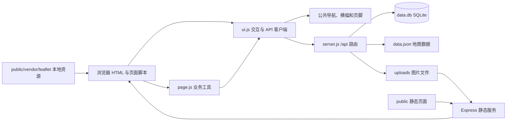

# sytime 项目地图

> 仓库归属与提交复核：2026-10-24。当前 GitHub 仓库为 `szzxai/sytime`，默认分支为 `main`；提交范围与本轮验证结果见文末最新记录。

> 更新日期：2026-10-24（合并论坛移除与远端菜品、收藏改进；写评价选菜首批 50 条及「显示更多」；保留 #29 收藏夹默认公开、菜品详情、评论关联、已有菜品选择及目录字体统一）。本文描述 #4 UI 改版、#5 菜品目录与菜单同步、#6 三元坊必吃榜，#10 头衔系统，#11 优化地图UI，#19 个人中心拆分（新增 settings.html），#20 个人中心重做（类 B 站资料头部 + 吸顶横向菜单栏），#21 用户主页（头像跳转 + 他人主页只读 + 管理面板），#22 必吃榜详情页样式（手动/自动，自动为纯 CSS 按宽度切换），#23 收藏功能与 #29 默认公开偏好的代码，并包含完整 SVG 校园导览改版及新版位置图校准、地块补绘。最新共享界面顶栏仅使用青柠切面图标，全站品牌为「拾光酥糕」（SHSTime）；历史章节保留对应版本时点及其测试数字。
>
> 本文依据实际文件、后端代码、全部前端页面、地图 JSON、SQLite 表结构及依赖清单整理。设计规范见 [UI.md](./UI.md)，验收记录见 [docs/ui/acceptance.md](./docs/ui/acceptance.md)，原始里程碑快照见 [PLAN_2026-10-01.md](./PLAN_2026-10-01.md)。

## 1. 项目概览

拾光酥糕是一个按 Berkeleytime 的页面布局与视觉风格重制、采用中文内容和绿色主题的动态校园信息网站，现有校园地图、菜谱评价、每周食谱图片、公告、账号与权限、学生认证、个人中心、设置和管理后台。用户可在设置页提交工单，管理员可审核认证、处理封禁申诉及批复工单。

| 层次 | 实际实现 | 入口 |
| --- | --- | --- |
| 服务端 | CommonJS、Node.js、Express 5；原有业务及网站内菜单 worker 模块 | [server.js](./server.js)、[lib/menu/](./lib/menu/) |
| 数据库 | Node 内置 `node:sqlite` 的同步 `DatabaseSync`；11 张原有表、3 张必吃榜表、2 张头衔表、2 张收藏夹表及 8 张菜单表 | [data.db](./data.db)、[lib/menu/store.js](./lib/menu/store.js)、[lib/shops/store.js](./lib/shops/store.js)、[lib/titles/store.js](./lib/titles/store.js)、[lib/collections/store.js](./lib/collections/store.js) |
| 前端 | 17 个功能页面及 404（含独立关于页与菜品详情），统一外部 CSS 与页面脚本；原生 JavaScript，无构建流程 | [public/](./public/) |
| 共享前端逻辑 | 导航壳、登录态、用户展示、横幅、表单、对话框、上传、图片查看器及页面工具 | [public/js/ui.js](./public/js/ui.js)、[public/js/page.js](./public/js/page.js) |
| 地图 | 本地 Leaflet 1.9.4；单一北向上 SVG 校园地图（31 个地点），支持触控板平移/捏合与大面积运动场插画 | [campus-places.js](./public/js/campus-places.js)、[campus.svg](./public/img/map/campus.svg)；[data.json](./data.json) 仅为旧数据归档 |
| 文件存储 | 本地图片文件，通过 `/uploads` 静态提供 | [uploads/](./uploads/) |
| 依赖与运行 | npm 安装；`npm start` 直接执行 `node server.js` | [package.json](./package.json)、[package-lock.json](./package-lock.json) |
| 验证 | Playwright 浏览器回归、axe 无障碍与布局检查；临时数据库和上传目录 | [tests/ui-smoke.mjs](./tests/ui-smoke.mjs) |
| 项目说明 | 使用说明、项目地图、开发记录、里程碑快照、UI 手册和许可证 | [README.md](./README.md)、[progress.md](./progress.md)、[UI.md](./UI.md)、[LICENSE](./LICENSE) |

## 2. 完整文件结构

以下为改版后的源码、文档和持久数据目录。`node_modules/`、本机 `.env` 和浏览器测试产物不提交。

```text
sytime/
├── .gitignore                    依赖、密钥、数据库临时文件和测试产物忽略规则
├── .env.example                  端口与 JWT 配置模板
├── LICENSE                       GNU AGPL v3 许可证正文
├── README.md                     项目功能、安装及部署说明
├── progress.md                   既有开发记录、接口和数据说明
├── package.json                  应用元数据、依赖、start/test 脚本
├── package-lock.json             npm lockfileVersion 3 依赖锁定文件
├── server.js                     原有后端逻辑、菜单模块与调度启动
├── lib/migrations/remove-forum.js  旧论坛表、收藏、消息与设置的幂等清理
├── lib/menu/
│   ├── schema.js                 名称归一、拼音与八字段校验
│   ├── store.js                  菜单建表、种子导入、原子发布与目录
│   ├── config.js                 密钥加密、设置与模型测试指纹
│   ├── schedule.js               北京时间每日调度纯函数
│   ├── source.js                 官网 HTML/robots、内联图片与分页
│   ├── provider.js               视觉 Chat Completions、严格 JSON 与缓存
│   ├── images.js                 sharp 处理、重叠分块与覆盖复核
│   ├── worker.js                 同步获取/识别任务
│   ├── service.js                队列、租约、取消、重试与调度
│   ├── manual.js                 JSON 预览、候选编辑、人工发布与审计
│   └── routes.js                 目录、developer 配置及三种管理角色的导入 API
├── data/menu-bootstrap.json      十篇历史菜单种子
├── tools/build-menu-seed.py      开发时离线整理种子，标准库
├── tools/build-menu-skill.py     同步规则并打包技能，标准库
├── tools/summarize-menu-live.cjs 汇总真实模型实验的保存结果
├── menu-json-rules.md            八字段 JSON、完整读图与人工导入规则
├── szzx-menu.skill               可直接导入 AI 客户端的技能 ZIP 包
├── skills/szzx-menu/             SKILL.md、references/menu-json-rules.md、scripts/validate_menu.py
├── .private/                     运行时主密钥、原图、补图、诊断及缓存（忽略）
├── data.db                       随仓库提交的 SQLite 数据库（启动迁移 shops / titles / collections 表）
├── data.json                     旧楼层地图数据归档；后端保留兼容
├── data/shops-config.json        高德地图中心、苏州中学参考点、姑苏区边界多边形（GCJ-02）
├── lib/shops/store.js            shops 表、路线字段校验、列表/详情与地理围栏
├── lib/dishes/store.js           recipes.dish_id 迁移、历史关联、详情统计及每页 20 条评论
├── lib/dishes/routes.js          公开菜品详情与分页评价，严格校验目录身份和偏移量
├── lib/shops/routes.js           店铺公开读取与带权限的创建 API
├── lib/titles/store.js           titles/user_titles 表、佩戴状态、种子与增删改查
├── lib/titles/rules.js           自动头衔规则注册表与发放逻辑
├── lib/titles/routes.js          用户佩戴接口与后台头衔管理接口
├── lib/collections/store.js      收藏夹表与默认公开偏好迁移、查询及默认收藏夹
├── lib/collections/routes.js     收藏夹列表、收藏/取消、分页详情、公开状态、他人公开收藏与默认设置 API
├── MAP.md                        项目结构与实现地图（本文）
├── docs/map-sources.md           31 个地点介绍的校内补充、公开资料与引用范围
├── docs/issue-10-plan.md         #10 头衔系统的实施范围与验收
├── PLAN_2026-10-01.md             国庆里程碑与全部 issue 的原始快照
├── UI.md                         全站 UI 设计总纲
├── docs/ui/
│   ├── assets/                   参考 CSS、JS、图标与可交互样张
│   ├── pages/                    现有及后续新功能的逐页设计规范
│   ├── components.md             组件骨架、状态与无障碍要求
│   ├── scenarios.md              边界场景与交互约定
│   ├── copy.md                   统一文案和错误提示
│   ├── implementation.md         实施步骤与可复现验证方法
│   └── acceptance.md             #4 实施范围及验收记录
├── tests/
│   ├── titles.test.cjs           头衔目录/授予撤销/佩戴/自动规则/序列化测试
│   ├── shops.test.cjs            店铺 API、字段校验、覆盖区域、角色/显式权限测试
│   ├── shops-ui.mjs              店铺列表/详情/创建与权限浏览器回归
│   ├── menu.test.cjs             菜单数据/调度/提供商/队列/权限测试
│   ├── forum-removal.test.cjs     旧库迁移、店铺数据保留与重复运行检查
│   ├── dishes.test.cjs           历史关联、详情隔离、分页、提交校验与图片清理
│   ├── dishes-ui.mjs             详情、选菜每批 50 条与边界、键盘、图文及明暗主题回归
│   ├── collections.test.cjs      收藏接口、旧账号默认公开迁移、参数与账号隔离
│   ├── collections-ui.mjs        收藏按钮、弹窗及收藏浏览回归
│   ├── collection-privacy-ui.mjs 默认公开即时保存、双向覆盖、加载失败与回滚回归
│   ├── helpers/app-fixture.cjs   独立临时站点、动态端口与受限目录清理
│   ├── menu-live.cjs             可选真实模型与三张菜单检查
│   ├── node-deploy.cjs           全新 Node 生产依赖安装检查
│   ├── menu-skill.py             便携技能、离线验证器及包内文件检查
│   ├── fixtures/menu-manual-review.json 三张原图的局部目视抽样
│   └── ui-smoke.mjs              页面、权限、表单及无障碍回归
├── public/
│   ├── index.html                渐变地标首页、开发团队与参与入口；根路径默认页跳转
│   ├── about.html                独立关于页：起源、学生维护与反馈
│   ├── map.html                  单一 SVG 校园地图，无楼层切换
│   ├── recipe.html               A–Z 菜品目录、评价与每周食谱三个页签
│   ├── dish.html                 单道菜品详情、评分和分页评论
│   ├── shops.html                三元坊必吃榜、高德地图与分类筛选
│   ├── shop.html                 店铺步行路线和坐标详情
│   ├── shop-new.html             权限校验后的店铺创建表单
│   ├── announcements.html        更新公告列表与正文
│   ├── login.html                登录与被封账号的解封申诉
│   ├── register.html             注册并自动登录
│   ├── student_verify.html       邀请码认证或提交学生审核申请
│   ├── profile.html              个人资料、我的头衔
│   ├── settings.html             设置：账号安全、网站设置、工单、消息通知、退出登录
│   ├── user.html                 其他用户主页（只读 + 权限足够时的管理面板）
│   ├── admin.html                权限控制的后台菜单、用户与头衔管理操作
│   ├── 404.html                  未知页面提示，使用绝对资源路径
│   ├── css/site.css              设计令牌、组件与响应式样式
│   ├── css/map.css               校园导览局部样式与明暗主题
│   ├── img/map/campus.svg        校园底图、路径、植被与建筑 symbol
│   ├── img/fan-zhongyan-user.png 首页与关于页使用的透明范仲淹像（维护者提供）
│   ├── img/brand-lime.svg        青柠切面，favicon 与共享品牌图标
│   ├── img/suzhou-high-school-mark.png 历史校徽资产，页面不再引用
│   ├── fonts/InterVariable.woff2 本地拉丁字母可变字体（Inter-LICENSE.txt 为 SIL OFL）
│   ├── fonts/NotoSansSC.woff2  本地中文字形子集（NotoSansSC-LICENSE.txt 为 SIL OFL）
│   ├── img/team-vc.svg           VC 团队橙子切面标志
│   ├── img/team-software.svg     软件开发社简化 SVG 标志
│   ├── img/                      icons.svg 与旧 favicon.svg（不再被页面引用）
│   ├── js/
│   │   ├── ui.js                 全站交互、导航壳与统一 API 客户端
│   │   ├── page-transition.js    跨页滑动方向在目标页首帧前初始化
│   │   ├── page.js               页面表单、请求、权限、面板和工单工具
│   │   ├── dish-review.js        共用已有菜品组合框（首批/追加 50 条）与图文评价对话框
│   │   ├── pages/dish.js         详情、评分统计、评价分页与发布后刷新
│   │   ├── campus-places.js      31 个导览地点、分类、别名、示意坐标与介绍
│   │   ├── pages/map.js          SVG 导览、搜索、选点与触控板手势
│   │   ├── shops-map.js          高德地图加载、标记、路线查询与外链
│   │   └── pages/                各页业务脚本、菜单同步/导入及店铺列表/创建/详情
│   ├── vendor/leaflet/           Leaflet JS、CSS、图片与上游 LICENSE
│   └── auth.js                   加载 ui.js 的旧调用兼容入口
└── uploads/
    └── weekly/
        ├── 1790494439396-979963766.png
        ├── 1790495069096-158832090.png
        ├── 1790495081861-230074113.png
        ├── 1790495090622-616644569.png
        ├── 1790495393944-169103336.png
        └── 1790495644744-976725163.png
```

`npm ci` 创建依赖，运行时创建 uploads 及非公开 `.private/`。生产只运行 Node，Python 脚本仅在开发时重建种子，无第二个服务。部署与配套密钥备份见 [docs/menu-sync.md](./docs/menu-sync.md)，确认范围见 [docs/issue-5-plan.md](./docs/issue-5-plan.md)。

## 3. 请求与数据流



`server.js` 启动顺序是加载环境变量、打开数据库、创建表与索引及迁移旧结构、创建上传目录、定义鉴权函数、挂载 CORS/JSON/静态服务、注册 API、404 兜底和错误处理，最后监听端口。

- `public/` 挂载在站点根路径，`/` 默认提供 `index.html`。
- `/uploads` 映射到项目内的 `uploads/`，图片 URL 保存到数据库或由文件名生成。
- 普通 JSON 请求体上限为 `8mb`；上传请求使用 multer 的 multipart 处理。
- 收藏新建流程（#29）：网站设置独立即时保存 `collection_default_public`；共享弹窗每次展开新建表单都从个人资料重新读取默认值，读取中禁用创建，失败回退私密，可手动覆盖。创建请求明确发送数值 `is_public`；旧客户端省略时由服务器读取当前登录用户最新偏好。不会更改已有收藏夹的公开状态，自动补建的「默认收藏夹」仍为私密。
- 菜单目录初始化后运行 `lib/dishes/store.js` 迁移：增加可空菜品外键，按归一名称补关联旧非每周评价。目录行用原生链接进入 `dish.html?id=...`，详情和评论按菜品 ID 读取；发布时后端只接受已有目录菜品 ID，名称取自服务端。原「菜品评价」全站列表不改排序或过滤。
- 两页共用写评价选择器继续一次读取完整已有目录，在前端筛选后按 50 条显示；首批 50，「显示更多」每次追加最多 50，所有匹配项均可访问。新关键词或收起后重新展开恢复首批，追加保留顺序与滚动位置；不改目录接口、数据表或评论列表的每页 20 条。
- 页面通过共享 `UI.api` 封装同源 `fetch('/api/...')`，统一 token、失败提示和登录回跳；后端仍使用原有业务接口。
- 未知 `/api` 路径返回 JSON 404；未知 GET 页面路径（无扩展名且不属于上传目录）返回 `404.html`。
- 登录返回 JWT；浏览器以 `localStorage.token` 保存，并以 `Authorization: Bearer <token>` 请求登录接口。`localStorage.user` 保存用户缓存。
- 网站默认页面、菜谱默认视图保存在用户表，同时用 `defaultPage`、`recipeDefaultView` 本地键作回退；旧 `default_floor` 字段保留兼容，设置页和地图均不再读取或写入楼层偏好。横幅关闭使用 `bannerDismissed:<用户名>` 与横幅版本。手机导航使用受控抽屉；旧 `navCollapsed` 设置不再使用。

## 4. 前端页面地图

| 页面 | 功能与交互 | 主要数据来源 |
| --- | --- | --- |
| `index.html` | 首页介绍、地图/菜谱/必吃榜/公告入口、关于我们与工单反馈；仅在根路径 `/` 且无锚点时按用户默认页面跳转 | `/api/user/profile`、本地默认页设置 |
| `about.html` | 独立关于内容、原创地标插画与工单入口 | 共享导航与横幅接口 |
| `map.html` | 单一北向上 SVG 校园地图：31 地点、名称/别名搜索、分类、介绍卡、大面积篮球场与操场、拖动/滚动平移、捏合或 Ctrl / ⌘ + 滚轮缩放、键盘与全景；无楼层视图及切换器 | 读取本地 `campus-places.js` + `campus.svg`，不调用旧地图接口或读取楼层偏好 |
| `recipe.html` | A–Z 菜品目录链接与搜索；原评价卡及已有菜品选择对话框；每周食谱折叠、放大及授权删除 | `/api/dishes`、`/api/recipes`、`/api/weekly-menu`、`/api/user/profile` |
| `dish.html?id=...` | 菜名、平均评分与评价数、完整图文评论和作者时间；每页 20 条；预选当前菜品写评价 | `/api/dishes/:id`、`/api/dishes/:id/reviews`、`/api/dishes`、`/api/recipes` |
| `shops.html` | 三元坊必吃榜；可拖动/缩放的高德地图，附近店铺按屏幕距离聚合为带数量的点，点击聚合点居中放大；分类、拼音 A–Z、道路/商场、距离/时间、点赞/评价/评分筛选与排序；列表分页（每页 20 条，`?page=` 保留）；店铺卡收藏按钮（#23） | `/api/shops`、`/api/shops/meta`、`/api/shops/map-image`；收藏夹接口 |
| `shop.html` | 地址、路线、本部/地铁出口距离、点赞/评价/评分汇总；学生及以上可点赞、提交/更新及删除本人 1–5 星评价，评价可选带一张实拍图（JPG/PNG，≤2 MB）、选填人数与总价并自动计算人均价；点赞右侧收藏按钮（#23）；详情页样式由账号 `shop_layout_mode` 决定：手动显示「纵向 / 双栏」开关并记住上次选择，自动则隐藏开关、纯 CSS 按屏幕宽度切换（#22） | `/api/shops/:id`、`/api/shops/:id/reviews`、互动写接口；收藏夹接口 |
| `shop-new.html` | 最低角色提示；店铺、地址、自定义类型、可选大众点评链接、GCJ-02 坐标和本部/地铁两组步行路线表单；高德步行路线测算 | `/api/shops/meta`、`POST /api/shops`、高德 AMap.Walking |
| `announcements.html` | 桌面主从列表；手机先看列表，选择后显示正文并可返回 | `/api/announcements` |
| `login.html` | 用户名/密码登录；封禁错误展示；允许申诉时提交理由及可选图片 | `/api/login`、`/api/user/appeal` |
| `register.html` | 用户名/昵称/密码及重复密码校验；注册后调用登录 | `/api/register`、`/api/login` |
| `student_verify.html` | 已达到学生角色时隐藏表单；否则填写新生号、班级、真实姓名，可填邀请码及补充信息 | `/api/user/profile`、`/api/student/apply` |
| `profile.html` | #20 类 B 站布局：资料头部（头像含编辑按钮 + 用户名/权限等级标签/昵称 + 个性签名；昵称与签名点击即可编辑、失焦弹确认保存）+ 吸顶横向菜单栏（主页 / 收藏 / 头衔 / 设置）；主页为空页面；收藏（#23）为左右分栏（必吃榜双层菜单 + 卡片网格 + 公开开关 + 分页，手机 UA 降级为顶部下拉）；头衔为佩戴/不佩戴选择；设置跳转 settings.html | `/api/user/profile`、`/api/user/avatar`、`/api/user/nickname`、`/api/user/signature`、`/api/user/titles`、`/api/user/title`；收藏夹接口 |
| `settings.html` | 设置页（左侧菜单，与个人中心同构）：账号安全（改密码）、网站设置（默认进入界面 / 菜品与食谱默认页 / 必吃榜默认排序与餐食类型 / 店铺详情页样式 / 收藏默认页 / 新建收藏夹默认公开（#29，切换即保存）/ 显示权限等级）、工单、退出登录 | `/api/user/profile`、`/api/user/settings`、`/api/user/settings/collection`、`/api/collections`、`/api/user/password`、`/api/tickets`、`/api/tickets/mine` |
| `user.html` | #21 其他用户主页（类个人中心版式，#20；只读）：资料头部 + 吸顶横向菜单栏（主页 / 收藏 / 头衔 / [管理]）；权限等级按该用户 `show_role` 显示；头衔只读；仅在目标存在公开收藏夹时显示「收藏」标签，只读展示公开收藏（#23）；有 `user_manage` / `title_manage` 且目标权重低于自己（非本人）时出现「管理」：改权限等级、发放特殊权限、发放头衔、封号/解封；`?id=` 为本人时跳转 profile.html | 公开 `GET /api/users/:id/profile`、`GET /api/users/:id/titles`、`GET /api/users/:id/collections`、`GET /api/collections/:id/items`（公开收藏夹）；`GET /api/me`；管理接口同上 |
| `inbox.html` | 消息箱：按天分组、全部/系统标签过滤、只看未读、全部标为已读、点击标记已读；页头消息铃显示未读数 | `/api/messages`、`/api/messages/unread-count`、`/api/messages/:id/read`、`/api/messages/read-all` |
| `admin.html` | 横幅、公告、发送系统通知、学生审核、邀请码、每周菜谱、用户管理、头衔管理、申诉、工单、developer 菜单同步和三种管理角色的 JSON 手动导入；待办红点 | `/api/admin/*`，菜单接口见 [运维文档](./docs/menu-sync.md) |
| `404.html` | 404 提示、返回首页与返回上一页 | 无 |
| `js/ui.js` | 公共导航/页脚、账户菜单、手机抽屉、横幅、用户信息与全站交互组件；头像跳转 `UI.avatarLink`/`UI.userHref`（#21）；收藏按钮与收藏夹选择弹窗 `UI.collections`（#23）；移动端判断 `UI.isMobile`、共享店铺卡片 `UI.shopCard`、分页器 `UI.pagerHtml` | `/api/user/profile`、`/api/settings/banner`、收藏夹接口 |
| `js/collections-view.js` | `UI.collectionsBrowser`：个人中心 / 用户主页共用的收藏浏览（左右分栏、双层菜单、公开开关、卡片网格、分页、手机 UA 下拉） | 收藏夹接口 |

页面布局由 `public/css/site.css` 统一维护，业务脚本位于 `public/js/pages/`。`ui.js` 集中处理角色权重、用户展示、日期、转义和交互；`page.js` 复用页面业务逻辑。动态文本使用 `UI.esc` 或 DOM `textContent` 输出。

## 5. 后端 API 全量索引

以下显式路由位于 [server.js](./server.js)。菜单新增的方法/路径组合位于 [lib/menu/routes.js](./lib/menu/routes.js)，索引见 [菜单同步接口](./docs/menu-sync.md#接口)。表中“公开”表示没有强制登录。

### 5.1 账号、个人资料与设置

| 方法 | 路径 | 访问条件 | 作用 |
| --- | --- | --- | --- |
| POST | `/api/register` | 公开 | 创建用户；首个用户为 developer，其余为 user；生成 display_id |
| POST | `/api/login` | 公开 | 验证密码、封禁状态，签发 JWT |
| GET | `/api/me` | 公开，可携带 token | 返回解析后的用户及显式权限 |
| GET | `/api/user/profile` | 登录 | 当前用户资料、设置、状态、权限与佩戴中的头衔；含数值 `collection_default_public`（0/1，默认 0），不在他人公开资料中返回 |
| GET | `/api/user/titles` | 登录 | 已拥有头衔（含佩戴状态）与未达成自动头衔的条件进度 |
| PUT | `/api/user/title` | 登录 | 佩戴或取消佩戴；未拥有的头衔 403，`title_id: null` 表示不佩戴 |
| PUT | `/api/user/settings` | 登录 | 部分更新：默认页、菜谱视图、必吃榜默认排序/餐食类型、`shop_layout_mode`（manual/auto）、`shop_layout`（stacked/split）、`show_role`、`collection_default_public`（仅数字 0/1，省略保留；非法值 400 且不写入其他字段）；响应回显新偏好；旧楼层字段仅保留后端兼容 |
| POST | `/api/user/avatar` | 登录 | 上传头像，更新 avatar_url |
| PUT | `/api/user/nickname` | 登录 | 修改昵称 |
| PUT | `/api/user/signature` | 登录 | 修改签名 |
| PUT | `/api/user/password` | 登录 | 校验旧密码并修改密码 |
| GET | `/api/users/:id/profile` | 公开 | 指定用户的公开资料（昵称/签名/头像/角色/`show_role`/状态/佩戴头衔）；用于用户主页（#21） |
| GET | `/api/users/:id/titles` | 公开 | 指定用户已拥有的头衔（只读，不含自动头衔进度）；用于用户主页「头衔」分区 |

### 5.2 菜谱、公告与地图

| 方法 | 路径 | 访问条件 | 作用 |
| --- | --- | --- | --- |
| GET | `/api/recipes` | 公开 | 按 `name COLLATE NOCASE, id` 排序读取评价记录 |
| GET | `/api/recipes/weekly` | 公开 | 读取 `is_weekly=1` 的评价记录；当前每周食谱页面使用另一接口 |
| POST | `/api/recipes` | 登录 | 必须传当前目录已有 `dish_id`，名称由服务端确定；评分为 0–5 整数，评论选填且最多 500 字，可选 JPG/PNG 图片 ≤2 MB；无效参数拒绝并清理该次上传文件 |
| GET | `/api/dishes` | 公开 | 有成功供应记录的独立菜品目录、拼音与索引元数据 |
| GET | `/api/dishes/:id` | 公开 | `{dish}` 包含目录字段、`reviews_count` 和保留一位小数的 `rating_avg`；只统计 `is_weekly=0`，没有评价时评分为 null；非目录 ID 返回 404 |
| GET | `/api/dishes/:id/reviews?offset=0` | 公开 | `{reviews,total,offset,has_more}`，每页 20 条，按 `created_at DESC,id DESC`；附作者昵称、头像、权限及头衔；偏移为 0–1000000 的整数字符串，否则 400；两种详情读取成功响应均 no-store |
| GET | `/api/announcements` | 公开 | 按发布日期倒序读取公告 |
| GET | `/api/weekly-menu` | 公开 | 每周食谱日期、图片 URL 和上传者 |
| GET | `/api/settings/banner` | 公开 | 当前横幅及版本 |
| GET | `/api/map-data` | 公开 | 兼容旧地图数据，每次从磁盘读取 data.json；当前地图页面不调用 |
| GET | `/api/shops` | 公开 | 店铺列表；支持 `type`、`q`、本部距离/时间及点赞/评价/评分范围过滤，`sort=campus/metro/likes/reviews/rating/new` 排序；拼音 A–Z 在前端排序 |
| GET | `/api/shops/meta` | 公开 | 浏览器端 JS Key（仅另配时返回）、静态地图是否可用、坐标/范围配置、分类和当前用户创建权限；不返回 Web 服务 Key |
| GET | `/api/shops/map-image?lat=..&lng=..&zoom=..` | 公开、同源代理 | 服务器端用 `AMAP_SERVICE_KEY` 按当前视图获取并缓存底图；中心限制在姑苏区边界外扩范围内，缩放级别限制为 9–18，不向浏览器暴露 Key |
| GET | `/api/shops/:id` | 公开 | 店铺详情，含路线、互动计数、平均评分与评分数 |
| GET | `/api/shops/:id/reviews` | 公开 | 评价列表和总数，含人数/总价/人均与配图地址；只回传当前用户自己的评价内容供编辑 |
| POST | `/api/shops/:id/like` | 登录 + 学生及以上 | 切换点赞状态；后端重新核验当前角色/状态 |
| POST | `/api/shops/:id/reviews` | 登录 + 学生及以上 | 创建或更新本人的评价；评分必填 1–5，文字最多 500 字；multipart 可选 `image`（JPG/PNG，≤2 MB），可选 `guests`（1–99）与 `total_price`（0–100000 元）字段，`per_person` 由服务端计算；`remove_image=1` 清除配图 |
| DELETE | `/api/shops/:id/reviews/me` | 登录 + 学生及以上 | 删除本人的评价并重算统计 |
| POST | `/api/shops` | 登录 + `shop_create`；默认 student 及以上 | 后端验证地址、分类、GCJ-02 坐标、路线字段与已配置覆盖多边形；同名返回 409 |
| PUT | `/api/admin/map-popup` | map_popup_edit | 兼容旧地图弹窗，按 feature.name 更新所有同名对象的 popup，回写 data.json；当前地图页面无编辑入口 |

### 5.3 学生认证、后台内容与用户管理

| 方法 | 路径 | 访问条件 | 作用 |
| --- | --- | --- | --- |
| GET | `/api/admin/ping` | super_admin 及以上 | 后台连通性检查 |
| POST | `/api/admin/announcements` | announcement_publish | 发布公告 |
| DELETE | `/api/admin/announcements/:id` | announcement_publish | 删除公告；不存在返回 404 |
| PUT | `/api/admin/settings/banner` | banner_edit | 修改/清空横幅并增加版本 |
| POST | `/api/student/apply` | 登录 | 有效邀请码直接认证，否则提交审核申请 |
| GET | `/api/admin/settings/invite-code` | invite_manage | 读取兼容的单邀请码设置 |
| PUT | `/api/admin/settings/invite-code` | invite_manage | 写入兼容的单邀请码设置 |
| GET | `/api/admin/invite-codes` | invite_manage | 多邀请码列表 |
| POST | `/api/admin/invite-codes` | invite_manage | 添加邀请码和使用上限，0 表示不限 |
| DELETE | `/api/admin/invite-codes/:id` | invite_manage | 删除邀请码 |
| GET | `/api/admin/student-applications` | student_review | 待审核认证申请 |
| PUT | `/api/admin/student-applications/approve` | student_review | 通过申请并提升未达学生级别用户的角色 |
| PUT | `/api/admin/student-applications/reject` | student_review | 拒绝申请并记录可选原因 |
| GET | `/api/admin/users` | user_manage | 用户 ID、显示 ID、账号、角色、状态与额外权限 |
| GET | `/api/admin/users/:id` | user_manage | 单个用户的管理信息（角色、状态、显式权限、头衔）；用于用户主页「管理」分区（#21） |
| GET | `/api/admin/permissions` | user_manage | 权限目录 |
| PUT | `/api/admin/users/role` | user_manage，另有目标角色限制 | 修改角色 |
| PUT | `/api/admin/users/ban` | user_manage，另有目标角色限制 | 封禁并保存理由、可选图片及是否允许申诉 |
| PUT | `/api/admin/users/unban` | user_manage，另有目标角色限制 | 解封并清空封禁信息 |
| PUT | `/api/admin/users/permissions` | user_manage，另有目标角色限制 | 替换显式权限列表 |
| POST | `/api/admin/weekly-menu/upload` | weekly_menu_upload | 上传日期范围内的每周食谱图片 |
| DELETE | `/api/admin/weekly-menu/:id` | 登录，上传者或 super_admin 及以上 | 删除食谱记录及图片文件 |
| GET | `/api/admin/titles` | title_manage | 头衔目录与持有人数 |
| GET | `/api/admin/titles/rules` | title_manage | 可用的自动头衔规则清单 |
| POST | `/api/admin/titles` | title_manage | 新建头衔；重名 409，名称超 8 字 422 |
| PUT | `/api/admin/titles/:id` | title_manage | 修改名称、颜色与描述 |
| DELETE | `/api/admin/titles/:id` | title_manage | 删除头衔并清理所有拥有与佩戴记录 |
| POST | `/api/admin/users/:id/titles` | title_manage，目标权重须低于自己 | 授予公共头衔；重复幂等，自动头衔 409 |
| POST | `/api/admin/users/:id/titles/custom` | title_manage，目标权重须低于自己 | 为该账号创建并颁发专属头衔；同名沿用同一行，不进公共目录 |
| DELETE | `/api/admin/users/:id/titles/:titleId` | title_manage，目标权重须低于自己 | 撤销头衔；佩戴中会清空佩戴并写入系统消息 |

### 5.4 申诉、工单与消息

| 方法 | 路径 | 访问条件 | 作用 |
| --- | --- | --- | --- |
| POST | `/api/user/appeal` | 公开；目标账号须已封禁 | 按用户名提交解封理由与可选 DataURL 图片 |
| GET | `/api/admin/ban-appeals` | ban_appeal_review | 待处理申诉 |
| PUT | `/api/admin/ban-appeals/review` | ban_appeal_review | 通过并解封，或驳回 |
| POST | `/api/tickets` | 登录 | 提交标题、正文及可见角色范围 |
| GET | `/api/tickets/mine` | 登录 | 本人工单与批复 |
| GET | `/api/admin/tickets` | ticket_manage，按角色再过滤 | 当前管理者可见的工单 |
| PUT | `/api/admin/tickets/reply` | ticket_manage，按工单可见级别再校验 | 批复正文及可选 DataURL 图片 |
| GET | `/api/admin/pending-counts` | 登录，按权限和工单范围统计 | 学生认证、申诉、工单待办数量 |
| GET | `/api/messages` | 登录 | 消息列表；支持 type(system)、unread、before 游标与 page_size |
| GET | `/api/messages/unread-count` | 登录 | 未读总数（页头消息铃轮询） |
| PUT | `/api/messages/:id/read` | 登录，限本人 | 单条标记已读 |
| PUT | `/api/messages/read-all` | 登录 | 全部标记已读 |
| POST | `/api/admin/notifications` | announcement_publish | 向全体用户发送系统通知（标题/正文/重要性） |

### 5.5 收藏夹（#23）

| 方法 | 路径 | 访问条件 | 作用 |
| --- | --- | --- | --- |
| GET | `/api/collections?section=shops` | 登录 | 当前用户该版块的收藏夹（含条目数）；该版块没有收藏夹时自动创建「默认收藏夹」；同时返回 `defaults` 默认收藏夹 |
| POST | `/api/collections` | 登录 | 新建 `{section, name, is_public?}`；版块 shops，名称 1–40 字；`is_public` 明确值只接受数字 0/1（非法 400），省略时读取当前登录用户最新 `collection_default_public`；响应 `collection.is_public` 仍为布尔值 |
| POST | `/api/collections/:id/items` | 登录，限本人收藏夹 | 收藏 `{item_type, item_id}`；item_type 必须与收藏夹版块匹配（shops→shop），重复收藏幂等 |
| DELETE | `/api/collections/:id/items/:itemType/:itemId` | 登录，限本人收藏夹 | 取消收藏 |
| GET | `/api/collections/:id/items?page=1` | 登录或公开收藏夹（可匿名）；私密仅本人 | 每页 20 条；店铺返回卡片信息；已删除内容标记 `deleted` |
| GET | `/api/users/:id/collections` | 公开 | 指定用户的公开收藏夹（`is_public=1`），供他人主页只读展示 |
| PUT | `/api/collections/:id/public` | 登录，限本人收藏夹 | 切换公开状态 `{is_public}` |
| PUT | `/api/user/settings/collection` | 登录 | 保存默认收藏夹；支持 `{default_collection_shops}` 或 `{section, collection_id}`，并校验归属与版块 |

## 6. 角色与权限模型

角色权重为 `developer(6) > super_admin(5) > admin(4) > student(3) > user(2) > guest(1)`。

- `checkRole(requiredRole)` 解析 JWT，缺失或无效 token 按 guest 处理；需要角色时比较权重。JWT 带有 id、role、username。
- `requireLogin` 在解析后要求有效用户 ID，否则返回 401。
- `requirePermission` 调用 `hasPermission`：角色达到该权限默认等级，或 `user_permissions` 存在显式授权，即可通过。
- 后台入口允许 admin 及以上或拥有任意显式权限的用户；后台菜单进一步按具体权限过滤。
- 修改用户角色、封禁/解封和替换权限时，禁止操作自己或同级/更高级目标；新角色最高只能低于操作者一级。
- 工单可见范围为 `admin`、`super_admin`、`developer`，后台在 ticket_manage 之外另按角色权重过滤。

| 权限 | 默认最低角色 | 功能 |
| --- | --- | --- |
| banner_edit | super_admin | 横幅编辑 |
| announcement_publish | super_admin | 发布公告 |
| student_review | super_admin | 学生认证审核 |
| invite_manage | super_admin | 邀请码管理 |
| user_manage | super_admin | 用户及显式权限管理 |
| ban_appeal_review | super_admin | 封禁申诉审核 |
| weekly_menu_upload | admin | 每周食谱上传 |
| map_popup_edit | admin | 地图弹窗编辑 |
| ticket_manage | admin | 工单管理 |
| shop_create | student（由 `SHOP_CREATE_MIN_ROLE` 可配置） | 添加店铺；也可在用户显式权限中单独授权 |
| title_manage | super_admin | 头衔目录维护与用户头衔授予/撤销 |

## 7. 数据模型与文件存储

### 7.1 SQLite

原有业务表中删除 3 张论坛表，其余 11 张保留；启动迁移另创建 `shops`、`shop_likes`、`shop_reviews` 三张店铺表、`titles`、`user_titles` 两张头衔表、`collections`、`collection_items` 两张收藏夹表和 8 张菜单表。店铺 schema 在 `lib/shops/store.js`，头衔 schema 与种子在 `lib/titles/store.js`，收藏夹 schema 在 `lib/collections/store.js`，菜单迁移与种子导入位于 `lib/menu/store.js`。另有内部表 sqlite_sequence；测试使用临时数据库。

| 表 | 主要字段/约束 | 关联与用途 |
| --- | --- | --- |
| users | id、display_id、username、nickname、password_hash、avatar_url、signature、role、网站设置（默认页/楼层/菜谱视图/必吃榜排序与餐食类型/`shop_layout_mode`/`shop_layout`/`show_role`）、默认收藏夹 `default_collection_shops`（可空）、`collection_default_public INTEGER NOT NULL DEFAULT 0`、status、封禁字段、`equipped_title_id`、`last_login_date`/`login_streak`；username/email 唯一 | email 为兼容字段；布局模式决定手动开关或按宽度切换，`shop_layout` 记住手动布局；默认收藏夹字段指向本人的店铺版块；`collection_default_public` 为主动新建收藏夹的默认公开偏好，旧/新账号默认 0，迁移幂等且不改已有收藏夹；头衔为单值，连续登录供自动规则使用；普通用户强制展示角色 |
| user_permissions | user_id、permission；二者联合唯一 | 用户显式授权 |
| collections | user_id、section（shops）、name、is_public（INTEGER NOT NULL DEFAULT 0）、created_at | 收藏夹（#23/#29）；主动创建保存明确选择或账号偏好；GET 时版块无收藏夹会自动创建私密「默认收藏夹」；修改默认偏好不追溯已有收藏夹 |
| collection_items | collection_id、item_type（shop）、item_id、created_at；三者联合唯一 | 收藏项；必吃榜收藏夹只允许 shop |
| recipes | user_id、username、name、rating、comment、image_url、is_weekly、可空 dish_id → dishes.id | 一条记录是一条评价；新评价必须选择已有菜品，保存规范名称；旧未匹配记录保留 NULL，无店铺关联；索引 `idx_recipes_dish(dish_id,created_at DESC,id DESC)` |
| weekly_menu_images | user_id、menu_start_date、menu_end_date、filename、uploaded_at | 每周食谱整张图片，与 recipes 分开 |
| announcements | title、content、publish_date | 公开公告 |
| settings | key 主键、value | 横幅、邀请码兼容设置及加密 menu_ai_config |
| student_applications | user_id、student_id、class_name、real_name、extra_info、reject_reason、status | 认证审核；pending/approved/rejected |
| invite_codes | code 唯一、max_uses、used_count | 多邀请码及次数限制 |
| ban_appeals | user_id、appeal_reason、appeal_image、status | 解封审核；pending/approved/rejected |
| tickets | user_id、username、title、content、visibility、status、reply_content、reply_image、reply_by、replied_at | 工单；pending/resolved |
| messages | user_id、type、actors(JSON)、count、target_kind/target_id、title/body/snippet、important、read_at | 消息箱；仅 system 消息，target 返回 null；旧互动消息由启动迁移清除 |
| titles | key（种子标识，可空）、name、hue、source（grant/auto）、rule（自动规则 key）、description、`owner_user_id` | 头衔目录，共 7 个种子：四个自动头衔（三元坊老饕/夜读星/闲者爱上网/校园老吃家）与三个手动（师者/创站元老/官方）；角色等级头衔已下线（角色改由权限等级标签体现），旧库中的这类目录行会在启动迁移时清理；`owner_user_id` 为空是公共头衔（按名称全站唯一），非空是该账号的专属头衔（按「账号 + 名称」唯一，不进公共目录）；`rule` 关联 `lib/titles/rules.js` 的规则；来源为 auto 时不可手动授予也不可手动撤销，带 `key` 的种子头衔不可删除，专属头衔不得与公共头衔同名 |
| user_titles | user_id、title_id 联合唯一、granted_by（NULL 表示自动发放）、created_at | 用户拥有的头衔，一人可多个；成就头衔只增不减；佩戴状态单独存在 users.equipped_title_id；撤销专属头衔时其 titles 目录行一并删除 |
| user_login_days | user_id、day 联合主键 | 登录逐日历史（北京时间自然日，登录时写入），供「闲者爱上网」按周末窗口统计；不做回填 |
| shops | name 唯一、address、location_note、可选 `dianping_url`、type、GCJ-02 lat/lng、本部/最近地铁出口 distance_m 与 walk_min、metro_station/metro_exit、created_by/created_at | 三元坊必吃榜；列表可按本部、地铁及互动统计排序筛选 |
| shop_likes | shop_id、user_id 唯一、created_at | 每名学生及以上用户每店一个点赞；重复点击取消 |
| shop_reviews | shop_id、user_id 唯一、rating 1–5、content、guests、total_price、image_url、created_at/updated_at | 每名学生及以上用户每店一条评价，可更新；可选带一张图（存 `uploads/shops/`）与人数/总价，人均价按总价/人数自动计算；汇总评价数、评分数和平均星级 |
| dishes | id、name、唯一 name_key、initial、pinyin、pinyin_initials、sort_key | 独立稳定 ID 菜品 |
| menu_sources | 来源 ID、可空 article_id、kind、publication_origin、revision、title/url、日期/摘要/计数/错误 | 官网队列与独立手动批次 |
| menu_records | source_id/record_key 联合主键、dish_id、日期/餐次/地点/档口/价格/辣椒 | 供应记录，明确外键 |
| menu_sync_jobs | UUID、唯一 auto_day、状态/阶段、配置版本、计数、取消标记 | 持久同步任务 |
| menu_job_items | job_id/source_id 联合主键、状态、阶段、错误及资料路径 | 逐篇结果 |
| menu_sync_lease | 单例 ID、owner、expires_at | 防并发同步与发布 fencing |
| menu_sync_state | key/value | 发现锚点 |
| menu_import_audit | source_id、actor_id、job_id、revision、records_json | 人工发布历史，与菜单发布同一事务 |

原有 user_id/post_id 关系由应用维护；新增菜单记录和任务条目声明外键。菜单供应按篇事务替换；评价关联迁移在目录初始化后独立执行。只为 `dish_id IS NULL AND is_weekly=0` 的旧评价按 NFC、首尾及连续空白、大小写归一后的名称补关联，保留原菜名、无法匹配记录及每周记录，不覆盖已有关联；重复启动幂等。原有删帖、认证和申诉限频规则保持。

实际已提交数据库保留旧迁移结构，例如 users.display_id 通过后续 `ALTER TABLE` 添加，没有新建库 SQL 中的 UNIQUE 约束；不能假设旧库与新库的所有约束完全一致。

### 7.2 校园地图与旧数据归档

2026-10-17 起，页面只展示北向上 SVG 校园地图。旧楼层平面、顶部视图切换器及设置页默认楼层字段已移除，旧前端渲染脚本已删除。

- 导览 `public/js/campus-places.js` 含 31 个地点，字段为 `id`（唯一选择键）、`name`、可选 `alias`、`category`、`icon`（SVG symbol）、`x/y`、`size`、可选 `height`、可选 `labelX/labelY/labelSize`（标签偏移/基础字号）、`area`、`summary`（用途摘要）、`description`（以空行分段）、可选 `sources`（引用键数组）。同文件 `CampusSources` 登记 10 个来源的 `label/url`；引用范围与校内补充记录于 [docs/map-sources.md](./docs/map-sources.md)。静态示意范围 1000 × 1540；`[x,y]` 转为 Leaflet `[-y,x]`，上方为北。未指定高度时使用宽度的 0.75 倍；篮球场为 132 × 292，北部两列三排加南侧一片；操场为 310 × 568，含跑道和足球场细节。
- `public/img/map/campus.svg` 提供边界、道路、植被、文庙区域和建筑图形；`map.js` 插入可点击、可键盘操作的 SVG 地点组。相同 symbol 复用于目录缩略图和地点详情。坐标与轮廓按用户2026-10-17提供的新版位置参考图校准；三元楼、科学楼、文庙、南部生活区采用地块结构插画，春雨池、碧霞池按不同岸线绘制，补充林地、交叉园路、竹林与未命名粉色地块；新增政道楼（原墨子馆）、府学碑廊、泮池与泮桥，周边梦工厂仅作参考轮廓。建筑与内部细节均为示意；不承诺实景还原或路线导航。
- 搜索覆盖名称、别名、用途摘要、区域和分类，支持「校史馆」→「尊经阁」、「面档」→「希文楼」、「宿舍」→「采芹园」；与分类取交集。目录副标题显示用途，希文楼归入生活类。结果数量实时更新，不匹配地点淡化并退出焦点顺序，空结果可重置。
- 地点介绍提供已确认用途与文化背景，新地点不编造未核实用途，采用维护者确认的校内信息和已阅读的公开原文。详情删除位置行，按段落渲染正文及来源链接，长文在卡内滚动；标题及关闭按钮保留，正文可键盘聚焦。政道楼按维护者确认改名，保留“墨子馆”搜索别名；介绍记录“文正之道”、对李政道先生的致敬及北京大学中学物理实验教学中心用途。引用网页仅在点击时打开，页面不联网抓取文章。
- 选中不重排建筑、不自动放大。`map.js` 将全部光晕统一置于建筑组下方，避免东红楼等地点的选中背景遮挡相邻建筑。点选或键盘聚焦时保留当前缩放，按地图留白、详情及控制条的实际矩形求最短避让平移；地标已可见则不动，不强制居中。460ms 缓出平移可由新选点或手势中断，减少动态效果模式立即完成。关闭/Escape 恢复焦点。手机目录可折叠；全景模式下尺寸变化重新适配。拖动、按钮、方向键/WASD、加减键与 Home 提供操作入口。
- 普通滚轮或触控板双指滚动双轴平移；Shift + 纵向滚轮横向移动。捏合或 Ctrl / ⌘ + 滚轮连续缩放并保持指针锚定；Safari 原生手势期间抑制重复滚轮事件。禁用 Leaflet 原生滚轮缩放，归一化增量并通过动画帧合并更新。手机保留双指缩放。
- 移除固定平移边界，解决宽屏中拖动回弹和缩放锚点漂移；用户可通过全景按钮复位。设置页与地图均不消费旧楼层偏好。
- 页面专用 `public/css/map.css` 管理简约面板、响应式、明暗地图与 reduced-motion；新增屋面、墙体、草坪、绿篱、水面、园路、运动标线及球场的明暗令牌；标签支持偏移与相对字号，点击热区限制在地块及文字，避免透明区域覆盖邻近地标。篮球场名称放回自身地块底部，与操场轮廓及热区分离，避免遮挡和误点。共享 `site.css` 和站点壳无改动。导览无需在线底图服务，也不依赖地图 API；SVG 请求失败可重试。

`data.json` 仅作为旧楼层数据归档，旧读取/弹窗接口与数据库 `default_floor` 字段保留兼容，当前地图页面不调用或使用。此文件是自定义格式，顶层包含 `meta`、`style`、`features`，并非标准 GeoJSON；本次未修改其几何或后端结构。

| 部分 | 字段与当前内容 |
| --- | --- |
| meta | rectW=1200、rectH=700、axisY=420、minZoom=-2、maxZoom=6、baseZoom=1 |
| style | outline、labelColor、fillOpacity、palette；建筑/绿地/水体/白色/无填充分类 |
| features | 227 个对象：153 条 polyline、48 个 polygon、26 个 label |
| layers | base=始终显示；数字 1–4=所在楼层；同一对象可以出现在多层 |
| 几何字段 | points 为 `[x,y]` 点数组；fill/stroke/dash/weight 控制路径 |
| 文字字段 | text、x1/y1/x2/y2、scale 控制区域文字；name/popup 控制名称与弹窗 |

归档楼层集合为：20 个 base 对象、118 个仅 1F 对象、42 个仅 2F 对象、2 个同时位于 1F/2F 的对象、45 个同时位于 2F/3F/4F 的对象。旧方向约定是左北、上东；不适用于当前北向上的 SVG 校园地图。兼容读取接口仍每次访问磁盘，兼容弹窗接口仍按名称批量更新同名对象；两者均不改变当前地图。

店铺地图使用服务器端高德静态图代理与前端自绘交互层，无需浏览器 JS Key；`data/shops-config.json` 坐标为 GCJ-02：`center` 为初始地图中心，`anchors.campus` 为苏中本部步行路线起点，`area.polygon` 为 `[纬度,经度]` 多边形。Web 服务 Key 放在被 `.gitignore` 排除的 `.env`（`AMAP_SERVICE_KEY`），仅服务器端使用且不下发。前端支持拖动、滚轮/双指缩放、缩放按钮及回到全域；店铺按当前视图的屏幕距离聚合，圆点显示数量，点击后以聚合中心放大。底图接口只允许姑苏区边界外扩范围内的中心点、缩放 9–18，并缓存近期视图。源码、测试和文档不含实际 Key。地图初始中心/缩放与本部路线起点分别来自配置的中心点和高德 POI「江苏省苏州中学本部」（120.622380, 31.295509）。地理围栏只有在多边形至少 3 个有效点时才生效；范围配置为空时后端无法判定区域。店铺初始化不使用虚构坐标或路线。

### 7.2.1 配套离线地图编辑器

`../szzx-mapeditor/map-editor.html` 是独立离线旧楼层编辑器。本站楼层页面已移除，其输出不再作用于当前校园地图。使用说明与完整字段表见 [编辑器 README](../szzx-mapeditor/README.md) 和 [编辑器 MAP.md](../szzx-mapeditor/MAP.md)。2026-10-09 编辑器内置数据与本项目归档 `data.json` 的 227 个要素一致，配色和 `minZoom=-2` 同步，几何不变。

- 编辑器通过下载导出 JSON；不会调用网站接口或写入数据库。替换本项目归档文件只影响旧兼容接口的返回值。
- 当前校园地图的位置、尺寸和介绍在 `campus-places.js` 维护，底图与插画在 `campus.svg` 维护；不读取编辑器的几何、楼层、字体或层级扩展字段。
- 旧兼容接口按名称批量编辑弹窗；编辑器修改单个对象不会自动同步同名对象。
- 编辑器回归只打开离线文件，不运行本网站，也不修改本项目的数据库、依赖或地图数据。2026-10-09 的配套编辑器协作仅更新文档；2026-10-17 的网站导览改版不修改编辑器或 `data.json`。

### 7.3 图片

| 场景 | 存储位置 | 后端限制 |
| --- | --- | --- |
| 头像、菜谱评价图片 | uploads/ | multer；JPEG/PNG，最多 2 MiB |
| 封禁图片 | uploads/bans/ | multer；JPEG/PNG，最多 2 MiB |
| 每周食谱图片 | uploads/weekly/ | multer；JPEG/PNG，最多 5 MiB |
| 申诉图片、工单批复图片 | 数据库文本字段 | 由页面读成 DataURL 后通过 JSON 提交，不使用上述 multipart 存储器 |

## 8. 运行、依赖与验证入口

[package.json](./package.json) 的直接依赖及当前 lockfile 版本为：express 5.2.1、cors 2.8.6、bcrypt 6.0.0、jsonwebtoken 9.0.3、multer 2.4.0、dotenv 18.0.3。项目未声明 `engines`；README 推荐 Node.js 24+，后端要求运行时提供 `node:sqlite`。

在根目录安装和启动：

```powershell
npm.cmd ci
npm.cmd start
```

复制 `.env.example` 为本机 `.env` 并修改密钥：

```dotenv
PORT=3000
JWT_SECRET=replace_with_a_long_random_secret
JWT_EXPIRES_IN=7d
```

代码默认端口为 3000，JWT 有效期为 7d；JWT_SECRET 有开发用回退值，部署时应显式配置。访问 `/`、`/map.html` 可检查页面；校园地图使用同源 SVG 与地点目录，`/api/map-data` 只用于旧数据兼容。

- 修改 server.js 需要重启服务；修改 public/ 静态文件刷新页面；修改 data.json 后下次 API 读取即生效。
- data.db、data.json 的在线编辑结果、uploads/ 都是本地持久数据；部署需要可写、持久化的存储和 Node 服务。
- 开发依赖为 Playwright 与 axe-core。运行 `npm.cmd test` 可执行浏览器回归；Windows 使用 Microsoft Edge，其他平台先运行 `npx playwright install chromium`。
- 回归测试在系统临时目录启动独立后端并创建测试数据库与上传文件；项目内的 `data.db`、`uploads/` 和 `data.json` 不被测试改写。
- 菜品专项命令为 `npm.cmd run test:dishes` 和 `npm.cmd run test:dishes:ui`，已加入 `npm.cmd test`；隔离夹具动态分配端口，等待目录就绪最多 60 秒，清理前核对临时目录真实路径与前缀。结果与截图位于 `output/playwright/dishes/`。
- 当前验证见本文末尾「2026-10-24 · 菜品详情与已有菜品选评」，不得用历史全绿记录替代本轮结果。真实模型的失败与限制见 [菜单验证记录](./docs/menu-validation.md)，测试产物位于忽略的 output/。

## 9. 文档与实现约定

每次更新完代码，必须在同一次改动中编写或更新相关文档，并实质修改根目录最新的 `MAP.md`（日期、受影响实现与验证记录）。即使没有接口或目录变化，也不能跳过项目地图。完整规则见 [AGENTS.md](./AGENTS.md)，[agent.md](./agent.md) 是兼容入口。

| 文档 | 用途及实际实现 |
| --- | --- |
| README、MAP、progress | 当前使用方式、结构、业务能力与开发记录；历史变更按当时实现保留 |
| UI.md、docs/ui/ | #4 设计手册、组件、逐页规范、场景、文案、样张与验收记录；P1 页面为后续 issue 的预设计 |
| docs/ui/assets 与 public | 前者是设计参考，后者是实际运行代码；运行代码包含资源路径、未保存表单保护和地图布局适配 |
| PLAN_2026-10-01.md | 保留需求读取时的原始正文和状态；执行进度见 progress 与验收记录，实时关闭状态以 GitHub 为准 |
| package.json、package-lock.json、LICENSE | 根包许可为 AGPL-3.0；本地 Leaflet 另附上游许可证 |
| #5 菜品与评价 | 独立目录、网站内同步、菜品详情与评价关联已实现；原评价栏保留，店铺关联后续实施 |

## 10. 国庆计划的代码定位

| Issue | 当前相关位置 | 实施状态或后续能力 |
| --- | --- | --- |
| [#4 修改UI](https://github.com/szzxvc/szzx-info/issues/4) | public HTML、css/site.css、js/、本地 Leaflet、UI.md 与 docs/ui/ | 已完成全站改版及浏览器验收，保留现有业务接口 |
| [#5 全部菜品](https://github.com/szzxvc/szzx-info/issues/5) | recipe.html、dish.html、lib/menu、lib/dishes、data 种子、离线工具、开发者后台 | 独立目录、详情与分页评论、已有菜品选评、统一拼音搜索、网站内识别及运维 |
| [#6 三元坊必吃榜](https://github.com/szzxvc/szzx-info/issues/6) | `shops.html`、`shop.html`、`shop-new.html`、`lib/shops/`、`data/shops-config.json`、高德 AMap JS API | 已实现：公开列表/分类筛选/搜索、拼音 A–Z、互动统计/排序/筛选、单一学校本部步行距离与地铁出口路线、自定义类型、认证学生互动和后端权限复验。围栏为高德姑苏区 adcode 320508 的完整 323 点 GCJ-02 边界；全区检索 5,942 条 POI，校验后导入 5,567 家，62 条同名记录跳过；未导入候选与高德检索范围限制见 README。静态地图使用服务器代理，Web 服务 Key 不下发浏览器。 |
| [#7 三元坊必吃榜 UI适配](https://github.com/szzxvc/szzx-info/issues/7) | profile.html、用户默认设置的保存模式 | 店铺详情页的两种布局、粘性导航与持久布局设置 |
| [#8 三元坊必吃榜菜谱上传](https://github.com/szzxvc/szzx-info/issues/8) | student 角色、multer 存储器、现有评价模型 | 菜品与店铺关联、学生上传权限、图片、去重及异常数据处理 |
| [#9 消息箱](https://github.com/szzxvc/szzx-info/issues/9) | inbox.html、messages 系统消息、settings.html 通知说明、admin.html 发送系统通知、ui.js 消息铃 | 已实现：系统通知与头衔授予消息、已读与未读计数、按天分组、系统类型过滤、super_admin 发送系统通知 |
| [#10 头衔系统](https://github.com/szzxvc/szzx-info/issues/10) | 用户资料、后台用户管理、各用户内容渲染处 | 头衔目录/拥有关系/佩戴状态、授予撤销、自动规则、统一用户展示 |
| [#11 优化地图UI](https://github.com/szzxvc/szzx-info/issues/11) | `map.html`、`public/js/pages/map.js`、`public/css/map.css`、`public/img/map/campus.svg`、`public/js/campus-places.js`、`tests/map-ui.mjs` | 已实现：重做为北向上完整 SVG 校园导览，补齐 31 个地点及手绘示意插画；支持名称/别名搜索、分类过滤、详情卡片、目录折叠、明暗主题与全景复位；移除旧楼层视图与设置项；优化 Mac 触控板平移与捏合/连续缩放；按新版图校准位置并补绘林地、竹林、池岸和院落，新增政道楼（原墨子馆）、碑廊与泮池泮桥；点选保留建筑层级与缩放，必要时最小平移；31 地点补齐用途和文化介绍、引用与长文阅读 |
| [#19 个人中心拆分](https://github.com/szzxvc/szzx-info/issues/19) | profile.html、settings.html、public/js/pages/profile.js、public/js/pages/settings.js、ui.js 账户菜单 | 已实现：账户菜单新增「设置」（个人中心与管理后台之间），新建 settings.html（同构左侧菜单），将账号安全、网站设置、工单、消息通知、退出登录从个人中心迁出；profile.html 仅保留个人资料与我的头衔 |
| [#20 个人中心重做](https://github.com/szzxvc/szzx-info/issues/20) | profile.html、public/js/pages/profile.js、public/css/site.css（.profile-hero / .profile-tabs） | 已实现：简洁资料头部（头像 + 用户名/权限等级/昵称 + 个性签名，昵称与签名点击可编辑、失焦确认保存）+ 吸顶横向菜单栏（主页 / 收藏 / 头衔 / 设置）；主页、收藏为空页面，头衔沿用原面板，设置直接跳转 settings.html |
| [#21 头像进入主页](https://github.com/szzxvc/szzx-info/issues/21) | public/js/ui.js（UI.userHref/UI.avatarLink）、reviews 头像、user.html、public/js/pages/user.js、server.js 公开用户接口 | 已实现：评价等处头像可点击，本人 → profile.html、他人 → user.html?id=；他人主页与个人中心同版式但只读、权限等级按 show_role 显示、无设置、头衔只读；有足够权限且目标权重更低时追加「管理」（改角色 / 权限 / 发头衔 / 封号） |
| [#22 必吃榜布局自动切换](https://github.com/szzxvc/szzx-info/issues/22) | settings.html、public/js/pages/settings.js、public/js/pages/shop-detail.js、public/css/site.css、server.js（users.shop_layout_mode） | 已实现：设置项「店铺详情页样式」改为手动/自动（带悬停说明）；手动时详情页保留纵向/双栏开关并把选择写入账号，下次进入保持；自动时隐藏开关，用纯 CSS 媒体查询按宽度切换（≥900px 双栏，否则纵向），窗口缩放不重渲染、不丢输入 |
| [#23 收藏功能](https://github.com/szzxvc/szzx-info/issues/23) | server.js（users 默认收藏夹字段）、lib/collections/store.js、lib/collections/routes.js、public/js/ui.js（UI.collections / shopCard / pager）、public/js/collections-view.js、shops/shop/profile/user/settings 页面脚本、tests/collections.test.cjs、tests/collections-ui.mjs | 已实现后端与数据库：collections / collection_items 表与启动迁移；收藏夹列表（无则自动建「默认收藏夹」）、新建、收藏/取消、分页详情、公开状态、默认收藏夹设置；公开收藏夹列表与条目支持匿名只读。已实现前端：店铺列表和详情页收藏按钮与统一弹窗；个人中心收藏页（左右分栏、双层菜单、公开开关、卡片网格、分页、手机 UA 下拉）；他人主页公开收藏只读标签；设置页必吃榜默认收藏夹 |

菜品目录、消息箱与必吃榜开关已开启。#6 姑苏区全域边界取自高德行政区 adcode 320508（GCJ-02、323 点），范围文案/地图/服务端地理围栏共用该多边形。全区分块检索得到 5,942 条高德餐饮 POI，地址及步行路线补全后 5,629 条通过初筛；正式导入 5,567 条，62 条同名项跳过。其余候选因地址格式、明确停业标记、名称长度或缺少最近地铁步行路线未导入（原因可能重叠）；数据代表高德可检索 POI，不保证涵盖所有实际店铺。数据库店铺均通过区界校验。页面具备可拖动/缩放的同源高德底图与近邻聚合点（显示店数、点击居中放大）、拼音 A–Z、店名/道路/商场搜索及本部距离/时间和互动指标筛选；地图代理不向浏览器泄漏 Web 服务 Key。#7 店铺详情双布局、#9 消息箱与 #10 头衔系统已实现；#8 店铺菜品关联仍待实施。回归入口：`npm test` 包含 `npm run test:menu`（18 项）、`npm run test:titles`（13 项）、`npm run test:shops`（14 项）、`npm run test:collections`（9 项）、`npm run test:collections:ui`（75 项）、`npm run test:shops:ui`（86 项）、`npm run test:user`（28 项）、`npm run test:ui`（370 项）、`npm run test:map`（134 项）。
菜品目录、消息箱与必吃榜开关已开启。#6 姑苏区全域边界取自高德行政区 adcode 320508（GCJ-02、323 点），范围文案/地图/服务端地理围栏共用该多边形。全区分块检索得到 5,942 条高德餐饮 POI，地址及步行路线补全后 5,629 条通过初筛；正式导入 5,567 条，62 条同名项跳过。其余候选因地址格式、明确停业标记、名称长度或缺少最近地铁步行路线未导入（原因可能重叠）；数据代表高德可检索 POI，不保证涵盖所有实际店铺。数据库店铺均通过区界校验。页面具备可拖动/缩放的同源高德底图与近邻聚合点（显示店数、点击居中放大）、拼音 A–Z、店名/道路/商场搜索及本部距离/时间和互动指标筛选；地图代理不向浏览器泄漏 Web 服务 Key。#7 店铺详情双布局、#9 消息箱与 #10 头衔系统已实现；#8 店铺菜品关联仍待实施。回归入口：`npm test` 包含 `npm run test:menu`（18 项）、`npm run test:titles`（13 项）、`npm run test:shops`（14 项）、`npm run test:shops:ui`（64 项）、`npm run test:user`（28 项）、`npm run test:ui`（370 项）、`npm run test:map`（217 项）。

## 2026-10-17 校园导览验证记录

新增 `tests/map-ui.mjs`（`npm run test:map`），接入 `npm test`。最新地图专项 **217 项**、全站浏览器 **370 项**均通过。专项新增旧名查找政道楼、名称寓意与用途、篮球场标签不与操场相交及标签下缘实际点击检查；继续覆盖选中建筑顺序不变、光晕位于所有建筑下方、可见地标不移动或缩放、边缘选点保留上下文、详情避让、实际动画中间帧、用途搜索、分段正文与引用、手机长文键盘滚动验证；31 地点、新地标点选、参考空间顺序、地表分区、七片球场及比例、未命名地块、搜索/分类、焦点、键盘/拖动/触控、尺寸变化、明暗主题、失败重试与旧视图移除回归继续通过。手势覆盖双轴平移、Ctrl / ⌘ 连续缩放与指针锚定、反向恢复、Safari 手势与重复滚轮抑制；Safari 事件在 Chromium 中模拟，未验证 Safari 引擎或实体 Mac 触控板。地图覆盖 1440×1000、390×844、360×740、1280×900、844×390，明暗主题 axe、页面报错与横向溢出均为 0；已人工检查校准后的桌面、手机、暗色全景，以及东红楼相邻建筑、泮水居边缘选点、手机详情与暗色长文截图。全站回归继续覆盖默认楼层设置移除与其他偏好保存。

本次重做还修正既有测试的浏览器平台选择、角色写入等待和个人中心过期选择器；共享 `UI.html.skeleton` 补齐 `role="status"`。此前同次改版已通过菜单后端 18 项、头衔后端 13 项、店铺后端 14 项、店铺浏览器 64 项、用户主页浏览器 28 项验证。所有测试使用隔离数据库和上传目录。最新报告为 `output/playwright/map/report.json`、`output/playwright/audit.json`；`ui-single-view.log` 为前次单地图版本的历史日志。


## 2026-10-17 · 拾光酥糕 v2 全站重制（历史品牌）

### 结构与呈现

- `public/index.html`：替换旧卡片式首页为 `.landing`。Hero 全屏渐变、左下中文标题、右下 `public/img/fan-zhongyan.svg`（纯白范仲淹像简笔剪影）；下方按参考站顺序呈现关于、开发团队、一起完善和寄语。
- `public/about.html`：由跳转文件变为独立关于内容页；保留首页 `#about` 锚点。
- `public/js/ui.js`：统一品牌、导航和三列页脚；登录入口与头像/消息/权限菜单分开渲染；主题支持顶栏明暗切换及页脚 auto/light/dark，存于 localStorage，监听系统偏好与跨标签页变更。
- `public/css/site.css`：白色/深灰背景、绿色强调、4/8/10px 圆角、细边框；第 18 节集中新版布局。论坛和菜谱 290px 左栏、必吃榜 330px 左栏；桌面侧栏吸顶且可独立滚动，小于 768px 顺排。设置、后台、公告、资料、认证、详情、消息和系统页统一共享组件。
- `public/css/map.css`：地图目录及控件继承新版令牌，地图几何、31 地点、镜头交互与来源内容不变。
- 所有 HTML 标题、英文眉题、动态帖子/店铺标题完成品牌与中文同步；浏览器图标及认证字章为「府」。

### 数据流与兼容

UI 重排 → 保留原控件 ID/表单/页面脚本 → 原接口 → 原数据库。未修改后端接口、数据表、角色权限、菜谱同步、头衔规则或地图位置。根路径默认页跳转继续由 `pages/index.js` 管理。首页入口仅使用已存在功能，无虚构统计或服务状态。开发团队名称及标志形态由维护者提供，标志为新绘 SVG。

## 2026-10-18 · SHSTime v2.2 对照校准

- 公共壳站名切换为 `SHSTime`，所有静态页标题和动态帖子/店铺标题同步；InterVariable 显示英文标志，使用 Berkeleytime 适配特性。新增本地 Noto Sans SC 可变字重精简 WOFF2（含当前公开界面 1,053 个中文字形）作为全站中文字体，保留系统字体作为扩展字符回退；字体许可证随资源分发。
- 顶栏可见名称调整为「地图、论坛、菜谱、必吃榜、更新公告」。页脚版权固定为「© 2026 苏州中学 VC 编程」。
- 首页 Hero 标题底部内距从 48px 改为 32px，使其下移约 16px；桌面雕像高度约 Hero 的 80%、宽度水平压缩并右距 100px。范仲淹像 SVG 以左上白光、右侧灰绿渐层和衣褶勾线增加立体感。
- 深色 Hero 绿色改为 `#14532D`；主题切换优先使用 280ms View Transition，降级到颜色过渡，减少动态效果时直接切换。顶栏主导航加入 120ms 离场与 220ms 进场动画，并遵从减少动态效果偏好。
- 本轮只改静态界面、字体、SVG、测试和文档；不改 API、表结构、业务权限及 URL 行为。

验证结果：`npm test` 全部通过：菜单后端 18 项、头衔后端 13 项、店铺/评价图片后端 14 项、店铺浏览器 64 项、用户主页 28 项、全站浏览器 **550 项**、地图 **217 项**。axe、页面报错和横向溢出均为 0。新增 360/768/1440px 的品牌/中文字体/导航/版权加载、明暗配色、主题转场、减少动态效果和主导航页面进出场动画验证；其余桌面首屏尺寸、公告变化、渐变连续、导航悬停、展开动画回归保持通过。人工对照 1710×858 基准下品牌 x=22/y=45.5、主标题 y≈720.4、顶栏和绿色首屏底部位置；检查手机、深色首页。Noto 可变字重字体 276KB，带许可证，1053 个中文字形；新增与现存三枚 SVG XML 解析、JavaScript 语法和 `git diff --check` 通过。测试使用隔离数据库及上传目录；截图存于忽略提交的 `output/playwright/shstime-home-{1710,dark,390}.png`。

### 验证记录

`npm test` 全部通过：菜单后端 18 项、头衔后端 13 项、店铺/评价图片后端 14 项、店铺浏览器 64 项、用户主页浏览器 28 项、全站浏览器 **498 项**、地图浏览器 **217 项**。全站报告 `output/playwright/audit.json` 的 `issues` 为空；axe、页面报错和横向溢出均为 0。

新增 360/768/1440px 首页中文与真实地标、开发团队及 SVG 加载、标题避让建筑、折叠项键盘操作、独立关于页、移动抽屉焦点、主题切换/刷新/跟随系统和三种工作区断点验证。人工核对参考站与新版首页、手机、深色及功能页截图；三枚新 SVG 通过 XML 解析，`git diff --check` 通过。

截图位于忽略提交的 `output/playwright/`，包括 `fuxue-home-*`、`fuxue-forum-*`、`fuxue-recipe-*` 和 `fuxue-shops-*`；最终地标人工截图为 `zhide-home-1440.png` 与 `zhide-home-360.png`。测试使用独立临时数据库与上传目录。

## 2026-10-17 · v2.1 首屏与交互精校

- `public/js/pages/index.js` 在保留根路径默认页跳转的前提下，观察共享顶栏和公告容器高度，写入首屏可用高度；异步公告、关闭、换行与窗口变化都参与计算。桌面不再有额外 16px 或最小高度导致屏底超出。
- `public/css/site.css` 使用本地 InterVariable（100–900，可变字重；中文系统回退），顶栏统一 56px、品牌 24px/580、导航 13px/32px、控件圆角 4px。首页无顶栏边线，渐变顶部与顶栏共用背景令牌。导航断点调整为 992px，抽屉变宽关闭行为同步。
- `fan-zhongyan.svg` 替换原门楼资产：首页右下最大宽 200px 的纯白雕像，关于页复用。团队并排间距 64px；首页区块标题和介绍恢复参考字号、行高与正常字距，页脚列距/列内距为 64/12px。
- 导航伪元素底色 100ms 淡入淡出；首页折叠保留原生键盘语义，以 Web Animations 驱动 200ms ease-out 高度变化，单项展开、收起 inert、快速反向点击和减少动态效果均处理；文本换行期间重新测量高度。
- 本轮未改变接口、数据表和业务权限。验证结果在本节末同步记录；上方 v2 初版数字为上一轮历史结果。

补充对照：深色基础面板统一参考站中性锌灰；地图底部说明与公告选中日期使用更深文字。展开内容的行内链接保留细下划线，版权行缩为站名与年份以免手机折行。

### 精校后验证结果

`npm test` 全部通过：菜单后端 18 项、头衔后端 13 项、店铺/图片后端 14 项、店铺浏览器 64 项、用户主页浏览器 28 项、全站浏览器 **532 项**、地图浏览器 **217 项**。`output/playwright/audit.json` 的 issues 和 `output/playwright/map/report.json` 的 errors 均为空。测试使用隔离数据库与上传目录，未改生产数据。

新增检查覆盖无公告、异步公告、多行公告与关闭后首屏填充；1024×600、1280×720、1440×1000、1920×1080、2560×1440 五组桌面尺寸；横排团队 64px 间距、992/993px 导航断点、渐变相邻像素连续、100ms 悬停淡入淡出、200ms 折叠中间帧/单项展开/连续反转/减少动态效果，以及展开内容无障碍。另人工核对 320/360/660/700/768/992/993px 布局、桌面与手机明暗截图；无横向溢出、无页面异常。字体为本地 InterVariable 加系统中文回退，未声称跨操作系统中文字形完全一致。

最终人工截图：`output/playwright/refined-home-1440.png`、`refined-home-360.png`、`refined-home-dark.png`、`refined-nav-hover.png`；全量日志 `/tmp/fuxue-final-test.log`。SVG XML 解析、JavaScript 语法检查和 `git diff --check` 通过。

## 2026-10-18 · 拾光酥糕 v2.3 校徽、雕像与跨页滑动

- 全部公开页面与动态帖子、店铺标题将站名统一为「拾光酥糕」；导航左上及抽屉、页脚的品牌链接只显示苏州中学校徽；顶栏图标为 32px，左边距 28px、上边距 15px，中文可访问名称仍标识首页。浏览器 favicon 与品牌图标共用由维护者校徽照片去白底生成的透明 PNG。
- 首页及关于页使用维护者提供的透明范仲淹像 PNG，保留原图左上光照与绿色暗面。首屏布局保持桌面大量留白及视口底对齐；992px 以下雕像缩至首屏高 56%，700px 以下继续按剩余宽度收缩。
- 同源跨文档导航使用浏览器 View Transition：顶栏与公告静止，下方新旧页面内容以 420ms 同步水平滑动，主导航按前后顺序判定方向，返回首页向右；目标页面头部提前读取方向。旧的逐元素上下淡入淡出逻辑已移除，减少动态效果时禁用位移。主题切换维持独立 280ms 淡变。浏览器不支持跨文档 View Transition 时直接导航。
- 对应资源为 public/img/suzhou-high-school-mark.png、public/img/fan-zhongyan-user.png 与 public/js/page-transition.js。没有修改后端接口、数据表或权限。此次验证结果记录见本节与 docs/ui/acceptance.md。

本轮验证：npm test 全绿（菜单后端 18、头衔 13、店铺后端 14、店铺浏览器 64、用户主页 28、全站浏览器 562、地图 217）。浏览器回归检查校徽及雕像加载、32px 顶栏图标留白、同源前进与返回方向、顶栏及公告静止、公告接口延迟 250ms 时首 18 帧顶栏位置稳定、明暗主题、手机布局与减少动态效果。中间帧实际采样旧页约 -1073px、新页约 +367px，顶栏和公告 transform 均为 none。桌面浅色、暗色和手机截图已人工核对；JavaScript 语法与 git diff --check 通过。测试使用隔离数据，未修改已有 data.db。

## 2026-10-18 · 跨页公告加载与顶栏稳定性修复

先前跨文档滑动时，目标页的公告接口异步返回，顶栏可在首帧位于 0px，随后被 32px 公告推下，出现短暂跳动。共享导航在点击站内链接时将公告实际高度存入当前标签页会话；目标页头部脚本在绘制第一帧前设置预留高度，空公告容器暂时占位，真实公告加载后接替。同名顶栏新快照在转场中保持可见，降低极短空白风险。只影响前端共享壳和动画，不改变公告接口、登录状态、持久数据、权限或页面 URL。

## 2026-10-19 · 合并 #27 与主干冲突解决

合并主干 `main`（包含 #22 必吃榜详情页布局自动切换与 #23 收藏功能体系）和 `feature/ui-redesign`（全站视觉重制、绿色主题、品牌统一为「拾光酥糕」/ SHSTime、校徽与范仲淹像、横向切页过渡）。

- **冲突解决**：
  - `CHANGELOG.md`：按时间倒序整合 2026-10-18 视觉重制与 2026-10-17 收藏、必吃榜布局条目。
  - `MAP.md`：更新概要、接口索引、前端页面表与模块入口，将 2 张收藏夹表及收藏接口、店铺详情自动布局并入文档地图。
  - `docs/ui/pages/forum.md`、`post.md`、`shops.md`、`shop-detail.md`：保持视觉重制容器结构与组件规范，补充 #22、#23 需求标签、收藏按钮交互及验收项。
- **页面转场异常防护**：
  - `public/js/page-transition.js`：在 `pagereveal`、`pageswap` 与 `unhandledrejection` 中为 ViewTransition 的 `ready` / `finished` promise 增加拒绝捕获逻辑，防止快速切页或 `location.replace` 重定向时触发 Chromium 偶发的未处理中止异常。
  - `public/js/ui.js`：在主题切换 `startViewTransition(commit).finished` 后增加 `.catch()` 处理。

### 验证记录

`npm test` 全量回归全部通过：
- 菜单后端：18 项通过
- 头衔系统：13 项通过
- 店铺后端与评价配图：14 项通过
- 收藏夹后端：9 项通过
- 收藏夹 UI 自动化：75 项通过
- 店铺 UI 自动化：86 项通过
- 用户主页 UI：28 项通过
- 全站 UI 冒烟测试：562 项通过
- 地图 UI 自动化：217 项通过
axe 无障碍违规：0；控制台页面报错：0；水平溢出：0。


## 2026-10-19 · 青柠品牌图标与独立运营声明

- 新增 `public/img/brand-lime.svg`：从 VC 团队橙子切面派生绿色版本，供全部 19 个 HTML 页的 favicon、共享顶栏、抽屉、页脚及登录/注册卡片使用；首页团队区保留原橙色图。更新资源版本以刷新浏览器缓存。
- 共享页脚替换为维护者提供的完整运营声明，说明学生自主运营、与校方无隶属关系、知识产权归属、官方资讯优先及勘误方式；邮箱可点击。身份区支持长文自然换行，保留手机纵向导航和明暗主题。
- 后端接口、数据库表与权限未变。验证：`npm run test:ui` 571 项通过，覆盖 360/1280px 明暗主题全站页面、360/768/1440px 首页、共享 logo 加载、favicon 引用、完整声明及邮件链接、既有键盘与手机布局；axe、横向溢出和页面报错均为 0。人工核对桌面与手机页脚截图，`node --check public/js/ui.js` 与 `git diff --check` 通过；测试数据库及上传目录隔离。


## 2026-10-23 · 完全移除论坛

- 删除 `public/forum.html`、`post.html`、`public/js/forum.js`、两个对应页面脚本及专属样式。共享导航、抽屉、页脚、首页、关于页、404 和默认页设置不再提供论坛入口；旧页面与全部论坛 API 返回 404。
- `lib/collections`、共享收藏弹窗与浏览器仅支持 `section=shops`、`item_type=shop`；默认字段只剩 `users.default_collection_shops`。个人中心和公开主页保留店铺收藏、分页、公开状态及移动端选择。
- 自动规则和种子删除 `forum_catalyst`、`top_liked`；头衔目录现有 7 项，头衔迁移清除这两项的拥有关系并取消相关佩戴。
- 消息箱保留系统通知及头衔授予消息，`target` 为 null；删除旧帖子关联查询、互动类型展示、通知偏好接口和评论/回复/点赞开关。
- 新增 `lib/migrations/remove-forum.js`：在启动的头衔/收藏迁移之后以事务清理 `forum_posts`、`forum_replies`、`post_likes`，重建仅允许店铺的收藏表，保留店铺收藏 ID/公开状态/时间/默认选择；删除帖子互动消息、`default_collection_forum`、`pref_comment`、`pref_reply`、`pref_like`，旧论坛默认页重置为首页。重复启动可安全执行。开发时未操作工作区原有 data.db。
- 测试用店铺数据继续验证收藏分页、权限、公开状态、默认设置和收藏弹窗；新增 `tests/forum-removal.test.cjs`，接入 `test:collections`，验证旧库迁移、店铺数据保留、约束和幂等性；接口测试覆盖旧路由各方法 404、前端文件删除与默认页回退。
- 文档同步：删除论坛及帖子逐页规范，更新 README、UI、共享组件、文案、相关页面规范、CHANGELOG、progress 和验收追加记录。本文此前带日期的章节及 progress/CHANGELOG 的旧条目保留为历史。

验证结果：菜单 18、头衔 13、店铺与图片后端 14、收藏后端与旧库迁移 10、收藏浏览器 73、店铺浏览器 86、用户主页 23、全站浏览器 527、地图 217 项全部通过。全站覆盖 360/1280px 与明暗主题，axe、横向溢出及页面异常为 0；既有键盘与手机布局检查通过，人工核对桌面/手机首页截图；JavaScript 语法与 `git diff --check` 通过。验证通过 `npm test` 各套件执行，修正头衔数量断言后单独复验 `npm run test:ui`，地图单独复验 `npm run test:map`，均使用隔离数据库及上传目录。

## 2026-10-24 · 全部菜品字体统一

- 字体排查：1,243 个历史菜名中，1,091 个同时使用精简 `NotoSansSC` 与系统中文字体，造成同一菜名中的字形混杂。
- `public/css/site.css` 抽取 `--font-sans-system` 完整系统字体栈，原有 `--font-sans` 的优先级不变；仅「全部菜品」的菜名改用系统栈，并将未定义的 `--fw-normal` 改为 `--fw-regular`（400）。保留桌面 14px、手机 13px、搜索高亮继承及现有布局和交互。
- `public/recipe.html` 更新样式缓存版本；后端接口、数据表、权限及字体资源文件未变。同步 UI 总纲、组件、菜谱/菜品规范、更新日志与进度记录。
- 字体专项验证通过：1,243 个菜名实际均由同一系统中文字体渲染，混用数量由 1,091 降为 0；360/1280px 明暗主题的 12 项排版断言及 1 项中文搜索高亮继承断言全部通过，人工核对四种页面截图。报告为 `output/playwright/dish-font-audit.json`。
- 全站 UI 脚本执行完 584 项检查，最终无障碍汇总未通过：现有目录行的 `li[role="button"]` 引发 `aria-allowed-role` 和 `list`，1440px 浅色首页另报 `color-contrast`；这些交互语义和首页颜色未纳入本次修改。首次运行隔离服务尚未就绪，输出启动日志重跑后完成全部检查；无页面脚本报错或横向溢出。`node --check tests/ui-smoke.mjs`、`git diff --check` 通过，数据库与上传文件隔离。

## 2026-10-24 · 菜品详情与已有菜品选评

- 目录行改为真实链接，进入 `dish.html?id=...`；保留原字体、分组、搜索与网格。`li` 恢复列表项语义，扩展链接支持整行点击、键盘回车及新标签页。详情显示真实平均评分、评价数和完整图文评论，按发布时间及编号倒序，每次 20 条；无评价时评分为 null，不虚构其他菜品资料。
- 新增 `lib/dishes/store.js`、`routes.js` 和两种公开详情读取；评价新增可空 `dish_id` 外键及复合索引。目录初始化后按统一归一名称补关联旧非每周评价，保留原文、无法匹配及每周记录，不覆盖已有关联。新发布必须传已有目录 ID，服务端确定菜名；无效提交清理本次上传文件。
- `public/js/dish-review.js` 共用写评价对话框，支持菜名/拼音/首字母筛选、初版最多 20 个候选（当前已按文末记录改为每批 50 条）、中文输入法、方向键/回车、Escape/Tab、加载失败重试和长菜名。只输入文字不能发布，修改已选名称会清空身份；详情预选当前菜品，改选发布后跳往对应详情。原「菜品评价」栏的卡片、排序、分页及每周图片功能不改。
- 同步 README、UI 总纲、组件、文案、菜谱与目录规范，并新增 [菜品详情规范](./docs/ui/pages/dish-detail.md)；用户更新日志和进度日志同步记录。新增隔离夹具及菜品后端/浏览器测试，加入默认测试链；全站冒烟补充详情页并使用已有菜品选评流程，保留字体专项断言。

### 本轮验证

| 验证 | 结果 |
| --- | --- |
| 菜品后端 `test:dishes` | 11 项通过：迁移幂等、旧内容保留、统计隔离、分页、身份与评分/评论校验、规范名称及无效上传清理 |
| 菜品浏览器 `test:dishes:ui` | 114 项通过；360/1280px × 明暗主题，包含原生跳转、评论分页、作者及配图、键盘选菜、无选择禁止发布、长名称、拼音、改选跳转、空/错/重试、访客登录和原评价栏保留；axe、脚本错误、横向溢出均为 0 |
| 其他后端 | 菜单 18、头衔 13、店铺及配图 14、收藏夹 9 项均通过 |
| 其他浏览器 | 收藏 75、店铺 86、用户主页 28 项均通过；全量链中断后单独补跑地图 217 项通过 |
| 全站 `test:ui` | 执行完 596 项检查；最终汇总仍因既有 `landing/1440/light` 的 `color-contrast`（27 个节点）失败。新目录列表语义问题已消失，详情与选菜没有新增违规，无页面脚本错误或横向溢出；未修改无关首页配色 |
| 静态与人工 | 新增及修改的 JavaScript 语法检查、`git diff --check` 通过；核对手机/桌面和明暗主题详情与候选浮层截图 |

不能将本次 `npm.cmd test` 记为全绿：链在全站首页对比度汇总处停止，地图已另行补跑。菜品报告与截图在 `output/playwright/dishes/`，全站报告为 `output/playwright/audit.json`，全量日志为 `output/run/dishes-full-regression-20261024.log`。历史章节保留原测试数字及当时问题。

测试使用临时数据库和上传目录，不写入现有业务数据。本地 3000 端口服务已重启启用功能，1,243 道目录、红烧牛肉面详情及评论读取、详情 HTML 均正常响应；仅正常启动迁移更新现有数据库，未向本地站点写入测试评价。

## 2026-10-24 · #29 收藏夹默认公开与新建时选择

### 当前实现

- `users.collection_default_public` 为 `INTEGER NOT NULL DEFAULT 0`；新建账号、旧账号启动迁移及旧结构重建均有安全默认值。收藏模块迁移幂等，不回写已有收藏夹的公开状态。
- 本人资料返回该数值偏好，他人公开资料不返回。网站设置部分更新只接受数字 0/1，省略则保留；非法值在任何字段写入前返回 400。切换开关只保存此字段，不意外保存其他表单草稿。
- 主动创建收藏夹时，明确的 `is_public: 0|1` 优先；省略时从当前登录用户数据库记录读取最新偏好。响应中的收藏夹公开状态仍为布尔值，后续公开切换及私密访问权限不变。首次读取版块时自动补建的「默认收藏夹」继续私密。
- 设置页开关位于「收藏默认页」下，切换即保存，加载/保存期间禁用，失败恢复已保存值。共享新建表单每次展开都重新读取本人资料；读取期间禁用创建，失败回退私密并说明，允许手动覆盖。新建失败保留名称和选择，成功后的下一次新建重新取默认值，不继承上一轮手动覆盖。
- 复用现有开关与弹窗，不新增样式。更新设置及论坛、帖子、必吃榜、店铺、个人中心、用户主页的共享脚本缓存版本；同步 README、UI、组件、文案、逐页规范、使用者更新日志及进度。

### 本轮验证

| 范围 | 实际结果 |
| --- | --- |
| 收藏后端 | `npm.cmd run test:collections` 14 项通过；含旧结构迁移与幂等、旧收藏状态保留、严格数值校验、单字段保存、账号隔离、两个版块的默认/明确覆盖及公开访问 |
| 收藏浏览器 | `npm.cmd run test:collections:ui`：原有 75 项 + 新专项 88 项通过，共 163 项；360/1280px 明暗主题，覆盖论坛/帖子/店铺列表/详情，键盘即时保存、刷新持久化、双向覆盖、再次新建重读、慢响应、读取失败安全回退、保存失败回滚及创建失败重试 |
| 专项质量 | 设置、新建表单及读取失败状态的 axe、页面脚本错误与横向溢出均为 0；人工核对手机浅色新建、手机深色设置、桌面深色新建及桌面浅色设置截图 |
| 其他回归 | 菜单 18、菜品后端 11、头衔 13、店铺及配图 14、菜品浏览器 114、店铺浏览器 86、用户主页 28、地图 217 项通过 |
| 全站浏览器 | 执行 596 项检查后汇总失败，唯一报告为既有 `landing/1440/light` 的 `color-contrast`，本轮 32 个节点；未改动无关首页配色 |
| 静态检查 | 8 个相关 JavaScript 文件的 `node --check` 与 `git diff --check` 通过 |
| 本地服务 | 已验证原端口与进程后重启；设置及相关 6 页、菜品目录均返回 200，未登录本人资料返回 401；只读核对新字段类型、非空与默认值，旧账号默认私密，原有 2 个收藏夹的编号/公开状态摘要前后一致 |

全量 `npm.cmd test` 首次在既有收藏浏览器夹具的启动等待阶段未就绪（`fetch failed`）而中断；补跑同一收藏浏览器命令及剩余各组后，仅全站首页对比度汇总仍失败，不能记为全量通过。没有调整无关测试启动逻辑或首页颜色。测试使用隔离数据库与上传目录，不向本地业务库添加测试账号或收藏；本地数据库仅发生正常启动迁移。

专项报告与 8 张截图：`output/playwright/collection-privacy/`；全站问题明细：`output/playwright/audit.json`；全量首轮日志：`output/run/issue29-full-regression-20261024.log`；各浏览器组补跑日志：`output/run/issue29-browser-regression-20261024-utf8.log`。本地服务运行于 `http://127.0.0.1:3000`，启动日志为 `output/run/server-issue29-20261024-181042.log`。保留此前未提交的菜品功能与文档，本轮未提交、更换分支或关闭 issue。

## 2026-10-24 · 写评价选菜每批 50 条与显示更多

- 菜谱评价页和菜品详情页共用选择器取消固定前 20 条的限制。完整目录仍只读取一次，前端按当前关键词匹配；初始展示最多 50 条，「显示更多」每次再展示最多 50 条，保留顺序与滚动位置。全部匹配项显示后隐藏入口；重新输入、清空或收起后重开恢复首批。
- 新按钮 `#dishPickerMore` 位于 `listbox` 外，状态提示总数与已显示数。列表显式排除原生 Tab 顺序，Tab 可直接访问追加/重试按钮，Enter/空格操作；离开选菜区域收起。追加不自动选择，方向键可访问追加项，末批按钮隐藏后焦点回到输入，Escape 在按钮上也先收起候选。避免追加渲染时短暂隐藏按钮导致焦点丢失。
- 仅修改共享选菜前端、两页脚本缓存版本及浏览器回归；复用现有按钮与浮层样式，不改 CSS、接口、数据库、权限或目录数据。详情评论与原「菜品评价」栏仍按每批 20 条显示，原卡片、排序和发布校验不变。
- 同步 README、UI、组件、文案、菜谱/详情/目录规范、CHANGELOG、进度与验收记录，保留 #29 和此前未提交的功能。

### 本轮验证

| 范围 | 结果 |
| --- | --- |
| 菜品浏览器 `npm.cmd run test:dishes:ui` | 288 项通过；360/1280px 明暗主题，两处写评价入口均验证首批 50、连续追加至 100/150/200、匹配顺序与无重复、滚动位置、重新筛选/清空、末批不足 50、0/50/51/100 条边界、Tab/Enter/空格、焦点与追加项鼠标/键盘选择；保留原详情、发布、配图、错误重试及评价栏回归 |
| 专项质量 | axe、页面脚本错误与横向溢出均为 0；新增 8 张追加候选截图，人工核对手机浅色详情、手机深色菜谱、桌面浅色菜谱和桌面深色详情 |
| 菜品后端 `npm.cmd run test:dishes` | 11 项通过，确认目录身份、评论隔离与原分页契约不变 |
| 全站 `npm.cmd run test:ui` | 执行 596 项检查后汇总失败，唯一报告仍为既有 `landing/1440/light` 的 `color-contrast`（本轮 27 节点）；没有新增脚本错误或横向溢出，未修改无关首页样式 |
| 静态与运行中页面 | 两个修改的 JavaScript 语法及 `git diff --check` 通过；本地菜谱页、详情页与新版本选菜脚本均返回 200，确认缓存版本和每批 50 条逻辑已提供，无需重启后端 |

所有测试使用临时数据库与上传目录，不向运行中业务库发布评价。报告为 `output/playwright/dishes/audit.json`，追加候选截图为同目录 `*-picker-more.png`；全站报告为 `output/playwright/audit.json`，日志为 `output/run/dish-picker50-ui-20261024.log`。不能将本次全站检查记为全绿；Safari/Firefox 未独立验证。本轮仍未提交。

## 2026-10-24 · sytime 仓库归属与提交前复核

- 当前仓库为 `szzxai/sytime`，拉取和推送均指向该仓库，默认分支为 `main`；保留原项目的提交历史与历史需求链接，目录根名称统一为 `sytime/`。
- 本次提交包含工作区已有的菜品字体、菜品详情、已有菜品选评、每批 50 条候选追加、收藏夹默认公开及其测试和配套文档。运行数据库 `data.db` 的本地变化保留在工作区，不纳入提交；新增字段和关联由启动迁移代码维护。依赖、本机环境配置与测试产物继续忽略。
- 按维护者要求，提交说明包含 `Closes #9`、`Closes #10`，指向当前 `szzxai/sytime` 的问题；共同作者使用 `GPT-6.1-Sol <codex@openai.com>`。历史原仓库问题索引不改写。

| 复核范围 | 结果 |
| --- | --- |
| 后端 | 菜单 18、菜品 11、头衔 13、店铺及配图 14、收藏夹 14 项全部通过 |
| 专项浏览器 | 菜品 288、收藏 75、默认公开 88、店铺 86、用户主页 28、地图 217 项全部通过 |
| 全量链与补跑 | `npm.cmd test` 在店铺浏览器隔离服务未就绪时因连接失败中断；单独补跑店铺及后续各组，除下述既有全站问题外全部通过 |
| 全站浏览器 | 执行 596 项检查后汇总失败，唯一场景为 `landing/1440/light` 的既有 `color-contrast`，本轮 25 个节点；未宣称全量全绿 |
| 静态与人工 | 17 个新增或修改的 JavaScript 文件语法和差异检查通过；46 个待提交文本文件未检出常见密钥格式；核对手机浅色选菜、桌面深色选菜、手机深色新建收藏夹和桌面浅色设置截图，专项继续覆盖键盘、手机及明暗主题 |

本轮日志为 `output/run/sytime-prepush-20261024.log`、`output/run/sytime-prepush-browser-20261024.log`，结构化补跑结果为 `output/run/sytime-prepush-browser-results-20261024.json`；浏览器明细保留在 `output/playwright/`。所有测试使用隔离数据库与上传目录，Safari/Firefox 未独立验证。

## 2026-10-24 · 论坛移除与远端功能合并验证

- 在现有 `main` 合并远端 `51190ad`，保留菜品详情、已有菜品选评、每批 50 条候选、目录字体统一和收藏默认公开功能，同时维持论坛页面、接口、收藏与通知偏好的移除。已删除的论坛/帖子页面及规范不恢复。
- 保留菜品详情需要的作者资料补充函数，修复自动合并后 `attachAuthors` 缺失造成的服务启动失败；本人资料继续返回 `collection_default_public`，默认页不再接受论坛，设置页仅保留默认公开的即时保存逻辑。
- 默认公开专项改用手机/桌面店铺列表与详情场景，保留明暗主题、键盘、双向覆盖、加载失败、回滚和重试覆盖；收藏后端只验证店铺版块，新旧库迁移额外确认默认公开偏好在论坛清理和重复启动后保留。完整接口与表结构已同步至本文当前索引。
- 最终 `npm test` 全量通过：菜单 18、菜品后端 11、菜品浏览器 288、头衔 13、店铺及配图后端 14、收藏后端及旧库迁移 15、收藏浏览器 73、默认公开浏览器 88、店铺浏览器 86、用户主页 23、全站浏览器 552、地图 217 项。收藏迁移补充断言后单独复验 15 项通过；18 个 JavaScript 文件语法检查及差异检查通过，无未解决冲突。此前 Windows 的首页对比度失败保留为历史记录，本轮 macOS 全站检查通过。
- 所有测试使用隔离数据库与上传目录；现有 `data.db` 本地修改保留、不纳入提交。完整测试日志为 `/tmp/sytime-merge-full.log`，地图与迁移复验分别为 `/tmp/sytime-merge-map.log`、`/tmp/sytime-merge-collections-final.log`；截图及结构化报告在忽略提交的 `output/playwright/`。
