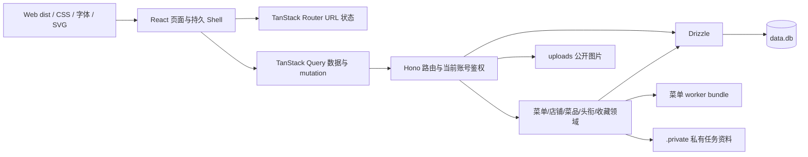

# sytime 项目地图

> 更新日期：2026-10-31（校正东紫阳楼与西红楼教学用途，补充地图回归和本地预览启动记录）。当前运行代码已迁移至 React 19 + TanStack Router/Query + Hono + Drizzle 的 npm workspaces Monorepo，沿用 SQLite、原有 URL、业务合同与视觉资产。当前仓库为 `szzxai/sytime`，分支 `main`。本地运行数据库 `data.db` 保留历史初始快照不纳入提交，业务与测试数据隔离。
>
> [架构说明](./docs/architecture.md) 描述实际模块边界、迁移、开发与部署；[2026-10-24 技术栈研究](./docs/tech-stack-recommendation-2026-10-24.md) 保留为候选比较，其中 Fastify/PostgreSQL 不是当前实现。文末按日期保留历史记录。

## 2026-10-31 · 校园教学区域说明校正

- 当前用途由 `apps/web/src/maps/places.ts` 的 `summary` 与 `description` 共同提供：东紫阳楼为高一、高二共同学习区域，二楼及三楼部分区域供高二、三楼另一部分区域及四楼供高一，不涉及高三；西红楼为少预班学习区域。移除东红楼与西红楼共同承担高二教学任务的过时关联，其自身高二用途不变。
- 保留原「当前用途与校园学习生活＋历史文化背景」两段式、来源链接、31 个地点、坐标及交互；用途依据维护者本次确认，未改旧楼层归档、接口、数据表或权限。同步地图逐页规范、来源说明、文案规范、更新日志、进度和验收记录。
- 验证：构建、TypeScript、lint、测试脚本语法、差异检查及本次地点文件 Prettier 检查通过；地图浏览器专项 **277 项通过**（原 217 项＋新增 60 项），覆盖五种尺寸/明暗主题、目录新摘要、真实键盘打开、楼层分配、移除旧年级、两段正文/引用、详情边界与「少预班」搜索，既有无障碍、手势和交互检查继续通过。人工核对桌面浅色东紫阳楼、手机深色西红楼截图，并在运行中的浏览器预览读取更新后的东紫阳楼详情。全仓格式检查报告 60 个文件问题；只格式化本次地点文件，未批量改无关文件，不能记为全仓格式通过。未运行全量 `npm test`；使用隔离测试数据库，保留既有工作区和业务数据库修改，未创建分支或提交。

## 1. 项目概览

拾光酥糕是一个按 Berkeleytime 的页面布局与视觉风格重制、采用中文内容和绿色主题的动态校园信息网站，现有校园地图、菜品星级评价、官网结构化每周食谱、公告、账号与权限、学生认证、个人中心、设置和管理后台。用户可在设置页提交工单，管理员可审核认证、处理封禁申诉及批复工单。

| 层次 | 实际实现 | 入口 |
| --- | --- | --- |
| Web | React 19、严格 TypeScript、TanStack Router/Query、Vite | `apps/web/src/main.tsx` |
| HTTP | Hono 原生路由，按领域分拆，Node 生产入口 | `apps/api/src/index.ts`、`app.js`、`routes/`、`domain/` |
| 数据 | Drizzle + better-sqlite3，27 张业务表及迁移 journal | `packages/db/src/schema.ts`、`packages/db/migrations/` |
| 共享合同 | DTO、角色权重与标签 | `packages/shared/src/index.ts` |
| 组件 | 持久 Shell、Dialog、表单、收藏、评价、后台、地图 | `apps/web/src/components/` 与 `layouts/` |
| 地图 | 保留 Leaflet、31 个校园地点、SVG 与高德坐标规则 | `apps/web/src/maps/`、`apps/web/public/img/map/` |
| 存储 | data.db、uploads、.private、data 与旧地图归档 | 根目录持久存储；私有文件不公开 |
| 构建与验证 | API/worker esbuild、Web Vite；类型/lint/格式/隔离回归 | `tools/`、`tests/`、根 scripts |

## 2. 完整文件结构

```text
apps/
  web/                  React 应用、Vite 入口与构建
    src/pages/          页面组件，保留原有 .html 地址
    src/components/     站点壳、表单、对话框、收藏、地图、评价及后台组件
    src/layouts/        复杂页面的展示结构，属性按具体 HTML 元素类型约束
    src/lib/            API、登录态、主题、URL 状态、导航层级/预加载与表单 Hook
    src/maps/           地图交互与地点数据
    public/             原有 CSS、字体、品牌图片、SVG 与本地 Leaflet
  api/
    src/index.ts        Node 入口、静态资源、404 与优雅退出
    src/app.js          Hono 组装与业务服务初始化
    src/routes/         账号、公告、资料、消息、工单、认证等路由
    src/domain/         菜单、店铺、菜品、头衔、收藏及历史迁移
packages/
  db/src/               Drizzle 类型化表结构、参数绑定及迁移入口
  db/migrations/        可接入旧库的 SQL 基线及迁移元数据
  shared/src/           共享 DTO、角色等级与标签
server.js               生产入口，加载 apps/api/dist/index.cjs
scripts/shops/          店铺数据整理工具
skills/szzx-menu/        独立菜单读图技能源文件
szzx-menu.skill          可导入的技能包
menu-json-rules.md      八字段 JSON 与完整读图约定
data.db                 运行数据库，保留历史快照
uploads/                上传图片，必须持久化
.private/               私有密钥、原图、诊断和缓存，禁止公开
data/                   菜单种子和店铺范围配置
data.json               旧地图兼容数据
tools/                  API/worker 构建、开发进程管理、技能构建
tests/                  后端、迁移、部署和浏览器回归
docs/                   架构、菜单运维、逐页规范及历史验收
```

生成目录为 `apps/api/dist`（index.cjs、worker.cjs 与 source map）和 `apps/web/dist`（SPA 入口、按页分块和资源），不提交。根目录旧 `apps/web/public/`、`apps/api/src/domain/` 已移除；既有算法和静态资产迁入各自工作区，运行时不依赖旧入口。

## 3. 请求与数据流



- 启动加载环境、连接数据库、登记 Drizzle 基线并运行历史升级、初始化非菜单领域种子与领域，监听后启动菜单调度。退出先关闭任务与 worker，再关闭 HTTP 和数据库。
- 原 `.html` 页面由同一个 React 入口提供，Router 按页面懒加载；站内页面使用 Router Link 意图预加载，可预加载组件与主要查询就绪后一次同页转场，无全局点击拦截；正文外按顶栏位置、内部详情按父子关系切换，公告与顶栏持续挂载。未知页面保留带站点壳的 404；`/api` 与 `/api/*` 的未知路由均返回 JSON 404。
- 页面路径、筛选、分页、hash 面板由 Router 管理；服务端数据由 Query 按公开/账号缓存。登录 token 仍由 Bearer 发送；每次受保护请求核对当前账号状态和权限。
- JSON 上限 8 MiB；multipart 总请求限额 64 MiB，具体文件数量、类型、单文件大小在上传模块和领域路由校验。公开图片仍映射 uploads；私有原图、密钥、任务资料只走鉴权 API。
- 默认页、菜谱视图、必吃榜设置、角色显示、收藏偏好及已有 localStorage 键保留。默认公开即时保存、新建收藏读取最新偏好、失败回退、自动默认夹私密等行为不变。
- 本次按授权重置上线前菜单数据；此后的菜品 ID、评论关联、整篇菜单原子替换、租约与发布审计保留。共用评价组件按每批 50 条加载候选，评论分页仍为 20 条。
- CSS、字体、品牌与地图素材保持；表单计数、密码显示、键盘操作、对话框焦点恢复、离线提示及未保存警告由组件/Hook 管理。

## 4. 前端页面地图

| 页面 | 功能与交互 | 主要数据来源 |
| --- | --- | --- |
| `index.html` | 首页介绍、地图/菜谱/必吃榜/公告入口、关于我们与工单反馈；仅在根路径 `/` 且无锚点时按用户默认页面跳转 | `/api/user/profile`、本地默认页设置 |
| `about.html` | 独立关于内容、原创地标插画与工单入口 | 共享导航与横幅接口 |
| `map.html` | 单一北向上 SVG 校园地图：31 地点、名称/别名搜索、分类、介绍卡、大面积篮球场与操场、拖动/滚动平移、捏合或 Ctrl / ⌘ + 滚轮缩放、键盘与全景；无楼层视图及切换器 | 读取本地 `apps/web/src/maps/places.ts` + `campus.svg`，不调用旧地图接口或读取楼层偏好 |
| `recipe.html` | 默认今天/明天双栏、日期/星期/校区/独立餐次、同菜合并地点；另有周视图与跨周高级筛选、星级及评价 | `/api/dishes`、`/api/recipes`、`/api/menu`、`/api/user/profile` |
| `dish.html?id=...` | 菜名、平均评分与评价数、完整图文评论和作者时间；每页 20 条；预选当前菜品写评价 | `/api/dishes/:id`、`/api/dishes/:id/reviews`、`/api/dishes`、`/api/recipes` |
| `shops.html` | 三元坊必吃榜；可拖动/缩放的高德地图，附近店铺按屏幕距离聚合为带数量的点，点击聚合点居中放大；分类、拼音 A–Z、道路/商场、距离/时间、点赞/评价/评分筛选与排序；列表分页（每页 20 条，`?page=` 保留）；店铺卡收藏按钮（#23） | `/api/shops`、`/api/shops/meta`、`/api/shops/map-image`；收藏夹接口 |
| `shop.html` | 地址、路线、本部/地铁出口距离、点赞/评价/评分汇总；学生及以上可点赞、提交/更新及删除本人 1–5 星评价，评价可选带一张实拍图（JPG/PNG，≤2 MB）、选填人数与总价并自动计算人均价；点赞右侧收藏按钮（#23）；详情页样式由账号 `shop_layout_mode` 决定：手动显示「纵向 / 双栏」开关并记住上次选择，自动则隐藏开关、纯 CSS 按屏幕宽度切换（#22） | `/api/shops/:id`、`/api/shops/:id/reviews`、互动写接口；收藏夹接口 |
| `shop-new.html` | 最低角色提示；店铺、地址、自定义类型、可选大众点评链接、GCJ-02 坐标和本部/地铁两组步行路线表单；高德步行路线测算 | `/api/shops/meta`、`POST /api/shops`、高德 AMap.Walking |
| `announcements.html` | 桌面主从列表；手机先看列表，选择后显示正文并可返回 | `/api/announcements` |
| `login.html` | 用户名/密码登录；封禁错误展示；允许申诉时提交理由及可选图片 | `/api/login`、`/api/user/appeal` |
| `register.html` | 用户名/昵称/密码及重复密码校验；注册后调用登录 | `/api/register`、`/api/login` |
| `student_verify.html` | 已达到学生角色时隐藏表单；否则填写新生号、班级、真实姓名，可填邀请码及补充信息 | `/api/user/profile`、`/api/student/apply` |
| `profile.html` | #20 类 B 站布局：资料头部（头像含编辑按钮 + 用户名/权限等级标签/昵称 + 个性签名；昵称与签名点击即可编辑、失焦弹确认保存）+ 吸顶横向菜单栏（主页 / 收藏 / 头衔 / 设置）；主页为空页面；收藏（#23）为左右分栏（必吃榜双层菜单 + 卡片网格 + 公开开关 + 分页，手机 UA 降级为顶部下拉）；头衔为佩戴/不佩戴选择；设置跳转 settings.html | `/api/user/profile`、`/api/user/avatar`、`/api/user/nickname`、`/api/user/signature`、`/api/user/titles`、`/api/user/title`；收藏夹接口 |
| `settings.html` | 设置页（左侧菜单，与个人中心同构）：账号安全（改密码）、网站设置（默认进入界面 / 菜品与食谱默认页 / 必吃榜默认排序与餐食类型 / 店铺详情页样式 / 收藏默认页 / 新建收藏夹默认公开（#29，切换即保存）/ 显示权限等级）、工单、退出登录 | `/api/user/profile`、`/api/user/settings`、`/api/user/settings/collection`、`/api/collections`、`/api/user/password`、`/api/tickets`、`/api/tickets/mine` |
| `user.html` | #21 其他用户主页（类个人中心版式，#20；只读）：资料头部 + 吸顶横向菜单栏（主页 / 收藏 / 头衔 / [管理]）；权限等级按该用户 `show_role` 显示；头衔只读；仅在目标存在公开收藏夹时显示「收藏」标签，只读展示公开收藏（#23）；有 `user_manage` / `title_manage` 且目标权重低于自己（非本人）时出现「管理」：改权限等级、发放特殊权限、发放头衔、封号/解封；`?id=` 为本人时跳转 profile.html | 公开 `GET /api/users/:id/profile`、`GET /api/users/:id/titles`、`GET /api/users/:id/collections`、`GET /api/collections/:id/items`（公开收藏夹）；`GET /api/me`；管理接口同上 |
| `inbox.html` | 消息箱：按天分组、全部/系统标签过滤、只看未读、全部标为已读、点击标记已读；页头消息铃显示未读数 | `/api/messages`、`/api/messages/unread-count`、`/api/messages/:id/read`、`/api/messages/read-all` |
| `admin.html` | 横幅、公告、发送系统通知、学生审核、邀请码、用户管理、头衔管理、申诉、工单、developer 菜单同步和三种管理角色的 JSON 手动导入；待办红点 | `/api/admin/*`，菜单接口见 [运维文档](./docs/menu-sync.md) |
| `404.html` | 404 提示、返回首页与返回上一页 | 无 |
| `components/Shell.tsx` 与 `components/ui.tsx` | 共享导航/页脚、账户菜单、手机抽屉、横幅、用户信息、主题、对话框、离线反馈 | 账号、横幅、消息数量接口 |
| `components/Collections.tsx` | 收藏操作与本人/公开收藏浏览，分页、公开状态、默认选择与手机下拉 | 收藏夹接口 |

页面布局由 `apps/web/public/css/site.css` 和 React 展示组件维护，业务组合位于 `apps/web/src/pages/`。共享 API、会话、主题与 URL Hook 位于 `apps/web/src/lib/`；动态文本使用 JSX 转义。各页面对应源码见 `docs/ui/pages/` 的当前 React 实现节。

## 5. 后端 API 全量索引

HTTP 入口位于 [index.ts](./apps/api/src/index.ts)，业务路由位于 `apps/api/src/routes/` 与 `apps/api/src/domain/*/routes.js`。菜单的方法/路径组合位于 [apps/api/src/domain/menu/routes.js](./apps/api/src/domain/menu/routes.js)，索引见 [菜单同步接口](./docs/menu-sync.md#页面与接口)。表中“公开”表示没有强制登录。

### 5.1 账号、个人资料与设置

| 方法 | 路径 | 访问条件 | 作用 |
| --- | --- | --- | --- |
| POST | `/api/register` | 公开 | 创建用户；首个用户为 developer，其余为 user；生成 display_id |
| POST | `/api/login` | 公开 | 验证密码、封禁状态，签发 JWT |
| GET | `/api/me` | 公开，可携带 token | 返回解析后的用户及显式权限 |
| GET | `/api/user/profile` | 登录 | 当前用户资料、设置、状态、权限与佩戴中的头衔；含数值 `collection_default_public`（0/1，默认 0），不在他人公开资料中返回 |
| GET | `/api/user/titles` | 登录 | 已拥有头衔（含佩戴状态）与未达成自动头衔的条件进度 |
| PUT | `/api/user/title` | 登录 | 佩戴或取消佩戴；未拥有的头衔 403，`title_id: null` 表示不佩戴 |
| PUT | `/api/user/settings` | 登录 | 部分更新：默认页、菜谱视图、必吃榜默认排序/餐食类型、`shop_layout_mode`（manual/auto）、`shop_layout`（stacked/split）、`show_role`、`collection_default_public`（仅数字 0/1，省略保留；非法值 400 且不写入其他字段）；响应回显新偏好；旧楼层字段仅保留后端兼容 |
| POST | `/api/user/avatar` | 登录 | 上传头像，更新 avatar_url |
| PUT | `/api/user/nickname` | 登录 | 修改昵称 |
| PUT | `/api/user/signature` | 登录 | 修改签名 |
| PUT | `/api/user/password` | 登录 | 校验旧密码并修改密码 |
| GET | `/api/users/:id/profile` | 公开 | 指定用户的公开资料（昵称/签名/头像/角色/`show_role`/状态/佩戴头衔）；用于用户主页（#21） |
| GET | `/api/users/:id/titles` | 公开 | 指定用户已拥有的头衔（只读，不含自动头衔进度）；用于用户主页「头衔」分区 |

### 5.2 菜谱、公告与地图

| 方法 | 路径 | 访问条件 | 作用 |
| --- | --- | --- | --- |
| GET | `/api/recipes` | 公开 | 按 `name COLLATE NOCASE, id` 排序读取评价记录 |
| POST | `/api/recipes` | 登录 | 必须传当前目录已有 `dish_id`，名称由服务端确定；评分为 1–5 整数，评论选填且最多 500 字，可选 JPG/PNG 图片 ≤2 MB；无效参数拒绝并清理该次上传文件 |
| GET | `/api/dishes` | 公开 | 有成功供应记录的独立菜品目录、拼音与索引元数据 |
| GET | `/api/dishes/:id` | 公开 | `{dish,supplies}` 包含最近 100 条供应及来源；历史菜品仍可访问，dish 包含目录字段、`reviews_count` 和保留一位小数的 `rating_avg`；只统计 `is_weekly=0`，没有评价时评分为 null；不存在 ID 返回 404 |
| GET | `/api/dishes/:id/reviews?offset=0` | 公开 | `{reviews,total,offset,has_more}`，每页 20 条，按 `created_at DESC,id DESC`；附作者昵称、头像、权限及头衔；偏移为 0–1000000 的整数字符串，否则 400；两种详情读取成功响应均 no-store |
| GET | `/api/announcements` | 公开 | 按发布日期倒序读取公告 |
| GET | `/api/menu?source_id=...` | 公开 | `{weeks,week,records,sync}`；默认最新供应周，all=1 跨全部已发布周（不可同时传 source_id）；供应含日期、餐次、地点、分类、菜名、价格、辣椒及真实评分；未知周 404，no-store |
| GET | `/api/settings/banner` | 公开 | 当前横幅及版本 |
| GET | `/api/map-data` | 公开 | 兼容旧地图数据，每次从磁盘读取 data.json；当前地图页面不调用 |
| GET | `/api/shops` | 公开 | 店铺列表；支持 `type`、`q`、本部距离/时间及点赞/评价/评分范围过滤，`sort=campus/metro/likes/reviews/rating/new` 排序；拼音 A–Z 在前端排序 |
| GET | `/api/shops/meta` | 公开 | 浏览器端 JS Key（仅另配时返回）、静态地图是否可用、坐标/范围配置、分类和当前用户创建权限；不返回 Web 服务 Key |
| GET | `/api/shops/map-image?lat=..&lng=..&zoom=..` | 公开、同源代理 | 服务器端用 `AMAP_SERVICE_KEY` 按当前视图获取并缓存底图；中心限制在姑苏区边界外扩范围内，缩放级别限制为 9–18，不向浏览器暴露 Key |
| GET | `/api/shops/:id` | 公开 | 店铺详情，含路线、互动计数、平均评分与评分数 |
| GET | `/api/shops/:id/reviews` | 公开 | 评价列表和总数，含人数/总价/人均与配图地址；只回传当前用户自己的评价内容供编辑 |
| POST | `/api/shops/:id/like` | 登录 + 学生及以上 | 切换点赞状态；后端重新核验当前角色/状态 |
| POST | `/api/shops/:id/reviews` | 登录 + 学生及以上 | 创建或更新本人的评价；评分必填 1–5，文字最多 500 字；multipart 可选 `image`（JPG/PNG，≤2 MB），可选 `guests`（1–99）与 `total_price`（0–100000 元）字段，`per_person` 由服务端计算；`remove_image=1` 清除配图 |
| DELETE | `/api/shops/:id/reviews/me` | 登录 + 学生及以上 | 删除本人的评价并重算统计 |
| POST | `/api/shops` | 登录 + `shop_create`；默认 student 及以上 | 后端验证地址、分类、GCJ-02 坐标、路线字段与已配置覆盖多边形；同名返回 409 |
| PUT | `/api/admin/map-popup` | map_popup_edit | 兼容旧地图弹窗，按 feature.name 更新所有同名对象的 popup，回写 data.json；当前地图页面无编辑入口 |

### 5.3 学生认证、后台内容与用户管理

| 方法 | 路径 | 访问条件 | 作用 |
| --- | --- | --- | --- |
| GET | `/api/admin/ping` | super_admin 及以上 | 后台连通性检查 |
| POST | `/api/admin/announcements` | announcement_publish | 发布公告 |
| DELETE | `/api/admin/announcements/:id` | announcement_publish | 删除公告；不存在返回 404 |
| PUT | `/api/admin/settings/banner` | banner_edit | 修改/清空横幅并增加版本 |
| POST | `/api/student/apply` | 登录 | 有效邀请码直接认证，否则提交审核申请 |
| GET | `/api/admin/settings/invite-code` | invite_manage | 读取兼容的单邀请码设置 |
| PUT | `/api/admin/settings/invite-code` | invite_manage | 写入兼容的单邀请码设置 |
| GET | `/api/admin/invite-codes` | invite_manage | 多邀请码列表 |
| POST | `/api/admin/invite-codes` | invite_manage | 添加邀请码和使用上限，0 表示不限 |
| DELETE | `/api/admin/invite-codes/:id` | invite_manage | 删除邀请码 |
| GET | `/api/admin/student-applications` | student_review | 待审核认证申请 |
| PUT | `/api/admin/student-applications/approve` | student_review | 通过申请并提升未达学生级别用户的角色 |
| PUT | `/api/admin/student-applications/reject` | student_review | 拒绝申请并记录可选原因 |
| GET | `/api/admin/users` | user_manage | 用户 ID、显示 ID、账号、角色、状态与额外权限 |
| GET | `/api/admin/users/:id` | user_manage | 单个用户的管理信息（角色、状态、显式权限、头衔）；用于用户主页「管理」分区（#21） |
| GET | `/api/admin/permissions` | user_manage | 权限目录 |
| PUT | `/api/admin/users/role` | user_manage，另有目标角色限制 | 修改角色 |
| PUT | `/api/admin/users/ban` | user_manage，另有目标角色限制 | 封禁并保存理由、可选图片及是否允许申诉 |
| PUT | `/api/admin/users/unban` | user_manage，另有目标角色限制 | 解封并清空封禁信息 |
| PUT | `/api/admin/users/permissions` | user_manage，另有目标角色限制 | 替换显式权限列表 |
| GET | `/api/admin/titles` | title_manage | 头衔目录与持有人数 |
| GET | `/api/admin/titles/rules` | title_manage | 可用的自动头衔规则清单 |
| POST | `/api/admin/titles` | title_manage | 新建头衔；重名 409，名称超 8 字 422 |
| PUT | `/api/admin/titles/:id` | title_manage | 修改名称、颜色与描述 |
| DELETE | `/api/admin/titles/:id` | title_manage | 删除头衔并清理所有拥有与佩戴记录 |
| POST | `/api/admin/users/:id/titles` | title_manage，目标权重须低于自己 | 授予公共头衔；重复幂等，自动头衔 409 |
| POST | `/api/admin/users/:id/titles/custom` | title_manage，目标权重须低于自己 | 为该账号创建并颁发专属头衔；同名沿用同一行，不进公共目录 |
| DELETE | `/api/admin/users/:id/titles/:titleId` | title_manage，目标权重须低于自己 | 撤销头衔；佩戴中会清空佩戴并写入系统消息 |

### 5.4 申诉、工单与消息

| 方法 | 路径 | 访问条件 | 作用 |
| --- | --- | --- | --- |
| POST | `/api/user/appeal` | 公开；目标账号须已封禁 | 按用户名提交解封理由与可选 DataURL 图片 |
| GET | `/api/admin/ban-appeals` | ban_appeal_review | 待处理申诉 |
| PUT | `/api/admin/ban-appeals/review` | ban_appeal_review | 通过并解封，或驳回 |
| POST | `/api/tickets` | 登录 | 提交标题、正文及可见角色范围 |
| GET | `/api/tickets/mine` | 登录 | 本人工单与批复 |
| GET | `/api/admin/tickets` | ticket_manage，按角色再过滤 | 当前管理者可见的工单 |
| PUT | `/api/admin/tickets/reply` | ticket_manage，按工单可见级别再校验 | 批复正文及可选 DataURL 图片 |
| GET | `/api/admin/pending-counts` | 登录，按权限和工单范围统计 | 学生认证、申诉、工单待办数量 |
| GET | `/api/messages` | 登录 | 消息列表；支持 type(system)、unread、before 游标与 page_size |
| GET | `/api/messages/unread-count` | 登录 | 未读总数（页头消息铃轮询） |
| PUT | `/api/messages/:id/read` | 登录，限本人 | 单条标记已读 |
| PUT | `/api/messages/read-all` | 登录 | 全部标记已读 |
| POST | `/api/admin/notifications` | announcement_publish | 向全体用户发送系统通知（标题/正文/重要性） |

### 5.5 收藏夹（#23）

| 方法 | 路径 | 访问条件 | 作用 |
| --- | --- | --- | --- |
| GET | `/api/collections?section=shops` | 登录 | 当前用户该版块的收藏夹（含条目数）；该版块没有收藏夹时自动创建「默认收藏夹」；同时返回 `defaults` 默认收藏夹 |
| POST | `/api/collections` | 登录 | 新建 `{section, name, is_public?}`；版块 shops，名称 1–40 字；`is_public` 明确值只接受数字 0/1（非法 400），省略时读取当前登录用户最新 `collection_default_public`；响应 `collection.is_public` 仍为布尔值 |
| POST | `/api/collections/:id/items` | 登录，限本人收藏夹 | 收藏 `{item_type, item_id}`；item_type 必须与收藏夹版块匹配（shops→shop），重复收藏幂等 |
| DELETE | `/api/collections/:id/items/:itemType/:itemId` | 登录，限本人收藏夹 | 取消收藏 |
| GET | `/api/collections/:id/items?page=1` | 登录或公开收藏夹（可匿名）；私密仅本人 | 每页 20 条；店铺返回卡片信息；已删除内容标记 `deleted` |
| GET | `/api/users/:id/collections` | 公开 | 指定用户的公开收藏夹（`is_public=1`），供他人主页只读展示 |
| PUT | `/api/collections/:id/public` | 登录，限本人收藏夹 | 切换公开状态 `{is_public}` |
| PUT | `/api/user/settings/collection` | 登录 | 保存默认收藏夹；支持 `{default_collection_shops}` 或 `{section, collection_id}`，并校验归属与版块 |

### 5.6 菜单同步与人工导入

| 方法 | 路径 | 访问条件 | 作用 |
| --- | --- | --- | --- |
| GET | `/api/admin/menu-sync/settings` | developer | 读取掩码配置与版本 |
| PUT | `/api/admin/menu-sync/settings` | developer | 保存配置、定时与开关 |
| POST | `/api/admin/menu-sync/test` | developer | 检查已保存模型与图片 JSON 能力 |
| GET | `/api/admin/menu-sync/jobs` | developer | 任务、来源、配置摘要 |
| POST | `/api/admin/menu-sync/jobs` | developer | 立即同步；支持最多六张补图 |
| GET | `/api/admin/menu-sync/jobs/:id` | admin 及以上 | 任务详情、逐篇状态 |
| POST | `/api/admin/menu-sync/jobs/:id/retry` | developer | 重试失败篇目 |
| POST | `/api/admin/menu-sync/jobs/:id/cancel` | developer | 取消任务 |
| GET | `/api/admin/menu-sync/jobs/:id/artifacts/:kind` | admin 及以上 | 按 source_id 读取原图、menu/diagnostic/source JSON |
| GET | `/api/admin/menu-sync/imports` | admin 及以上 | 来源、结束任务及审计 |
| GET | `/api/admin/menu-sync/imports/source` | admin 及以上 | 已发布记录或 job_id 对应候选 |
| POST | `/api/admin/menu-sync/imports/preview` | admin 及以上 | 八字段校验、归一化及摘要 |
| POST | `/api/admin/menu-sync/imports` | admin 及以上 | 校验版本、digest、reviewed 后原子发布 |
| GET | `/menu-json-rules.md` | 公开 | 下载完整读图与 JSON 规则 |

## 6. 角色与权限模型

角色权重为 `developer(6) > super_admin(5) > admin(4) > student(3) > user(2) > guest(1)`。

- `checkRole(requiredRole)` 解析 JWT，缺失或无效 token 按 guest 处理；需要角色时比较权重。JWT 带有 id、role、username；角色判断使用数据库当前账号而非凭据中的旧角色。已封禁账号视为无有效登录。
- `requireLogin` 在解析后要求有效用户 ID，否则返回 401。
- `requirePermission` 调用 `hasPermission`：角色达到该权限默认等级，或 `user_permissions` 存在显式授权，即可通过。
- 后台入口允许 admin 及以上或拥有任意显式权限的用户；后台菜单进一步按具体权限过滤。
- 修改用户角色、封禁/解封和替换权限时，禁止操作自己或同级/更高级目标；新角色最高只能低于操作者一级。
- 工单可见范围为 `admin`、`super_admin`、`developer`，后台在 ticket_manage 之外另按角色权重过滤。

| 权限 | 默认最低角色 | 功能 |
| --- | --- | --- |
| banner_edit | super_admin | 横幅编辑 |
| announcement_publish | super_admin | 发布公告 |
| student_review | super_admin | 学生认证审核 |
| invite_manage | super_admin | 邀请码管理 |
| user_manage | super_admin | 用户及显式权限管理 |
| ban_appeal_review | super_admin | 封禁申诉审核 |
| map_popup_edit | admin | 地图弹窗编辑 |
| ticket_manage | admin | 工单管理 |
| shop_create | student（由 `SHOP_CREATE_MIN_ROLE` 可配置） | 添加店铺；也可在用户显式权限中单独授权 |
| title_manage | super_admin | 头衔目录维护与用户头衔授予/撤销 |

## 7. 数据模型与文件存储

### 7.1 SQLite

当前 Drizzle schema 与基线包含 27 张业务表；旧论坛表由历史迁移清除。包括账号/登录记录/权限、公告/设置、认证/邀请/申诉/工单/消息/评价、店铺互动、头衔、收藏和菜单等领域。店铺 schema 在 `apps/api/src/domain/shops/store.js`，头衔 schema 与种子在 `apps/api/src/domain/titles/store.js`，收藏夹 schema 在 `apps/api/src/domain/collections/store.js`，菜单迁移与显式测试种子工具位于 `apps/api/src/domain/menu/store.js`。另有内部表 sqlite_sequence、__drizzle_migrations。完整字段、默认值、外键和索引见下方「Drizzle 完整结构」，以 packages/db/src/schema.ts 及迁移为源；测试使用临时数据库。

| 表 | 主要字段/约束 | 关联与用途 |
| --- | --- | --- |
| users | id、display_id、username、nickname、password_hash、avatar_url、signature、role、网站设置（默认页/楼层/菜谱视图/必吃榜排序与餐食类型/`shop_layout_mode`/`shop_layout`/`show_role`）、默认收藏夹 `default_collection_shops`（可空）、`collection_default_public INTEGER NOT NULL DEFAULT 0`、status、封禁字段、`equipped_title_id`、`last_login_date`/`login_streak`；username/email 唯一 | email 为兼容字段；布局模式决定手动开关或按宽度切换，`shop_layout` 记住手动布局；默认收藏夹字段指向本人的店铺版块；`collection_default_public` 为主动新建收藏夹的默认公开偏好，旧/新账号默认 0，迁移幂等且不改已有收藏夹；头衔为单值，连续登录供自动规则使用；普通用户强制展示角色 |
| user_permissions | user_id、permission；二者联合唯一 | 用户显式授权 |
| collections | user_id、section（shops）、name、is_public（INTEGER NOT NULL DEFAULT 0）、created_at | 收藏夹（#23/#29）；主动创建保存明确选择或账号偏好；GET 时版块无收藏夹会自动创建私密「默认收藏夹」；修改默认偏好不追溯已有收藏夹 |
| collection_items | collection_id、item_type（shop）、item_id、created_at；三者联合唯一 | 收藏项；必吃榜收藏夹只允许 shop |
| recipes | user_id、username、name、rating、comment、image_url、is_weekly、可空 dish_id → dishes.id | 一条记录是一条评价；新评价必须选择已有菜品，保存规范名称；旧未匹配记录保留 NULL，无店铺关联；索引 `idx_recipes_dish(dish_id,created_at DESC,id DESC)` |
| weekly_menu_images | user_id、menu_start_date、menu_end_date、filename、uploaded_at | 已停用兼容空表，无上传与读取接口 |
| announcements | title、content、publish_date | 公开公告 |
| settings | key 主键、value | 横幅、邀请码兼容设置及加密 menu_ai_config |
| student_applications | user_id、student_id、class_name、real_name、extra_info、reject_reason、status | 认证审核；pending/approved/rejected |
| invite_codes | code 唯一、max_uses、used_count | 多邀请码及次数限制 |
| ban_appeals | user_id、appeal_reason、appeal_image、status | 解封审核；pending/approved/rejected |
| tickets | user_id、username、title、content、visibility、status、reply_content、reply_image、reply_by、replied_at | 工单；pending/resolved |
| messages | user_id、type、actors(JSON)、count、target_kind/target_id、title/body/snippet、important、read_at | 消息箱；仅 system 消息，target 返回 null；旧互动消息由启动迁移清除 |
| titles | key（种子标识，可空）、name、hue、source（grant/auto）、rule（自动规则 key）、description、`owner_user_id` | 头衔目录，共 7 个种子：四个自动头衔（三元坊老饕/夜读星/闲者爱上网/校园老吃家）与三个手动（师者/创站元老/官方）；角色等级头衔已下线（角色改由权限等级标签体现），旧库中的这类目录行会在启动迁移时清理；`owner_user_id` 为空是公共头衔（按名称全站唯一），非空是该账号的专属头衔（按「账号 + 名称」唯一，不进公共目录）；`rule` 关联 `apps/api/src/domain/titles/rules.js` 的规则；来源为 auto 时不可手动授予也不可手动撤销，带 `key` 的种子头衔不可删除，专属头衔不得与公共头衔同名 |
| user_titles | user_id、title_id 联合唯一、granted_by（NULL 表示自动发放）、created_at | 用户拥有的头衔，一人可多个；成就头衔只增不减；佩戴状态单独存在 users.equipped_title_id；撤销专属头衔时其 titles 目录行一并删除 |
| user_login_days | user_id、day 联合主键 | 登录逐日历史（北京时间自然日，登录时写入），供「闲者爱上网」按周末窗口统计；不做回填 |
| shops | name 唯一、address、location_note、可选 `dianping_url`、type、GCJ-02 lat/lng、本部/最近地铁出口 distance_m 与 walk_min、metro_station/metro_exit、created_by/created_at | 三元坊必吃榜；列表可按本部、地铁及互动统计排序筛选 |
| shop_likes | shop_id、user_id 唯一、created_at | 每名学生及以上用户每店一个点赞；重复点击取消 |
| shop_reviews | shop_id、user_id 唯一、rating 1–5、content、guests、total_price、image_url、created_at/updated_at | 每名学生及以上用户每店一条评价，可更新；可选带一张图（存 `uploads/shops/`）与人数/总价，人均价按总价/人数自动计算；汇总评价数、评分数和平均星级 |
| dishes | id、name、唯一 name_key、initial、pinyin、pinyin_initials、sort_key | 独立稳定 ID 菜品 |
| menu_sources | 来源 ID、可空 article_id、kind、publication_origin、revision、title/url、日期/摘要/计数/错误 | 官网队列与独立手动批次 |
| menu_records | source_id/record_key 联合主键、dish_id、日期/餐次/地点/档口/价格/辣椒 | 供应记录，明确外键 |
| menu_sync_jobs | UUID、唯一 auto_day、状态/阶段、配置版本、计数、取消标记 | 持久同步任务 |
| menu_job_items | job_id/source_id 联合主键、状态、阶段、错误及资料路径 | 逐篇结果 |
| menu_sync_lease | 单例 ID、owner、expires_at | 防并发同步与发布 fencing |
| menu_sync_state | key/value | 发现锚点 |
| menu_import_audit | source_id、actor_id、job_id、revision、records_json | 人工发布历史，与菜单发布同一事务 |

迁移 `0001_menu_rebuild.sql` 一次清理菜单、评价、任务、配置，并将现有用户食谱默认页设为 weekly；新注册也显式设 weekly，schema 的 all 仅为历史基线默认值。启动不再自动导入菜单种子。原有用户关联主要由应用维护；新增菜单记录和任务条目声明外键。菜单供应按篇事务替换；评价关联迁移在目录初始化后独立执行。只为 `dish_id IS NULL AND is_weekly=0` 的旧评价按 NFC、首尾及连续空白、大小写归一后的名称补关联，保留原菜名、无法匹配记录及每周记录，不覆盖已有关联；重复启动幂等。认证和申诉限频规则保持。

实际已提交数据库保留旧迁移结构，例如 users.display_id 通过后续 `ALTER TABLE` 添加，没有新建库 SQL 中的 UNIQUE 约束；不能假设旧库与新库的所有约束完全一致。

### Drizzle 完整结构

下表由隔离新库的实际 PRAGMA 生成（27 张业务表）；旧库既有约束差异仍按升级说明处理。所有时间戳单位沿用原接口。

#### `announcements`

| 字段 | SQLite 类型 | 非空 | 默认值 | 主键序位 |
| --- | --- | --- | --- | --- |
| id | INTEGER | 否 | — | 1 |
| title | TEXT | 是 | — | — |
| content | TEXT | 是 | — | — |
| publish_date | TEXT | 是 | date('now') | — |

索引：`idx_announcements_date`。
#### `ban_appeals`

| 字段 | SQLite 类型 | 非空 | 默认值 | 主键序位 |
| --- | --- | --- | --- | --- |
| id | INTEGER | 否 | — | 1 |
| user_id | INTEGER | 是 | — | — |
| appeal_reason | TEXT | 是 | — | — |
| appeal_image | TEXT | 是 | '' | — |
| status | TEXT | 是 | 'pending' | — |
| created_at | INTEGER | 是 | strftime('%s','now') | — |

索引：`idx_ban_appeals_user`、`idx_ban_appeals_status`。
#### `collection_items`

| 字段 | SQLite 类型 | 非空 | 默认值 | 主键序位 |
| --- | --- | --- | --- | --- |
| id | INTEGER | 否 | — | 1 |
| collection_id | INTEGER | 是 | — | — |
| item_type | TEXT | 是 | — | — |
| item_id | INTEGER | 是 | — | — |
| created_at | INTEGER | 是 | strftime('%s','now') | — |

索引：`idx_collection_items_item`、`idx_collection_items_collection`、`sqlite_autoindex_collection_items_1`（唯一）。
#### `collections`

| 字段 | SQLite 类型 | 非空 | 默认值 | 主键序位 |
| --- | --- | --- | --- | --- |
| id | INTEGER | 否 | — | 1 |
| user_id | INTEGER | 是 | — | — |
| section | TEXT | 是 | — | — |
| name | TEXT | 是 | — | — |
| is_public | INTEGER | 是 | 0 | — |
| created_at | INTEGER | 是 | strftime('%s','now') | — |

索引：`idx_collections_user_section`。
#### `dishes`

| 字段 | SQLite 类型 | 非空 | 默认值 | 主键序位 |
| --- | --- | --- | --- | --- |
| id | INTEGER | 否 | — | 1 |
| name | TEXT | 是 | — | — |
| name_key | TEXT | 是 | — | — |
| initial | TEXT | 是 | — | — |
| pinyin | TEXT | 是 | — | — |
| pinyin_initials | TEXT | 是 | — | — |
| sort_key | TEXT | 是 | — | — |
| created_at | INTEGER | 是 | — | — |

索引：`sqlite_autoindex_dishes_1`（唯一）。
#### `invite_codes`

| 字段 | SQLite 类型 | 非空 | 默认值 | 主键序位 |
| --- | --- | --- | --- | --- |
| id | INTEGER | 否 | — | 1 |
| code | TEXT | 是 | — | — |
| max_uses | INTEGER | 是 | 0 | — |
| used_count | INTEGER | 是 | 0 | — |
| created_at | INTEGER | 是 | strftime('%s','now') | — |

索引：`sqlite_autoindex_invite_codes_1`（唯一）。
#### `menu_import_audit`

| 字段 | SQLite 类型 | 非空 | 默认值 | 主键序位 |
| --- | --- | --- | --- | --- |
| id | TEXT | 否 | — | 1 |
| source_id | TEXT | 是 | — | — |
| actor_id | INTEGER | 是 | — | — |
| job_id | TEXT | 否 | — | — |
| created_at | INTEGER | 是 | — | — |
| records_count | INTEGER | 是 | — | — |
| records_json | TEXT | 是 | — | — |
| revision | INTEGER | 是 | — | — |

索引：`sqlite_autoindex_menu_import_audit_1`（唯一）。

外键：`source_id → menu_sources.id`（删除 NO ACTION）。
#### `menu_job_items`

| 字段 | SQLite 类型 | 非空 | 默认值 | 主键序位 |
| --- | --- | --- | --- | --- |
| job_id | TEXT | 是 | — | 1 |
| source_id | TEXT | 是 | — | 2 |
| article_id | INTEGER | 是 | — | — |
| title | TEXT | 是 | — | — |
| status | TEXT | 是 | — | — |
| phase | TEXT | 是 | 'fetch' | — |
| records_count | INTEGER | 是 | 0 | — |
| error | TEXT | 是 | '' | — |
| artifact_path | TEXT | 否 | — | — |

索引：`sqlite_autoindex_menu_job_items_1`（唯一）。

外键：`job_id → menu_sync_jobs.id`（删除 NO ACTION）。
#### `menu_records`

| 字段 | SQLite 类型 | 非空 | 默认值 | 主键序位 |
| --- | --- | --- | --- | --- |
| source_id | TEXT | 是 | — | 1 |
| record_key | TEXT | 是 | — | 2 |
| dish_id | INTEGER | 是 | — | — |
| date | TEXT | 否 | — | — |
| weekday | TEXT | 否 | — | — |
| time_json | TEXT | 是 | — | — |
| place | TEXT | 否 | — | — |
| group_name | TEXT | 否 | — | — |
| price | REAL | 否 | — | — |
| spicy | INTEGER | 否 | — | — |

索引：`idx_menu_records_dish`、`sqlite_autoindex_menu_records_1`（唯一）。

外键：`dish_id → dishes.id`（删除 NO ACTION）、`source_id → menu_sources.id`（删除 NO ACTION）。
#### `menu_sources`

| 字段 | SQLite 类型 | 非空 | 默认值 | 主键序位 |
| --- | --- | --- | --- | --- |
| id | TEXT | 否 | — | 1 |
| article_id | INTEGER | 否 | — | — |
| title | TEXT | 是 | — | — |
| url | TEXT | 是 | — | — |
| published_date | TEXT | 否 | — | — |
| content_hash | TEXT | 否 | — | — |
| updated_at | INTEGER | 否 | — | — |
| checked_at | INTEGER | 否 | — | — |
| records_count | INTEGER | 是 | 0 | — |
| last_error | TEXT | 是 | '' | — |
| kind | TEXT | 是 | 'school' | — |
| publication_origin | TEXT | 是 | 'automatic' | — |
| revision | INTEGER | 是 | 0 | — |

索引：`sqlite_autoindex_menu_sources_2`（唯一）、`sqlite_autoindex_menu_sources_1`（唯一）。
#### `menu_sync_jobs`

| 字段 | SQLite 类型 | 非空 | 默认值 | 主键序位 |
| --- | --- | --- | --- | --- |
| id | TEXT | 否 | — | 1 |
| trigger | TEXT | 是 | — | — |
| auto_day | TEXT | 否 | — | — |
| status | TEXT | 是 | — | — |
| phase | TEXT | 是 | 'queued' | — |
| created_at | INTEGER | 是 | — | — |
| started_at | INTEGER | 否 | — | — |
| finished_at | INTEGER | 否 | — | — |
| config_revision | INTEGER | 是 | — | — |
| provider | TEXT | 是 | — | — |
| model | TEXT | 是 | — | — |
| total | INTEGER | 是 | 0 | — |
| processed | INTEGER | 是 | 0 | — |
| succeeded | INTEGER | 是 | 0 | — |
| failed | INTEGER | 是 | 0 | — |
| cancel_requested | INTEGER | 是 | 0 | — |
| error | TEXT | 是 | '' | — |

索引：`sqlite_autoindex_menu_sync_jobs_2`（唯一）、`sqlite_autoindex_menu_sync_jobs_1`（唯一）。
#### `menu_sync_lease`

| 字段 | SQLite 类型 | 非空 | 默认值 | 主键序位 |
| --- | --- | --- | --- | --- |
| id | INTEGER | 否 | — | 1 |
| owner | TEXT | 是 | — | — |
| expires_at | INTEGER | 是 | — | — |

索引：无独立索引。
#### `menu_sync_state`

| 字段 | SQLite 类型 | 非空 | 默认值 | 主键序位 |
| --- | --- | --- | --- | --- |
| key | TEXT | 否 | — | 1 |
| value | TEXT | 是 | — | — |

索引：`sqlite_autoindex_menu_sync_state_1`（唯一）。
#### `messages`

| 字段 | SQLite 类型 | 非空 | 默认值 | 主键序位 |
| --- | --- | --- | --- | --- |
| id | INTEGER | 否 | — | 1 |
| user_id | INTEGER | 是 | — | — |
| type | TEXT | 是 | — | — |
| actors | TEXT | 是 | '[]' | — |
| count | INTEGER | 是 | 1 | — |
| target_kind | TEXT | 是 | '' | — |
| target_id | INTEGER | 否 | — | — |
| title | TEXT | 是 | '' | — |
| body | TEXT | 是 | '' | — |
| snippet | TEXT | 是 | '' | — |
| important | INTEGER | 是 | 0 | — |
| read_at | INTEGER | 否 | — | — |
| created_at | INTEGER | 是 | strftime('%s','now') | — |

索引：`idx_messages_created`、`idx_messages_user`。
#### `recipes`

| 字段 | SQLite 类型 | 非空 | 默认值 | 主键序位 |
| --- | --- | --- | --- | --- |
| id | INTEGER | 否 | — | 1 |
| user_id | INTEGER | 是 | — | — |
| username | TEXT | 是 | — | — |
| name | TEXT | 是 | — | — |
| rating | INTEGER | 是 | 0 | — |
| comment | TEXT | 否 | — | — |
| image_url | TEXT | 否 | — | — |
| is_weekly | INTEGER | 是 | 0 | — |
| created_at | INTEGER | 是 | strftime('%s','now') | — |
| dish_id | INTEGER | 否 | — | — |

索引：`idx_recipes_dish`、`idx_recipes_weekly`。

外键：`dish_id → dishes.id`（删除 NO ACTION）。
#### `settings`

| 字段 | SQLite 类型 | 非空 | 默认值 | 主键序位 |
| --- | --- | --- | --- | --- |
| key | TEXT | 否 | — | 1 |
| value | TEXT | 否 | — | — |

索引：`sqlite_autoindex_settings_1`（唯一）。
#### `shop_likes`

| 字段 | SQLite 类型 | 非空 | 默认值 | 主键序位 |
| --- | --- | --- | --- | --- |
| id | INTEGER | 否 | — | 1 |
| shop_id | INTEGER | 是 | — | — |
| user_id | INTEGER | 是 | — | — |
| created_at | INTEGER | 是 | strftime('%s','now') | — |

索引：`idx_shop_likes_shop`、`sqlite_autoindex_shop_likes_1`（唯一）。
#### `shop_reviews`

| 字段 | SQLite 类型 | 非空 | 默认值 | 主键序位 |
| --- | --- | --- | --- | --- |
| id | INTEGER | 否 | — | 1 |
| shop_id | INTEGER | 是 | — | — |
| user_id | INTEGER | 是 | — | — |
| rating | INTEGER | 是 | — | — |
| content | TEXT | 是 | '' | — |
| guests | INTEGER | 否 | — | — |
| total_price | REAL | 否 | — | — |
| image_url | TEXT | 是 | '' | — |
| created_at | INTEGER | 是 | strftime('%s','now') | — |
| updated_at | INTEGER | 是 | strftime('%s','now') | — |

索引：`idx_shop_reviews_shop`、`sqlite_autoindex_shop_reviews_1`（唯一）。
#### `shops`

| 字段 | SQLite 类型 | 非空 | 默认值 | 主键序位 |
| --- | --- | --- | --- | --- |
| id | INTEGER | 否 | — | 1 |
| name | TEXT | 是 | — | — |
| address | TEXT | 是 | — | — |
| location_note | TEXT | 是 | '' | — |
| dianping_url | TEXT | 是 | '' | — |
| type | TEXT | 是 | — | — |
| lat | REAL | 是 | — | — |
| lng | REAL | 是 | — | — |
| north_gate_distance_m | INTEGER | 是 | — | — |
| north_gate_walk_min | INTEGER | 是 | — | — |
| east_gate_distance_m | INTEGER | 是 | — | — |
| east_gate_walk_min | INTEGER | 是 | — | — |
| campus_distance_m | INTEGER | 是 | 0 | — |
| campus_walk_min | INTEGER | 是 | 0 | — |
| metro_station | TEXT | 是 | '' | — |
| metro_exit | TEXT | 是 | '' | — |
| metro_distance_m | INTEGER | 是 | — | — |
| metro_walk_min | INTEGER | 是 | — | — |
| created_by | INTEGER | 否 | — | — |
| created_by_name | TEXT | 是 | '' | — |
| created_at | INTEGER | 是 | strftime('%s','now') | — |
| updated_at | INTEGER | 是 | strftime('%s','now') | — |

索引：`idx_shops_campus`、`idx_shops_metro`、`idx_shops_east`、`idx_shops_north`、`idx_shops_name`（唯一）。
#### `student_applications`

| 字段 | SQLite 类型 | 非空 | 默认值 | 主键序位 |
| --- | --- | --- | --- | --- |
| id | INTEGER | 否 | — | 1 |
| user_id | INTEGER | 是 | — | — |
| student_id | TEXT | 是 | — | — |
| class_name | TEXT | 是 | — | — |
| real_name | TEXT | 是 | — | — |
| extra_info | TEXT | 否 | — | — |
| reject_reason | TEXT | 否 | — | — |
| status | TEXT | 是 | 'pending' | — |
| created_at | INTEGER | 是 | strftime('%s','now') | — |

索引：`idx_student_applications_user`。
#### `tickets`

| 字段 | SQLite 类型 | 非空 | 默认值 | 主键序位 |
| --- | --- | --- | --- | --- |
| id | INTEGER | 否 | — | 1 |
| user_id | INTEGER | 是 | — | — |
| username | TEXT | 是 | '' | — |
| title | TEXT | 是 | — | — |
| content | TEXT | 是 | — | — |
| visibility | TEXT | 是 | 'admin' | — |
| status | TEXT | 是 | 'pending' | — |
| reply_content | TEXT | 是 | '' | — |
| reply_image | TEXT | 是 | '' | — |
| reply_by | TEXT | 是 | '' | — |
| replied_at | INTEGER | 否 | — | — |
| created_at | INTEGER | 是 | strftime('%s','now') | — |

索引：`idx_tickets_user`、`idx_tickets_status`。
#### `titles`

| 字段 | SQLite 类型 | 非空 | 默认值 | 主键序位 |
| --- | --- | --- | --- | --- |
| id | INTEGER | 否 | — | 1 |
| key | TEXT | 是 | '' | — |
| name | TEXT | 是 | — | — |
| hue | TEXT | 是 | 'stone' | — |
| source | TEXT | 是 | 'grant' | — |
| rule | TEXT | 是 | '' | — |
| description | TEXT | 是 | '' | — |
| owner_user_id | INTEGER | 否 | — | — |
| created_at | INTEGER | 是 | strftime('%s','now') | — |

索引：`idx_titles_owner`、`idx_titles_owner_name`（唯一）、`idx_titles_public_name`（唯一）、`idx_titles_key`（唯一）。
#### `user_login_days`

| 字段 | SQLite 类型 | 非空 | 默认值 | 主键序位 |
| --- | --- | --- | --- | --- |
| user_id | INTEGER | 是 | — | 1 |
| day | TEXT | 是 | — | 2 |

索引：`sqlite_autoindex_user_login_days_1`（唯一）。
#### `user_permissions`

| 字段 | SQLite 类型 | 非空 | 默认值 | 主键序位 |
| --- | --- | --- | --- | --- |
| id | INTEGER | 否 | — | 1 |
| user_id | INTEGER | 是 | — | — |
| permission | TEXT | 是 | — | — |
| created_at | INTEGER | 是 | strftime('%s','now') | — |

索引：`idx_user_permissions_user`、`sqlite_autoindex_user_permissions_1`（唯一）。
#### `user_titles`

| 字段 | SQLite 类型 | 非空 | 默认值 | 主键序位 |
| --- | --- | --- | --- | --- |
| id | INTEGER | 否 | — | 1 |
| user_id | INTEGER | 是 | — | — |
| title_id | INTEGER | 是 | — | — |
| granted_by | INTEGER | 否 | — | — |
| created_at | INTEGER | 是 | strftime('%s','now') | — |

索引：`idx_user_titles_title`、`idx_user_titles_user`、`sqlite_autoindex_user_titles_1`（唯一）。
#### `users`

| 字段 | SQLite 类型 | 非空 | 默认值 | 主键序位 |
| --- | --- | --- | --- | --- |
| id | INTEGER | 否 | — | 1 |
| display_id | TEXT | 否 | — | — |
| email | TEXT | 否 | — | — |
| password_hash | TEXT | 否 | — | — |
| username | TEXT | 否 | — | — |
| nickname | TEXT | 否 | — | — |
| avatar_url | TEXT | 是 | '' | — |
| signature | TEXT | 否 | — | — |
| role | TEXT | 是 | 'user' | — |
| default_page | TEXT | 是 | 'index.html' | — |
| default_floor | INTEGER | 是 | 1 | — |
| recipe_default_view | TEXT | 是 | 'all' | — |
| shop_default_sort | TEXT | 是 | 'campus' | — |
| shop_default_type | TEXT | 是 | '' | — |
| shop_layout | TEXT | 是 | 'stacked' | — |
| shop_layout_mode | TEXT | 是 | 'manual' | — |
| default_collection_shops | INTEGER | 否 | — | — |
| collection_default_public | INTEGER | 是 | 0 | — |
| status | TEXT | 是 | 'active' | — |
| ban_reason | TEXT | 是 | '' | — |
| ban_image | TEXT | 是 | '' | — |
| allow_appeal | INTEGER | 是 | 1 | — |
| created_at | INTEGER | 是 | strftime('%s','now') | — |
| last_login_date | TEXT | 是 | '' | — |
| login_streak | INTEGER | 是 | 0 | — |
| show_role | INTEGER | 是 | 1 | — |
| equipped_title_id | INTEGER | 否 | — | — |

索引：`sqlite_autoindex_users_3`（唯一）、`sqlite_autoindex_users_2`（唯一）、`sqlite_autoindex_users_1`（唯一）。
#### `weekly_menu_images`

| 字段 | SQLite 类型 | 非空 | 默认值 | 主键序位 |
| --- | --- | --- | --- | --- |
| id | INTEGER | 否 | — | 1 |
| user_id | INTEGER | 否 | — | — |
| menu_start_date | TEXT | 是 | — | — |
| menu_end_date | TEXT | 是 | — | — |
| filename | TEXT | 是 | — | — |
| uploaded_at | INTEGER | 是 | strftime('%s','now') | — |

索引：`idx_weekly_menu_dates`。

### 7.2 校园地图与旧数据归档

2026-10-17 起，页面只展示北向上 SVG 校园地图。旧楼层平面、顶部视图切换器及设置页默认楼层字段已移除，旧前端渲染脚本已删除。

- 导览 `apps/web/src/maps/places.ts` 含 31 个地点，字段为 `id`（唯一选择键）、`name`、可选 `alias`、`category`、`icon`（SVG symbol）、`x/y`、`size`、可选 `height`、可选 `labelX/labelY/labelSize`（标签偏移/基础字号）、`area`、`summary`（用途摘要）、`description`（以空行分段）、可选 `sources`（引用键数组）。同文件 `CampusSources` 登记 10 个来源的 `label/url`；引用范围与校内补充记录于 [docs/map-sources.md](./docs/map-sources.md)。静态示意范围 1000 × 1540；`[x,y]` 转为 Leaflet `[-y,x]`，上方为北。未指定高度时使用宽度的 0.75 倍；篮球场为 132 × 292，北部两列三排加南侧一片；操场为 310 × 568，含跑道和足球场细节。
- `apps/web/public/img/map/campus.svg` 提供边界、道路、植被、文庙区域和建筑图形；`apps/web/src/maps/campus.js` 插入可点击、可键盘操作的 SVG 地点组。相同 symbol 复用于目录缩略图和地点详情。坐标与轮廓按用户2026-10-17提供的新版位置参考图校准；三元楼、科学楼、文庙、南部生活区采用地块结构插画，春雨池、碧霞池按不同岸线绘制，补充林地、交叉园路、竹林与未命名粉色地块；新增政道楼（原墨子馆）、府学碑廊、泮池与泮桥，周边梦工厂仅作参考轮廓。建筑与内部细节均为示意；不承诺实景还原或路线导航。
- 搜索覆盖名称、别名、用途摘要、区域和分类，支持「校史馆」→「尊经阁」、「面档」→「希文楼」、「宿舍」→「采芹园」；与分类取交集。目录副标题显示用途，希文楼归入生活类。结果数量实时更新，不匹配地点淡化并退出焦点顺序，空结果可重置。
- 地点介绍提供已确认用途与文化背景，新地点不编造未核实用途，采用维护者确认的校内信息和已阅读的公开原文。详情删除位置行，按段落渲染正文及来源链接，长文在卡内滚动；标题及关闭按钮保留，正文可键盘聚焦。政道楼按维护者确认改名，保留“墨子馆”搜索别名；介绍记录“文正之道”、对李政道先生的致敬及北京大学中学物理实验教学中心用途。引用网页仅在点击时打开，页面不联网抓取文章。
- 选中不重排建筑、不自动放大。`map.js` 将全部光晕统一置于建筑组下方，避免东红楼等地点的选中背景遮挡相邻建筑。点选或键盘聚焦时保留当前缩放，按地图留白、详情及控制条的实际矩形求最短避让平移；地标已可见则不动，不强制居中。460ms 缓出平移可由新选点或手势中断，减少动态效果模式立即完成。关闭/Escape 恢复焦点。手机目录可折叠；全景模式下尺寸变化重新适配。拖动、按钮、方向键/WASD、加减键与 Home 提供操作入口。
- 普通滚轮或触控板双指滚动双轴平移；Shift + 纵向滚轮横向移动。捏合或 Ctrl / ⌘ + 滚轮连续缩放并保持指针锚定；Safari 原生手势期间抑制重复滚轮事件。禁用 Leaflet 原生滚轮缩放，归一化增量并通过动画帧合并更新。手机保留双指缩放。
- 移除固定平移边界，解决宽屏中拖动回弹和缩放锚点漂移；用户可通过全景按钮复位。设置页与地图均不消费旧楼层偏好。
- 页面专用 `apps/web/public/css/map.css` 管理简约面板、响应式、明暗地图与 reduced-motion；新增屋面、墙体、草坪、绿篱、水面、园路、运动标线及球场的明暗令牌；标签支持偏移与相对字号，点击热区限制在地块及文字，避免透明区域覆盖邻近地标。篮球场名称放回自身地块底部，与操场轮廓及热区分离，避免遮挡和误点。共享 `site.css` 和站点壳无改动。导览无需在线底图服务，也不依赖地图 API；SVG 请求失败可重试。

`data.json` 仅作为旧楼层数据归档，旧读取/弹窗接口与数据库 `default_floor` 字段保留兼容，当前地图页面不调用或使用。此文件是自定义格式，顶层包含 `meta`、`style`、`features`，并非标准 GeoJSON；本次未修改其几何或后端结构。

| 部分 | 字段与当前内容 |
| --- | --- |
| meta | rectW=1200、rectH=700、axisY=420、minZoom=-2、maxZoom=6、baseZoom=1 |
| style | outline、labelColor、fillOpacity、palette；建筑/绿地/水体/白色/无填充分类 |
| features | 227 个对象：153 条 polyline、48 个 polygon、26 个 label |
| layers | base=始终显示；数字 1–4=所在楼层；同一对象可以出现在多层 |
| 几何字段 | points 为 `[x,y]` 点数组；fill/stroke/dash/weight 控制路径 |
| 文字字段 | text、x1/y1/x2/y2、scale 控制区域文字；name/popup 控制名称与弹窗 |

归档楼层集合为：20 个 base 对象、118 个仅 1F 对象、42 个仅 2F 对象、2 个同时位于 1F/2F 的对象、45 个同时位于 2F/3F/4F 的对象。旧方向约定是左北、上东；不适用于当前北向上的 SVG 校园地图。兼容读取接口仍每次访问磁盘，兼容弹窗接口仍按名称批量更新同名对象；两者均不改变当前地图。

店铺地图使用服务器端高德静态图代理与前端自绘交互层，无需浏览器 JS Key；`data/shops-config.json` 坐标为 GCJ-02：`center` 为初始地图中心，`anchors.campus` 为苏中本部步行路线起点，`area.polygon` 为 `[纬度,经度]` 多边形。Web 服务 Key 放在被 `.gitignore` 排除的 `.env`（`AMAP_SERVICE_KEY`），仅服务器端使用且不下发。前端支持拖动、滚轮/双指缩放、缩放按钮及回到全域；店铺按当前视图的屏幕距离聚合，圆点显示数量，点击后以聚合中心放大。底图接口只允许姑苏区边界外扩范围内的中心点、缩放 9–18，并缓存近期视图。源码、测试和文档不含实际 Key。地图初始中心/缩放与本部路线起点分别来自配置的中心点和高德 POI「江苏省苏州中学本部」（120.622380, 31.295509）。地理围栏只有在多边形至少 3 个有效点时才生效；范围配置为空时后端无法判定区域。店铺初始化不使用虚构坐标或路线。

### 7.2.1 配套离线地图编辑器

`../szzx-mapeditor/map-editor.html` 是独立离线旧楼层编辑器。本站楼层页面已移除，其输出不再作用于当前校园地图。使用说明与完整字段表见 [编辑器 README](../szzx-mapeditor/README.md) 和 [编辑器 MAP.md](../szzx-mapeditor/MAP.md)。2026-10-09 编辑器内置数据与本项目归档 `data.json` 的 227 个要素一致，配色和 `minZoom=-2` 同步，几何不变。

- 编辑器通过下载导出 JSON；不会调用网站接口或写入数据库。替换本项目归档文件只影响旧兼容接口的返回值。
- 当前校园地图的位置、尺寸和介绍在 `apps/web/src/maps/places.ts` 维护，底图与插画在 `campus.svg` 维护；不读取编辑器的几何、楼层、字体或层级扩展字段。
- 旧兼容接口按名称批量编辑弹窗；编辑器修改单个对象不会自动同步同名对象。
- 编辑器回归只打开离线文件，不运行本网站，也不修改本项目的数据库、依赖或地图数据。2026-10-09 的配套编辑器协作仅更新文档；2026-10-17 的网站导览改版不修改编辑器或 `data.json`。

### 7.3 图片

| 场景 | 存储位置 | 后端限制 |
| --- | --- | --- |
| 头像、菜谱评价图片 | uploads/ | Hono FormData；JPEG/PNG，最多 2 MiB |
| 封禁图片 | uploads/bans/ | Hono FormData；JPEG/PNG，最多 2 MiB |
| 官网食谱原图、缓存与诊断 | .private/menu-sources、menu-cache、menu-jobs | 私有存档，正文内联 PNG 解码与铺白；后台鉴权读取 |
| 申诉图片、工单批复图片 | 数据库文本字段 | 由页面读成 DataURL 后通过 JSON 提交，不使用上述 multipart 存储器 |

## 8. 运行、依赖与验证入口

Node ≥22.13，推荐 24 LTS，npm workspaces。运行依赖分布在 API/Web/db/shared 的 package.json，根 package.json 管理构建、TypeScript、ESLint、Prettier、Drizzle Kit 与 Playwright；精确版本锁定在 package-lock.json。

```bash
npm ci
npm run build
npm start
# 开发：npm run dev（Web 5173，API 3000）
# 生产构建后可 npm prune --omit=dev
```

`PORT`、`JWT_SECRET`、`JWT_EXPIRES_IN` 等沿用 `.env.example`，密钥需显式配置。`APP_ROOT` 默认为工作目录，定位数据、迁移、前端构建与私有存储，测试使用完整临时应用根目录。没有构建产物时不能只安装生产依赖启动。

本地浏览器预览配置为 `.claude/launch.json` 的 `sytime-dev`，通过 Node 的模块入口先设置 `process.env.PORT='3000'` 再导入 `tools/dev.mjs`，避免预览工具注入的 5173 被 API 继承；Web 监听 5173，API 监听 3000，沿用既有热更新与退出清理逻辑。首次启动需 `npm ci` 安装开发依赖；若提示找不到 `vite/package.json`，先完成依赖安装再启动。此配置不改变业务接口、权限或数据库结构。

2026-10-31 启动验证：锁文件依赖安装成功；前端根页面、3000 的公告设置读取及 5173 的对应代理请求均返回 HTTP 200，代理返回 JSON。浏览器确认校园地图实际渲染（31 个地点），并执行导航按钮和搜索输入交互；浏览器页面在检查过程中变化，本次不将搜索结果计为专项通过。日志中曾有后端冷启动前的公告代理 502，服务就绪后两次 HTTP 检查均正常；Vite 另有静态资源路径提示及未构建生产静态目录提示，开发页面仍正常响应。本轮仅作启动冒烟，不运行全量回归；原有业务数据库修改保留，未创建分支或提交。

| 验证命令 | 范围 |
| --- | --- |
| `npm run typecheck` / `lint` / `format:check` | TS 严格类型、React Hook 与通用代码规则、格式 |
| `npm run test:architecture` | 无 journal 的旧库升级、重启幂等、原 ID/记录、当前权限与 JSON 404 |
| `npm run test:backend` | 菜单、菜品、头衔、店铺、配图、收藏、论坛历史清理 |
| `npm run test:dishes:ui` / `test:collections:ui` / `test:shops:ui` / `test:user` / `test:map` | 各业务浏览器回归，手机/桌面、明暗、键盘 |
| `npm run test:ui` | 全站布局与 axe、首页转场、账号及后台场景 |
| `npm run test:deploy` | 临时源码安装、构建、去开发依赖、生产启动及文件保护 |
| `npm run test:menu-skill` | 离线菜单规则与技能包 |

先构建再执行测试；浏览器首次安装用 `npx playwright install chromium`，Windows 使用现有 Edge。测试数据和上传目录隔离，截图在 output/playwright；不写业务 data.db。最新实际执行范围见文末重构记录；按变更补测，不重复已通过的无关组。开发启动/重建/退出也在临时 APP_ROOT 验证。

## 9. 文档与实现约定

每次更新完代码，必须在同一次改动中编写或更新相关文档，并实质修改根目录最新的 `MAP.md`（日期、受影响实现与验证记录）。即使没有接口或目录变化，也不能跳过项目地图。完整规则见 [AGENTS.md](./AGENTS.md)，[agent.md](./agent.md) 是兼容入口。

| 文档 | 用途及实际实现 |
| --- | --- |
| README、MAP、progress | 当前使用方式、结构、业务能力与开发记录；历史变更按当时实现保留 |
| UI.md、docs/ui/ | #4 设计手册、组件、逐页规范、场景、文案、样张与验收记录；P1 页面为后续 issue 的预设计 |
| docs/ui/assets 与 apps/web | 前者是设计参考，后者为 React 实现与静态素材；文档旧 HTML 示例仅表达 DOM/CSS 规范 |
| PLAN_2026-10-01.md | 保留需求读取时的原始正文和状态；执行进度见 progress 与验收记录，实时关闭状态以 GitHub 为准 |
| package.json、package-lock.json、LICENSE | 根包许可为 AGPL-3.0；本地 Leaflet 另附上游许可证 |
| #5 菜品与评价 | 独立目录、网站内同步、菜品详情与评价关联已实现；原评价栏保留，店铺关联后续实施 |

## 10. 历史需求与当前模块

| 能力 | 当前定位 |
| --- | --- |
| 全站 UI 与地图 | apps/web/src/pages、components、maps 与 public |
| 菜单、目录和评价 | apps/api/src/domain/menu、dishes；RecipePage、DishPage、DishReview |
| 必吃榜、配图和收藏 | domain/shops、collections；ShopPage、ShopsPage、Collections |
| 消息、工单和账号 | apps/api/src/routes；InboxPage、SettingsPage、Tickets |
| 头衔与公开用户主页 | domain/titles；ProfilePage、TitleManagement、AccountManagement |
| 构建、部署与数据升级 | tools、packages/db、docs/architecture.md |

原国庆计划与 issues 是历史需求快照；本节映射当前实现路径，不改变其中未实施的后续需求。实际验证以最新记录为准。

## 2026-10-17 校园导览验证记录

新增 `tests/map-ui.mjs`（`npm run test:map`），接入 `npm test`。最新地图专项 **217 项**、全站浏览器 **370 项**均通过。专项新增旧名查找政道楼、名称寓意与用途、篮球场标签不与操场相交及标签下缘实际点击检查；继续覆盖选中建筑顺序不变、光晕位于所有建筑下方、可见地标不移动或缩放、边缘选点保留上下文、详情避让、实际动画中间帧、用途搜索、分段正文与引用、手机长文键盘滚动验证；31 地点、新地标点选、参考空间顺序、地表分区、七片球场及比例、未命名地块、搜索/分类、焦点、键盘/拖动/触控、尺寸变化、明暗主题、失败重试与旧视图移除回归继续通过。手势覆盖双轴平移、Ctrl / ⌘ 连续缩放与指针锚定、反向恢复、Safari 手势与重复滚轮抑制；Safari 事件在 Chromium 中模拟，未验证 Safari 引擎或实体 Mac 触控板。地图覆盖 1440×1000、390×844、360×740、1280×900、844×390，明暗主题 axe、页面报错与横向溢出均为 0；已人工检查校准后的桌面、手机、暗色全景，以及东红楼相邻建筑、泮水居边缘选点、手机详情与暗色长文截图。全站回归继续覆盖默认楼层设置移除与其他偏好保存。

本次重做还修正既有测试的浏览器平台选择、角色写入等待和个人中心过期选择器；共享 `UI.html.skeleton` 补齐 `role="status"`。此前同次改版已通过菜单后端 18 项、头衔后端 13 项、店铺后端 14 项、店铺浏览器 64 项、用户主页浏览器 28 项验证。所有测试使用隔离数据库和上传目录。最新报告为 `output/playwright/map/report.json`、`output/playwright/audit.json`；`ui-single-view.log` 为前次单地图版本的历史日志。


## 2026-10-17 · 拾光酥糕 v2 全站重制（历史品牌）

### 结构与呈现

- `public/index.html`：替换旧卡片式首页为 `.landing`。Hero 全屏渐变、左下中文标题、右下 `public/img/fan-zhongyan.svg`（纯白范仲淹像简笔剪影）；下方按参考站顺序呈现关于、开发团队、一起完善和寄语。
- `public/about.html`：由跳转文件变为独立关于内容页；保留首页 `#about` 锚点。
- `public/js/ui.js`：统一品牌、导航和三列页脚；登录入口与头像/消息/权限菜单分开渲染；主题支持顶栏明暗切换及页脚 auto/light/dark，存于 localStorage，监听系统偏好与跨标签页变更。
- `public/css/site.css`：白色/深灰背景、绿色强调、4/8/10px 圆角、细边框；第 18 节集中新版布局。论坛和菜谱 290px 左栏、必吃榜 330px 左栏；桌面侧栏吸顶且可独立滚动，小于 768px 顺排。设置、后台、公告、资料、认证、详情、消息和系统页统一共享组件。
- `public/css/map.css`：地图目录及控件继承新版令牌，地图几何、31 地点、镜头交互与来源内容不变。
- 所有 HTML 标题、英文眉题、动态帖子/店铺标题完成品牌与中文同步；浏览器图标及认证字章为「府」。

### 数据流与兼容

UI 重排 → 保留原控件 ID/表单/页面脚本 → 原接口 → 原数据库。未修改后端接口、数据表、角色权限、菜谱同步、头衔规则或地图位置。根路径默认页跳转继续由 `pages/index.js` 管理。首页入口仅使用已存在功能，无虚构统计或服务状态。开发团队名称及标志形态由维护者提供，标志为新绘 SVG。

## 2026-10-18 · SHSTime v2.2 对照校准

- 公共壳站名切换为 `SHSTime`，所有静态页标题和动态帖子/店铺标题同步；InterVariable 显示英文标志，使用 Berkeleytime 适配特性。新增本地 Noto Sans SC 可变字重精简 WOFF2（含当前公开界面 1,053 个中文字形）作为全站中文字体，保留系统字体作为扩展字符回退；字体许可证随资源分发。
- 顶栏可见名称调整为「地图、论坛、菜谱、必吃榜、更新公告」。页脚版权固定为「© 2026 苏州中学 VC 编程」。
- 首页 Hero 标题底部内距从 48px 改为 32px，使其下移约 16px；桌面雕像高度约 Hero 的 80%、宽度水平压缩并右距 100px。范仲淹像 SVG 以左上白光、右侧灰绿渐层和衣褶勾线增加立体感。
- 深色 Hero 绿色改为 `#14532D`；主题切换优先使用 280ms View Transition，降级到颜色过渡，减少动态效果时直接切换。顶栏主导航加入 120ms 离场与 220ms 进场动画，并遵从减少动态效果偏好。
- 本轮只改静态界面、字体、SVG、测试和文档；不改 API、表结构、业务权限及 URL 行为。

验证结果：`npm test` 全部通过：菜单后端 18 项、头衔后端 13 项、店铺/评价图片后端 14 项、店铺浏览器 64 项、用户主页 28 项、全站浏览器 **550 项**、地图 **217 项**。axe、页面报错和横向溢出均为 0。新增 360/768/1440px 的品牌/中文字体/导航/版权加载、明暗配色、主题转场、减少动态效果和主导航页面进出场动画验证；其余桌面首屏尺寸、公告变化、渐变连续、导航悬停、展开动画回归保持通过。人工对照 1710×858 基准下品牌 x=22/y=45.5、主标题 y≈720.4、顶栏和绿色首屏底部位置；检查手机、深色首页。Noto 可变字重字体 276KB，带许可证，1053 个中文字形；新增与现存三枚 SVG XML 解析、JavaScript 语法和 `git diff --check` 通过。测试使用隔离数据库及上传目录；截图存于忽略提交的 `output/playwright/shstime-home-{1710,dark,390}.png`。

### 验证记录

`npm test` 全部通过：菜单后端 18 项、头衔后端 13 项、店铺/评价图片后端 14 项、店铺浏览器 64 项、用户主页浏览器 28 项、全站浏览器 **498 项**、地图浏览器 **217 项**。全站报告 `output/playwright/audit.json` 的 `issues` 为空；axe、页面报错和横向溢出均为 0。

新增 360/768/1440px 首页中文与真实地标、开发团队及 SVG 加载、标题避让建筑、折叠项键盘操作、独立关于页、移动抽屉焦点、主题切换/刷新/跟随系统和三种工作区断点验证。人工核对参考站与新版首页、手机、深色及功能页截图；三枚新 SVG 通过 XML 解析，`git diff --check` 通过。

截图位于忽略提交的 `output/playwright/`，包括 `fuxue-home-*`、`fuxue-forum-*`、`fuxue-recipe-*` 和 `fuxue-shops-*`；最终地标人工截图为 `zhide-home-1440.png` 与 `zhide-home-360.png`。测试使用独立临时数据库与上传目录。

## 2026-10-17 · v2.1 首屏与交互精校

- `public/js/pages/index.js` 在保留根路径默认页跳转的前提下，观察共享顶栏和公告容器高度，写入首屏可用高度；异步公告、关闭、换行与窗口变化都参与计算。桌面不再有额外 16px 或最小高度导致屏底超出。
- `public/css/site.css` 使用本地 InterVariable（100–900，可变字重；中文系统回退），顶栏统一 56px、品牌 24px/580、导航 13px/32px、控件圆角 4px。首页无顶栏边线，渐变顶部与顶栏共用背景令牌。导航断点调整为 992px，抽屉变宽关闭行为同步。
- `fan-zhongyan.svg` 替换原门楼资产：首页右下最大宽 200px 的纯白雕像，关于页复用。团队并排间距 64px；首页区块标题和介绍恢复参考字号、行高与正常字距，页脚列距/列内距为 64/12px。
- 导航伪元素底色 100ms 淡入淡出；首页折叠保留原生键盘语义，以 Web Animations 驱动 200ms ease-out 高度变化，单项展开、收起 inert、快速反向点击和减少动态效果均处理；文本换行期间重新测量高度。
- 本轮未改变接口、数据表和业务权限。验证结果在本节末同步记录；上方 v2 初版数字为上一轮历史结果。

补充对照：深色基础面板统一参考站中性锌灰；地图底部说明与公告选中日期使用更深文字。展开内容的行内链接保留细下划线，版权行缩为站名与年份以免手机折行。

### 精校后验证结果

`npm test` 全部通过：菜单后端 18 项、头衔后端 13 项、店铺/图片后端 14 项、店铺浏览器 64 项、用户主页浏览器 28 项、全站浏览器 **532 项**、地图浏览器 **217 项**。`output/playwright/audit.json` 的 issues 和 `output/playwright/map/report.json` 的 errors 均为空。测试使用隔离数据库与上传目录，未改生产数据。

新增检查覆盖无公告、异步公告、多行公告与关闭后首屏填充；1024×600、1280×720、1440×1000、1920×1080、2560×1440 五组桌面尺寸；横排团队 64px 间距、992/993px 导航断点、渐变相邻像素连续、100ms 悬停淡入淡出、200ms 折叠中间帧/单项展开/连续反转/减少动态效果，以及展开内容无障碍。另人工核对 320/360/660/700/768/992/993px 布局、桌面与手机明暗截图；无横向溢出、无页面异常。字体为本地 InterVariable 加系统中文回退，未声称跨操作系统中文字形完全一致。

最终人工截图：`output/playwright/refined-home-1440.png`、`refined-home-360.png`、`refined-home-dark.png`、`refined-nav-hover.png`；全量日志 `/tmp/fuxue-final-test.log`。SVG XML 解析、JavaScript 语法检查和 `git diff --check` 通过。

## 2026-10-18 · 拾光酥糕 v2.3 校徽、雕像与跨页滑动

- 全部公开页面与动态帖子、店铺标题将站名统一为「拾光酥糕」；导航左上及抽屉、页脚的品牌链接只显示苏州中学校徽；顶栏图标为 32px，左边距 28px、上边距 15px，中文可访问名称仍标识首页。浏览器 favicon 与品牌图标共用由维护者校徽照片去白底生成的透明 PNG。
- 首页及关于页使用维护者提供的透明范仲淹像 PNG，保留原图左上光照与绿色暗面。首屏布局保持桌面大量留白及视口底对齐；992px 以下雕像缩至首屏高 56%，700px 以下继续按剩余宽度收缩。
- 同源跨文档导航使用浏览器 View Transition：顶栏与公告静止，下方新旧页面内容以 420ms 同步水平滑动，主导航按前后顺序判定方向，返回首页向右；目标页面头部提前读取方向。旧的逐元素上下淡入淡出逻辑已移除，减少动态效果时禁用位移。主题切换维持独立 280ms 淡变。浏览器不支持跨文档 View Transition 时直接导航。
- 对应资源为 public/img/suzhou-high-school-mark.png、public/img/fan-zhongyan-user.png 与 public/js/page-transition.js。没有修改后端接口、数据表或权限。此次验证结果记录见本节与 docs/ui/acceptance.md。

本轮验证：npm test 全绿（菜单后端 18、头衔 13、店铺后端 14、店铺浏览器 64、用户主页 28、全站浏览器 562、地图 217）。浏览器回归检查校徽及雕像加载、32px 顶栏图标留白、同源前进与返回方向、顶栏及公告静止、公告接口延迟 250ms 时首 18 帧顶栏位置稳定、明暗主题、手机布局与减少动态效果。中间帧实际采样旧页约 -1073px、新页约 +367px，顶栏和公告 transform 均为 none。桌面浅色、暗色和手机截图已人工核对；JavaScript 语法与 git diff --check 通过。测试使用隔离数据，未修改已有 data.db。

## 2026-10-18 · 跨页公告加载与顶栏稳定性修复

先前跨文档滑动时，目标页的公告接口异步返回，顶栏可在首帧位于 0px，随后被 32px 公告推下，出现短暂跳动。共享导航在点击站内链接时将公告实际高度存入当前标签页会话；目标页头部脚本在绘制第一帧前设置预留高度，空公告容器暂时占位，真实公告加载后接替。同名顶栏新快照在转场中保持可见，降低极短空白风险。只影响前端共享壳和动画，不改变公告接口、登录状态、持久数据、权限或页面 URL。

## 2026-10-19 · 合并 #27 与主干冲突解决

合并主干 `main`（包含 #22 必吃榜详情页布局自动切换与 #23 收藏功能体系）和 `feature/ui-redesign`（全站视觉重制、绿色主题、品牌统一为「拾光酥糕」/ SHSTime、校徽与范仲淹像、横向切页过渡）。

- **冲突解决**：
  - `CHANGELOG.md`：按时间倒序整合 2026-10-18 视觉重制与 2026-10-17 收藏、必吃榜布局条目。
  - `MAP.md`：更新概要、接口索引、前端页面表与模块入口，将 2 张收藏夹表及收藏接口、店铺详情自动布局并入文档地图。
  - `docs/ui/pages/forum.md`、`post.md`、`shops.md`、`shop-detail.md`：保持视觉重制容器结构与组件规范，补充 #22、#23 需求标签、收藏按钮交互及验收项。
- **页面转场异常防护**：
  - `public/js/page-transition.js`：在 `pagereveal`、`pageswap` 与 `unhandledrejection` 中为 ViewTransition 的 `ready` / `finished` promise 增加拒绝捕获逻辑，防止快速切页或 `location.replace` 重定向时触发 Chromium 偶发的未处理中止异常。
  - `public/js/ui.js`：在主题切换 `startViewTransition(commit).finished` 后增加 `.catch()` 处理。

### 验证记录

`npm test` 全量回归全部通过：
- 菜单后端：18 项通过
- 头衔系统：13 项通过
- 店铺后端与评价配图：14 项通过
- 收藏夹后端：9 项通过
- 收藏夹 UI 自动化：75 项通过
- 店铺 UI 自动化：86 项通过
- 用户主页 UI：28 项通过
- 全站 UI 冒烟测试：562 项通过
- 地图 UI 自动化：217 项通过
axe 无障碍违规：0；控制台页面报错：0；水平溢出：0。


## 2026-10-19 · 青柠品牌图标与独立运营声明

- 新增 `public/img/brand-lime.svg`：从 VC 团队橙子切面派生绿色版本，供全部 19 个 HTML 页的 favicon、共享顶栏、抽屉、页脚及登录/注册卡片使用；首页团队区保留原橙色图。更新资源版本以刷新浏览器缓存。
- 共享页脚替换为维护者提供的完整运营声明，说明学生自主运营、与校方无隶属关系、知识产权归属、官方资讯优先及勘误方式；邮箱可点击。身份区支持长文自然换行，保留手机纵向导航和明暗主题。
- 后端接口、数据库表与权限未变。验证：`npm run test:ui` 571 项通过，覆盖 360/1280px 明暗主题全站页面、360/768/1440px 首页、共享 logo 加载、favicon 引用、完整声明及邮件链接、既有键盘与手机布局；axe、横向溢出和页面报错均为 0。人工核对桌面与手机页脚截图，`node --check public/js/ui.js` 与 `git diff --check` 通过；测试数据库及上传目录隔离。


## 2026-10-23 · 完全移除论坛

- 删除 `public/forum.html`、`post.html`、`public/js/forum.js`、两个对应页面脚本及专属样式。共享导航、抽屉、页脚、首页、关于页、404 和默认页设置不再提供论坛入口；旧页面与全部论坛 API 返回 404。
- `lib/collections`、共享收藏弹窗与浏览器仅支持 `section=shops`、`item_type=shop`；默认字段只剩 `users.default_collection_shops`。个人中心和公开主页保留店铺收藏、分页、公开状态及移动端选择。
- 自动规则和种子删除 `forum_catalyst`、`top_liked`；头衔目录现有 7 项，头衔迁移清除这两项的拥有关系并取消相关佩戴。
- 消息箱保留系统通知及头衔授予消息，`target` 为 null；删除旧帖子关联查询、互动类型展示、通知偏好接口和评论/回复/点赞开关。
- 新增 `lib/migrations/remove-forum.js`：在启动的头衔/收藏迁移之后以事务清理 `forum_posts`、`forum_replies`、`post_likes`，重建仅允许店铺的收藏表，保留店铺收藏 ID/公开状态/时间/默认选择；删除帖子互动消息、`default_collection_forum`、`pref_comment`、`pref_reply`、`pref_like`，旧论坛默认页重置为首页。重复启动可安全执行。开发时未操作工作区原有 data.db。
- 测试用店铺数据继续验证收藏分页、权限、公开状态、默认设置和收藏弹窗；新增 `tests/forum-removal.test.cjs`，接入 `test:collections`，验证旧库迁移、店铺数据保留、约束和幂等性；接口测试覆盖旧路由各方法 404、前端文件删除与默认页回退。
- 文档同步：删除论坛及帖子逐页规范，更新 README、UI、共享组件、文案、相关页面规范、CHANGELOG、progress 和验收追加记录。本文此前带日期的章节及 progress/CHANGELOG 的旧条目保留为历史。

验证结果：菜单 18、头衔 13、店铺与图片后端 14、收藏后端与旧库迁移 10、收藏浏览器 73、店铺浏览器 86、用户主页 23、全站浏览器 527、地图 217 项全部通过。全站覆盖 360/1280px 与明暗主题，axe、横向溢出及页面异常为 0；既有键盘与手机布局检查通过，人工核对桌面/手机首页截图；JavaScript 语法与 `git diff --check` 通过。验证通过 `npm test` 各套件执行，修正头衔数量断言后单独复验 `npm run test:ui`，地图单独复验 `npm run test:map`，均使用隔离数据库及上传目录。

## 2026-10-24 · 全部菜品字体统一

- 字体排查：1,243 个历史菜名中，1,091 个同时使用精简 `NotoSansSC` 与系统中文字体，造成同一菜名中的字形混杂。
- `public/css/site.css` 抽取 `--font-sans-system` 完整系统字体栈，原有 `--font-sans` 的优先级不变；仅「全部菜品」的菜名改用系统栈，并将未定义的 `--fw-normal` 改为 `--fw-regular`（400）。保留桌面 14px、手机 13px、搜索高亮继承及现有布局和交互。
- `public/recipe.html` 更新样式缓存版本；后端接口、数据表、权限及字体资源文件未变。同步 UI 总纲、组件、菜谱/菜品规范、更新日志与进度记录。
- 字体专项验证通过：1,243 个菜名实际均由同一系统中文字体渲染，混用数量由 1,091 降为 0；360/1280px 明暗主题的 12 项排版断言及 1 项中文搜索高亮继承断言全部通过，人工核对四种页面截图。报告为 `output/playwright/dish-font-audit.json`。
- 全站 UI 脚本执行完 584 项检查，最终无障碍汇总未通过：现有目录行的 `li[role="button"]` 引发 `aria-allowed-role` 和 `list`，1440px 浅色首页另报 `color-contrast`；这些交互语义和首页颜色未纳入本次修改。首次运行隔离服务尚未就绪，输出启动日志重跑后完成全部检查；无页面脚本报错或横向溢出。`node --check tests/ui-smoke.mjs`、`git diff --check` 通过，数据库与上传文件隔离。

## 2026-10-24 · 菜品详情与已有菜品选评

- 目录行改为真实链接，进入 `dish.html?id=...`；保留原字体、分组、搜索与网格。`li` 恢复列表项语义，扩展链接支持整行点击、键盘回车及新标签页。详情显示真实平均评分、评价数和完整图文评论，按发布时间及编号倒序，每次 20 条；无评价时评分为 null，不虚构其他菜品资料。
- 新增 `lib/dishes/store.js`、`routes.js` 和两种公开详情读取；评价新增可空 `dish_id` 外键及复合索引。目录初始化后按统一归一名称补关联旧非每周评价，保留原文、无法匹配及每周记录，不覆盖已有关联。新发布必须传已有目录 ID，服务端确定菜名；无效提交清理本次上传文件。
- `public/js/dish-review.js` 共用写评价对话框，支持菜名/拼音/首字母筛选、初版最多 20 个候选（当前已按文末记录改为每批 50 条）、中文输入法、方向键/回车、Escape/Tab、加载失败重试和长菜名。只输入文字不能发布，修改已选名称会清空身份；详情预选当前菜品，改选发布后跳往对应详情。原「菜品评价」栏的卡片、排序、分页及每周图片功能不改。
- 同步 README、UI 总纲、组件、文案、菜谱与目录规范，并新增 [菜品详情规范](./docs/ui/pages/dish-detail.md)；用户更新日志和进度日志同步记录。新增隔离夹具及菜品后端/浏览器测试，加入默认测试链；全站冒烟补充详情页并使用已有菜品选评流程，保留字体专项断言。

### 本轮验证

| 验证 | 结果 |
| --- | --- |
| 菜品后端 `test:dishes` | 11 项通过：迁移幂等、旧内容保留、统计隔离、分页、身份与评分/评论校验、规范名称及无效上传清理 |
| 菜品浏览器 `test:dishes:ui` | 114 项通过；360/1280px × 明暗主题，包含原生跳转、评论分页、作者及配图、键盘选菜、无选择禁止发布、长名称、拼音、改选跳转、空/错/重试、访客登录和原评价栏保留；axe、脚本错误、横向溢出均为 0 |
| 其他后端 | 菜单 18、头衔 13、店铺及配图 14、收藏夹 9 项均通过 |
| 其他浏览器 | 收藏 75、店铺 86、用户主页 28 项均通过；全量链中断后单独补跑地图 217 项通过 |
| 全站 `test:ui` | 执行完 596 项检查；最终汇总仍因既有 `landing/1440/light` 的 `color-contrast`（27 个节点）失败。新目录列表语义问题已消失，详情与选菜没有新增违规，无页面脚本错误或横向溢出；未修改无关首页配色 |
| 静态与人工 | 新增及修改的 JavaScript 语法检查、`git diff --check` 通过；核对手机/桌面和明暗主题详情与候选浮层截图 |

不能将本次 `npm.cmd test` 记为全绿：链在全站首页对比度汇总处停止，地图已另行补跑。菜品报告与截图在 `output/playwright/dishes/`，全站报告为 `output/playwright/audit.json`，全量日志为 `output/run/dishes-full-regression-20261024.log`。历史章节保留原测试数字及当时问题。

测试使用临时数据库和上传目录，不写入现有业务数据。本地 3000 端口服务已重启启用功能，1,243 道目录、红烧牛肉面详情及评论读取、详情 HTML 均正常响应；仅正常启动迁移更新现有数据库，未向本地站点写入测试评价。

## 2026-10-24 · #29 收藏夹默认公开与新建时选择

### 当前实现

- `users.collection_default_public` 为 `INTEGER NOT NULL DEFAULT 0`；新建账号、旧账号启动迁移及旧结构重建均有安全默认值。收藏模块迁移幂等，不回写已有收藏夹的公开状态。
- 本人资料返回该数值偏好，他人公开资料不返回。网站设置部分更新只接受数字 0/1，省略则保留；非法值在任何字段写入前返回 400。切换开关只保存此字段，不意外保存其他表单草稿。
- 主动创建收藏夹时，明确的 `is_public: 0|1` 优先；省略时从当前登录用户数据库记录读取最新偏好。响应中的收藏夹公开状态仍为布尔值，后续公开切换及私密访问权限不变。首次读取版块时自动补建的「默认收藏夹」继续私密。
- 设置页开关位于「收藏默认页」下，切换即保存，加载/保存期间禁用，失败恢复已保存值。共享新建表单每次展开都重新读取本人资料；读取期间禁用创建，失败回退私密并说明，允许手动覆盖。新建失败保留名称和选择，成功后的下一次新建重新取默认值，不继承上一轮手动覆盖。
- 复用现有开关与弹窗，不新增样式。更新设置及论坛、帖子、必吃榜、店铺、个人中心、用户主页的共享脚本缓存版本；同步 README、UI、组件、文案、逐页规范、使用者更新日志及进度。

### 本轮验证

| 范围 | 实际结果 |
| --- | --- |
| 收藏后端 | `npm.cmd run test:collections` 14 项通过；含旧结构迁移与幂等、旧收藏状态保留、严格数值校验、单字段保存、账号隔离、两个版块的默认/明确覆盖及公开访问 |
| 收藏浏览器 | `npm.cmd run test:collections:ui`：原有 75 项 + 新专项 88 项通过，共 163 项；360/1280px 明暗主题，覆盖论坛/帖子/店铺列表/详情，键盘即时保存、刷新持久化、双向覆盖、再次新建重读、慢响应、读取失败安全回退、保存失败回滚及创建失败重试 |
| 专项质量 | 设置、新建表单及读取失败状态的 axe、页面脚本错误与横向溢出均为 0；人工核对手机浅色新建、手机深色设置、桌面深色新建及桌面浅色设置截图 |
| 其他回归 | 菜单 18、菜品后端 11、头衔 13、店铺及配图 14、菜品浏览器 114、店铺浏览器 86、用户主页 28、地图 217 项通过 |
| 全站浏览器 | 执行 596 项检查后汇总失败，唯一报告为既有 `landing/1440/light` 的 `color-contrast`，本轮 32 个节点；未改动无关首页配色 |
| 静态检查 | 8 个相关 JavaScript 文件的 `node --check` 与 `git diff --check` 通过 |
| 本地服务 | 已验证原端口与进程后重启；设置及相关 6 页、菜品目录均返回 200，未登录本人资料返回 401；只读核对新字段类型、非空与默认值，旧账号默认私密，原有 2 个收藏夹的编号/公开状态摘要前后一致 |

全量 `npm.cmd test` 首次在既有收藏浏览器夹具的启动等待阶段未就绪（`fetch failed`）而中断；补跑同一收藏浏览器命令及剩余各组后，仅全站首页对比度汇总仍失败，不能记为全量通过。没有调整无关测试启动逻辑或首页颜色。测试使用隔离数据库与上传目录，不向本地业务库添加测试账号或收藏；本地数据库仅发生正常启动迁移。

专项报告与 8 张截图：`output/playwright/collection-privacy/`；全站问题明细：`output/playwright/audit.json`；全量首轮日志：`output/run/issue29-full-regression-20261024.log`；各浏览器组补跑日志：`output/run/issue29-browser-regression-20261024-utf8.log`。本地服务运行于 `http://127.0.0.1:3000`，启动日志为 `output/run/server-issue29-20261024-181042.log`。保留此前未提交的菜品功能与文档，本轮未提交、更换分支或关闭 issue。

## 2026-10-24 · 写评价选菜每批 50 条与显示更多

- 菜谱评价页和菜品详情页共用选择器取消固定前 20 条的限制。完整目录仍只读取一次，前端按当前关键词匹配；初始展示最多 50 条，「显示更多」每次再展示最多 50 条，保留顺序与滚动位置。全部匹配项显示后隐藏入口；重新输入、清空或收起后重开恢复首批。
- 新按钮 `#dishPickerMore` 位于 `listbox` 外，状态提示总数与已显示数。列表显式排除原生 Tab 顺序，Tab 可直接访问追加/重试按钮，Enter/空格操作；离开选菜区域收起。追加不自动选择，方向键可访问追加项，末批按钮隐藏后焦点回到输入，Escape 在按钮上也先收起候选。避免追加渲染时短暂隐藏按钮导致焦点丢失。
- 仅修改共享选菜前端、两页脚本缓存版本及浏览器回归；复用现有按钮与浮层样式，不改 CSS、接口、数据库、权限或目录数据。详情评论与原「菜品评价」栏仍按每批 20 条显示，原卡片、排序和发布校验不变。
- 同步 README、UI、组件、文案、菜谱/详情/目录规范、CHANGELOG、进度与验收记录，保留 #29 和此前未提交的功能。

### 本轮验证

| 范围 | 结果 |
| --- | --- |
| 菜品浏览器 `npm.cmd run test:dishes:ui` | 288 项通过；360/1280px 明暗主题，两处写评价入口均验证首批 50、连续追加至 100/150/200、匹配顺序与无重复、滚动位置、重新筛选/清空、末批不足 50、0/50/51/100 条边界、Tab/Enter/空格、焦点与追加项鼠标/键盘选择；保留原详情、发布、配图、错误重试及评价栏回归 |
| 专项质量 | axe、页面脚本错误与横向溢出均为 0；新增 8 张追加候选截图，人工核对手机浅色详情、手机深色菜谱、桌面浅色菜谱和桌面深色详情 |
| 菜品后端 `npm.cmd run test:dishes` | 11 项通过，确认目录身份、评论隔离与原分页契约不变 |
| 全站 `npm.cmd run test:ui` | 执行 596 项检查后汇总失败，唯一报告仍为既有 `landing/1440/light` 的 `color-contrast`（本轮 27 节点）；没有新增脚本错误或横向溢出，未修改无关首页样式 |
| 静态与运行中页面 | 两个修改的 JavaScript 语法及 `git diff --check` 通过；本地菜谱页、详情页与新版本选菜脚本均返回 200，确认缓存版本和每批 50 条逻辑已提供，无需重启后端 |

所有测试使用临时数据库与上传目录，不向运行中业务库发布评价。报告为 `output/playwright/dishes/audit.json`，追加候选截图为同目录 `*-picker-more.png`；全站报告为 `output/playwright/audit.json`，日志为 `output/run/dish-picker50-ui-20261024.log`。不能将本次全站检查记为全绿；Safari/Firefox 未独立验证。本轮仍未提交。

## 2026-10-24 · sytime 仓库归属与提交前复核

- 当前仓库为 `szzxai/sytime`，拉取和推送均指向该仓库，默认分支为 `main`；保留原项目的提交历史与历史需求链接，目录根名称统一为 `sytime/`。
- 本次提交包含工作区已有的菜品字体、菜品详情、已有菜品选评、每批 50 条候选追加、收藏夹默认公开及其测试和配套文档。运行数据库 `data.db` 的本地变化保留在工作区，不纳入提交；新增字段和关联由启动迁移代码维护。依赖、本机环境配置与测试产物继续忽略。
- 按维护者要求，提交说明包含 `Closes #9`、`Closes #10`，指向当前 `szzxai/sytime` 的问题；共同作者使用 `GPT-6.1-Sol <codex@openai.com>`。历史原仓库问题索引不改写。

| 复核范围 | 结果 |
| --- | --- |
| 后端 | 菜单 18、菜品 11、头衔 13、店铺及配图 14、收藏夹 14 项全部通过 |
| 专项浏览器 | 菜品 288、收藏 75、默认公开 88、店铺 86、用户主页 28、地图 217 项全部通过 |
| 全量链与补跑 | `npm.cmd test` 在店铺浏览器隔离服务未就绪时因连接失败中断；单独补跑店铺及后续各组，除下述既有全站问题外全部通过 |
| 全站浏览器 | 执行 596 项检查后汇总失败，唯一场景为 `landing/1440/light` 的既有 `color-contrast`，本轮 25 个节点；未宣称全量全绿 |
| 静态与人工 | 17 个新增或修改的 JavaScript 文件语法和差异检查通过；46 个待提交文本文件未检出常见密钥格式；核对手机浅色选菜、桌面深色选菜、手机深色新建收藏夹和桌面浅色设置截图，专项继续覆盖键盘、手机及明暗主题 |

本轮日志为 `output/run/sytime-prepush-20261024.log`、`output/run/sytime-prepush-browser-20261024.log`，结构化补跑结果为 `output/run/sytime-prepush-browser-results-20261024.json`；浏览器明细保留在 `output/playwright/`。所有测试使用隔离数据库与上传目录，Safari/Firefox 未独立验证。

## 2026-10-24 · 论坛移除与远端功能合并验证

- 在现有 `main` 合并远端 `51190ad`，保留菜品详情、已有菜品选评、每批 50 条候选、目录字体统一和收藏默认公开功能，同时维持论坛页面、接口、收藏与通知偏好的移除。已删除的论坛/帖子页面及规范不恢复。
- 保留菜品详情需要的作者资料补充函数，修复自动合并后 `attachAuthors` 缺失造成的服务启动失败；本人资料继续返回 `collection_default_public`，默认页不再接受论坛，设置页仅保留默认公开的即时保存逻辑。
- 默认公开专项改用手机/桌面店铺列表与详情场景，保留明暗主题、键盘、双向覆盖、加载失败、回滚和重试覆盖；收藏后端只验证店铺版块，新旧库迁移额外确认默认公开偏好在论坛清理和重复启动后保留。完整接口与表结构已同步至本文当前索引。
- 最终 `npm test` 全量通过：菜单 18、菜品后端 11、菜品浏览器 288、头衔 13、店铺及配图后端 14、收藏后端及旧库迁移 15、收藏浏览器 73、默认公开浏览器 88、店铺浏览器 86、用户主页 23、全站浏览器 552、地图 217 项。收藏迁移补充断言后单独复验 15 项通过；18 个 JavaScript 文件语法检查及差异检查通过，无未解决冲突。此前 Windows 的首页对比度失败保留为历史记录，本轮 macOS 全站检查通过。
- 所有测试使用隔离数据库与上传目录；现有 `data.db` 本地修改保留、不纳入提交。完整测试日志为 `/tmp/sytime-merge-full.log`，地图与迁移复验分别为 `/tmp/sytime-merge-map.log`、`/tmp/sytime-merge-collections-final.log`；截图及结构化报告在忽略提交的 `output/playwright/`。

## 2026-10-25 · React / Hono / Drizzle 全栈重构

### 当前交付

- npm workspaces 分为 apps/web、apps/api、packages/db 和 packages/shared。全部功能页面使用 React 19，TanStack Router 维护 URL / hash / query，TanStack Query 维护请求与 mutation；旧根 public / lib 入口已移除。
- 后端为原生 Hono 路由；复杂业务按领域拆分，Drizzle 负责 SQLite 读写与版本迁移。保留 27 张业务表、稳定 ID、现有账号内容和文件目录；旧库可无 journal 接入，重复启动不改写已有关联记录。
- 共享导航、表单、字数统计、密码显隐、离线提示、过期登录、对话框、焦点恢复、上传、图片查看、评价选择、收藏、后台、头衔及地图均由组件和 Hook 管理。原有 CSS、字体、SVG、图片及地图规则保留；已核对手机后台、桌面首页和既有明暗截图。
- 每次鉴权读取当前角色与封禁状态，旧 JWT 无法保留已撤销权限。登录过期会清除本地会话并保留 next；未新增改密后撤销全部凭据的规则。
- 开发模式同时运行 Vite / API，API 和 worker 共同重建并优雅重启；生产从源码构建后可移除开发依赖。部署、备份、数据升级和回退见 docs/architecture.md。

### 实际验证

| 范围 | 结果 |
| --- | --- |
| 构建与规范 | build、typecheck、lint、format:check 通过；Drizzle schema 生成核对无额外差异；git diff --check 通过 |
| 后端 | 71/71，通过菜单、菜品、头衔、店铺/配图、收藏与历史清理 |
| 架构 | 2/2，无 journal 接入、重复启动、账号/收藏/头衔/评价 ID 保留、数据库完整性、即时降权/封禁、API JSON 404 |
| React / Router 兼容 | 16/16，表单计数/重置、脏表单取消离开、成功清理、返回恢复菜谱/店铺筛选、清筛选、消息 URL、公告 hash 历史、离线恢复、过期登录与目标回跳 |
| 菜品浏览器 | 288/288，详情和两处共用选菜、50 条追加、输入法、键盘、焦点、手机/桌面明暗 |
| 收藏浏览器 | 73/73；默认公开专项 88/88，失败回滚、读取偏好、隐私和公开只读 |
| 店铺 / 用户 / 地图浏览器 | 店铺 86/86（Router 调整后补测通过）；用户 23/23；地图 217/217 |
| 全站布局与流程 | 最新完整 UI 执行 551 项，四组 360/1280px 明暗页面扫描完成，仅工单列表标题层级报告问题；修为 h2 后补跑相关后台/资料等范围 216/216，axe/布局/脚本错误 0。首页与转场范围此前 29/29 通过。没有将分组覆盖描述成整条 npm test 一次全绿 |
| 开发链路 | 临时 APP_ROOT 启动 API / Vite、API/worker 源变更重建、优雅重启与退出关闭通过 |
| 生产部署 | 临时源码副本 npm ci → build → prune --omit=dev → start 通过；目录 1,243 / 供应 5,874、页面深链接、私有文件保护、管理员鉴权均通过 |
| 菜单技能 | 示例、16 个拒绝用例、CLI、技能包和 CRLF 可重现构建通过；未调用真实付费模型 |

测试分组使用临时数据库、端口和上传目录；原工作区 data.db 的既有改动未被测试写入。原研究文档和进度记录保留。未创建分支、提交或部署到外部环境。源码保留领域 JavaScript 以沿用成熟业务算法；严格 TypeScript 检查覆盖 TS/TSX，新库基线不会强行重建旧库既有约束差异。

## 2026-10-25 · 意图预加载、导航层级与加载稳定性

- 新增 `docs/navigation.md` 作为行为合同；`SiteLink.tsx` 替代全局 document 点击监听，`MapLinks.tsx` 将地图生成链接交给 React portal 保留意图预加载。外部/下载/锚点仍原生。
- `navigation.ts` 统一顶栏序列、菜品/店铺归属、详情父子关系、历史方向与来源返回；`useDisplayedLocation` 隔离待加载目标 URL，避免旧页筛选/标签在提交前重置。
- 页面采用可预加载组件；菜谱当前分类、必吃榜筛选/账号默认排序、菜品/店铺详情与公告共享 Query 缓存。准备期间保留旧页、位置和页脚，200ms 后顶部显示 3px 状态条。420ms 横滑与滚动恢复分开，减少动态效果不滑动。
- 普通正文预留可用视口高度，地图在新快照前同步独立壳与页脚状态；手机公告正文按父子方向，桌面仍主从。同页搜索/标签不整页横滑。现有后端接口、数据表及持久数据契约未变化。
- 新增 `npm run test:navigation` 并加入全量测试入口；回归选择器同步 Router Link 产生的根路径地址。
- 验证：导航专项128项（360/1280px明暗、聚焦/Enter/悬停、慢网单次快照、状态/位置恢复、栏目/内部入口区别、地图店铺链接、连续选择、失败重试、手机公告、冷启动占位与减少动态效果）和路由兼容16项通过；构建、typecheck、lint、format:check与diff检查通过。后端71项与架构2项、菜品UI288、店铺UI86、用户主页23、地图217、收藏公开UI88通过；全站UI551项在最终冷启动修正后复验通过。已人工核对360px浅色与1280px暗色截图。
- 全量限制：`npm test`在既有收藏UI「未设置时默认选中默认收藏夹」断言停止，现有设置显示“自动选择”，测试要求默认收藏夹编号；该默认选择逻辑本轮未改。其后分组已单独补跑，不记全量通过。测试数据隔离，原业务库和此前工作区改动保留；未建分支或提交。

## 2026-10-25 · 官网周菜单与 Gemini 自动发布

- 同仓库维护：`apps/api/src/domain/menu/gemini.js` 使用官方 `@google/genai`；`extract.js` 做分块、紧凑 Schema、原图复核及结果收敛；`public.js` 聚合公开周菜单与评分，`RecipePage`/`DishPage` 展示供应和评价。`tools/menu-setup.cjs`（`npm run menu:setup`）测试能力、加密配置并首次导入。
- 数据流：栏目最新文章 → `#newstext` 内联图片解码/铺白 → 五表及日期/餐次分块 → 高分辨率 Gemini 识别与完整数据复核 → 八字段校验 → 单篇事务替换供应 → 页面每 60 秒刷新。失败保留旧发布结果；未变摘要跳过模型；稳定菜名沿用评价。
- 默认 `gemini-flash-lite-latest`；上海时间周六/日 08–22 点每小时检查，周一 08/12 点补查；持久化时段键、任务、租约和发现锚点，停机补最近时段。能力测试通过才可开启，当前本地已配置启用。需要常驻 Node 服务及网络；免费额度不足时留待后续时段重试。
- 官网 11427（10 月 26–31 日）成功发布 **966 条供应、252 个菜品**。正式 worker 复用研究阶段 37 个有效缓存，新增模型请求 0；重新抓取为 unchanged，模型请求 0、缓存命中 0，仍为 966 条。真实识别成功轮 33 次调用，地点规则修正后新增 7 次，不能把缓存命中记为新增模型测试。失败方案、抽样和限制见 `docs/menu-validation.md`。
- 根库迁移前在线备份位于忽略目录 `.private/menu-research/backups/`。5 用户（除有意重置的菜单默认页）、5567 店铺、2 收藏夹、7 头衔逐行保持。未创建分支或提交。验证结果见最新 UI 验收追加记录。

## 2026-10-25 · 双栏视口布局与历史菜单适配

- 新组件 MenuDaily.tsx：默认标题严格“今天我吃了…”/“明天吃什么？”，400 字重，不在标题下写日期，不显示原食谱链接。顶部日期原生日历、星期七天弹层、校区切换；两栏午餐默认且独立选择，跨周分别读来源。稳定菜品 ID 合并同菜，去重地点用“和”连接，风味/现煮不显示标签，其他简短分类保留。
- 默认正文解除 1280px 居中上限，以视口宽度布局，两侧 3.2vw（24–72px）留白，上边距 16px；2048px 下标题位于左右两栏各自中心，不再向页面中间收缩。手机上下堆叠。三个 34×32px 同高按钮使用同笔画 20px SVG；第二种保留周视图，第三种支持全部已发布周、日期/地点/餐次/分类/辣椒/评分/价格/搜索。
- GET /api/menu?all=1 返回全部已发布供应，保留原单周合同；all 重复、非 1 或与 source_id 同传返回 400。前端高级页按 dish_id 去重。DTO、设置读写和新注册增加 daily；迁移 0002_menu_daily_view 一次把旧 weekly 默认改 daily，不清理数据，保留 all/reviews，之后可明确改回 weekly。当前迁移 journal 共三条。
- 历史图发现并修复：6096px 宽图缩小时浅线消失，导致五表误识别为三表；日期列 930/999/930px 不等宽，等宽后缀曾把早几天当成标签。现按当前图浅网格测量每列，左侧仅保留真正标签；每餐分带沿真实合并标签边界，无法确定时完整表识别，不猜固定坐标。私有证据记录实际日期列与餐带坐标。现煮、括号地点及纯楼层误覆盖分别归一，课间固定为空餐次。
- 前两周实际 Lite 测试：11415（10/19–24，6096×4707）最终 937 条、11408（10/12–17，2993×4860）1012 条，识别/完整结果复核通过。分别五表/六表；逐日切片只包含自己的日期，价格/辣椒/地点/空白抽样通过；历史结果留在隔离研究目录，未发布到业务菜单。累计研究含失败、修正及缓存，不能把最终命中当成新调用或全图准确率，详见 menu-validation.md。
- 新增 npm run test:menu:ui；最终双栏 65（含 2048px 宽屏坐标）、周视图 26、导航 128、后端 82、迁移 2 项通过；构建/类型/lint/格式通过。全站、部署与最终汇总见最新验收追加记录。现有根库最新周仍 966 条，自动同步开启，未创建分支或提交。

- 最终验证补记：布局修改后全站 UI 518 项、Router 16 项与全新安装→构建→裁剪开发依赖→生产启动链通过，菜单技能通过。2048px 实页正文覆盖视口、左右内距约 65.5px、双标题 y=208px，400 字重，无来源链接和横向溢出；截图 output/playwright/menu-daily/live-2048-light.png 已核对。最新 11427 按最终识别规则复验 966 条，命中缓存 37 次、新模型请求 0。完整记录见 docs/ui/acceptance.md 最新追加节；未宣称整条 npm test 全绿。


## 2026-10-30 · 菜谱统一视口与评价表单

- MenuPage.css 将全视口宽度、左右 3.2vw（24–72px）及顶部 16px 内边距提升至 menu-page.container，适用于双栏、周视图、全部菜品和兼容评价列表；顶部栏使用两列网格，右侧切换器与正文边界不随视图切换移动，手机为日期换行保留一致空间。
- 新增 apps/web/src/components/DishReview.css，由 DishReview.tsx 引入：桌面弹窗最大 34rem、手机底部面板；字段间 24px/20px、44px 星级选项、收紧上传空白并保留正文滚动及底部安全区。删除重复选菜说明、默认评分说明和失效辅助引用，增加星级选项可访问名称；评分默认五分、提交合同不变。
- 不改变接口、数据表、迁移、定时任务及业务数据。回归新增三视图坐标/尺寸/顶部栏一致性，以及评价提示、间距、键盘星级和弹窗无障碍检查；菜谱 UI 146 项、周菜单/评价 UI 44 项通过；三种尺寸切换器 x/y/宽/高、正文边界及顶部栏高度差均小于 1px。评价字段间距、44px 星级、键盘评分、发布刷新和 axe 检查通过，截图已人工核对。构建、类型、lint、format:check 通过；最终全站 UI 518 项及 git diff --check 通过；本轮未运行整条 npm test。


## 2026-10-30 · 移动端导航重做与署名更新

- Shell.tsx 将移动端 Dialog 左抽屉替换为顶栏内持久挂载的全宽 mobile-nav；992px 及以下覆盖顶栏下方剩余动态视口，顶栏品牌、主题、账户工具保持原位。app.css 管理 200ms 展开/关闭、300ms 逐项延迟淡入、汉堡变形与减少动态效果。
- 开启时 inert 隔离正文/页脚并锁定背景滚动，Tab 循环覆盖顶栏与菜单，Esc 关闭、焦点无滚动归还；短屏内部滚动、底部安全区、路由关闭与桌面断点清理均集中在 Shell。保留全部主栏目和按权限生成的账户入口，补充移动端消息箱。
- HomeContent.tsx 首个团队文案为「人工智能部」，team-vc.svg 资源不变；全站页脚版权精确为「© 2026 苏州中学软件开发社人工智能部」。无 API、数据表或业务数据变更。
- 更新导航专项与全站首页断言；验证：npm run test:navigation 200 项通过，含全屏布局、固定顶栏、主栏目/账户入口、展开/关闭动画、快速反向切换、Esc、焦点循环与恢复、滚动锁定/原位置恢复、桌面断点清理、减少动态效果、短屏账户滚动、路由关闭、手机/桌面明暗和展开菜单 axe；npm run test:ui 518 项通过。npm run build、typecheck、lint（0 warning）、format:check 与 git diff --check 通过。人工核对 Berkeleytime 参考及手机浅/深色截图；测试使用隔离数据库/上传目录，导航时钟固定到夹具供餐日期 2026-10-26，避免运行日期漂移导致无菜品。没有运行整条 npm test，不声称全量回归通过。本轮沿用既有分支，保留迁移及数据库已有改动，不创建分支或提交。


## 2026-10-30 · 团队简称与移动导航闪烁修复

首页开发团队首项改为「软开人工智能部」，沿用原有橙子图标；页脚版权仍为「© 2026 苏州中学软件开发社人工智能部」。点击移动菜单的普通站内链接时，先同步提交关闭状态并完成菜单及按钮的关闭动画，再由 Router 捕获页面转场快照，避免把尚在淡出的导航重新显示到下一页。点击关闭按钮和 Esc 仍播放原有 200ms 淡出，修饰键打开新标签保留当前菜单；账户链接与主栏目使用相同处理，不增加等待定时器。

实现：HomeContent.tsx 仅更新团队文字；Shell.tsx 的 closeForNavigation 在普通左键/键盘链接激活时使用 flushSync 先提交关闭状态，完成菜单/切换按钮有限 CSS 动画后进入现有 Router Link 流程，避免 stationary-header 快照捕获淡出中的菜单。保留预加载、历史方向、原生修饰键、手动关闭动效及版权。导航专项新增切页前菜单透明/隐藏、页面转场捕获时菜单隐藏的明暗回归断言；验证：导航专项 204 项、全站 UI 518 项通过；新增明暗主题断言确认菜单在页面转场开始前 opacity=0、visibility=hidden、data-open=false，避免关闭动画进入导航快照；既有键盘、滚动锁定、减少动态效果、历史方向和账户入口回归通过。构建、typecheck、lint、format:check、JavaScript 语法及差异检查通过。使用隔离数据库与上传目录，未运行整条 npm test。无 API/数据库变化，不创建分支或提交。


## 2026-10-30 · 移动菜单图标与高亮居中

移动断点下菜单按钮保持 inline-grid，并沿用 icon-btn 的 place-items: center，让三横线/关闭图形始终位于 32px 按钮及其圆形高亮的中心。修复此前 inline-flex 覆盖网格布局后图形横向偏移的问题；悬停、展开、动画变形及触屏模式均使用相同中心点。

实现：apps/web/public/css/site.css 的 992px 移动断点将 site-header__menu 恢复为 inline-grid，复用 icon-btn 网格双轴居中，消除菜单图形相对背景约 7px 的横向偏移。导航专项增加关闭/悬停和展开状态的图形与按钮中心坐标断言。验证：导航专项 208 项通过；额外触屏检查覆盖 360/768/992px、浅/深色、收起/展开，共 12 个状态，按钮与图形的横纵中心偏差均小于 0.5px。构建、format:check、测试脚本语法与 git diff --check 通过，人工核对手机浅色首页及深色展开截图。测试数据库及上传目录隔离，本轮未运行整条 npm test 或全站 UI 套件。 无 API/数据变化。


## 2026-10-30 · Monorepo 重构、导航优化与成果提交推送

- 整理并提交 Monorepo 迁移与优化成果：React 19 + TypeScript + Vite 前端、Hono 领域分拆后端、Drizzle + better-sqlite3 数据层、DTO 共享包、全屏移动导航、意图预加载与平滑过渡、官网食谱自动分块提取与无人值守同步、双栏菜谱及评价间距精细优化。
- 遵循运行数据安全与历史快照规范，本地运行数据库 `data.db` 保留历史初始快照不纳入提交，业务与测试数据完全隔离。
- 验证：`npm run build`、`npm run typecheck`、`npm run lint`、`npm run format:check`、`npm run test:backend`（82 项通过）、`npm run test:architecture`（2 项通过）、`npm run test:architecture:ui`（16 项通过）、`npm run test:deploy`（通过）、`npm run test:navigation`（208 项通过）、`npm run test:menu:ui`（146 项通过）。配套文档完整同步，提交并推送到远端 `origin/main`。
