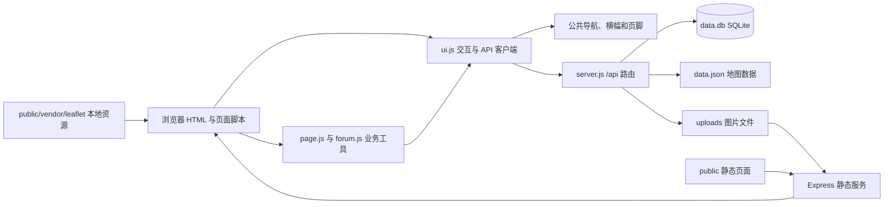

# szzx-info 项目地图

> 更新日期：2026-10-02。本文描述 #4 UI 改版、#5 菜品目录与菜单同步，以及 #6 三元坊必吃榜的代码。
>
> 本文依据实际文件、后端代码、全部前端页面、地图 JSON、SQLite 表结构及依赖清单整理。设计规范见 [UI.md](./UI.md)，验收记录见 [docs/ui/acceptance.md](./docs/ui/acceptance.md)，原始里程碑快照见 [PLAN_2026-10-01.md](./PLAN_2026-10-01.md)。

## 1. 项目概览

校园信息网是一个采用「宣纸·黛青·朱印」风格的动态网站，现有校园地图、论坛、菜谱评价、每周食谱图片、公告、账号与权限、学生认证、个人设置和管理后台。用户可在个人中心提交工单，管理员可审核认证、处理封禁申诉及批复工单。

| 层次 | 实际实现 | 入口 |
| --- | --- | --- |
| 服务端 | CommonJS、Node.js、Express 5；原有业务及网站内菜单 worker 模块 | [server.js](./server.js)、[lib/menu/](./lib/menu/) |
| 数据库 | Node 内置 `node:sqlite` 的同步 `DatabaseSync`；13 张原有表及 8 张菜单表 | [data.db](./data.db)、[lib/menu/store.js](./lib/menu/store.js) |
| 前端 | 16 个功能页面及 404，统一外部 CSS 与页面脚本；原生 JavaScript，无构建流程 | [public/](./public/) |
| 共享前端逻辑 | 导航壳、登录态、用户展示、横幅、表单、对话框、上传、图片查看器及页面工具 | [public/js/ui.js](./public/js/ui.js)、[public/js/page.js](./public/js/page.js) |
| 地图 | 本地 Leaflet 1.9.4；自定义平面坐标数据，保留原有几何与楼层关系 | [public/vendor/leaflet/](./public/vendor/leaflet/)、[data.json](./data.json) |
| 文件存储 | 本地图片文件，通过 `/uploads` 静态提供 | [uploads/](./uploads/) |
| 依赖与运行 | npm 安装；`npm start` 直接执行 `node server.js` | [package.json](./package.json)、[package-lock.json](./package-lock.json) |
| 验证 | Playwright 浏览器回归、axe 无障碍与布局检查；临时数据库和上传目录 | [tests/ui-smoke.mjs](./tests/ui-smoke.mjs) |
| 项目说明 | 使用说明、项目地图、开发记录、里程碑快照、UI 手册和许可证 | [README.md](./README.md)、[progress.md](./progress.md)、[UI.md](./UI.md)、[LICENSE](./LICENSE) |

## 2. 完整文件结构

以下为改版后的源码、文档和持久数据目录。`node_modules/`、本机 `.env` 和浏览器测试产物不提交。

```text
szzx-info/
├── .gitignore                    依赖、密钥、数据库临时文件和测试产物忽略规则
├── .env.example                  端口与 JWT 配置模板
├── LICENSE                       GNU AGPL v3 许可证正文
├── README.md                     项目功能、安装及部署说明
├── progress.md                   既有开发记录、接口和数据说明
├── package.json                  应用元数据、依赖、start/test 脚本
├── package-lock.json             npm lockfileVersion 3 依赖锁定文件
├── server.js                     原有后端逻辑、菜单模块与调度启动
├── lib/menu/
│   ├── schema.js                 名称归一、拼音与八字段校验
│   ├── store.js                  菜单建表、种子导入、原子发布与目录
│   ├── config.js                 密钥加密、设置与模型测试指纹
│   ├── schedule.js               北京时间每日调度纯函数
│   ├── source.js                 官网 HTML/robots、内联图片与分页
│   ├── provider.js               视觉 Chat Completions、严格 JSON 与缓存
│   ├── images.js                 sharp 处理、重叠分块与覆盖复核
│   ├── worker.js                 同步获取/识别任务
│   ├── service.js                队列、租约、取消、重试与调度
│   ├── manual.js                 JSON 预览、候选编辑、人工发布与审计
│   └── routes.js                 目录、developer 配置及三种管理角色的导入 API
├── data/menu-bootstrap.json      十篇历史菜单种子
├── tools/build-menu-seed.py      开发时离线整理种子，标准库
├── tools/build-menu-skill.py     同步规则并打包技能，标准库
├── tools/summarize-menu-live.cjs 汇总真实模型实验的保存结果
├── menu-json-rules.md            八字段 JSON、完整读图与人工导入规则
├── szzx-menu.skill               可直接导入 AI 客户端的技能 ZIP 包
├── skills/szzx-menu/             SKILL.md、references/menu-json-rules.md、scripts/validate_menu.py
├── .private/                     运行时主密钥、原图、补图、诊断及缓存（忽略）
├── data.db                       随仓库提交的 SQLite 数据库（启动迁移 shops 表）
├── data.json                     校园地图几何、楼层、文字和配色
├── data/shops-config.json        高德地图中心、苏州中学参考点、姑苏区边界多边形（GCJ-02）
├── lib/shops/store.js            shops 表、路线字段校验、列表/详情与地理围栏
├── lib/shops/routes.js           店铺公开读取与带权限的创建 API
├── MAP.md                        项目结构与实现地图（本文）
├── PLAN_2026-10-01.md             国庆里程碑与全部 issue 的原始快照
├── UI.md                         全站 UI 设计总纲
├── docs/ui/
│   ├── assets/                   参考 CSS、JS、图标与可交互样张
│   ├── pages/                    现有及后续新功能的逐页设计规范
│   ├── components.md             组件骨架、状态与无障碍要求
│   ├── scenarios.md              边界场景与交互约定
│   ├── copy.md                   统一文案和错误提示
│   ├── implementation.md         实施步骤与可复现验证方法
│   └── acceptance.md             #4 实施范围及验收记录
├── tests/
│   ├── shops.test.cjs            店铺 API、字段校验、覆盖区域、角色/显式权限测试
│   ├── shops-ui.mjs              店铺列表/详情/创建与权限浏览器回归
│   ├── menu.test.cjs             菜单数据/调度/提供商/队列/权限测试
│   ├── menu-live.cjs             可选真实模型与三张菜单检查
│   ├── node-deploy.cjs           全新 Node 生产依赖安装检查
│   ├── menu-skill.py             便携技能、离线验证器及包内文件检查
│   ├── fixtures/menu-manual-review.json 三张原图的局部目视抽样
│   └── ui-smoke.mjs              页面、权限、表单及无障碍回归
├── public/
│   ├── index.html                首页与关于我们；根路径默认页面跳转
│   ├── about.html                旧地址兼容入口，跳转 index.html#about
│   ├── map.html                  校园地图、楼层切换、弹窗编辑
│   ├── forum.html                讨论/提问列表、发帖、回复、点赞、删帖
│   ├── post.html                 单帖详情，通过 ?id=<帖子 ID> 访问
│   ├── recipe.html               A–Z 菜品目录、评价与每周食谱三个页签
│   ├── shops.html                三元坊必吃榜、高德地图与分类筛选
│   ├── shop.html                 店铺步行路线和坐标详情
│   ├── shop-new.html             权限校验后的店铺创建表单
│   ├── announcements.html        更新公告列表与正文
│   ├── login.html                登录与被封账号的解封申诉
│   ├── register.html             注册并自动登录
│   ├── student_verify.html       邀请码认证或提交学生审核申请
│   ├── profile.html              资料、密码、网站设置、工单
│   ├── admin.html                权限控制的后台菜单与管理操作
│   ├── 404.html                  未知页面提示，使用绝对资源路径
│   ├── css/site.css              设计令牌、组件与响应式样式
│   ├── img/                      icons.svg 与 favicon.svg
│   ├── js/
│   │   ├── ui.js                 全站交互、导航壳与统一 API 客户端
│   │   ├── page.js               页面表单、请求、权限、面板和工单工具
│   │   ├── forum.js              论坛及详情共用的点赞、回复与删除逻辑
│   │   ├── shops-map.js          高德地图加载、标记、路线查询与外链
│   │   └── pages/                各页业务脚本、菜单同步/导入及店铺列表/创建/详情
│   ├── vendor/leaflet/           Leaflet JS、CSS、图片与上游 LICENSE
│   └── auth.js                   加载 ui.js 的旧调用兼容入口
└── uploads/
    └── weekly/
        ├── 1790494439396-979963766.png
        ├── 1790495069096-158832090.png
        ├── 1790495081861-230074113.png
        ├── 1790495090622-616644569.png
        ├── 1790495393944-169103336.png
        └── 1790495644744-976725163.png
```

`npm ci` 创建依赖，运行时创建 uploads 及非公开 `.private/`。生产只运行 Node，Python 脚本仅在开发时重建种子，无第二个服务。部署与配套密钥备份见 [docs/menu-sync.md](./docs/menu-sync.md)，确认范围见 [docs/issue-5-plan.md](./docs/issue-5-plan.md)。

## 3. 请求与数据流



`server.js` 启动顺序是加载环境变量、打开数据库、创建表与索引及迁移旧结构、创建上传目录、定义鉴权函数、挂载 CORS/JSON/静态服务、注册 API、404 兜底和错误处理，最后监听端口。

- `public/` 挂载在站点根路径，`/` 默认提供 `index.html`。
- `/uploads` 映射到项目内的 `uploads/`，图片 URL 保存到数据库或由文件名生成。
- 普通 JSON 请求体上限为 `8mb`；上传请求使用 multer 的 multipart 处理。
- 页面通过共享 `UI.api` 封装同源 `fetch('/api/...')`，统一 token、失败提示和登录回跳；后端仍使用原有业务接口。
- 未知 `/api` 路径返回 JSON 404；未知 GET 页面路径（无扩展名且不属于上传目录）返回 `404.html`。
- 登录返回 JWT；浏览器以 `localStorage.token` 保存，并以 `Authorization: Bearer <token>` 请求登录接口。`localStorage.user` 保存用户缓存。
- 网站默认页面、地图楼层、菜谱默认视图保存在用户表，同时用 `defaultPage`、`defaultFloor`、`recipeDefaultView` 本地键作回退；横幅关闭使用 `bannerDismissed:<用户名>` 与横幅版本。手机导航使用受控抽屉；旧 `navCollapsed` 设置不再使用。

## 4. 前端页面地图

| 页面 | 功能与交互 | 主要数据来源 |
| --- | --- | --- |
| `index.html` | 首页介绍、地图/论坛/菜谱/公告入口、关于我们与工单反馈；仅在根路径 `/` 且无锚点时按用户默认页面跳转 | `/api/user/profile`、本地默认页设置 |
| `about.html` | 跳转 `/index.html#about`，并保留可读的兼容链接 | 无 |
| `map.html` | `CRS.Simple` 地图；1F–4F；缩放、拖动、WASD/方向键；按权限编辑建筑文字弹窗 | `/api/map-data`、`/api/me`、`/api/user/profile`、`PUT /api/admin/map-popup` |
| `forum.html` | 讨论/提问切换；发帖对话框；每批 20 条；卡片跳转详情；回复展开、发布；点赞及失败回滚；更多菜单删帖 | `/api/forum/posts` 及其回复、点赞、删除路由 |
| `post.html` | 按查询参数 `id` 加载正文与点赞状态；默认展开回复 | `/api/forum/posts/:id` 及其回复、点赞路由 |
| `recipe.html` | A–Z 菜品目录与搜索；评价卡与发布对话框；每周食谱折叠、放大及授权删除 | `/api/dishes`、`/api/recipes`、`/api/weekly-menu`、`/api/user/profile` |
| `shops.html` | 三元坊必吃榜；可拖动/缩放的高德地图，附近店铺按屏幕距离聚合为带数量的点，点击聚合点居中放大；分类、拼音 A–Z、道路/商场、距离/时间、点赞/评价/评分筛选与排序；列表分页（每页 20 条，`?page=` 保留） | `/api/shops`、`/api/shops/meta`、`/api/shops/map-image` |
| `shop.html` | 地址、路线、本部/地铁出口距离、点赞/评价/评分汇总；学生及以上可点赞、提交/更新及删除本人 1–5 星评价，评价可选带一张实拍图（JPG/PNG，≤2 MB）、选填人数与总价并自动计算人均价；详情页「纵向 / 双栏」两种布局（个人中心设默认） | `/api/shops/:id`、`/api/shops/:id/reviews`、互动写接口 |
| `shop-new.html` | 最低角色提示；店铺、地址、自定义类型、可选大众点评链接、GCJ-02 坐标和本部/地铁两组步行路线表单；高德步行路线测算 | `/api/shops/meta`、`POST /api/shops`、高德 AMap.Walking |
| `announcements.html` | 桌面主从列表；手机先看列表，选择后显示正文并可返回 | `/api/announcements` |
| `login.html` | 用户名/密码登录；封禁错误展示；允许申诉时提交理由及可选图片 | `/api/login`、`/api/user/appeal` |
| `register.html` | 用户名/昵称/密码及重复密码校验；注册后调用登录 | `/api/register`、`/api/login` |
| `student_verify.html` | 已达到学生角色时隐藏表单；否则填写新生号、班级、真实姓名，可填邀请码及补充信息 | `/api/user/profile`、`/api/student/apply` |
| `profile.html` | 展示 ID/角色/额外权限；修改头像、昵称、签名、密码；保存网站设置（默认进入界面 / 校园地图默认楼层 / 菜品与食谱默认页 / 必吃榜默认排序与餐食类型 / 店铺详情页样式）；提交与查看本人工单；消息通知偏好（系统/评论/回复/点赞） | `/api/user/*`、`/api/tickets`、`/api/tickets/mine`、`/api/user/preferences` |
| `inbox.html` | 消息箱：按天分组、四类标签过滤、只看未读、全部标为已读、点击标记已读并跳转；页头消息铃显示未读数 | `/api/messages`、`/api/messages/unread-count`、`/api/messages/:id/read`、`/api/messages/read-all` |
| `admin.html` | 横幅、公告、发送系统通知、学生审核、邀请码、每周菜谱、用户管理、申诉、工单、developer 菜单同步和三种管理角色的 JSON 手动导入；待办红点 | `/api/admin/*`，菜单接口见 [运维文档](./docs/menu-sync.md) |
| `404.html` | 404 提示、返回首页与返回上一页 | 无 |
| `js/ui.js` | 公共导航/页脚、账户菜单、手机抽屉、横幅、用户信息与全站交互组件 | `/api/user/profile`、`/api/settings/banner` |

页面布局由 `public/css/site.css` 统一维护，业务脚本位于 `public/js/pages/`。`ui.js` 集中处理角色权重、用户展示、日期、转义和交互；`page.js` 与 `forum.js` 复用页面业务逻辑。动态文本使用 `UI.esc` 或 DOM `textContent` 输出。

## 5. 后端 API 全量索引

以下显式路由位于 [server.js](./server.js)。菜单新增的方法/路径组合位于 [lib/menu/routes.js](./lib/menu/routes.js)，索引见 [菜单同步接口](./docs/menu-sync.md#接口)。表中“公开”表示没有强制登录；帖子读取可带 token 获取点赞状态。

### 5.1 账号、个人资料与设置

| 方法 | 路径 | 访问条件 | 作用 |
| --- | --- | --- | --- |
| POST | `/api/register` | 公开 | 创建用户；首个用户为 developer，其余为 user；生成 display_id |
| POST | `/api/login` | 公开 | 验证密码、封禁状态，签发 JWT |
| GET | `/api/me` | 公开，可携带 token | 返回解析后的用户及显式权限 |
| GET | `/api/user/profile` | 登录 | 当前用户资料、设置、状态、权限 |
| PUT | `/api/user/settings` | 登录 | 部分更新：默认页、1–4 楼层、菜谱视图（all/reviews/weekly）、必吃榜默认排序/餐食类型、店铺详情页样式（stacked/split） |
| POST | `/api/user/avatar` | 登录 | 上传头像，更新 avatar_url |
| PUT | `/api/user/nickname` | 登录 | 修改昵称 |
| PUT | `/api/user/signature` | 登录 | 修改签名 |
| PUT | `/api/user/password` | 登录 | 校验旧密码并修改密码 |

### 5.2 论坛、菜谱、公告与地图

| 方法 | 路径 | 访问条件 | 作用 |
| --- | --- | --- | --- |
| GET | `/api/forum/posts` | 公开，可携带 token | 按分类读取帖子，附回复数、点赞数及本人点赞状态 |
| GET | `/api/forum/posts/:id` | 公开，可携带 token | 单帖详情及点赞状态 |
| POST | `/api/forum/posts` | 登录 | 发布讨论或提问 |
| DELETE | `/api/forum/posts/:id` | 登录，作者或 admin 及以上 | 删除帖子，手动清理其回复和点赞 |
| POST | `/api/forum/posts/:id/like` | 登录 | 点赞帖子 |
| DELETE | `/api/forum/posts/:id/like` | 登录 | 取消点赞 |
| GET | `/api/forum/posts/:id/replies` | 公开 | 按时间读取该帖回复 |
| POST | `/api/forum/posts/:id/replies` | 登录 | 发布回复 |
| GET | `/api/recipes` | 公开 | 按 `name COLLATE NOCASE, id` 排序读取评价记录 |
| GET | `/api/recipes/weekly` | 公开 | 读取 `is_weekly=1` 的评价记录；当前每周食谱页面使用另一接口 |
| POST | `/api/recipes` | 登录 | 上传可选图片并写入菜谱评价；评分范围 0–5 |
| GET | `/api/announcements` | 公开 | 按发布日期倒序读取公告 |
| GET | `/api/weekly-menu` | 公开 | 每周食谱日期、图片 URL 和上传者 |
| GET | `/api/settings/banner` | 公开 | 当前横幅及版本 |
| GET | `/api/map-data` | 公开 | 每次从磁盘读取 data.json |
| GET | `/api/shops` | 公开 | 店铺列表；支持 `type`、`q`、本部距离/时间及点赞/评价/评分范围过滤，`sort=campus/metro/likes/reviews/rating/new` 排序；拼音 A–Z 在前端排序 |
| GET | `/api/shops/meta` | 公开 | 浏览器端 JS Key（仅另配时返回）、静态地图是否可用、坐标/范围配置、分类和当前用户创建权限；不返回 Web 服务 Key |
| GET | `/api/shops/map-image?lat=..&lng=..&zoom=..` | 公开、同源代理 | 服务器端用 `AMAP_SERVICE_KEY` 按当前视图获取并缓存底图；中心限制在姑苏区边界外扩范围内，缩放级别限制为 9–18，不向浏览器暴露 Key |
| GET | `/api/shops/:id` | 公开 | 店铺详情，含路线、互动计数、平均评分与评分数 |
| GET | `/api/shops/:id/reviews` | 公开 | 评价列表和总数，含人数/总价/人均与配图地址；只回传当前用户自己的评价内容供编辑 |
| POST | `/api/shops/:id/like` | 登录 + 学生及以上 | 切换点赞状态；后端重新核验当前角色/状态 |
| POST | `/api/shops/:id/reviews` | 登录 + 学生及以上 | 创建或更新本人的评价；评分必填 1–5，文字最多 500 字；multipart 可选 `image`（JPG/PNG，≤2 MB），可选 `guests`（1–99）与 `total_price`（0–100000 元）字段，`per_person` 由服务端计算；`remove_image=1` 清除配图 |
| DELETE | `/api/shops/:id/reviews/me` | 登录 + 学生及以上 | 删除本人的评价并重算统计 |
| POST | `/api/shops` | 登录 + `shop_create`；默认 student 及以上 | 后端验证地址、分类、GCJ-02 坐标、路线字段与已配置覆盖多边形；同名返回 409 |
| PUT | `/api/admin/map-popup` | map_popup_edit | 按 feature.name 更新所有同名对象的 popup，回写 data.json |

### 5.3 学生认证、后台内容与用户管理

| 方法 | 路径 | 访问条件 | 作用 |
| --- | --- | --- | --- |
| GET | `/api/admin/ping` | super_admin 及以上 | 后台连通性检查 |
| POST | `/api/admin/announcements` | announcement_publish | 发布公告 |
| DELETE | `/api/admin/announcements/:id` | announcement_publish | 删除公告；不存在返回 404 |
| PUT | `/api/admin/settings/banner` | banner_edit | 修改/清空横幅并增加版本 |
| POST | `/api/student/apply` | 登录 | 有效邀请码直接认证，否则提交审核申请 |
| GET | `/api/admin/settings/invite-code` | invite_manage | 读取兼容的单邀请码设置 |
| PUT | `/api/admin/settings/invite-code` | invite_manage | 写入兼容的单邀请码设置 |
| GET | `/api/admin/invite-codes` | invite_manage | 多邀请码列表 |
| POST | `/api/admin/invite-codes` | invite_manage | 添加邀请码和使用上限，0 表示不限 |
| DELETE | `/api/admin/invite-codes/:id` | invite_manage | 删除邀请码 |
| GET | `/api/admin/student-applications` | student_review | 待审核认证申请 |
| PUT | `/api/admin/student-applications/approve` | student_review | 通过申请并提升未达学生级别用户的角色 |
| PUT | `/api/admin/student-applications/reject` | student_review | 拒绝申请并记录可选原因 |
| GET | `/api/admin/users` | user_manage | 用户 ID、显示 ID、账号、角色、状态与额外权限 |
| GET | `/api/admin/permissions` | user_manage | 权限目录 |
| PUT | `/api/admin/users/role` | user_manage，另有目标角色限制 | 修改角色 |
| PUT | `/api/admin/users/ban` | user_manage，另有目标角色限制 | 封禁并保存理由、可选图片及是否允许申诉 |
| PUT | `/api/admin/users/unban` | user_manage，另有目标角色限制 | 解封并清空封禁信息 |
| PUT | `/api/admin/users/permissions` | user_manage，另有目标角色限制 | 替换显式权限列表 |
| POST | `/api/admin/weekly-menu/upload` | weekly_menu_upload | 上传日期范围内的每周食谱图片 |
| DELETE | `/api/admin/weekly-menu/:id` | 登录，上传者或 super_admin 及以上 | 删除食谱记录及图片文件 |

### 5.4 申诉、工单与消息

| 方法 | 路径 | 访问条件 | 作用 |
| --- | --- | --- | --- |
| POST | `/api/user/appeal` | 公开；目标账号须已封禁 | 按用户名提交解封理由与可选 DataURL 图片 |
| GET | `/api/admin/ban-appeals` | ban_appeal_review | 待处理申诉 |
| PUT | `/api/admin/ban-appeals/review` | ban_appeal_review | 通过并解封，或驳回 |
| POST | `/api/tickets` | 登录 | 提交标题、正文及可见角色范围 |
| GET | `/api/tickets/mine` | 登录 | 本人工单与批复 |
| GET | `/api/admin/tickets` | ticket_manage，按角色再过滤 | 当前管理者可见的工单 |
| PUT | `/api/admin/tickets/reply` | ticket_manage，按工单可见级别再校验 | 批复正文及可选 DataURL 图片 |
| GET | `/api/admin/pending-counts` | 登录，按权限和工单范围统计 | 学生认证、申诉、工单待办数量 |
| GET | `/api/messages` | 登录 | 消息列表；支持 type(system/interact/like)、unread、before 游标与 page_size |
| GET | `/api/messages/unread-count` | 登录 | 未读总数（页头消息铃轮询） |
| PUT | `/api/messages/:id/read` | 登录，限本人 | 单条标记已读 |
| PUT | `/api/messages/read-all` | 登录 | 全部标记已读 |
| GET | `/api/user/preferences` | 登录 | 评论/回复/点赞通知开关 |
| PUT | `/api/user/preferences` | 登录 | 保存通知开关（系统消息始终接收） |
| POST | `/api/admin/notifications` | announcement_publish | 向全体用户发送系统通知（标题/正文/重要性） |

## 6. 角色与权限模型

角色权重为 `developer(6) > super_admin(5) > admin(4) > student(3) > user(2) > guest(1)`。

- `checkRole(requiredRole)` 解析 JWT，缺失或无效 token 按 guest 处理；需要角色时比较权重。JWT 带有 id、role、username。
- `requireLogin` 在解析后要求有效用户 ID，否则返回 401。
- `requirePermission` 调用 `hasPermission`：角色达到该权限默认等级，或 `user_permissions` 存在显式授权，即可通过。
- 后台入口允许 admin 及以上或拥有任意显式权限的用户；后台菜单进一步按具体权限过滤。
- 修改用户角色、封禁/解封和替换权限时，禁止操作自己或同级/更高级目标；新角色最高只能低于操作者一级。
- 工单可见范围为 `admin`、`super_admin`、`developer`，后台在 ticket_manage 之外另按角色权重过滤。

| 权限 | 默认最低角色 | 功能 |
| --- | --- | --- |
| banner_edit | super_admin | 横幅编辑 |
| announcement_publish | super_admin | 发布公告 |
| student_review | super_admin | 学生认证审核 |
| invite_manage | super_admin | 邀请码管理 |
| user_manage | super_admin | 用户及显式权限管理 |
| ban_appeal_review | super_admin | 封禁申诉审核 |
| weekly_menu_upload | admin | 每周食谱上传 |
| map_popup_edit | admin | 地图弹窗编辑 |
| ticket_manage | admin | 工单管理 |
| shop_create | student（由 `SHOP_CREATE_MIN_ROLE` 可配置） | 添加店铺；也可在用户显式权限中单独授权 |

## 7. 数据模型与文件存储

### 7.1 SQLite

原有 14 张业务表保留；启动迁移另创建 `shops`、`shop_likes`、`shop_reviews` 三张店铺表和 8 张菜单表。店铺 schema 在 `lib/shops/store.js`，菜单迁移与种子导入位于 `lib/menu/store.js`。另有内部表 sqlite_sequence；测试使用临时数据库。

| 表 | 主要字段/约束 | 关联与用途 |
| --- | --- | --- |
| users | id、display_id、username、nickname、password_hash、avatar_url、signature、role、三项默认设置、status、封禁字段、三条通知偏好（pref_comment/pref_reply/pref_like）；username/email 唯一 | 账号与偏好；email 为兼容字段，现有注册不使用邮箱 |
| user_permissions | user_id、permission；二者联合唯一 | 用户显式授权 |
| forum_posts | user_id、username、category、title、content、created_at；category 只允许讨论/提问 | 论坛帖子 |
| forum_replies | post_id、user_id、username、content、created_at | 平铺帖子回复；没有父评论 ID |
| post_likes | post_id、user_id、created_at；二者联合唯一 | 帖子点赞；目前没有评论点赞表 |
| recipes | user_id、username、name、rating、comment、image_url、is_weekly | 一条记录是一条用户评价，没有独立菜品 ID 或店铺 ID |
| weekly_menu_images | user_id、menu_start_date、menu_end_date、filename、uploaded_at | 每周食谱整张图片，与 recipes 分开 |
| announcements | title、content、publish_date | 公开公告 |
| settings | key 主键、value | 横幅、邀请码兼容设置及加密 menu_ai_config |
| student_applications | user_id、student_id、class_name、real_name、extra_info、reject_reason、status | 认证审核；pending/approved/rejected |
| invite_codes | code 唯一、max_uses、used_count | 多邀请码及次数限制 |
| ban_appeals | user_id、appeal_reason、appeal_image、status | 解封审核；pending/approved/rejected |
| tickets | user_id、username、title、content、visibility、status、reply_content、reply_image、reply_by、replied_at | 工单；pending/resolved |
| messages | user_id、type、actors(JSON)、count、target_kind/target_id、title/body/snippet、important、read_at | 消息箱；system/comment/reply/like，点赞按目标聚合 |
| shops | name 唯一、address、location_note、可选 `dianping_url`、type、GCJ-02 lat/lng、本部/最近地铁出口 distance_m 与 walk_min、metro_station/metro_exit、created_by/created_at | 三元坊必吃榜；列表可按本部、地铁及互动统计排序筛选 |
| shop_likes | shop_id、user_id 唯一、created_at | 每名学生及以上用户每店一个点赞；重复点击取消 |
| shop_reviews | shop_id、user_id 唯一、rating 1–5、content、guests、total_price、image_url、created_at/updated_at | 每名学生及以上用户每店一条评价，可更新；可选带一张图（存 `uploads/shops/`）与人数/总价，人均价按总价/人数自动计算；汇总评价数、评分数和平均星级 |
| dishes | id、name、唯一 name_key、initial、pinyin、pinyin_initials、sort_key | 独立稳定 ID 菜品 |
| menu_sources | 来源 ID、可空 article_id、kind、publication_origin、revision、title/url、日期/摘要/计数/错误 | 官网队列与独立手动批次 |
| menu_records | source_id/record_key 联合主键、dish_id、日期/餐次/地点/档口/价格/辣椒 | 供应记录，明确外键 |
| menu_sync_jobs | UUID、唯一 auto_day、状态/阶段、配置版本、计数、取消标记 | 持久同步任务 |
| menu_job_items | job_id/source_id 联合主键、状态、阶段、错误及资料路径 | 逐篇结果 |
| menu_sync_lease | 单例 ID、owner、expires_at | 防并发同步与发布 fencing |
| menu_sync_state | key/value | 发现锚点 |
| menu_import_audit | source_id、actor_id、job_id、revision、records_json | 人工发布历史，与菜单发布同一事务 |

原有 user_id/post_id 关系由应用维护；新增菜单记录和任务条目声明外键。菜单供应按篇事务替换，不修改原有评价表。原有删帖、认证和申诉限频规则保持。

实际已提交数据库保留旧迁移结构，例如 users.display_id 通过后续 `ALTER TABLE` 添加，没有新建库 SQL 中的 UNIQUE 约束；不能假设旧库与新库的所有约束完全一致。

### 7.2 地图 JSON

`data.json` 是自定义格式，顶层包含 `meta`、`style`、`features`，并非标准 GeoJSON。

| 部分 | 字段与当前内容 |
| --- | --- |
| meta | rectW=1200、rectH=700、axisY=420、minZoom=-2、maxZoom=6、baseZoom=1 |
| style | outline、labelColor、fillOpacity、palette；建筑/绿地/水体/白色/无填充分类 |
| features | 227 个对象：153 条 polyline、48 个 polygon、26 个 label |
| layers | base=始终显示；数字 1–4=所在楼层；同一对象可以出现在多层 |
店铺地图使用服务器端高德静态图代理与前端自绘交互层，无需浏览器 JS Key；`data/shops-config.json` 坐标为 GCJ-02：`center` 为初始地图中心，`anchors.campus` 为苏中本部步行路线起点，`area.polygon` 为 `[纬度,经度]` 多边形。Web 服务 Key 放在被 `.gitignore` 排除的 `.env`（`AMAP_SERVICE_KEY`），仅服务器端使用且不下发。前端支持拖动、滚轮/双指缩放、缩放按钮及回到全域；店铺按当前视图的屏幕距离聚合，圆点显示数量，点击后以聚合中心放大。底图接口只允许姑苏区边界外扩范围内的中心点、缩放 9–18，并缓存近期视图。源码、测试和文档不含实际 Key。地图初始中心/缩放与本部路线起点分别来自配置的中心点和高德 POI「江苏省苏州中学本部」（120.622380, 31.295509）。地理围栏只有在多边形至少 3 个有效点时才生效；范围配置为空时后端无法判定区域。店铺初始化不使用虚构坐标或路线。

| 几何字段 | points 为 `[x,y]` 点数组；fill/stroke/dash/weight 控制路径 |
| 文字字段 | text、x1/y1/x2/y2、scale 控制区域文字；name/popup 控制名称与弹窗 |

当前楼层集合为：20 个 base 对象、118 个仅 1F 对象、42 个仅 2F 对象、2 个同时位于 1F/2F 的对象、45 个同时位于 2F/3F/4F 的对象。`public/js/pages/map.js` 将 `[x,y]` 转为 Leaflet 的 `[y,x]`，按 polygon → polyline → label 顺序绘制。方向约定是左为北、上为东、右为南、下为西。#4 仅调整配色和最小缩放级别，227 个 feature 的几何、文字和楼层数据与改版前一致。

地图读取每次访问磁盘，修改数据刷新即可；地图弹窗编辑按名称批量更新，同名几何会一起变化。

### 7.3 图片

| 场景 | 存储位置 | 后端限制 |
| --- | --- | --- |
| 头像、菜谱评价图片 | uploads/ | multer；JPEG/PNG，最多 2 MiB |
| 封禁图片 | uploads/bans/ | multer；JPEG/PNG，最多 2 MiB |
| 每周食谱图片 | uploads/weekly/ | multer；JPEG/PNG，最多 5 MiB |
| 申诉图片、工单批复图片 | 数据库文本字段 | 由页面读成 DataURL 后通过 JSON 提交，不使用上述 multipart 存储器 |

## 8. 运行、依赖与验证入口

[package.json](./package.json) 的直接依赖及当前 lockfile 版本为：express 5.2.1、cors 2.8.6、bcrypt 6.0.0、jsonwebtoken 9.0.3、multer 2.4.0、dotenv 18.0.3。项目未声明 `engines`；README 推荐 Node.js 24+，后端要求运行时提供 `node:sqlite`。

在根目录安装和启动：

```powershell
npm.cmd ci
npm.cmd start
```

复制 `.env.example` 为本机 `.env` 并修改密钥：

```dotenv
PORT=3000
JWT_SECRET=replace_with_a_long_random_secret
JWT_EXPIRES_IN=7d
```

代码默认端口为 3000，JWT 有效期为 7d；JWT_SECRET 有开发用回退值，部署时应显式配置。访问 `/`、`/map.html` 或 `/api/map-data` 可分别检查页面和地图数据入口。

- 修改 server.js 需要重启服务；修改 public/ 静态文件刷新页面；修改 data.json 后下次 API 读取即生效。
- data.db、data.json 的在线编辑结果、uploads/ 都是本地持久数据；部署需要可写、持久化的存储和 Node 服务。
- 开发依赖为 Playwright 与 axe-core。运行 `npm.cmd test` 可执行浏览器回归；Windows 使用 Microsoft Edge，其他平台先运行 `npx playwright install chromium`。
- 回归测试在系统临时目录启动独立后端并创建测试数据库与上传文件；项目内的 `data.db`、`uploads/` 和 `data.json` 不被测试改写。
- 最近一次验证：13 项菜单后端测试、295 项浏览器检查及全新 Node 生产安装通过；360px/1280px、light/dark 扫描无违规。真实模型的失败与限制见 [菜单验证记录](./docs/menu-validation.md)，产物位于忽略的 output/。

## 9. 文档与实现约定

| 文档 | 用途及实际实现 |
| --- | --- |
| README、MAP、progress | 当前使用方式、结构、业务能力与开发记录；历史变更按当时实现保留 |
| UI.md、docs/ui/ | #4 设计手册、组件、逐页规范、场景、文案、样张与验收记录；P1 页面为后续 issue 的预设计 |
| docs/ui/assets 与 public | 前者是设计参考，后者是实际运行代码；运行代码包含资源路径、未保存表单保护和地图布局适配 |
| PLAN_2026-10-01.md | 保留需求读取时的原始正文和状态；执行进度见 progress 与验收记录，实时关闭状态以 GitHub 为准 |
| package.json、package-lock.json、LICENSE | 根包许可为 AGPL-3.0；本地 Leaflet 另附上游许可证 |
| #5 菜品与评价 | 独立目录和网站内同步已实现；原评价独立保留，店铺关联后续实施 |

## 10. 国庆计划的代码定位

| Issue | 当前相关位置 | 实施状态或后续能力 |
| --- | --- | --- |
| [#4 修改UI](https://github.com/szzxvc/szzx-info/issues/4) | public HTML、css/site.css、js/、本地 Leaflet、UI.md 与 docs/ui/ | 已完成全站改版及浏览器验收，保留现有业务接口 |
| [#5 全部菜品](https://github.com/szzxvc/szzx-info/issues/5) | recipe.html、lib/menu、data 种子、离线工具、开发者后台 | 独立目录、统一拼音搜索、网站内识别、每日自定时间与运维文档 |
| [#6 三元坊必吃榜](https://github.com/szzxvc/szzx-info/issues/6) | `shops.html`、`shop.html`、`shop-new.html`、`lib/shops/`、`data/shops-config.json`、高德 AMap JS API | 已实现：公开列表/分类筛选/搜索、拼音 A–Z、互动统计/排序/筛选、单一学校本部步行距离与地铁出口路线、自定义类型、认证学生互动和后端权限复验。围栏为高德姑苏区 adcode 320508 的完整 323 点 GCJ-02 边界；全区检索 5,942 条 POI，校验后导入 5,567 家，62 条同名记录跳过；未导入候选与高德检索范围限制见 README。静态地图使用服务器代理，Web 服务 Key 不下发浏览器。 |
| [#7 三元坊必吃榜 UI适配](https://github.com/szzxvc/szzx-info/issues/7) | profile.html、用户默认设置的保存模式 | 店铺详情页的两种布局、粘性导航与持久布局设置 |
| [#8 三元坊必吃榜菜谱上传](https://github.com/szzxvc/szzx-info/issues/8) | student 角色、multer 存储器、现有评价模型 | 菜品与店铺关联、学生上传权限、图片、去重及异常数据处理 |
| [#9 消息箱](https://github.com/szzxvc/szzx-info/issues/9) | inbox.html、messages 表、论坛回复/点赞通知、profile.html 通知偏好、admin.html 发送系统通知、ui.js 消息铃 | 已实现：系统/评论/回复/点赞消息、聚合点赞、已读与未读计数、按天分组、类型过滤、通知偏好、super_admin 发送系统通知 |
| [#10 头衔系统](https://github.com/szzxvc/szzx-info/issues/10) | 用户资料、后台用户管理、各用户内容渲染处 | 头衔目录/拥有关系/佩戴状态、授予撤销、自动规则、统一用户展示 |

菜品目录、消息箱与必吃榜开关已开启。#6 姑苏区全域边界取自高德行政区 adcode 320508（GCJ-02、323 点），范围文案/地图/服务端地理围栏共用该多边形。全区分块检索得到 5,942 条高德餐饮 POI，地址及步行路线补全后 5,629 条通过初筛；正式导入 5,567 条，62 条同名项跳过。其余候选因地址格式、明确停业标记、名称长度或缺少最近地铁步行路线未导入（原因可能重叠）；数据代表高德可检索 POI，不保证涵盖所有实际店铺。数据库店铺均通过区界校验。页面具备可拖动/缩放的同源高德底图与近邻聚合点（显示店数、点击居中放大）、拼音 A–Z、店名/道路/商场搜索及本部距离/时间和互动指标筛选；地图代理不向浏览器泄漏 Web 服务 Key。后端 13 项、浏览器 58 项测试通过。#7/#8 店铺详情布局和店铺菜品关联、#10 头衔仍未实现。
