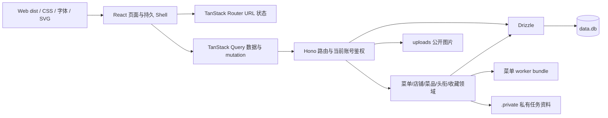

# sytime 项目地图

> 更新日期：2026-10-31（首页文案焕新、公开前数据隔离与安全门禁）。当前运行代码已迁移至 React 19 + TanStack Router/Query + Hono + Drizzle 的 npm workspaces Monorepo，沿用 SQLite、原有 URL、业务合同与视觉资产。当前仓库为 `szzxai/sytime`，分支 `main`。本地运行数据库 `data.db`、上传文件与私有配置保留在工作区，已取消跟踪并从本地可达历史移除，业务与测试数据隔离；远端历史尚未替换，不可直接切换为 public。
>
> [架构说明](./docs/architecture.md) 描述实际模块边界、迁移、开发与部署；[2026-10-24 技术栈研究](./docs/tech-stack-recommendation-2026-10-24.md) 保留为候选比较，其中 Fastify/PostgreSQL 不是当前实现。文末按日期保留历史记录。

## 1. 项目概览

拾光酥糕是一个按 Berkeleytime 的页面布局与视觉风格重制、采用中文内容和绿色主题的动态校园信息网站，现有校园地图、菜品星级评价、官网结构化每周食谱、公告、账号与权限、学生认证、个人中心、设置和管理后台。用户可在设置页提交工单，管理员可审核认证、处理封禁申诉及批复工单。

| 层次 | 实际实现 | 入口 |
| --- | --- | --- |
| Web | React 19、严格 TypeScript、TanStack Router/Query、Vite | `apps/web/src/main.tsx` |
| HTTP | Hono 原生路由，按领域分拆，Node 生产入口 | `apps/api/src/index.ts`、`app.js`、`routes/`、`domain/` |
| 数据 | Drizzle + better-sqlite3，29 张应用表及迁移 journal | `packages/db/src/schema.ts`、`packages/db/migrations/` |
| 共享合同 | DTO、角色权重与标签 | `packages/shared/src/index.ts` |
| 组件 | 持久 Shell、Dialog、表单、收藏、评价、后台、地图 | `apps/web/src/components/` 与 `layouts/` |
| 地图 | 保留 Leaflet、31 个校园地点、SVG 与高德坐标规则 | `apps/web/src/maps/`、`apps/web/public/img/map/` |
| 存储 | data.db、uploads、.private、data 与旧地图归档 | 根目录持久存储；私有文件不公开 |
| 构建与验证 | API/worker esbuild、Web Vite；类型/lint/格式/隔离回归 | `tools/`、`tests/`、根 scripts |

## 2. 完整文件结构

```text
apps/
  web/                  React 应用、Vite 入口与构建
    src/pages/          页面组件，保留原有 .html 地址
    src/components/     站点壳、表单、对话框、收藏、地图、评价及后台组件
    src/layouts/        复杂页面的展示结构，属性按具体 HTML 元素类型约束
    src/lib/            API、登录态、主题、URL 状态、导航层级/预加载与表单 Hook
    src/maps/           地图交互与地点数据
    public/             原有 CSS、字体、品牌图片、SVG 与本地 Leaflet
  api/
    src/index.ts        Node 入口、静态资源、404 与优雅退出
    src/app.js          Hono 组装与业务服务初始化
    src/routes/         公告、资料、消息、工单等路由；账号工作流集中于 domain/accounts
    src/domain/         账号与审核、菜单、店铺、菜品、头衔、收藏及历史迁移
packages/
  db/src/               Drizzle 类型化表结构、参数绑定及迁移入口
  db/migrations/        可接入旧库的 SQL 基线及迁移元数据
  shared/src/           共享 DTO、角色等级与标签
server.js               生产入口，加载 apps/api/dist/index.cjs
scripts/shops/          店铺数据整理工具
skills/szzx-menu/        独立菜单读图技能源文件
szzx-menu.skill          本地生成的可导入技能包，忽略、不随源码提交
menu-json-rules.md      八字段 JSON 与完整读图约定
data.db                 本地运行数据库，必须持久化，不跟踪、不公开历史快照
uploads/                本地上传图片，必须持久化，不跟踪
.private/               私有密钥、原图、诊断和缓存，禁止公开
data/                   菜单种子和店铺范围配置
data.json               旧地图兼容数据
tools/                  API/worker/operator CLI 构建、开发进程、技能构建
tests/                  后端、迁移、部署和浏览器回归
docs/                   架构、菜单运维、逐页规范及历史验收
```

生成目录为 `apps/api/dist`（index.cjs、worker.cjs、operator.cjs 与 source map）和 `apps/web/dist`（SPA 入口、按页分块和资源），不提交。根目录旧 `public/` 与 `lib/` 入口已移除；既有算法和静态资产迁入各自工作区的 `apps/web/public/` 与 `apps/api/src/domain/`，运行时不依赖旧入口。

## 3. 请求与数据流



- 启动加载环境、连接数据库、登记 Drizzle 基线并运行历史升级、初始化非菜单领域种子与领域，监听后启动菜单调度。退出先关闭任务与 worker，再关闭 HTTP 和数据库。
- 原 `.html` 页面由同一个 React 入口提供，Router 按页面懒加载；站内页面使用 Router Link 意图预加载，可预加载组件与主要查询就绪后一次同页转场，无全局点击拦截；正文外按顶栏位置、内部详情按父子关系切换，公告与顶栏持续挂载。未知页面保留带站点壳的 404；`/api` 与 `/api/*` 的未知路由均返回 JSON 404。
- 页面路径、筛选、分页、hash 面板由 Router 管理；服务端数据由 Query 按公开/账号缓存。浏览器使用 HttpOnly/SameSite=Strict Cookie，localStorage 只保留会话标记；API 可使用 Bearer。每次受保护请求核对当前账号、状态、会话与版本。
- JSON 上限 8 MiB；multipart 总请求限额 64 MiB，具体文件数量、类型、单文件大小在上传模块和领域路由校验。公开图片仍映射 uploads；待审图片只保存在私有审核载荷，批准后才写 uploads/approved；菜单原图、密钥与诊断不提供 HTTP 下载。
- 默认页、菜谱视图、必吃榜设置、角色显示、收藏偏好及已有 localStorage 键保留。默认公开即时保存、新建收藏读取最新偏好、失败回退、自动默认夹私密等行为不变。
- 本次按授权重置上线前菜单数据；此后的菜品 ID、评论关联、整篇菜单原子替换、租约与发布审计保留。共用评价组件按每批 50 条加载候选，评论分页仍为 20 条。
- CSS、字体、品牌与地图素材保持；表单计数、密码显示、键盘操作、对话框焦点恢复、离线提示及未保存警告由组件/Hook 管理。

## 4. 前端页面地图

| 页面 | 功能与交互 | 主要数据来源 |
| --- | --- | --- |
| `index.html` | 首页介绍、地图/菜谱/必吃榜/公告入口、关于我们与工单反馈；仅在根路径 `/` 且无锚点时按用户默认页面跳转 | `/api/user/profile`、本地默认页设置 |
| `about.html` | 独立关于内容、原创地标插画与工单入口 | 共享导航与横幅接口 |
| `map.html` | 单一北向上 SVG 校园地图：31 地点、名称/别名搜索、分类、介绍卡、大面积篮球场与操场、拖动/滚动平移、捏合或 Ctrl / ⌘ + 滚轮缩放、键盘与全景；无楼层视图及切换器 | 读取本地 `apps/web/src/maps/places.ts` + `campus.svg`，不调用旧地图接口或读取楼层偏好 |
| `recipe.html` | 默认今天/明天双栏、日期/星期/校区/独立餐次、同菜合并地点；另有周视图与跨周高级筛选、星级及评价 | `/api/dishes`、`/api/recipes`、`/api/menu`、`/api/user/profile` |
| `dish.html?id=...` | 菜名、平均评分与评价数、完整图文评论和作者时间；每页 20 条；预选当前菜品写评价 | `/api/dishes/:id`、`/api/dishes/:id/reviews`、`/api/dishes`、`/api/recipes` |
| `shops.html` | 三元坊必吃榜；可拖动/缩放的高德地图，附近店铺按屏幕距离聚合为带数量的点，点击聚合点居中放大；分类、拼音 A–Z、道路/商场、距离/时间、点赞/评价/评分筛选与排序；列表分页（每页 20 条，`?page=` 保留）；店铺卡收藏按钮（#23） | `/api/shops`、`/api/shops/meta`、`/api/shops/map-image`；收藏夹接口 |
| `shop.html` | 地址、路线、本部/地铁出口距离、点赞/评价/评分汇总；学生及以上可点赞、提交/更新及删除本人 1–5 星评价，评价可选带一张实拍图（JPG/PNG，≤2 MB）、选填人数与总价并自动计算人均价；点赞右侧收藏按钮（#23）；详情页样式由账号 `shop_layout_mode` 决定：手动显示「纵向 / 双栏」开关并记住上次选择，自动则隐藏开关、纯 CSS 按屏幕宽度切换（#22） | `/api/shops/:id`、`/api/shops/:id/reviews`、互动写接口；收藏夹接口 |
| `shop-new.html` | 最低角色提示；店铺、地址、自定义类型、可选大众点评链接、GCJ-02 坐标和本部/地铁两组步行路线表单；高德步行路线测算 | `/api/shops/meta`、`POST /api/shops`、高德 AMap.Walking |
| `announcements.html` | 桌面主从列表；手机先看列表，选择后显示正文并可返回 | `/api/announcements` |
| `login.html` | 用户名/密码登录，不显示或检查密码强度；封禁状态、最近申诉结果及允许申诉入口 | `/api/login`、`/api/user/appeal` |
| `register.html` | 用户名/昵称、新密码逐项检查、重复密码；注册一律 user，昵称待审核 | `/api/register`、`/api/login` |
| `student_verify.html` | 新生号/学号、班级与姓名认证，绑定状态和密码确认解绑；待审不占用、通过唯一绑定 | `/api/student/binding`、`/api/student/apply`、`/api/student/unbind` |
| `profile.html` | 用户名/昵称为主、ID 辅助展示；资料修改与审核记录、学生绑定、收藏与头衔，公开资料先审后发 | `/api/user/profile`、`/api/user/submissions`、资料审核及收藏/头衔接口 |
| `settings.html` | 设置页（左侧菜单，与个人中心同构）：账号安全（改密码）、网站设置（默认进入界面 / 菜品与食谱默认页 / 必吃榜默认排序与餐食类型 / 店铺详情页样式 / 收藏默认页 / 新建收藏夹默认公开（#29，切换即保存）/ 显示权限等级）、工单、退出登录 | `/api/user/profile`、`/api/user/settings`、`/api/user/settings/collection`、`/api/collections`、`/api/user/password`、`/api/tickets`、`/api/tickets/mine` |
| `user.html` | 只读已审核资料、公开收藏及头衔；有权管理目标账号时显示管理入口，不支持个人特殊授权 | `/api/users/:id/profile`、`/api/users/:id/titles`、公开收藏接口及分级管理接口 |
| `inbox.html` | 消息箱：分组/筛选/未读、点击先标已读再定位评论或私人申请；已处理待办自动已读，页头显示未读数 | `/api/messages`、`/api/messages/unread-count`、`/api/messages/:id/read`、`/api/messages/read-all` |
| `admin.html` | 现代工作台：概览、统一审核、用户、申诉、工单、内容、头衔与审计；按角色保护管理目标 | `/api/admin/*`，详见下方接口索引 |
| `404.html` | 404 提示、返回首页与返回上一页 | 无 |
| `components/Shell.tsx` 与 `components/ui.tsx` | 共享导航/页脚、账户菜单、手机抽屉、横幅、用户信息、主题、对话框、离线反馈 | 账号、横幅、消息数量接口 |
| `components/Collections.tsx` | 收藏操作与本人/公开收藏浏览，分页、公开状态、默认选择与手机下拉 | 收藏夹接口 |

页面布局由 `apps/web/public/css/site.css` 和 React 展示组件维护，业务组合位于 `apps/web/src/pages/`。共享 API、会话、主题与 URL Hook 位于 `apps/web/src/lib/`；动态文本使用 JSX 转义。各页面对应源码见 `docs/ui/pages/` 的当前 React 实现节。

## 5. 后端 API 全量索引（2026-10-31）

下表从本次实际 Hono 注册路由核对；中间件和重复鉴权不计为接口。未知接口返回 JSON 404。所有后台写入另受目标角色、自审/状态、工单可见范围保护。分页审核/账号/记录 limit 默认 20、最多 50。

| 方法 | 路径 | 访问与行为 |
| --- | --- | --- |
| DELETE | `/api/admin/announcements/:id` | admin/operator；管理账号须满足目标保护 |
| DELETE | `/api/admin/titles/:id` | admin/operator；管理账号须满足目标保护 |
| DELETE | `/api/admin/users/:id/titles/:titleId` | admin/operator；管理账号须满足目标保护 |
| DELETE | `/api/collections/:id/items/:itemType/:itemId` | 登录且归属本人；公开创建/切换另需 student 及以上 |
| DELETE | `/api/shops/:id/reviews/me` | student 及以上；仅本人互动 |
| GET | `/api/admin/audit` | admin/operator；管理账号须满足目标保护 |
| GET | `/api/admin/overview` | admin/operator；管理账号须满足目标保护 |
| GET | `/api/admin/reviews` | admin/operator；管理账号须满足目标保护 |
| GET | `/api/admin/reviews/:id` | admin/operator；管理账号须满足目标保护 |
| GET | `/api/admin/tickets` | admin/operator；管理账号须满足目标保护 |
| GET | `/api/admin/titles` | admin/operator；管理账号须满足目标保护 |
| GET | `/api/admin/titles/rules` | admin/operator；管理账号须满足目标保护 |
| GET | `/api/admin/users` | admin/operator；管理账号须满足目标保护 |
| GET | `/api/admin/users/:id` | admin/operator；管理账号须满足目标保护 |
| GET | `/api/announcements` | 公开；登录可返回本人互动状态 |
| GET | `/api/collections` | 有效会话，限本人 |
| GET | `/api/collections/:id/items` | 私密仅本人；公开可匿名 |
| GET | `/api/dishes` | 公开；登录可返回本人互动状态 |
| GET | `/api/dishes/:id` | 公开；登录可返回本人互动状态 |
| GET | `/api/dishes/:id/reviews` | 公开；登录可返回本人互动状态 |
| GET | `/api/map-data` | 公开；登录可返回本人互动状态 |
| GET | `/api/me` | 公开；登录可返回本人互动状态 |
| GET | `/api/menu` | 公开；登录可返回本人互动状态 |
| GET | `/api/messages` | 有效会话，限本人 |
| GET | `/api/messages/unread-count` | 有效会话，限本人 |
| GET | `/api/recipes` | 公开；登录可返回本人互动状态 |
| GET | `/api/settings/banner` | 公开；登录可返回本人互动状态 |
| GET | `/api/shops` | 公开；登录可返回本人互动状态 |
| GET | `/api/shops/:id` | 公开；登录可返回本人互动状态 |
| GET | `/api/shops/:id/reviews` | 公开；登录可返回本人互动状态 |
| GET | `/api/shops/map-image` | 公开；登录可返回本人互动状态 |
| GET | `/api/shops/meta` | 公开；登录可返回本人互动状态 |
| GET | `/api/student/binding` | 有效会话，限本人 |
| GET | `/api/tickets/mine` | 有效会话，限本人 |
| GET | `/api/user/profile` | 有效会话，限本人 |
| GET | `/api/user/submissions` | 有效会话，限本人 |
| GET | `/api/user/titles` | 有效会话，限本人 |
| GET | `/api/users/:id/collections` | 公开；登录可返回本人互动状态 |
| GET | `/api/users/:id/profile` | 公开；登录可返回本人互动状态 |
| GET | `/api/users/:id/titles` | 公开；登录可返回本人互动状态 |
| POST | `/api/admin/announcements` | admin/operator；管理账号须满足目标保护 |
| POST | `/api/admin/notifications` | admin/operator；管理账号须满足目标保护 |
| POST | `/api/admin/reviews/:id/decision` | admin/operator；管理账号须满足目标保护 |
| POST | `/api/admin/titles` | admin/operator；管理账号须满足目标保护 |
| POST | `/api/admin/users/:id/titles` | admin/operator；管理账号须满足目标保护 |
| POST | `/api/admin/users/:id/titles/custom` | admin/operator；管理账号须满足目标保护 |
| POST | `/api/admin/users/:id/unbind` | admin/operator；管理账号须满足目标保护 |
| POST | `/api/collections` | 登录且归属本人；公开创建/切换另需 student 及以上 |
| POST | `/api/collections/:id/items` | 登录且归属本人；公开创建/切换另需 student 及以上 |
| POST | `/api/login` | 公开、限流；注册固定 user，登录只核对凭据 |
| POST | `/api/logout` | 有效会话，限本人 |
| POST | `/api/recipes` | student 及以上；202 先审后发；店铺每日最多 10 次 |
| POST | `/api/register` | 公开、限流；注册固定 user，登录只核对凭据 |
| POST | `/api/shops` | student 及以上；202 先审后发；店铺每日最多 10 次 |
| POST | `/api/shops/:id/like` | student 及以上；仅本人互动 |
| POST | `/api/shops/:id/reviews` | student 及以上；202 先审后发；店铺每日最多 10 次 |
| POST | `/api/student/apply` | 登录；待审不占用学号，事务批准唯一绑定 |
| POST | `/api/student/unbind` | 本人密码确认，解绑并撤销全部会话 |
| POST | `/api/tickets` | 有效会话，限本人 |
| POST | `/api/user/appeal` | 正确用户名/密码、已封禁且允许申诉 |
| POST | `/api/user/avatar` | 登录；202 提交私有资料审核 |
| POST | `/api/user/sessions/revoke` | 本人密码确认，撤销全部会话 |
| POST | `/api/user/submissions/:id/withdraw` | 有效会话，限本人 |
| PUT | `/api/admin/settings/banner` | admin/operator；管理账号须满足目标保护 |
| PUT | `/api/admin/tickets/reply` | admin/operator；管理账号须满足目标保护 |
| PUT | `/api/admin/titles/:id` | admin/operator；管理账号须满足目标保护 |
| PUT | `/api/admin/users/ban` | admin/operator；管理账号须满足目标保护 |
| PUT | `/api/admin/users/role` | admin/operator；管理账号须满足目标保护 |
| PUT | `/api/admin/users/unban` | admin/operator；管理账号须满足目标保护 |
| PUT | `/api/collections/:id/public` | 登录且归属本人；公开创建/切换另需 student 及以上 |
| PUT | `/api/messages/:id/read` | 有效会话，限本人 |
| PUT | `/api/messages/read-all` | 有效会话，限本人 |
| PUT | `/api/user/display_id` | 登录；202 提交私有资料审核 |
| PUT | `/api/user/nickname` | 登录；202 提交私有资料审核 |
| PUT | `/api/user/password` | 旧密码确认，新密码策略，撤销全部会话 |
| PUT | `/api/user/settings` | 有效会话，限本人 |
| PUT | `/api/user/settings/collection` | 有效会话，限本人 |
| PUT | `/api/user/signature` | 登录；202 提交私有资料审核 |
| PUT | `/api/user/title` | 有效会话，限本人 |

展示 ID/昵称/签名为 PUT、头像为 POST。学生认证、申诉与内容进入 moderation_requests；决定统一经 `/api/admin/reviews/:id/decision`，decision=approve/reject，拒绝必须提供 reason。仅 pending 可决定，不能自审；202 返回 id/status/message，批准返回 published_id。

本人历史提供摘要、状态、原因、时间与已发布链接；私有图片不在公共读取中返回。已封禁账号在凭据正确的登录响应中可查询最近申诉状态/原因；申诉被拒后仍受十分钟提交限制。

删除店铺评价同时撤回同店待审修改。`/api/admin/menu-sync/*`、旧菜单上传/每周图片、地图编辑、邀请码、权限授予、旧认证/申诉审核接口均已删除。菜单公开 GET 接口与环境驱动自动任务保留。

## 6. 角色、安全与审核

`operator(5) > admin(4) > student(3) > user(2) > guest(1)`。guest 公开浏览，user 个人基础/私密功能，student 内容提交和点赞，admin 正常管理，operator 另管 admin；不存在个人授权绕过。

账号管理禁止操作自己或 operator；admin 不能管理 admin。学生角色必须有已批准绑定。历史 developer/super_admin 映射 operator/admin，无唯一绑定的旧 student 回到 user 重验；迁移用 account_migrations 幂等标记。

JWT 限定 HS256、签发者、接收者，包含用户 ID 和随机 sid；数据库会话及版本有效才允许操作。浏览器 Cookie HttpOnly、SameSite=Strict，HTTPS/生产 Secure；改密/封禁/角色变化/解绑撤销全部会话。退出只撤销当前会话。API 客户端可用 Bearer，角色不信任 token 中的旧字段。开发无 JWT_SECRET 时持久生成私有随机密钥，生产显式设随机密钥、准确 APP_ORIGIN 和 HTTPS。

注册/新密码至少 8 字符、大小写英文字母与数字、首尾无空白、最多 72 UTF-8 字节；bcrypt cost12。**登录不检查或显示密码强度**，旧弱密码仍可凭正确值登录，下一次改密必须符合新规则。持久限流覆盖登录（来源30/10分钟、用户名10/10分钟）、注册10/10分钟、申诉15/10分钟、改密10/10分钟、解绑5/10分钟、提交30/10分钟；学生/申诉自身每十分钟一次。限流键散列保存；写请求校验 Origin/Sec-Fetch-Site。

学号 NFKC/大写归一化，批准使用立即写事务与唯一约束保证单一绑定，同时拒绝竞争申请、通知、留审计。解绑释放身份、降级学生、撤回未处理内容并将收藏转私密；历史已发布内容保留。

公开资料、菜品/店铺评价、推荐一律私有待审；同账号同类同对象最多一项 pending。店铺限北京时间自然日 10 次（含拒绝和撤回），额度及申请同一事务写入。图片限2MB与真实解码，限制像素、去元数据、转PNG，通过前无公开路径。通过时才修改公开表/评分；拒绝和撤回删除私有图片字节。审核、发布、站内消息与审计原子提交，文件失败回滚清理。角色降级/封禁后的内容不能获批。

## 7. 数据模型与文件存储

### 7.1 SQLite 当前完整结构

Drizzle 基线三条迁移后运行历史升级，再执行 `domain/accounts/migrate.js` 的账号工作流幂等迁移。users 新增 session_version；student_bindings 的 student_id 主键、user_id UNIQUE，moderation_requests 同人/类型/对象仅一个 pending（部分唯一索引）。account_sessions 按 user_id、审核队列按状态/类型/时间、本人记录按 user_id/时间建索引。

删除 invite_codes、user_permissions、weekly_menu_images 和旧设置凭据。student_applications、ban_appeals 只保留旧数据兼容，不再接受 HTTP 新写入；新请求全在统一队列。本次账户清理命令可删除旧测试记录，先备份。

以下为隔离新库实际 DDL（共 30 表；省略索引 SQL，约束保留）：

```sql
CREATE TABLE account_audit (
      id INTEGER PRIMARY KEY AUTOINCREMENT, actor_id INTEGER REFERENCES users(id) ON DELETE SET NULL,
      target_id INTEGER REFERENCES users(id) ON DELETE SET NULL, action TEXT NOT NULL,
      detail TEXT NOT NULL DEFAULT '{}', created_at INTEGER NOT NULL DEFAULT (unixepoch())
    );

CREATE TABLE account_migrations (key TEXT PRIMARY KEY, applied_at INTEGER NOT NULL);

CREATE TABLE account_sessions (
      id TEXT PRIMARY KEY, user_id INTEGER NOT NULL REFERENCES users(id) ON DELETE CASCADE,
      version INTEGER NOT NULL, expires_at INTEGER NOT NULL, created_at INTEGER NOT NULL DEFAULT (unixepoch())
    );

CREATE TABLE announcements (
  id INTEGER PRIMARY KEY AUTOINCREMENT,
  title TEXT NOT NULL,
  content TEXT NOT NULL,
  publish_date TEXT NOT NULL DEFAULT (date('now'))
);

CREATE TABLE auth_limits (key TEXT PRIMARY KEY, count INTEGER NOT NULL, reset_at INTEGER NOT NULL);

CREATE TABLE ban_appeals (
  id INTEGER PRIMARY KEY AUTOINCREMENT,
  user_id INTEGER NOT NULL,
  appeal_reason TEXT NOT NULL,
  appeal_image TEXT NOT NULL DEFAULT '',
  status TEXT NOT NULL DEFAULT 'pending',
  created_at INTEGER NOT NULL DEFAULT (strftime('%s','now'))
);

CREATE TABLE collection_items (
      id INTEGER PRIMARY KEY AUTOINCREMENT,
      collection_id INTEGER NOT NULL,
      item_type TEXT NOT NULL CHECK (item_type IN ('shop')),
      item_id INTEGER NOT NULL,
      created_at INTEGER NOT NULL DEFAULT (strftime('%s','now')),
      UNIQUE(collection_id, item_type, item_id)
    );

CREATE TABLE collections (
      id INTEGER PRIMARY KEY AUTOINCREMENT,
      user_id INTEGER NOT NULL,
      section TEXT NOT NULL CHECK (section IN ('shops')),
      name TEXT NOT NULL,
      is_public INTEGER NOT NULL DEFAULT 0,
      created_at INTEGER NOT NULL DEFAULT (strftime('%s','now'))
    );

CREATE TABLE dishes (
      id INTEGER PRIMARY KEY AUTOINCREMENT, name TEXT NOT NULL, name_key TEXT NOT NULL UNIQUE,
      initial TEXT NOT NULL, pinyin TEXT NOT NULL, pinyin_initials TEXT NOT NULL, sort_key TEXT NOT NULL,
      created_at INTEGER NOT NULL
    );

CREATE TABLE menu_import_audit (
    id TEXT PRIMARY KEY,source_id TEXT NOT NULL REFERENCES menu_sources(id),actor_id INTEGER NOT NULL,
    job_id TEXT,created_at INTEGER NOT NULL,records_count INTEGER NOT NULL,records_json TEXT NOT NULL,revision INTEGER NOT NULL
  );

CREATE TABLE menu_job_items (
      job_id TEXT NOT NULL REFERENCES menu_sync_jobs(id), source_id TEXT NOT NULL,
      article_id INTEGER NOT NULL, title TEXT NOT NULL, status TEXT NOT NULL,
      phase TEXT NOT NULL DEFAULT 'fetch', records_count INTEGER NOT NULL DEFAULT 0,
      error TEXT NOT NULL DEFAULT '', artifact_path TEXT, PRIMARY KEY (job_id, source_id)
    );

CREATE TABLE menu_records (
      source_id TEXT NOT NULL REFERENCES menu_sources(id), record_key TEXT NOT NULL,
      dish_id INTEGER NOT NULL REFERENCES dishes(id), date TEXT, weekday TEXT, time_json TEXT NOT NULL,
      place TEXT, group_name TEXT, price REAL, spicy INTEGER,
      PRIMARY KEY (source_id, record_key)
    );

CREATE TABLE menu_sources (
      id TEXT PRIMARY KEY, article_id INTEGER UNIQUE, title TEXT NOT NULL, url TEXT NOT NULL,
      published_date TEXT, content_hash TEXT, updated_at INTEGER, checked_at INTEGER,
      records_count INTEGER NOT NULL DEFAULT 0, last_error TEXT NOT NULL DEFAULT ''
    , kind TEXT NOT NULL DEFAULT 'school', publication_origin TEXT NOT NULL DEFAULT 'automatic', revision INTEGER NOT NULL DEFAULT 0);

CREATE TABLE menu_sync_jobs (
      id TEXT PRIMARY KEY, trigger TEXT NOT NULL, auto_day TEXT UNIQUE, status TEXT NOT NULL,
      phase TEXT NOT NULL DEFAULT 'queued', created_at INTEGER NOT NULL, started_at INTEGER, finished_at INTEGER,
      config_revision INTEGER NOT NULL, provider TEXT NOT NULL, model TEXT NOT NULL,
      total INTEGER NOT NULL DEFAULT 0, processed INTEGER NOT NULL DEFAULT 0,
      succeeded INTEGER NOT NULL DEFAULT 0, failed INTEGER NOT NULL DEFAULT 0,
      cancel_requested INTEGER NOT NULL DEFAULT 0, error TEXT NOT NULL DEFAULT ''
    );

CREATE TABLE menu_sync_lease (id INTEGER PRIMARY KEY CHECK(id=1), owner TEXT NOT NULL, expires_at INTEGER NOT NULL);

CREATE TABLE menu_sync_state (key TEXT PRIMARY KEY, value TEXT NOT NULL);

CREATE TABLE messages (
  id INTEGER PRIMARY KEY AUTOINCREMENT,
  user_id INTEGER NOT NULL,
  type TEXT NOT NULL,
  actors TEXT NOT NULL DEFAULT '[]',
  count INTEGER NOT NULL DEFAULT 1,
  target_kind TEXT NOT NULL DEFAULT '',
  target_id INTEGER,
  title TEXT NOT NULL DEFAULT '',
  body TEXT NOT NULL DEFAULT '',
  snippet TEXT NOT NULL DEFAULT '',
  important INTEGER NOT NULL DEFAULT 0,
  read_at INTEGER,
  created_at INTEGER NOT NULL DEFAULT (strftime('%s','now'))
);

CREATE TABLE moderation_requests (
      id INTEGER PRIMARY KEY AUTOINCREMENT, user_id INTEGER NOT NULL REFERENCES users(id) ON DELETE CASCADE,
      kind TEXT NOT NULL CHECK(kind IN ('student','display_id','avatar','nickname','signature','dish_review','shop','shop_review','appeal')),
      subject_key TEXT NOT NULL, payload TEXT NOT NULL,
      status TEXT NOT NULL DEFAULT 'pending' CHECK(status IN ('pending','approved','rejected','withdrawn')),
      reason TEXT NOT NULL DEFAULT '', reviewer_id INTEGER REFERENCES users(id) ON DELETE SET NULL,
      created_at INTEGER NOT NULL DEFAULT (unixepoch()), reviewed_at INTEGER, published_id INTEGER
    );

CREATE TABLE recipes (
  id INTEGER PRIMARY KEY AUTOINCREMENT,
  user_id INTEGER NOT NULL,
  username TEXT NOT NULL,
  name TEXT NOT NULL,
  rating INTEGER NOT NULL DEFAULT 0,
  comment TEXT,
  image_url TEXT,
  is_weekly INTEGER NOT NULL DEFAULT 0,
  created_at INTEGER NOT NULL DEFAULT (strftime('%s','now'))
, dish_id INTEGER REFERENCES dishes(id));

CREATE TABLE settings (
  key TEXT PRIMARY KEY,
  value TEXT
);

CREATE TABLE shop_likes (
      id INTEGER PRIMARY KEY AUTOINCREMENT,
      shop_id INTEGER NOT NULL,
      user_id INTEGER NOT NULL,
      created_at INTEGER NOT NULL DEFAULT (strftime('%s','now')),
      UNIQUE(shop_id, user_id)
    );

CREATE TABLE shop_reviews (
      id INTEGER PRIMARY KEY AUTOINCREMENT,
      shop_id INTEGER NOT NULL,
      user_id INTEGER NOT NULL,
      rating INTEGER NOT NULL CHECK(rating BETWEEN 1 AND 5),
      content TEXT NOT NULL DEFAULT '',
      guests INTEGER,
      total_price REAL,
      image_url TEXT NOT NULL DEFAULT '',
      created_at INTEGER NOT NULL DEFAULT (strftime('%s','now')),
      updated_at INTEGER NOT NULL DEFAULT (strftime('%s','now')),
      UNIQUE(shop_id, user_id)
    );

CREATE TABLE shops (
      id INTEGER PRIMARY KEY AUTOINCREMENT,
      name TEXT NOT NULL,
      address TEXT NOT NULL,
      location_note TEXT NOT NULL DEFAULT '',
      dianping_url TEXT NOT NULL DEFAULT '',
      type TEXT NOT NULL,
      lat REAL NOT NULL,
      lng REAL NOT NULL,
      north_gate_distance_m INTEGER NOT NULL,
      north_gate_walk_min INTEGER NOT NULL,
      east_gate_distance_m INTEGER NOT NULL,
      east_gate_walk_min INTEGER NOT NULL,
      campus_distance_m INTEGER NOT NULL DEFAULT 0,
      campus_walk_min INTEGER NOT NULL DEFAULT 0,
      metro_station TEXT NOT NULL DEFAULT '',
      metro_exit TEXT NOT NULL DEFAULT '',
      metro_distance_m INTEGER NOT NULL,
      metro_walk_min INTEGER NOT NULL,
      created_by INTEGER,
      created_by_name TEXT NOT NULL DEFAULT '',
      created_at INTEGER NOT NULL DEFAULT (strftime('%s','now')),
      updated_at INTEGER NOT NULL DEFAULT (strftime('%s','now'))
    );

CREATE TABLE student_applications (
  id INTEGER PRIMARY KEY AUTOINCREMENT,
  user_id INTEGER NOT NULL,
  student_id TEXT NOT NULL,
  class_name TEXT NOT NULL,
  real_name TEXT NOT NULL,
  extra_info TEXT,
  reject_reason TEXT,
  status TEXT NOT NULL DEFAULT 'pending',
  created_at INTEGER NOT NULL DEFAULT (strftime('%s','now'))
);

CREATE TABLE student_bindings (
      student_id TEXT PRIMARY KEY, user_id INTEGER NOT NULL UNIQUE REFERENCES users(id) ON DELETE CASCADE,
      real_name TEXT NOT NULL, class_name TEXT NOT NULL, bound_at INTEGER NOT NULL DEFAULT (unixepoch())
    );

CREATE TABLE tickets (
  id INTEGER PRIMARY KEY AUTOINCREMENT,
  user_id INTEGER NOT NULL,
  username TEXT NOT NULL DEFAULT '',
  title TEXT NOT NULL,
  content TEXT NOT NULL,
  visibility TEXT NOT NULL DEFAULT 'admin',
  status TEXT NOT NULL DEFAULT 'pending',
  reply_content TEXT NOT NULL DEFAULT '',
  reply_image TEXT NOT NULL DEFAULT '',
  reply_by TEXT NOT NULL DEFAULT '',
  replied_at INTEGER,
  created_at INTEGER NOT NULL DEFAULT (strftime('%s','now'))
);

CREATE TABLE titles (
      id INTEGER PRIMARY KEY AUTOINCREMENT,
      key TEXT NOT NULL DEFAULT '',
      name TEXT NOT NULL,
      hue TEXT NOT NULL DEFAULT 'stone',
      source TEXT NOT NULL DEFAULT 'grant',
      rule TEXT NOT NULL DEFAULT '',
      description TEXT NOT NULL DEFAULT '',
      owner_user_id INTEGER,
      created_at INTEGER NOT NULL DEFAULT (strftime('%s','now'))
    );

CREATE TABLE user_login_days (
      user_id INTEGER NOT NULL,
      day TEXT NOT NULL,
      PRIMARY KEY (user_id, day)
    );

CREATE TABLE user_titles (
      id INTEGER PRIMARY KEY AUTOINCREMENT,
      user_id INTEGER NOT NULL,
      title_id INTEGER NOT NULL,
      granted_by INTEGER,
      created_at INTEGER NOT NULL DEFAULT (strftime('%s','now')),
      UNIQUE(user_id, title_id)
    );

CREATE TABLE users (
  id INTEGER PRIMARY KEY AUTOINCREMENT,
  display_id TEXT UNIQUE,
  email TEXT UNIQUE,
  password_hash TEXT,
  username TEXT UNIQUE,
  nickname TEXT,
  avatar_url TEXT NOT NULL DEFAULT '',
  signature TEXT,
  role TEXT NOT NULL DEFAULT 'user',
  default_page TEXT NOT NULL DEFAULT 'index.html',
  default_floor INTEGER NOT NULL DEFAULT 1,
  recipe_default_view TEXT NOT NULL DEFAULT 'all',
  shop_default_sort TEXT NOT NULL DEFAULT 'campus',
  shop_default_type TEXT NOT NULL DEFAULT '',
  shop_layout TEXT NOT NULL DEFAULT 'stacked',
  shop_layout_mode TEXT NOT NULL DEFAULT 'manual',
  default_collection_shops INTEGER,
  collection_default_public INTEGER NOT NULL DEFAULT 0,
  status TEXT NOT NULL DEFAULT 'active',
  ban_reason TEXT NOT NULL DEFAULT '',
  ban_image TEXT NOT NULL DEFAULT '',
  allow_appeal INTEGER NOT NULL DEFAULT 1,
  created_at INTEGER NOT NULL DEFAULT (strftime('%s','now'))
, last_login_date TEXT NOT NULL DEFAULT '', login_streak INTEGER NOT NULL DEFAULT 0, show_role INTEGER NOT NULL DEFAULT 1, equipped_title_id INTEGER, session_version INTEGER NOT NULL DEFAULT 0);
```

### 7.2 校园地图与旧数据归档

2026-10-17 起，页面只展示北向上 SVG 校园地图。旧楼层平面、顶部视图切换器及设置页默认楼层字段已移除，旧前端渲染脚本已删除。

- 导览 `apps/web/src/maps/places.ts` 含 31 个地点，字段为 `id`（唯一选择键）、`name`、可选 `alias`、`category`、`icon`（SVG symbol）、`x/y`、`size`、可选 `height`、可选 `labelX/labelY/labelSize`（标签偏移/基础字号）、`area`、`summary`（用途摘要）、`description`（以空行分段）、可选 `sources`（引用键数组）。同文件 `CampusSources` 登记 10 个来源的 `label/url`；引用范围与校内补充记录于 [docs/map-sources.md](./docs/map-sources.md)。静态示意范围 1000 × 1540；`[x,y]` 转为 Leaflet `[-y,x]`，上方为北。未指定高度时使用宽度的 0.75 倍；篮球场为 132 × 292，北部两列三排加南侧一片；操场为 310 × 568，含跑道和足球场细节。
- `apps/web/public/img/map/campus.svg` 提供边界、道路、植被、文庙区域和建筑图形；`apps/web/src/maps/campus.js` 插入可点击、可键盘操作的 SVG 地点组。相同 symbol 复用于目录缩略图和地点详情。坐标与轮廓按用户2026-10-17提供的新版位置参考图校准；三元楼、科学楼、文庙、南部生活区采用地块结构插画，春雨池、碧霞池按不同岸线绘制，补充林地、交叉园路、竹林与未命名粉色地块；新增政道楼（原墨子馆）、府学碑廊、泮池与泮桥，周边梦工厂仅作参考轮廓。建筑与内部细节均为示意；不承诺实景还原或路线导航。
- 搜索覆盖名称、别名、用途摘要、区域和分类，支持「校史馆」→「尊经阁」、「面档」→「希文楼」、「宿舍」→「采芹园」；与分类取交集。目录副标题显示用途，希文楼归入生活类。结果数量实时更新，不匹配地点淡化并退出焦点顺序，空结果可重置。
- 地点介绍提供已确认用途与文化背景，新地点不编造未核实用途，采用维护者确认的校内信息和已阅读的公开原文。详情删除位置行，按段落渲染正文及来源链接，长文在卡内滚动；标题及关闭按钮保留，正文可键盘聚焦。政道楼按维护者确认改名，保留“墨子馆”搜索别名；介绍记录“文正之道”、对李政道先生的致敬及北京大学中学物理实验教学中心用途。引用网页仅在点击时打开，页面不联网抓取文章。
- 选中不重排建筑、不自动放大。`map.js` 将全部光晕统一置于建筑组下方，避免东红楼等地点的选中背景遮挡相邻建筑。点选或键盘聚焦时保留当前缩放，按地图留白、详情及控制条的实际矩形求最短避让平移；地标已可见则不动，不强制居中。460ms 缓出平移可由新选点或手势中断，减少动态效果模式立即完成。关闭/Escape 恢复焦点。手机目录可折叠；全景模式下尺寸变化重新适配。拖动、按钮、方向键/WASD、加减键与 Home 提供操作入口。
- 普通滚轮或触控板双指滚动双轴平移；Shift + 纵向滚轮横向移动。捏合或 Ctrl / ⌘ + 滚轮连续缩放并保持指针锚定；Safari 原生手势期间抑制重复滚轮事件。禁用 Leaflet 原生滚轮缩放，归一化增量并通过动画帧合并更新。手机保留双指缩放。
- 移除固定平移边界，解决宽屏中拖动回弹和缩放锚点漂移；用户可通过全景按钮复位。设置页与地图均不消费旧楼层偏好。
- 页面专用 `apps/web/public/css/map.css` 管理简约面板、响应式、明暗地图与 reduced-motion；新增屋面、墙体、草坪、绿篱、水面、园路、运动标线及球场的明暗令牌；标签支持偏移与相对字号，点击热区限制在地块及文字，避免透明区域覆盖邻近地标。篮球场名称放回自身地块底部，与操场轮廓及热区分离，避免遮挡和误点。共享 `site.css` 和站点壳无改动。导览无需在线底图服务，也不依赖地图 API；SVG 请求失败可重试。

`data.json` 仅作为旧楼层数据归档，旧读取接口与数据库 `default_floor` 字段保留兼容；写接口已删除，当前地图页面不调用或使用。此文件是自定义格式，顶层包含 `meta`、`style`、`features`，并非标准 GeoJSON；本次未修改其几何或后端结构。

| 部分 | 字段与当前内容 |
| --- | --- |
| meta | rectW=1200、rectH=700、axisY=420、minZoom=-2、maxZoom=6、baseZoom=1 |
| style | outline、labelColor、fillOpacity、palette；建筑/绿地/水体/白色/无填充分类 |
| features | 227 个对象：153 条 polyline、48 个 polygon、26 个 label |
| layers | base=始终显示；数字 1–4=所在楼层；同一对象可以出现在多层 |
| 几何字段 | points 为 `[x,y]` 点数组；fill/stroke/dash/weight 控制路径 |
| 文字字段 | text、x1/y1/x2/y2、scale 控制区域文字；name/popup 控制名称与弹窗 |

归档楼层集合为：20 个 base 对象、118 个仅 1F 对象、42 个仅 2F 对象、2 个同时位于 1F/2F 的对象、45 个同时位于 2F/3F/4F 的对象。旧方向约定是左北、上东；不适用于当前北向上的 SVG 校园地图。兼容读取接口仍每次访问磁盘；弹窗写接口已删除，当前地图只通过仓库代码维护。

店铺地图使用服务器端高德静态图代理与前端自绘交互层，无需浏览器 JS Key；`data/shops-config.json` 坐标为 GCJ-02：`center` 为初始地图中心，`anchors.campus` 为苏中本部步行路线起点，`area.polygon` 为 `[纬度,经度]` 多边形。Web 服务 Key 放在被 `.gitignore` 排除的 `.env`（`AMAP_SERVICE_KEY`），仅服务器端使用且不下发。前端支持拖动、滚轮/双指缩放、缩放按钮及回到全域；店铺按当前视图的屏幕距离聚合，圆点显示数量，点击后以聚合中心放大。底图接口只允许姑苏区边界外扩范围内的中心点、缩放 9–18，并缓存近期视图。源码、测试和文档不含实际 Key。地图初始中心/缩放与本部路线起点分别来自配置的中心点和高德 POI「江苏省苏州中学本部」（120.622380, 31.295509）。地理围栏只有在多边形至少 3 个有效点时才生效；范围配置为空时后端无法判定区域。店铺初始化不使用虚构坐标或路线。

### 7.2.1 地图维护边界

本站不含地图编辑器或写接口；当前地图通过仓库的 places.ts 和 SVG 修改，旧楼层 JSON 只保留兼容读取。仓库外的历史工具不是站内功能。

### 7.3 图片

| 场景 | 存储位置 | 后端限制 |
| --- | --- | --- |
| 待审头像、菜品/店铺评价图片 | 私有 moderation_requests 载荷 | 前端超限先压缩；后端真实解码、像素限制、最多 2 MiB、去元数据转 PNG；终态清理字节 |
| 已批准图片 | uploads/approved/ 随机 PNG | 批准时生成，事务失败清理；旧公开文件保留兼容 |
| 官网食谱原图、缓存与诊断 | .private/menu-sources、menu-cache、menu-jobs | 服务器私有存储，无网页管理或下载入口 |
| 封禁、申诉与工单图片 | 历史文件/记录只读兼容 | 新操作不接受图片 |

## 8. 运行、依赖与验证入口

Node ≥22.13，推荐 24 LTS，npm workspaces。运行依赖分布在 API/Web/db/shared 的 package.json，根 package.json 管理构建、TypeScript、ESLint、Prettier、Drizzle Kit 与 Playwright；精确版本锁定在 package-lock.json。

```bash
npm ci
npm run build
npm start
# 开发：npm run dev（Web 5173，API 3000）
# 生产构建后可 npm prune --omit=dev
```

`PORT`、`JWT_SECRET`、`JWT_EXPIRES_IN` 等沿用 `.env.example`，密钥需显式配置。`APP_ROOT` 默认为工作目录，定位数据、迁移、前端构建与私有存储，测试使用完整临时应用根目录。没有构建产物时不能只安装生产依赖启动。构建后 `npm run account:operator` 在服务器本地创建运营账号，支持裁剪开发依赖后的部署；非生产测试清理选项会先备份。配置与使用边界见 [账号重建说明](./docs/account-rebuild.md)。菜单同步凭据仅使用环境变量，见 [菜单运维](./docs/menu-sync.md)。

| 验证命令 | 范围 |
| --- | --- |
| `npm run typecheck` / `lint` / `format:check` | TS 严格类型、React Hook 与通用代码规则、格式 |
| `npm run test:architecture` | 无 journal 的旧库升级、重启幂等、原 ID/记录、当前权限与 JSON 404 |
| `npm run test:backend` | 账号审核、迁移、菜单、菜品、头衔、店铺、配图、收藏、论坛历史清理 |
| `npm run test:accounts` / `test:accounts:ui` | 角色、会话、唯一绑定、先审后发、申诉、后台与密码提示 |
| `npm run test:dishes:ui` / `test:collections:ui` / `test:shops:ui` / `test:user` / `test:map` | 各业务浏览器回归，手机/桌面、明暗、键盘 |
| `npm run test:ui` | 全站布局与 axe、首页转场、账号及后台场景 |
| `npm run test:deploy` | 临时源码安装、构建、去开发依赖、生产启动及文件保护 |
| `npm run test:menu-skill` | 离线菜单规则与技能包 |

先构建再执行测试；浏览器首次安装用 `npx playwright install chromium`，Windows 使用现有 Edge。测试数据和上传目录隔离，截图在 output/playwright；不写业务 data.db。最新实际执行范围见文末重构记录；按变更补测，不重复已通过的无关组。开发启动/重建/退出也在临时 APP_ROOT 验证。

## 9. 文档与实现约定

每次更新完代码，必须在同一次改动中编写或更新相关文档，并实质修改根目录最新的 `MAP.md`（日期、受影响实现与验证记录）。即使没有接口或目录变化，也不能跳过项目地图。完整规则见 [AGENTS.md](./AGENTS.md)，[agent.md](./agent.md) 是兼容入口。

| 文档 | 用途及实际实现 |
| --- | --- |
| README、MAP、progress | 当前使用方式、结构、业务能力与开发记录；历史变更按当时实现保留 |
| UI.md、docs/ui/ | #4 设计手册、组件、逐页规范、场景、文案、样张与验收记录；P1 页面为后续 issue 的预设计 |
| docs/ui/assets 与 apps/web | 前者是设计参考，后者为 React 实现与静态素材；文档旧 HTML 示例仅表达 DOM/CSS 规范 |
| PLAN_2026-10-01.md | 保留需求读取时的原始正文和状态；执行进度见 progress 与验收记录，实时关闭状态以 GitHub 为准 |
| package.json、package-lock.json、LICENSE | 根包许可为 AGPL-3.0；本地 Leaflet 另附上游许可证 |
| #5 菜品与评价 | 独立目录、服务器环境驱动同步、菜品详情与待审评价关联已实现；原评价栏保留，店铺关联后续实施 |

## 10. 历史需求与当前模块

| 能力 | 当前定位 |
| --- | --- |
| 全站 UI 与地图 | apps/web/src/pages、components、maps 与 public |
| 菜单、目录和评价 | apps/api/src/domain/menu、dishes；RecipePage、DishPage、DishReview |
| 必吃榜、配图和收藏 | domain/shops、collections；ShopPage、ShopsPage、Collections |
| 消息、工单和账号 | apps/api/src/routes、domain/accounts；InboxPage、SettingsPage、Tickets、Submissions、AdminPage |
| 头衔与公开用户主页 | domain/titles；ProfilePage、TitleManagement、AccountManagement |
| 构建、部署与数据升级 | tools、packages/db、docs/architecture.md |

原国庆计划与 issues 是历史需求快照；本节映射当前实现路径，不改变其中未实施的后续需求。实际验证以最新记录为准。

## 2026-10-17 校园导览验证记录

新增 `tests/map-ui.mjs`（`npm run test:map`），接入 `npm test`。最新地图专项 **217 项**、全站浏览器 **370 项**均通过。专项新增旧名查找政道楼、名称寓意与用途、篮球场标签不与操场相交及标签下缘实际点击检查；继续覆盖选中建筑顺序不变、光晕位于所有建筑下方、可见地标不移动或缩放、边缘选点保留上下文、详情避让、实际动画中间帧、用途搜索、分段正文与引用、手机长文键盘滚动验证；31 地点、新地标点选、参考空间顺序、地表分区、七片球场及比例、未命名地块、搜索/分类、焦点、键盘/拖动/触控、尺寸变化、明暗主题、失败重试与旧视图移除回归继续通过。手势覆盖双轴平移、Ctrl / ⌘ 连续缩放与指针锚定、反向恢复、Safari 手势与重复滚轮抑制；Safari 事件在 Chromium 中模拟，未验证 Safari 引擎或实体 Mac 触控板。地图覆盖 1440×1000、390×844、360×740、1280×900、844×390，明暗主题 axe、页面报错与横向溢出均为 0；已人工检查校准后的桌面、手机、暗色全景，以及东红楼相邻建筑、泮水居边缘选点、手机详情与暗色长文截图。全站回归继续覆盖默认楼层设置移除与其他偏好保存。

本次重做还修正既有测试的浏览器平台选择、角色写入等待和个人中心过期选择器；共享 `UI.html.skeleton` 补齐 `role="status"`。此前同次改版已通过菜单后端 18 项、头衔后端 13 项、店铺后端 14 项、店铺浏览器 64 项、用户主页浏览器 28 项验证。所有测试使用隔离数据库和上传目录。最新报告为 `output/playwright/map/report.json`、`output/playwright/audit.json`；`ui-single-view.log` 为前次单地图版本的历史日志。


## 2026-10-17 · 拾光酥糕 v2 全站重制（历史品牌）

### 结构与呈现

- `public/index.html`：替换旧卡片式首页为 `.landing`。Hero 全屏渐变、左下中文标题、右下 `public/img/fan-zhongyan.svg`（纯白范仲淹像简笔剪影）；下方按参考站顺序呈现关于、开发团队、一起完善和寄语。
- `public/about.html`：由跳转文件变为独立关于内容页；保留首页 `#about` 锚点。
- `public/js/ui.js`：统一品牌、导航和三列页脚；登录入口与头像/消息/权限菜单分开渲染；主题支持顶栏明暗切换及页脚 auto/light/dark，存于 localStorage，监听系统偏好与跨标签页变更。
- `public/css/site.css`：白色/深灰背景、绿色强调、4/8/10px 圆角、细边框；第 18 节集中新版布局。论坛和菜谱 290px 左栏、必吃榜 330px 左栏；桌面侧栏吸顶且可独立滚动，小于 768px 顺排。设置、后台、公告、资料、认证、详情、消息和系统页统一共享组件。
- `public/css/map.css`：地图目录及控件继承新版令牌，地图几何、31 地点、镜头交互与来源内容不变。
- 所有 HTML 标题、英文眉题、动态帖子/店铺标题完成品牌与中文同步；浏览器图标及认证字章为「府」。

### 数据流与兼容

UI 重排 → 保留原控件 ID/表单/页面脚本 → 原接口 → 原数据库。未修改后端接口、数据表、角色权限、菜谱同步、头衔规则或地图位置。根路径默认页跳转继续由 `pages/index.js` 管理。首页入口仅使用已存在功能，无虚构统计或服务状态。开发团队名称及标志形态由维护者提供，标志为新绘 SVG。

## 2026-10-18 · SHSTime v2.2 对照校准

- 公共壳站名切换为 `SHSTime`，所有静态页标题和动态帖子/店铺标题同步；InterVariable 显示英文标志，使用 Berkeleytime 适配特性。新增本地 Noto Sans SC 可变字重精简 WOFF2（含当前公开界面 1,053 个中文字形）作为全站中文字体，保留系统字体作为扩展字符回退；字体许可证随资源分发。
- 顶栏可见名称调整为「地图、论坛、菜谱、必吃榜、更新公告」。页脚版权固定为「© 2026 苏州中学 VC 编程」。
- 首页 Hero 标题底部内距从 48px 改为 32px，使其下移约 16px；桌面雕像高度约 Hero 的 80%、宽度水平压缩并右距 100px。范仲淹像 SVG 以左上白光、右侧灰绿渐层和衣褶勾线增加立体感。
- 深色 Hero 绿色改为 `#14532D`；主题切换优先使用 280ms View Transition，降级到颜色过渡，减少动态效果时直接切换。顶栏主导航加入 120ms 离场与 220ms 进场动画，并遵从减少动态效果偏好。
- 本轮只改静态界面、字体、SVG、测试和文档；不改 API、表结构、业务权限及 URL 行为。

验证结果：`npm test` 全部通过：菜单后端 18 项、头衔后端 13 项、店铺/评价图片后端 14 项、店铺浏览器 64 项、用户主页 28 项、全站浏览器 **550 项**、地图 **217 项**。axe、页面报错和横向溢出均为 0。新增 360/768/1440px 的品牌/中文字体/导航/版权加载、明暗配色、主题转场、减少动态效果和主导航页面进出场动画验证；其余桌面首屏尺寸、公告变化、渐变连续、导航悬停、展开动画回归保持通过。人工对照 1710×858 基准下品牌 x=22/y=45.5、主标题 y≈720.4、顶栏和绿色首屏底部位置；检查手机、深色首页。Noto 可变字重字体 276KB，带许可证，1053 个中文字形；新增与现存三枚 SVG XML 解析、JavaScript 语法和 `git diff --check` 通过。测试使用隔离数据库及上传目录；截图存于忽略提交的 `output/playwright/shstime-home-{1710,dark,390}.png`。

### 验证记录

`npm test` 全部通过：菜单后端 18 项、头衔后端 13 项、店铺/评价图片后端 14 项、店铺浏览器 64 项、用户主页浏览器 28 项、全站浏览器 **498 项**、地图浏览器 **217 项**。全站报告 `output/playwright/audit.json` 的 `issues` 为空；axe、页面报错和横向溢出均为 0。

新增 360/768/1440px 首页中文与真实地标、开发团队及 SVG 加载、标题避让建筑、折叠项键盘操作、独立关于页、移动抽屉焦点、主题切换/刷新/跟随系统和三种工作区断点验证。人工核对参考站与新版首页、手机、深色及功能页截图；三枚新 SVG 通过 XML 解析，`git diff --check` 通过。

截图位于忽略提交的 `output/playwright/`，包括 `fuxue-home-*`、`fuxue-forum-*`、`fuxue-recipe-*` 和 `fuxue-shops-*`；最终地标人工截图为 `zhide-home-1440.png` 与 `zhide-home-360.png`。测试使用独立临时数据库与上传目录。

## 2026-10-17 · v2.1 首屏与交互精校

- `public/js/pages/index.js` 在保留根路径默认页跳转的前提下，观察共享顶栏和公告容器高度，写入首屏可用高度；异步公告、关闭、换行与窗口变化都参与计算。桌面不再有额外 16px 或最小高度导致屏底超出。
- `public/css/site.css` 使用本地 InterVariable（100–900，可变字重；中文系统回退），顶栏统一 56px、品牌 24px/580、导航 13px/32px、控件圆角 4px。首页无顶栏边线，渐变顶部与顶栏共用背景令牌。导航断点调整为 992px，抽屉变宽关闭行为同步。
- `fan-zhongyan.svg` 替换原门楼资产：首页右下最大宽 200px 的纯白雕像，关于页复用。团队并排间距 64px；首页区块标题和介绍恢复参考字号、行高与正常字距，页脚列距/列内距为 64/12px。
- 导航伪元素底色 100ms 淡入淡出；首页折叠保留原生键盘语义，以 Web Animations 驱动 200ms ease-out 高度变化，单项展开、收起 inert、快速反向点击和减少动态效果均处理；文本换行期间重新测量高度。
- 本轮未改变接口、数据表和业务权限。验证结果在本节末同步记录；上方 v2 初版数字为上一轮历史结果。

补充对照：深色基础面板统一参考站中性锌灰；地图底部说明与公告选中日期使用更深文字。展开内容的行内链接保留细下划线，版权行缩为站名与年份以免手机折行。

### 精校后验证结果

`npm test` 全部通过：菜单后端 18 项、头衔后端 13 项、店铺/图片后端 14 项、店铺浏览器 64 项、用户主页浏览器 28 项、全站浏览器 **532 项**、地图浏览器 **217 项**。`output/playwright/audit.json` 的 issues 和 `output/playwright/map/report.json` 的 errors 均为空。测试使用隔离数据库与上传目录，未改生产数据。

新增检查覆盖无公告、异步公告、多行公告与关闭后首屏填充；1024×600、1280×720、1440×1000、1920×1080、2560×1440 五组桌面尺寸；横排团队 64px 间距、992/993px 导航断点、渐变相邻像素连续、100ms 悬停淡入淡出、200ms 折叠中间帧/单项展开/连续反转/减少动态效果，以及展开内容无障碍。另人工核对 320/360/660/700/768/992/993px 布局、桌面与手机明暗截图；无横向溢出、无页面异常。字体为本地 InterVariable 加系统中文回退，未声称跨操作系统中文字形完全一致。

最终人工截图：`output/playwright/refined-home-1440.png`、`refined-home-360.png`、`refined-home-dark.png`、`refined-nav-hover.png`；全量日志 `/tmp/fuxue-final-test.log`。SVG XML 解析、JavaScript 语法检查和 `git diff --check` 通过。

## 2026-10-18 · 拾光酥糕 v2.3 校徽、雕像与跨页滑动

- 全部公开页面与动态帖子、店铺标题将站名统一为「拾光酥糕」；导航左上及抽屉、页脚的品牌链接只显示苏州中学校徽；顶栏图标为 32px，左边距 28px、上边距 15px，中文可访问名称仍标识首页。浏览器 favicon 与品牌图标共用由维护者校徽照片去白底生成的透明 PNG。
- 首页及关于页使用维护者提供的透明范仲淹像 PNG，保留原图左上光照与绿色暗面。首屏布局保持桌面大量留白及视口底对齐；992px 以下雕像缩至首屏高 56%，700px 以下继续按剩余宽度收缩。
- 同源跨文档导航使用浏览器 View Transition：顶栏与公告静止，下方新旧页面内容以 420ms 同步水平滑动，主导航按前后顺序判定方向，返回首页向右；目标页面头部提前读取方向。旧的逐元素上下淡入淡出逻辑已移除，减少动态效果时禁用位移。主题切换维持独立 280ms 淡变。浏览器不支持跨文档 View Transition 时直接导航。
- 对应资源为 public/img/suzhou-high-school-mark.png、public/img/fan-zhongyan-user.png 与 public/js/page-transition.js。没有修改后端接口、数据表或权限。此次验证结果记录见本节与 docs/ui/acceptance.md。

本轮验证：npm test 全绿（菜单后端 18、头衔 13、店铺后端 14、店铺浏览器 64、用户主页 28、全站浏览器 562、地图 217）。浏览器回归检查校徽及雕像加载、32px 顶栏图标留白、同源前进与返回方向、顶栏及公告静止、公告接口延迟 250ms 时首 18 帧顶栏位置稳定、明暗主题、手机布局与减少动态效果。中间帧实际采样旧页约 -1073px、新页约 +367px，顶栏和公告 transform 均为 none。桌面浅色、暗色和手机截图已人工核对；JavaScript 语法与 git diff --check 通过。测试使用隔离数据，未修改已有 data.db。

## 2026-10-18 · 跨页公告加载与顶栏稳定性修复

先前跨文档滑动时，目标页的公告接口异步返回，顶栏可在首帧位于 0px，随后被 32px 公告推下，出现短暂跳动。共享导航在点击站内链接时将公告实际高度存入当前标签页会话；目标页头部脚本在绘制第一帧前设置预留高度，空公告容器暂时占位，真实公告加载后接替。同名顶栏新快照在转场中保持可见，降低极短空白风险。只影响前端共享壳和动画，不改变公告接口、登录状态、持久数据、权限或页面 URL。

## 2026-10-19 · 合并 #27 与主干冲突解决

合并主干 `main`（包含 #22 必吃榜详情页布局自动切换与 #23 收藏功能体系）和 `feature/ui-redesign`（全站视觉重制、绿色主题、品牌统一为「拾光酥糕」/ SHSTime、校徽与范仲淹像、横向切页过渡）。

- **冲突解决**：
  - `CHANGELOG.md`：按时间倒序整合 2026-10-18 视觉重制与 2026-10-17 收藏、必吃榜布局条目。
  - `MAP.md`：更新概要、接口索引、前端页面表与模块入口，将 2 张收藏夹表及收藏接口、店铺详情自动布局并入文档地图。
  - `docs/ui/pages/forum.md`、`post.md`、`shops.md`、`shop-detail.md`：保持视觉重制容器结构与组件规范，补充 #22、#23 需求标签、收藏按钮交互及验收项。
- **页面转场异常防护**：
  - `public/js/page-transition.js`：在 `pagereveal`、`pageswap` 与 `unhandledrejection` 中为 ViewTransition 的 `ready` / `finished` promise 增加拒绝捕获逻辑，防止快速切页或 `location.replace` 重定向时触发 Chromium 偶发的未处理中止异常。
  - `public/js/ui.js`：在主题切换 `startViewTransition(commit).finished` 后增加 `.catch()` 处理。

### 验证记录

`npm test` 全量回归全部通过：
- 菜单后端：18 项通过
- 头衔系统：13 项通过
- 店铺后端与评价配图：14 项通过
- 收藏夹后端：9 项通过
- 收藏夹 UI 自动化：75 项通过
- 店铺 UI 自动化：86 项通过
- 用户主页 UI：28 项通过
- 全站 UI 冒烟测试：562 项通过
- 地图 UI 自动化：217 项通过
axe 无障碍违规：0；控制台页面报错：0；水平溢出：0。


## 2026-10-19 · 青柠品牌图标与独立运营声明

- 新增 `public/img/brand-lime.svg`：从 VC 团队橙子切面派生绿色版本，供全部 19 个 HTML 页的 favicon、共享顶栏、抽屉、页脚及登录/注册卡片使用；首页团队区保留原橙色图。更新资源版本以刷新浏览器缓存。
- 共享页脚替换为维护者提供的完整运营声明，说明学生自主运营、与校方无隶属关系、知识产权归属、官方资讯优先及勘误方式；邮箱可点击。身份区支持长文自然换行，保留手机纵向导航和明暗主题。
- 后端接口、数据库表与权限未变。验证：`npm run test:ui` 571 项通过，覆盖 360/1280px 明暗主题全站页面、360/768/1440px 首页、共享 logo 加载、favicon 引用、完整声明及邮件链接、既有键盘与手机布局；axe、横向溢出和页面报错均为 0。人工核对桌面与手机页脚截图，`node --check public/js/ui.js` 与 `git diff --check` 通过；测试数据库及上传目录隔离。


## 2026-10-23 · 完全移除论坛

- 删除 `public/forum.html`、`post.html`、`public/js/forum.js`、两个对应页面脚本及专属样式。共享导航、抽屉、页脚、首页、关于页、404 和默认页设置不再提供论坛入口；旧页面与全部论坛 API 返回 404。
- `lib/collections`、共享收藏弹窗与浏览器仅支持 `section=shops`、`item_type=shop`；默认字段只剩 `users.default_collection_shops`。个人中心和公开主页保留店铺收藏、分页、公开状态及移动端选择。
- 自动规则和种子删除 `forum_catalyst`、`top_liked`；头衔目录现有 7 项，头衔迁移清除这两项的拥有关系并取消相关佩戴。
- 消息箱保留系统通知及头衔授予消息，`target` 为 null；删除旧帖子关联查询、互动类型展示、通知偏好接口和评论/回复/点赞开关。
- 新增 `lib/migrations/remove-forum.js`：在启动的头衔/收藏迁移之后以事务清理 `forum_posts`、`forum_replies`、`post_likes`，重建仅允许店铺的收藏表，保留店铺收藏 ID/公开状态/时间/默认选择；删除帖子互动消息、`default_collection_forum`、`pref_comment`、`pref_reply`、`pref_like`，旧论坛默认页重置为首页。重复启动可安全执行。开发时未操作工作区原有 data.db。
- 测试用店铺数据继续验证收藏分页、权限、公开状态、默认设置和收藏弹窗；新增 `tests/forum-removal.test.cjs`，接入 `test:collections`，验证旧库迁移、店铺数据保留、约束和幂等性；接口测试覆盖旧路由各方法 404、前端文件删除与默认页回退。
- 文档同步：删除论坛及帖子逐页规范，更新 README、UI、共享组件、文案、相关页面规范、CHANGELOG、progress 和验收追加记录。本文此前带日期的章节及 progress/CHANGELOG 的旧条目保留为历史。

验证结果：菜单 18、头衔 13、店铺与图片后端 14、收藏后端与旧库迁移 10、收藏浏览器 73、店铺浏览器 86、用户主页 23、全站浏览器 527、地图 217 项全部通过。全站覆盖 360/1280px 与明暗主题，axe、横向溢出及页面异常为 0；既有键盘与手机布局检查通过，人工核对桌面/手机首页截图；JavaScript 语法与 `git diff --check` 通过。验证通过 `npm test` 各套件执行，修正头衔数量断言后单独复验 `npm run test:ui`，地图单独复验 `npm run test:map`，均使用隔离数据库及上传目录。

## 2026-10-24 · 全部菜品字体统一

- 字体排查：1,243 个历史菜名中，1,091 个同时使用精简 `NotoSansSC` 与系统中文字体，造成同一菜名中的字形混杂。
- `public/css/site.css` 抽取 `--font-sans-system` 完整系统字体栈，原有 `--font-sans` 的优先级不变；仅「全部菜品」的菜名改用系统栈，并将未定义的 `--fw-normal` 改为 `--fw-regular`（400）。保留桌面 14px、手机 13px、搜索高亮继承及现有布局和交互。
- `public/recipe.html` 更新样式缓存版本；后端接口、数据表、权限及字体资源文件未变。同步 UI 总纲、组件、菜谱/菜品规范、更新日志与进度记录。
- 字体专项验证通过：1,243 个菜名实际均由同一系统中文字体渲染，混用数量由 1,091 降为 0；360/1280px 明暗主题的 12 项排版断言及 1 项中文搜索高亮继承断言全部通过，人工核对四种页面截图。报告为 `output/playwright/dish-font-audit.json`。
- 全站 UI 脚本执行完 584 项检查，最终无障碍汇总未通过：现有目录行的 `li[role="button"]` 引发 `aria-allowed-role` 和 `list`，1440px 浅色首页另报 `color-contrast`；这些交互语义和首页颜色未纳入本次修改。首次运行隔离服务尚未就绪，输出启动日志重跑后完成全部检查；无页面脚本报错或横向溢出。`node --check tests/ui-smoke.mjs`、`git diff --check` 通过，数据库与上传文件隔离。

## 2026-10-24 · 菜品详情与已有菜品选评

- 目录行改为真实链接，进入 `dish.html?id=...`；保留原字体、分组、搜索与网格。`li` 恢复列表项语义，扩展链接支持整行点击、键盘回车及新标签页。详情显示真实平均评分、评价数和完整图文评论，按发布时间及编号倒序，每次 20 条；无评价时评分为 null，不虚构其他菜品资料。
- 新增 `lib/dishes/store.js`、`routes.js` 和两种公开详情读取；评价新增可空 `dish_id` 外键及复合索引。目录初始化后按统一归一名称补关联旧非每周评价，保留原文、无法匹配及每周记录，不覆盖已有关联。新发布必须传已有目录 ID，服务端确定菜名；无效提交清理本次上传文件。
- `public/js/dish-review.js` 共用写评价对话框，支持菜名/拼音/首字母筛选、初版最多 20 个候选（当前已按文末记录改为每批 50 条）、中文输入法、方向键/回车、Escape/Tab、加载失败重试和长菜名。只输入文字不能发布，修改已选名称会清空身份；详情预选当前菜品，改选发布后跳往对应详情。原「菜品评价」栏的卡片、排序、分页及每周图片功能不改。
- 同步 README、UI 总纲、组件、文案、菜谱与目录规范，并新增 [菜品详情规范](./docs/ui/pages/dish-detail.md)；用户更新日志和进度日志同步记录。新增隔离夹具及菜品后端/浏览器测试，加入默认测试链；全站冒烟补充详情页并使用已有菜品选评流程，保留字体专项断言。

### 本轮验证

| 验证 | 结果 |
| --- | --- |
| 菜品后端 `test:dishes` | 11 项通过：迁移幂等、旧内容保留、统计隔离、分页、身份与评分/评论校验、规范名称及无效上传清理 |
| 菜品浏览器 `test:dishes:ui` | 114 项通过；360/1280px × 明暗主题，包含原生跳转、评论分页、作者及配图、键盘选菜、无选择禁止发布、长名称、拼音、改选跳转、空/错/重试、访客登录和原评价栏保留；axe、脚本错误、横向溢出均为 0 |
| 其他后端 | 菜单 18、头衔 13、店铺及配图 14、收藏夹 9 项均通过 |
| 其他浏览器 | 收藏 75、店铺 86、用户主页 28 项均通过；全量链中断后单独补跑地图 217 项通过 |
| 全站 `test:ui` | 执行完 596 项检查；最终汇总仍因既有 `landing/1440/light` 的 `color-contrast`（27 个节点）失败。新目录列表语义问题已消失，详情与选菜没有新增违规，无页面脚本错误或横向溢出；未修改无关首页配色 |
| 静态与人工 | 新增及修改的 JavaScript 语法检查、`git diff --check` 通过；核对手机/桌面和明暗主题详情与候选浮层截图 |

不能将本次 `npm.cmd test` 记为全绿：链在全站首页对比度汇总处停止，地图已另行补跑。菜品报告与截图在 `output/playwright/dishes/`，全站报告为 `output/playwright/audit.json`，全量日志为 `output/run/dishes-full-regression-20261024.log`。历史章节保留原测试数字及当时问题。

测试使用临时数据库和上传目录，不写入现有业务数据。本地 3000 端口服务已重启启用功能，1,243 道目录、红烧牛肉面详情及评论读取、详情 HTML 均正常响应；仅正常启动迁移更新现有数据库，未向本地站点写入测试评价。

## 2026-10-24 · #29 收藏夹默认公开与新建时选择

### 当前实现

- `users.collection_default_public` 为 `INTEGER NOT NULL DEFAULT 0`；新建账号、旧账号启动迁移及旧结构重建均有安全默认值。收藏模块迁移幂等，不回写已有收藏夹的公开状态。
- 本人资料返回该数值偏好，他人公开资料不返回。网站设置部分更新只接受数字 0/1，省略则保留；非法值在任何字段写入前返回 400。切换开关只保存此字段，不意外保存其他表单草稿。
- 主动创建收藏夹时，明确的 `is_public: 0|1` 优先；省略时从当前登录用户数据库记录读取最新偏好。响应中的收藏夹公开状态仍为布尔值，后续公开切换及私密访问权限不变。首次读取版块时自动补建的「默认收藏夹」继续私密。
- 设置页开关位于「收藏默认页」下，切换即保存，加载/保存期间禁用，失败恢复已保存值。共享新建表单每次展开都重新读取本人资料；读取期间禁用创建，失败回退私密并说明，允许手动覆盖。新建失败保留名称和选择，成功后的下一次新建重新取默认值，不继承上一轮手动覆盖。
- 复用现有开关与弹窗，不新增样式。更新设置及论坛、帖子、必吃榜、店铺、个人中心、用户主页的共享脚本缓存版本；同步 README、UI、组件、文案、逐页规范、使用者更新日志及进度。

### 本轮验证

| 范围 | 实际结果 |
| --- | --- |
| 收藏后端 | `npm.cmd run test:collections` 14 项通过；含旧结构迁移与幂等、旧收藏状态保留、严格数值校验、单字段保存、账号隔离、两个版块的默认/明确覆盖及公开访问 |
| 收藏浏览器 | `npm.cmd run test:collections:ui`：原有 75 项 + 新专项 88 项通过，共 163 项；360/1280px 明暗主题，覆盖论坛/帖子/店铺列表/详情，键盘即时保存、刷新持久化、双向覆盖、再次新建重读、慢响应、读取失败安全回退、保存失败回滚及创建失败重试 |
| 专项质量 | 设置、新建表单及读取失败状态的 axe、页面脚本错误与横向溢出均为 0；人工核对手机浅色新建、手机深色设置、桌面深色新建及桌面浅色设置截图 |
| 其他回归 | 菜单 18、菜品后端 11、头衔 13、店铺及配图 14、菜品浏览器 114、店铺浏览器 86、用户主页 28、地图 217 项通过 |
| 全站浏览器 | 执行 596 项检查后汇总失败，唯一报告为既有 `landing/1440/light` 的 `color-contrast`，本轮 32 个节点；未改动无关首页配色 |
| 静态检查 | 8 个相关 JavaScript 文件的 `node --check` 与 `git diff --check` 通过 |
| 本地服务 | 已验证原端口与进程后重启；设置及相关 6 页、菜品目录均返回 200，未登录本人资料返回 401；只读核对新字段类型、非空与默认值，旧账号默认私密，原有 2 个收藏夹的编号/公开状态摘要前后一致 |

全量 `npm.cmd test` 首次在既有收藏浏览器夹具的启动等待阶段未就绪（`fetch failed`）而中断；补跑同一收藏浏览器命令及剩余各组后，仅全站首页对比度汇总仍失败，不能记为全量通过。没有调整无关测试启动逻辑或首页颜色。测试使用隔离数据库与上传目录，不向本地业务库添加测试账号或收藏；本地数据库仅发生正常启动迁移。

专项报告与 8 张截图：`output/playwright/collection-privacy/`；全站问题明细：`output/playwright/audit.json`；全量首轮日志：`output/run/issue29-full-regression-20261024.log`；各浏览器组补跑日志：`output/run/issue29-browser-regression-20261024-utf8.log`。本地服务运行于 `http://127.0.0.1:3000`，启动日志为 `output/run/server-issue29-20261024-181042.log`。保留此前未提交的菜品功能与文档，本轮未提交、更换分支或关闭 issue。

## 2026-10-24 · 写评价选菜每批 50 条与显示更多

- 菜谱评价页和菜品详情页共用选择器取消固定前 20 条的限制。完整目录仍只读取一次，前端按当前关键词匹配；初始展示最多 50 条，「显示更多」每次再展示最多 50 条，保留顺序与滚动位置。全部匹配项显示后隐藏入口；重新输入、清空或收起后重开恢复首批。
- 新按钮 `#dishPickerMore` 位于 `listbox` 外，状态提示总数与已显示数。列表显式排除原生 Tab 顺序，Tab 可直接访问追加/重试按钮，Enter/空格操作；离开选菜区域收起。追加不自动选择，方向键可访问追加项，末批按钮隐藏后焦点回到输入，Escape 在按钮上也先收起候选。避免追加渲染时短暂隐藏按钮导致焦点丢失。
- 仅修改共享选菜前端、两页脚本缓存版本及浏览器回归；复用现有按钮与浮层样式，不改 CSS、接口、数据库、权限或目录数据。详情评论与原「菜品评价」栏仍按每批 20 条显示，原卡片、排序和发布校验不变。
- 同步 README、UI、组件、文案、菜谱/详情/目录规范、CHANGELOG、进度与验收记录，保留 #29 和此前未提交的功能。

### 本轮验证

| 范围 | 结果 |
| --- | --- |
| 菜品浏览器 `npm.cmd run test:dishes:ui` | 288 项通过；360/1280px 明暗主题，两处写评价入口均验证首批 50、连续追加至 100/150/200、匹配顺序与无重复、滚动位置、重新筛选/清空、末批不足 50、0/50/51/100 条边界、Tab/Enter/空格、焦点与追加项鼠标/键盘选择；保留原详情、发布、配图、错误重试及评价栏回归 |
| 专项质量 | axe、页面脚本错误与横向溢出均为 0；新增 8 张追加候选截图，人工核对手机浅色详情、手机深色菜谱、桌面浅色菜谱和桌面深色详情 |
| 菜品后端 `npm.cmd run test:dishes` | 11 项通过，确认目录身份、评论隔离与原分页契约不变 |
| 全站 `npm.cmd run test:ui` | 执行 596 项检查后汇总失败，唯一报告仍为既有 `landing/1440/light` 的 `color-contrast`（本轮 27 节点）；没有新增脚本错误或横向溢出，未修改无关首页样式 |
| 静态与运行中页面 | 两个修改的 JavaScript 语法及 `git diff --check` 通过；本地菜谱页、详情页与新版本选菜脚本均返回 200，确认缓存版本和每批 50 条逻辑已提供，无需重启后端 |

所有测试使用临时数据库与上传目录，不向运行中业务库发布评价。报告为 `output/playwright/dishes/audit.json`，追加候选截图为同目录 `*-picker-more.png`；全站报告为 `output/playwright/audit.json`，日志为 `output/run/dish-picker50-ui-20261024.log`。不能将本次全站检查记为全绿；Safari/Firefox 未独立验证。本轮仍未提交。

## 2026-10-24 · sytime 仓库归属与提交前复核

- 当前仓库为 `szzxai/sytime`，拉取和推送均指向该仓库，默认分支为 `main`；保留原项目的提交历史与历史需求链接，目录根名称统一为 `sytime/`。
- 本次提交包含工作区已有的菜品字体、菜品详情、已有菜品选评、每批 50 条候选追加、收藏夹默认公开及其测试和配套文档。运行数据库 `data.db` 的本地变化保留在工作区，不纳入提交；新增字段和关联由启动迁移代码维护。依赖、本机环境配置与测试产物继续忽略。
- 按维护者要求，提交说明包含 `Closes #9`、`Closes #10`，指向当前 `szzxai/sytime` 的问题；共同作者使用 `GPT-6.1-Sol <codex@openai.com>`。历史原仓库问题索引不改写。

| 复核范围 | 结果 |
| --- | --- |
| 后端 | 菜单 18、菜品 11、头衔 13、店铺及配图 14、收藏夹 14 项全部通过 |
| 专项浏览器 | 菜品 288、收藏 75、默认公开 88、店铺 86、用户主页 28、地图 217 项全部通过 |
| 全量链与补跑 | `npm.cmd test` 在店铺浏览器隔离服务未就绪时因连接失败中断；单独补跑店铺及后续各组，除下述既有全站问题外全部通过 |
| 全站浏览器 | 执行 596 项检查后汇总失败，唯一场景为 `landing/1440/light` 的既有 `color-contrast`，本轮 25 个节点；未宣称全量全绿 |
| 静态与人工 | 17 个新增或修改的 JavaScript 文件语法和差异检查通过；46 个待提交文本文件未检出常见密钥格式；核对手机浅色选菜、桌面深色选菜、手机深色新建收藏夹和桌面浅色设置截图，专项继续覆盖键盘、手机及明暗主题 |

本轮日志为 `output/run/sytime-prepush-20261024.log`、`output/run/sytime-prepush-browser-20261024.log`，结构化补跑结果为 `output/run/sytime-prepush-browser-results-20261024.json`；浏览器明细保留在 `output/playwright/`。所有测试使用隔离数据库与上传目录，Safari/Firefox 未独立验证。

## 2026-10-24 · 论坛移除与远端功能合并验证

- 在现有 `main` 合并远端 `51190ad`，保留菜品详情、已有菜品选评、每批 50 条候选、目录字体统一和收藏默认公开功能，同时维持论坛页面、接口、收藏与通知偏好的移除。已删除的论坛/帖子页面及规范不恢复。
- 保留菜品详情需要的作者资料补充函数，修复自动合并后 `attachAuthors` 缺失造成的服务启动失败；本人资料继续返回 `collection_default_public`，默认页不再接受论坛，设置页仅保留默认公开的即时保存逻辑。
- 默认公开专项改用手机/桌面店铺列表与详情场景，保留明暗主题、键盘、双向覆盖、加载失败、回滚和重试覆盖；收藏后端只验证店铺版块，新旧库迁移额外确认默认公开偏好在论坛清理和重复启动后保留。完整接口与表结构已同步至本文当前索引。
- 最终 `npm test` 全量通过：菜单 18、菜品后端 11、菜品浏览器 288、头衔 13、店铺及配图后端 14、收藏后端及旧库迁移 15、收藏浏览器 73、默认公开浏览器 88、店铺浏览器 86、用户主页 23、全站浏览器 552、地图 217 项。收藏迁移补充断言后单独复验 15 项通过；18 个 JavaScript 文件语法检查及差异检查通过，无未解决冲突。此前 Windows 的首页对比度失败保留为历史记录，本轮 macOS 全站检查通过。
- 所有测试使用隔离数据库与上传目录；现有 `data.db` 本地修改保留、不纳入提交。完整测试日志为 `/tmp/sytime-merge-full.log`，地图与迁移复验分别为 `/tmp/sytime-merge-map.log`、`/tmp/sytime-merge-collections-final.log`；截图及结构化报告在忽略提交的 `output/playwright/`。

## 2026-10-25 · React / Hono / Drizzle 全栈重构

### 当前交付

- npm workspaces 分为 apps/web、apps/api、packages/db 和 packages/shared。全部功能页面使用 React 19，TanStack Router 维护 URL / hash / query，TanStack Query 维护请求与 mutation；旧根 public / lib 入口已移除。
- 后端为原生 Hono 路由；复杂业务按领域拆分，Drizzle 负责 SQLite 读写与版本迁移。保留 27 张业务表、稳定 ID、现有账号内容和文件目录；旧库可无 journal 接入，重复启动不改写已有关联记录。
- 共享导航、表单、字数统计、密码显隐、离线提示、过期登录、对话框、焦点恢复、上传、图片查看、评价选择、收藏、后台、头衔及地图均由组件和 Hook 管理。原有 CSS、字体、SVG、图片及地图规则保留；已核对手机后台、桌面首页和既有明暗截图。
- 每次鉴权读取当前角色与封禁状态，旧 JWT 无法保留已撤销权限。登录过期会清除本地会话并保留 next；未新增改密后撤销全部凭据的规则。
- 开发模式同时运行 Vite / API，API 和 worker 共同重建并优雅重启；生产从源码构建后可移除开发依赖。部署、备份、数据升级和回退见 docs/architecture.md。

### 实际验证

| 范围 | 结果 |
| --- | --- |
| 构建与规范 | build、typecheck、lint、format:check 通过；Drizzle schema 生成核对无额外差异；git diff --check 通过 |
| 后端 | 71/71，通过菜单、菜品、头衔、店铺/配图、收藏与历史清理 |
| 架构 | 2/2，无 journal 接入、重复启动、账号/收藏/头衔/评价 ID 保留、数据库完整性、即时降权/封禁、API JSON 404 |
| React / Router 兼容 | 16/16，表单计数/重置、脏表单取消离开、成功清理、返回恢复菜谱/店铺筛选、清筛选、消息 URL、公告 hash 历史、离线恢复、过期登录与目标回跳 |
| 菜品浏览器 | 288/288，详情和两处共用选菜、50 条追加、输入法、键盘、焦点、手机/桌面明暗 |
| 收藏浏览器 | 73/73；默认公开专项 88/88，失败回滚、读取偏好、隐私和公开只读 |
| 店铺 / 用户 / 地图浏览器 | 店铺 86/86（Router 调整后补测通过）；用户 23/23；地图 217/217 |
| 全站布局与流程 | 最新完整 UI 执行 551 项，四组 360/1280px 明暗页面扫描完成，仅工单列表标题层级报告问题；修为 h2 后补跑相关后台/资料等范围 216/216，axe/布局/脚本错误 0。首页与转场范围此前 29/29 通过。没有将分组覆盖描述成整条 npm test 一次全绿 |
| 开发链路 | 临时 APP_ROOT 启动 API / Vite、API/worker 源变更重建、优雅重启与退出关闭通过 |
| 生产部署 | 临时源码副本 npm ci → build → prune --omit=dev → start 通过；目录 1,243 / 供应 5,874、页面深链接、私有文件保护、管理员鉴权均通过 |
| 菜单技能 | 示例、16 个拒绝用例、CLI、技能包和 CRLF 可重现构建通过；未调用真实付费模型 |

测试分组使用临时数据库、端口和上传目录；原工作区 data.db 的既有改动未被测试写入。原研究文档和进度记录保留。未创建分支、提交或部署到外部环境。源码保留领域 JavaScript 以沿用成熟业务算法；严格 TypeScript 检查覆盖 TS/TSX，新库基线不会强行重建旧库既有约束差异。

## 2026-10-25 · 意图预加载、导航层级与加载稳定性

- 新增 `docs/navigation.md` 作为行为合同；`SiteLink.tsx` 替代全局 document 点击监听，`MapLinks.tsx` 将地图生成链接交给 React portal 保留意图预加载。外部/下载/锚点仍原生。
- `navigation.ts` 统一顶栏序列、菜品/店铺归属、详情父子关系、历史方向与来源返回；`useDisplayedLocation` 隔离待加载目标 URL，避免旧页筛选/标签在提交前重置。
- 页面采用可预加载组件；菜谱当前分类、必吃榜筛选/账号默认排序、菜品/店铺详情与公告共享 Query 缓存。准备期间保留旧页、位置和页脚，200ms 后顶部显示 3px 状态条。420ms 横滑与滚动恢复分开，减少动态效果不滑动。
- 普通正文预留可用视口高度，地图在新快照前同步独立壳与页脚状态；手机公告正文按父子方向，桌面仍主从。同页搜索/标签不整页横滑。现有后端接口、数据表及持久数据契约未变化。
- 新增 `npm run test:navigation` 并加入全量测试入口；回归选择器同步 Router Link 产生的根路径地址。
- 验证：导航专项128项（360/1280px明暗、聚焦/Enter/悬停、慢网单次快照、状态/位置恢复、栏目/内部入口区别、地图店铺链接、连续选择、失败重试、手机公告、冷启动占位与减少动态效果）和路由兼容16项通过；构建、typecheck、lint、format:check与diff检查通过。后端71项与架构2项、菜品UI288、店铺UI86、用户主页23、地图217、收藏公开UI88通过；全站UI551项在最终冷启动修正后复验通过。已人工核对360px浅色与1280px暗色截图。
- 全量限制：`npm test`在既有收藏UI「未设置时默认选中默认收藏夹」断言停止，现有设置显示“自动选择”，测试要求默认收藏夹编号；该默认选择逻辑本轮未改。其后分组已单独补跑，不记全量通过。测试数据隔离，原业务库和此前工作区改动保留；未建分支或提交。

## 2026-10-25 · 官网周菜单与 Gemini 自动发布

- 同仓库维护：`apps/api/src/domain/menu/gemini.js` 使用官方 `@google/genai`；`extract.js` 做分块、紧凑 Schema、原图复核及结果收敛；`public.js` 聚合公开周菜单与评分，`RecipePage`/`DishPage` 展示供应和评价。`tools/menu-setup.cjs`（`npm run menu:setup`）测试能力、加密配置并首次导入。
- 数据流：栏目最新文章 → `#newstext` 内联图片解码/铺白 → 五表及日期/餐次分块 → 高分辨率 Gemini 识别与完整数据复核 → 八字段校验 → 单篇事务替换供应 → 页面每 60 秒刷新。失败保留旧发布结果；未变摘要跳过模型；稳定菜名沿用评价。
- 默认 `gemini-flash-lite-latest`；上海时间周六/日 08–22 点每小时检查，周一 08/12 点补查；持久化时段键、任务、租约和发现锚点，停机补最近时段。能力测试通过才可开启，当前本地已配置启用。需要常驻 Node 服务及网络；免费额度不足时留待后续时段重试。
- 官网 11427（10 月 26–31 日）成功发布 **966 条供应、252 个菜品**。正式 worker 复用研究阶段 37 个有效缓存，新增模型请求 0；重新抓取为 unchanged，模型请求 0、缓存命中 0，仍为 966 条。真实识别成功轮 33 次调用，地点规则修正后新增 7 次，不能把缓存命中记为新增模型测试。失败方案、抽样和限制见 `docs/menu-validation.md`。
- 根库迁移前在线备份位于忽略目录 `.private/menu-research/backups/`。5 用户（除有意重置的菜单默认页）、5567 店铺、2 收藏夹、7 头衔逐行保持。未创建分支或提交。验证结果见最新 UI 验收追加记录。

## 2026-10-25 · 双栏视口布局与历史菜单适配

- 新组件 MenuDaily.tsx：默认标题严格“今天我吃了…”/“明天吃什么？”，400 字重，不在标题下写日期，不显示原食谱链接。顶部日期原生日历、星期七天弹层、校区切换；两栏午餐默认且独立选择，跨周分别读来源。稳定菜品 ID 合并同菜，去重地点用“和”连接，风味/现煮不显示标签，其他简短分类保留。
- 默认正文解除 1280px 居中上限，以视口宽度布局，两侧 3.2vw（24–72px）留白，上边距 16px；2048px 下标题位于左右两栏各自中心，不再向页面中间收缩。手机上下堆叠。三个 34×32px 同高按钮使用同笔画 20px SVG；第二种保留周视图，第三种支持全部已发布周、日期/地点/餐次/分类/辣椒/评分/价格/搜索。
- GET /api/menu?all=1 返回全部已发布供应，保留原单周合同；all 重复、非 1 或与 source_id 同传返回 400。前端高级页按 dish_id 去重。DTO、设置读写和新注册增加 daily；迁移 0002_menu_daily_view 一次把旧 weekly 默认改 daily，不清理数据，保留 all/reviews，之后可明确改回 weekly。当前迁移 journal 共三条。
- 历史图发现并修复：6096px 宽图缩小时浅线消失，导致五表误识别为三表；日期列 930/999/930px 不等宽，等宽后缀曾把早几天当成标签。现按当前图浅网格测量每列，左侧仅保留真正标签；每餐分带沿真实合并标签边界，无法确定时完整表识别，不猜固定坐标。私有证据记录实际日期列与餐带坐标。现煮、括号地点及纯楼层误覆盖分别归一，课间固定为空餐次。
- 前两周实际 Lite 测试：11415（10/19–24，6096×4707）最终 937 条、11408（10/12–17，2993×4860）1012 条，识别/完整结果复核通过。分别五表/六表；逐日切片只包含自己的日期，价格/辣椒/地点/空白抽样通过；历史结果留在隔离研究目录，未发布到业务菜单。累计研究含失败、修正及缓存，不能把最终命中当成新调用或全图准确率，详见 menu-validation.md。
- 新增 npm run test:menu:ui；最终双栏 65（含 2048px 宽屏坐标）、周视图 26、导航 128、后端 82、迁移 2 项通过；构建/类型/lint/格式通过。全站、部署与最终汇总见最新验收追加记录。现有根库最新周仍 966 条，自动同步开启，未创建分支或提交。

- 最终验证补记：布局修改后全站 UI 518 项、Router 16 项与全新安装→构建→裁剪开发依赖→生产启动链通过，菜单技能通过。2048px 实页正文覆盖视口、左右内距约 65.5px、双标题 y=208px，400 字重，无来源链接和横向溢出；截图 output/playwright/menu-daily/live-2048-light.png 已核对。最新 11427 按最终识别规则复验 966 条，命中缓存 37 次、新模型请求 0。完整记录见 docs/ui/acceptance.md 最新追加节；未宣称整条 npm test 全绿。


## 2026-10-30 · 菜谱统一视口与评价表单

- MenuPage.css 将全视口宽度、左右 3.2vw（24–72px）及顶部 16px 内边距提升至 menu-page.container，适用于双栏、周视图、全部菜品和兼容评价列表；顶部栏使用两列网格，右侧切换器与正文边界不随视图切换移动，手机为日期换行保留一致空间。
- 新增 apps/web/src/components/DishReview.css，由 DishReview.tsx 引入：桌面弹窗最大 34rem、手机底部面板；字段间 24px/20px、44px 星级选项、收紧上传空白并保留正文滚动及底部安全区。删除重复选菜说明、默认评分说明和失效辅助引用，增加星级选项可访问名称；评分默认五分、提交合同不变。
- 不改变接口、数据表、迁移、定时任务及业务数据。回归新增三视图坐标/尺寸/顶部栏一致性，以及评价提示、间距、键盘星级和弹窗无障碍检查；菜谱 UI 146 项、周菜单/评价 UI 44 项通过；三种尺寸切换器 x/y/宽/高、正文边界及顶部栏高度差均小于 1px。评价字段间距、44px 星级、键盘评分、发布刷新和 axe 检查通过，截图已人工核对。构建、类型、lint、format:check 通过；最终全站 UI 518 项及 git diff --check 通过；本轮未运行整条 npm test。


## 2026-10-30 · 移动端导航重做与署名更新

- Shell.tsx 将移动端 Dialog 左抽屉替换为顶栏内持久挂载的全宽 mobile-nav；992px 及以下覆盖顶栏下方剩余动态视口，顶栏品牌、主题、账户工具保持原位。app.css 管理 200ms 展开/关闭、300ms 逐项延迟淡入、汉堡变形与减少动态效果。
- 开启时 inert 隔离正文/页脚并锁定背景滚动，Tab 循环覆盖顶栏与菜单，Esc 关闭、焦点无滚动归还；短屏内部滚动、底部安全区、路由关闭与桌面断点清理均集中在 Shell。保留全部主栏目和按权限生成的账户入口，补充移动端消息箱。
- HomeContent.tsx 首个团队文案为「人工智能部」，team-vc.svg 资源不变；全站页脚版权精确为「© 2026 苏州中学软件开发社人工智能部」。无 API、数据表或业务数据变更。
- 更新导航专项与全站首页断言；验证：npm run test:navigation 200 项通过，含全屏布局、固定顶栏、主栏目/账户入口、展开/关闭动画、快速反向切换、Esc、焦点循环与恢复、滚动锁定/原位置恢复、桌面断点清理、减少动态效果、短屏账户滚动、路由关闭、手机/桌面明暗和展开菜单 axe；npm run test:ui 518 项通过。npm run build、typecheck、lint（0 warning）、format:check 与 git diff --check 通过。人工核对 Berkeleytime 参考及手机浅/深色截图；测试使用隔离数据库/上传目录，导航时钟固定到夹具供餐日期 2026-10-26，避免运行日期漂移导致无菜品。没有运行整条 npm test，不声称全量回归通过。本轮沿用既有分支，保留迁移及数据库已有改动，不创建分支或提交。


## 2026-10-30 · 团队简称与移动导航闪烁修复

首页开发团队首项改为「软开人工智能部」，沿用原有橙子图标；页脚版权仍为「© 2026 苏州中学软件开发社人工智能部」。点击移动菜单的普通站内链接时，先同步提交关闭状态并完成菜单及按钮的关闭动画，再由 Router 捕获页面转场快照，避免把尚在淡出的导航重新显示到下一页。点击关闭按钮和 Esc 仍播放原有 200ms 淡出，修饰键打开新标签保留当前菜单；账户链接与主栏目使用相同处理，不增加等待定时器。

实现：HomeContent.tsx 仅更新团队文字；Shell.tsx 的 closeForNavigation 在普通左键/键盘链接激活时使用 flushSync 先提交关闭状态，完成菜单/切换按钮有限 CSS 动画后进入现有 Router Link 流程，避免 stationary-header 快照捕获淡出中的菜单。保留预加载、历史方向、原生修饰键、手动关闭动效及版权。导航专项新增切页前菜单透明/隐藏、页面转场捕获时菜单隐藏的明暗回归断言；验证：导航专项 204 项、全站 UI 518 项通过；新增明暗主题断言确认菜单在页面转场开始前 opacity=0、visibility=hidden、data-open=false，避免关闭动画进入导航快照；既有键盘、滚动锁定、减少动态效果、历史方向和账户入口回归通过。构建、typecheck、lint、format:check、JavaScript 语法及差异检查通过。使用隔离数据库与上传目录，未运行整条 npm test。无 API/数据库变化，不创建分支或提交。


## 2026-10-30 · 移动菜单图标与高亮居中

移动断点下菜单按钮保持 inline-grid，并沿用 icon-btn 的 place-items: center，让三横线/关闭图形始终位于 32px 按钮及其圆形高亮的中心。修复此前 inline-flex 覆盖网格布局后图形横向偏移的问题；悬停、展开、动画变形及触屏模式均使用相同中心点。

实现：apps/web/public/css/site.css 的 992px 移动断点将 site-header__menu 恢复为 inline-grid，复用 icon-btn 网格双轴居中，消除菜单图形相对背景约 7px 的横向偏移。导航专项增加关闭/悬停和展开状态的图形与按钮中心坐标断言。验证：导航专项 208 项通过；额外触屏检查覆盖 360/768/992px、浅/深色、收起/展开，共 12 个状态，按钮与图形的横纵中心偏差均小于 0.5px。构建、format:check、测试脚本语法与 git diff --check 通过，人工核对手机浅色首页及深色展开截图。测试数据库及上传目录隔离，本轮未运行整条 npm test 或全站 UI 套件。 无 API/数据变化。


## 2026-10-30 · Monorepo 重构、导航优化与成果提交推送

- 整理并提交 Monorepo 迁移与优化成果：React 19 + TypeScript + Vite 前端、Hono 领域分拆后端、Drizzle + better-sqlite3 数据层、DTO 共享包、全屏移动导航、意图预加载与平滑过渡、官网食谱自动分块提取与无人值守同步、双栏菜谱及评价间距精细优化。
- 遵循运行数据安全与历史快照规范，本地运行数据库 `data.db` 保留历史初始快照不纳入提交，业务与测试数据完全隔离。
- 验证：`npm run build`、`npm run typecheck`、`npm run lint`、`npm run format:check`、`npm run test:backend`（82 项通过）、`npm run test:architecture`（2 项通过）、`npm run test:architecture:ui`（16 项通过）、`npm run test:deploy`（通过）、`npm run test:navigation`（208 项通过）、`npm run test:menu:ui`（146 项通过）。配套文档完整同步，提交并推送到远端 `origin/main`。

## 2026-10-31 · 账号与审核 V2（当前规则，取代旧角色/邀请码/立即发布描述）

- 当前角色：guest → user → student → admin → operator。注册永远为 user；operator 仅服务器 `npm run account:operator` 创建，不开放 HTTP 提权入口。历史 developer→operator、super_admin→admin；历史无绑定学生需重新认证。
- `apps/api/src/domain/accounts/`：安全校验、会话、幂等迁移、审核事务及账号路由。移除旧 session/verification/accounts-admin 路由文件；移除邀请码和个人特殊授权表/接口。菜单管理、菜单上传及地图编辑 HTTP 接口全部移除，公开菜单与地图保留。同步凭据来自环境变量。
- 登录为 HttpOnly + SameSite=Strict 会话 Cookie，HTTPS/生产 Secure；浏览器本地只存登录标记。JWT 限定算法、签发者和接收者，必须匹配有效会话及数据库版本。改密、封禁、角色变更及解绑撤销所有会话。注册/登录/改密/申诉/提交均有限流；写操作校验来源。
- 学号规范化（NFKC/大写）后唯一绑定，待审不占用。批准时写事务/唯一键兜底，并自动拒绝竞争申请。允许验证密码解绑；解绑降级学生、撤回待审内容、释放学号并通知。本人申请不能自审。
- 展示 ID、头像、昵称、签名、菜品评价、店铺创建与店铺评价采用独立审核记录；只在批准后写公开表。图片真实解码/限制像素/去元数据后保存于私有申请载荷，批准后才生成公开随机 PNG 文件。店铺每天北京时间最多提交 10 家，撤回或拒绝不返还次数。
- admin 管理 user/student；operator 额外管理 admin。两者不能管理自己或 operator 账号，解封与申诉遵守同一边界。拒绝必填原因，仅 pending 可处理，申请记录不被重提覆盖。
- 申诉需用户名和密码，后端检查封禁状态和允许申诉开关。审核、竞争失败、解绑、封禁/解封、角色变更、工单提交/回复均通知并留记录。

### V2 接口索引

| 方法 | 路径 | 行为与权限 |
| --- | --- | --- |
| POST | `/api/register`、`/api/login` | 普通注册、限流登录；无首次注册提权 |
| POST | `/api/logout`、`/api/user/sessions/revoke` | 撤销本次/全部会话；全部撤销需密码 |
| GET | `/api/me` | 当前数据库身份 |
| PUT | `/api/user/password` | 校验旧密码与新密码策略，撤销全部会话 |
| GET/POST | `/api/student/binding`、`/api/student/apply` | 本人绑定信息 / 提交人工认证 |
| POST | `/api/student/unbind` | 密码确认解绑 |
| PUT/POST | `/api/user/display_id`、`/api/user/nickname`、`/api/user/signature`、`/api/user/avatar` | 公开资料提交审核（头像 POST，其余 PUT），202 |
| POST | `/api/recipes`、`/api/shops`、`/api/shops/:id/reviews` | student 及以上提交审核，202；不直接公开 |
| POST | `/api/user/appeal` | 密码验证且允许申诉的封禁账号提交 |
| GET/POST | `/api/user/submissions`、`/api/user/submissions/:id/withdraw` | 分页查询本人历史 / 撤回本人 pending |
| GET | `/api/admin/overview`、`/api/admin/reviews`、`/api/admin/reviews/:id` | 工作台统计、分页筛选及私有申请详情 |
| POST | `/api/admin/reviews/:id/decision` | 通过/拒绝；事务发布、通知及审计 |
| GET | `/api/admin/users`、`/api/admin/users/:id` | 分页搜索账号及头衔管理详情 |
| PUT/POST | `/api/admin/users/role`、`/api/admin/users/ban`、`/api/admin/users/unban`、`/api/admin/users/:id/unbind` | 前三项 PUT，解绑 POST；按目标角色保护 |
| GET | `/api/admin/audit` | 分页查看操作记录 |
| POST/GET/PUT | `/api/tickets`、`/api/tickets/mine`、`/api/admin/tickets`、`/api/admin/tickets/reply` | 提交、本人历史、分级查看、一次性回复通知 |

### V2 新增数据结构

- `users.session_version INTEGER NOT NULL DEFAULT 0`：凭据版本；角色、封禁与改密变更递增。
- `account_sessions(id PK, user_id FK, version, expires_at, created_at)`：随机会话标识、数据库版本与期限。
- `student_bindings(student_id PK, user_id UNIQUE FK, real_name, class_name, bound_at)`：一号一身份，唯一约束作为事务兜底。
- `moderation_requests(id PK, user_id FK, kind, subject_key, payload JSON, status, reason, reviewer_id FK, created_at, reviewed_at, published_id)`：状态 pending/approved/rejected/withdrawn；同人同类同对象仅一个 pending，保留历史。
- `account_audit(id PK, actor_id FK, target_id FK, action, detail JSON, created_at)`：操作追溯，不保存密码或 token。
- `auth_limits(key PK, count, reset_at)`：散列限流键；`account_migrations(key PK, applied_at)`：幂等升级标记。
- 删除 `invite_codes`、`user_permissions`、`weekly_menu_images`；旧认证/申诉表仅迁移兼容，不再接受写入。

### 验证（2026-10-31 完成）

- 完整 `npm test` 退出 0：账号后端 11、账号/后台浏览器 113、导航 208、架构 2、路由 16、菜单后端 29、菜品后端 4/浏览器 48、双栏菜单 146、头衔 4、店铺/配图后端 3、收藏后端 15/浏览器 72+88、店铺浏览器 85、用户主页 30、全站 360、地图 217 项通过；另行后端合并 68/68 通过。
- typecheck、lint、format:check、生产构建通过。生产安装/构建/裁剪依赖/启动、裁剪后 operator CLI 与实际登录通过；菜单技能使用 python3 构建并校验通过。
- 账号/后台覆盖 390/1280px、明暗、键盘、axe 与溢出；人工核对截图。登录无密码强度校验，注册/新密码有逐项检查；历史弱密码登录和删除评价撤回待审修改均有回归。
- 本地测试账号已备份后清理，operator 已创建并验证登录；保留 5,567 店铺、966 菜单供应、252 菜品，完整性与外键检查通过。凭据不写入文档。当前未配置菜单模型 Key，需服务器环境配置后同步。详见 docs/account-rebuild.md 与 docs/ui/acceptance.md。

---

## 2026-10-31 · 公开仓库筹备：Logo 重新设计与 README 用户化重写

- **Logo 重新设计**：新增品牌矢量 Logo 资产 `docs/logo.svg`、`docs/assets/logo.svg` 与 `apps/web/public/img/logo.svg`。设计融合江南传统如意海棠酥糕造型、苏中竹柏绿（`#248A57` / `#1B6D44`）与晨曦拾光金芒（`#F59E0B` / `#FCD34D`），适配暗色/浅色视口与 GitHub 仓库展示。
- **README 重构**：根目录 `README.md` 全面去除技术栈、数据表模型、接口路由与开发启动部署指令，重构为面向苏州中学师生、校友与访客的极简、温润、面向使用者的项目总览，涵盖校园手绘导览、三元坊必吃榜、食堂每周食谱、场景化使用指南、学生共建机制、勘误邮箱与自主运营免责声明。
- **文档与代码状态**：同步更新 `CHANGELOG.md`、`progress.md` 与本文件。未修改任何应用或后端代码文件，用户正在进行的开发工作区完全保持原样。

## 2026-10-31 · 上传与九项交互修正（当前行为）

- 新增 apps/web/src/lib/imageUpload.ts / useReviewTarget.ts 与 apps/api/src/domain/accounts/notifications.js。超限图片本机压缩后提交，头像和评价处理期禁止提交，输入字号在最终主题样式后纠正；用户名/昵称优先、ID 次要，后台满宽、单弹窗审核、认证桌面双栏和手机地图目录外关闭。
- 不增加数据表/字段。messages.target_kind 使用 moderation_pending / moderation_result / ticket_pending / ticket_result，target_id 为对应申请/工单 ID。安全校验后的目标由后端生成，不保存任意外部跳转地址。审核/工单事务将所有相关旧待办已读，新结果维持未读；列表/统计按本人补偿同步终态。notification-targets-v2 幂等标记仅回填可唯一对应的旧系统文案。
- GET /api/messages 的 target.url 可指向公开具体评价、本人私人申请、管理员对应审核详情及工单面板。已批准且未删除的评价定位公开卡片，拒绝/撤回/删除后定位私人原文。鼠标/键盘均在已读响应成功后导航；列表 30 秒刷新。
- GET /api/user/submissions 新增可选 id 过滤，只查当前用户；返回安全 summary 与 target_url，公开详情失败时可回看原评论。GET /api/dishes/:id/reviews 与 /api/shops/:id/reviews 新增可选 review，返回限于当前资源的 focus_review，普通分页合同不变；前端去重、聚焦和强调第一页外的目标。
- 前端地址：/profile.html?submission=<申请号>#home、/admin.html?request=<申请号>#reviews、菜品/店铺详情 ?id=<对象号>&review=<评价号>#review-<评价号>。
- 新增 tests/accounts-followup-ui.mjs，接入 test:accounts:ui；账号后端增加通知目标、处理后已读、私人拒绝记录及跨页评论定位回归。
- 最终验证：完整 npm test 退出 0，账号后端 12、账号后台浏览器 113+新增交互 64、导航 208、架构 2、路由 16、菜单后端 29、菜品后端 4/浏览器 48、菜单双栏 146、头衔 4、店铺配图后端 3、收藏后端 15/浏览器 72+88、店铺浏览器 85、用户主页 32、全站 360、地图 217 项通过。额外后端合并 69/69 与历史通知升级/幂等专项、build/typecheck/lint/format/diff 通过。
- 已核对 1920/1280/390px 明暗、键盘、axe、溢出和截图，未验证实体 iPhone/Safari。首轮旧 ID 主标题断言按新需求更新后全链重跑通过。本地 notification-targets-v2 已应用，未重置账号或清理业务数据；没有创建分支或提交。详细记录见 docs/ui/acceptance.md 和 progress.md 第 98 条。

## 2026-10-31 · 首页文案焕新（当前行为）

- **文案更新**：更新 `apps/web/src/pages/HomeContent.tsx` 首页正文及寄语。
  - 「关于我们」：『「拾光酥糕」是由苏中学子自主构建的校园数字指南。从每日三餐的食谱测评，到校园角落的地理坐标，我们致力于整合分散的校园资讯，让每一份信息都触手可及。』
  - 「开发团队」说明：『源于热爱，始于代码。由志愿者构建和维护，用技术探索校园生活的更多可能。』
  - 「一起完善」说明：『这是一个工具，更是一座由全体同学共建的校园信息库。你的每一次标注与评价，都在让这个平台变得更加完整。』
  - 底部大标题与副标题：大标题『探索苏中日常，定格校园拾光』；副标题『连接三餐四季与道山风物，汇聚属于苏中人的共同记忆。』。
- **文档同步**：同步 `docs/ui/copy.md`、`docs/ui/pages/home.md`、`CHANGELOG.md`、`progress.md` 与根目录 `MAP.md`。
- **验证记录**：生产构建 `npm run build`、类型检查 `npm run typecheck`、ESLint `npm run lint`（0 warning）、代码风格 `npm run format:check`、208 项导航专项测试 `npm run test:navigation` 与 360 项全站 UI 回归 `npm run test:ui` 全部通过。


## 2026-10-31 · 公开前清理、历史净化与安全门禁

- 清理根目录服务日志、测试输出和系统杂项；.gitignore 增加数据库及侧文件、uploads、备份/私钥、临时产物和生成技能包规则。真实数据库、7 张本地上传图和密钥保留，不随源码公开；公开地图、店铺范围、学校菜单历史测试来源保留，边界见 docs/public-release.md。未改变应用接口和表结构。
- 获维护者授权后，在仓库外私有目录保存完整 Git、已验证 bundle 和工作区归档，用 git-filter-repo 清理全部本地分支与独立远端快照。12 个旧数据库 blob 在当前对象库均不可读取。原 36 个本地可达提交清理后为 34；补回远端另一个地图修复提交的清理后引用后为 35。当前 main=f191084，origin/main=5e86dae，本地尚未合入该地图修复；未创建分支、提交、推送或改可见性。远端仍有旧历史，需整合额外提交、授权替换全部远端分支并重新克隆复验后才能公开。
- tools/public-safety.mjs 检查待公开工作文件、不同的索引内容、全引用路径和历史 blob，只输出脱敏位置；三项回归覆盖强制加入、伪装 SQLite、忽略后仍残留历史及索引秘密。package.json 增加 test:public-safety / public:check / public:check:history，并接入 npm test。新增 .gitleaks.toml、.github/workflows/public-safety.yml、SECURITY.md；Gitleaks 仅精确豁免 tests 内人工密码，不跳过整个目录。
- tests/node-deploy.cjs 仅复制 Git 可公开候选文件，排除本机数据与构建；隔离环境、随机 JWT、关闭任务，在 production 下使用 npm ci --include=dev，裁剪后检查空菜单、私有文件 404、operator 创建与登录。技能包从源码生成再测试，修正 Python 3 命令。
- 验证：门禁 3/3、后端 69/69、build、typecheck、lint、format:check、技能包（16 个无效样本及 CRLF 可复现性）、全新生产部署和 npm audit --omit=dev（0 漏洞）通过。源码及全部历史 Gitleaks 无发现；本机两项已配置秘密与源码/历史精确比对无匹配。全引用门禁无发现，git fsck 和差异检查通过。首次部署复验因 production 省略开发依赖而失败，显式包含后完整重跑通过。
- 历史替换瞬间 257 文件 SHA-256 一致。后续检查本地业务各表行内容与备份一致，完整性 ok、外键 0 违规；运行库仅 SQLite 自增序列有差异，来源未确定，未回滚正在使用的数据。上传与密钥校验一致。未运行整条 npm test 或 UI/Computer Use，因本轮无页面行为变更；既有未提交功能与并行工作保留。
