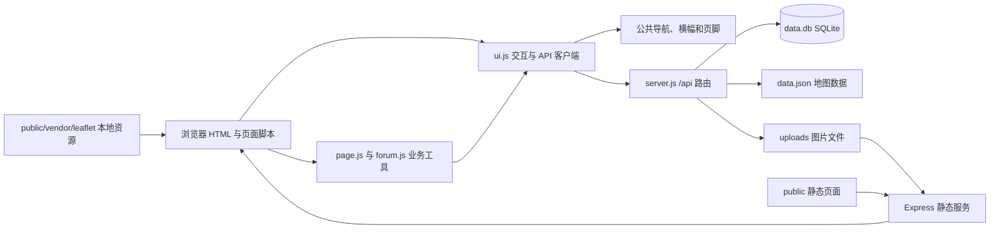

# szzx-info 项目地图

> 更新日期：2026-10-01。本文描述需求 #4 全站 UI 改版后的代码；改版基于 `main` 的 `81ffb7ebde31cd2d2b399585673c2a29cc38b16b`（`10.1版本`）。
>
> 本文依据实际文件、后端代码、全部前端页面、地图 JSON、SQLite 表结构及依赖清单整理。设计规范见 [UI.md](./UI.md)，验收记录见 [docs/ui/acceptance.md](./docs/ui/acceptance.md)，原始里程碑快照见 [PLAN_2026-10-01.md](./PLAN_2026-10-01.md)。

## 1. 项目概览

校园信息网是一个采用「宣纸·黛青·朱印」风格的动态网站，现有校园地图、论坛、菜谱评价、每周食谱图片、公告、账号与权限、学生认证、个人设置和管理后台。用户可在个人中心提交工单，管理员可审核认证、处理封禁申诉及批复工单。

| 层次 | 实际实现 | 入口 |
| --- | --- | --- |
| 服务端 | CommonJS、Node.js、Express 5；所有中间件、数据库初始化和业务路由集中在一个文件 | [server.js](./server.js) |
| 数据库 | Node 内置 `node:sqlite` 的同步 `DatabaseSync`；13 张业务表 | [data.db](./data.db) |
| 前端 | 12 个现有页面及新增 404，统一外部 CSS 与页面脚本；原生 JavaScript，无构建流程 | [public/](./public/) |
| 共享前端逻辑 | 导航壳、登录态、用户展示、横幅、表单、对话框、上传、图片查看器及页面工具 | [public/js/ui.js](./public/js/ui.js)、[public/js/page.js](./public/js/page.js) |
| 地图 | 本地 Leaflet 1.9.4；自定义平面坐标数据，保留原有几何与楼层关系 | [public/vendor/leaflet/](./public/vendor/leaflet/)、[data.json](./data.json) |
| 文件存储 | 本地图片文件，通过 `/uploads` 静态提供 | [uploads/](./uploads/) |
| 依赖与运行 | npm 安装；`npm start` 直接执行 `node server.js` | [package.json](./package.json)、[package-lock.json](./package-lock.json) |
| 验证 | Playwright 浏览器回归、axe 无障碍与布局检查；临时数据库和上传目录 | [tests/ui-smoke.mjs](./tests/ui-smoke.mjs) |
| 项目说明 | 使用说明、项目地图、开发记录、里程碑快照、UI 手册和许可证 | [README.md](./README.md)、[progress.md](./progress.md)、[UI.md](./UI.md)、[LICENSE](./LICENSE) |

## 2. 完整文件结构

以下为改版后的源码、文档和持久数据目录。`node_modules/`、本机 `.env` 和浏览器测试产物不提交。

```text
szzx-info/
├── .gitignore                    依赖、密钥、数据库临时文件和测试产物忽略规则
├── .env.example                  端口与 JWT 配置模板
├── LICENSE                       GNU AGPL v3 许可证正文
├── README.md                     项目功能、安装及部署说明
├── progress.md                   既有开发记录、接口和数据说明
├── package.json                  应用元数据、依赖、start/test 脚本
├── package-lock.json             npm lockfileVersion 3 依赖锁定文件
├── server.js                     全部后端逻辑，53 个显式 API 路由
├── data.db                       随仓库提交的 SQLite 数据库
├── data.json                     校园地图几何、楼层、文字和配色
├── MAP.md                        项目结构与实现地图（本文）
├── PLAN_2026-10-01.md             国庆里程碑与全部 issue 的原始快照
├── UI.md                         全站 UI 设计总纲
├── docs/ui/
│   ├── assets/                   参考 CSS、JS、图标与可交互样张
│   ├── pages/                    现有及后续新功能的逐页设计规范
│   ├── components.md             组件骨架、状态与无障碍要求
│   ├── scenarios.md              边界场景与交互约定
│   ├── copy.md                   统一文案和错误提示
│   ├── implementation.md         实施步骤与可复现验证方法
│   └── acceptance.md             #4 实施范围及验收记录
├── tests/
│   └── ui-smoke.mjs              页面、权限、表单及无障碍回归
├── public/
│   ├── index.html                首页与关于我们；根路径默认页面跳转
│   ├── about.html                旧地址兼容入口，跳转 index.html#about
│   ├── map.html                  校园地图、楼层切换、弹窗编辑
│   ├── forum.html                讨论/提问列表、发帖、回复、点赞、删帖
│   ├── post.html                 单帖详情，通过 ?id=<帖子 ID> 访问
│   ├── recipe.html               菜谱评价列表与每周食谱图片
│   ├── announcements.html        更新公告列表与正文
│   ├── login.html                登录与被封账号的解封申诉
│   ├── register.html             注册并自动登录
│   ├── student_verify.html       邀请码认证或提交学生审核申请
│   ├── profile.html              资料、密码、网站设置、工单
│   ├── admin.html                权限控制的后台菜单与管理操作
│   ├── 404.html                  未知页面提示，使用绝对资源路径
│   ├── css/site.css              设计令牌、组件与响应式样式
│   ├── img/                      icons.svg 与 favicon.svg
│   ├── js/
│   │   ├── ui.js                 全站交互、导航壳与统一 API 客户端
│   │   ├── page.js               页面表单、请求、权限、面板和工单工具
│   │   ├── forum.js              论坛及详情共用的点赞、回复与删除逻辑
│   │   └── pages/                各页业务脚本，与 HTML 同名
│   ├── vendor/leaflet/           Leaflet JS、CSS、图片与上游 LICENSE
│   └── auth.js                   加载 ui.js 的旧调用兼容入口
└── uploads/
    └── weekly/
        ├── 1790494439396-979963766.png
        ├── 1790495069096-158832090.png
        ├── 1790495081861-230074113.png
        ├── 1790495090622-616644569.png
        ├── 1790495393944-169103336.png
        └── 1790495644744-976725163.png
```

`npm ci` 创建 `node_modules/`，运行时按需创建 `uploads/`、`uploads/weekly/` 与 `uploads/bans/`；普通头像和评价图片直接写入 `uploads/`。`data.db` 与已有上传图片继续随仓库保存。项目暂无 Python、CI、Docker 或独立数据库迁移目录。

## 3. 请求与数据流



`server.js` 启动顺序是加载环境变量、打开数据库、创建表与索引及迁移旧结构、创建上传目录、定义鉴权函数、挂载 CORS/JSON/静态服务、注册 API、404 兜底和错误处理，最后监听端口。

- `public/` 挂载在站点根路径，`/` 默认提供 `index.html`。
- `/uploads` 映射到项目内的 `uploads/`，图片 URL 保存到数据库或由文件名生成。
- 普通 JSON 请求体上限为 `8mb`；上传请求使用 multer 的 multipart 处理。
- 页面通过共享 `UI.api` 封装同源 `fetch('/api/...')`，统一 token、失败提示和登录回跳；后端仍使用原有业务接口。
- 未知 `/api` 路径返回 JSON 404；未知 GET 页面路径（无扩展名且不属于上传目录）返回 `404.html`。
- 登录返回 JWT；浏览器以 `localStorage.token` 保存，并以 `Authorization: Bearer <token>` 请求登录接口。`localStorage.user` 保存用户缓存。
- 网站默认页面、地图楼层、菜谱默认视图保存在用户表，同时用 `defaultPage`、`defaultFloor`、`recipeDefaultView` 本地键作回退；横幅关闭使用 `bannerDismissed:<用户名>` 与横幅版本。手机导航使用受控抽屉；旧 `navCollapsed` 设置不再使用。

## 4. 前端页面地图

| 页面 | 功能与交互 | 主要数据来源 |
| --- | --- | --- |
| `index.html` | 首页介绍、地图/论坛/菜谱/公告入口、关于我们与工单反馈；仅在根路径 `/` 且无锚点时按用户默认页面跳转 | `/api/user/profile`、本地默认页设置 |
| `about.html` | 跳转 `/index.html#about`，并保留可读的兼容链接 | 无 |
| `map.html` | `CRS.Simple` 地图；1F–4F；缩放、拖动、WASD/方向键；按权限编辑建筑文字弹窗 | `/api/map-data`、`/api/me`、`/api/user/profile`、`PUT /api/admin/map-popup` |
| `forum.html` | 讨论/提问切换；发帖对话框；每批 20 条；卡片跳转详情；回复展开、发布；点赞及失败回滚；更多菜单删帖 | `/api/forum/posts` 及其回复、点赞、删除路由 |
| `post.html` | 按查询参数 `id` 加载正文与点赞状态；默认展开回复 | `/api/forum/posts/:id` 及其回复、点赞路由 |
| `recipe.html` | “全部评价”按名称展示评价记录；评价对话框含菜名/评分/评论/图片；每周食谱按日期展开，图片缩放、拖动；有权用户可删每周图片 | `/api/recipes`、`/api/weekly-menu`、`/api/user/profile` |
| `announcements.html` | 桌面主从列表；手机先看列表，选择后显示正文并可返回 | `/api/announcements` |
| `login.html` | 用户名/密码登录；封禁错误展示；允许申诉时提交理由及可选图片 | `/api/login`、`/api/user/appeal` |
| `register.html` | 用户名/昵称/密码及重复密码校验；注册后调用登录 | `/api/register`、`/api/login` |
| `student_verify.html` | 已达到学生角色时隐藏表单；否则填写新生号、班级、真实姓名，可填邀请码及补充信息 | `/api/user/profile`、`/api/student/apply` |
| `profile.html` | 展示 ID/角色/额外权限；修改头像、昵称、签名、密码；保存三项网站设置；提交与查看本人工单 | `/api/user/*`、`/api/tickets`、`/api/tickets/mine` |
| `admin.html` | 横幅、公告、学生审核、邀请码、每周菜谱、用户管理、申诉、工单；认证/申诉/工单菜单按待办数显示红点 | `/api/admin/*`、横幅和每周食谱读取接口 |
| `404.html` | 404 提示、返回首页与返回上一页 | 无 |
| `js/ui.js` | 公共导航/页脚、账户菜单、手机抽屉、横幅、用户信息与全站交互组件 | `/api/user/profile`、`/api/settings/banner` |

页面布局由 `public/css/site.css` 统一维护，业务脚本位于 `public/js/pages/`。`ui.js` 集中处理角色权重、用户展示、日期、转义和交互；`page.js` 与 `forum.js` 复用页面业务逻辑。动态文本使用 `UI.esc` 或 DOM `textContent` 输出。

## 5. 后端 API 全量索引

以下 53 个显式路由均位于 [server.js](./server.js)。表中“公开”表示该路由没有强制登录中间件；公开帖子读取可以携带 token 获取当前用户点赞状态。细粒度权限的默认角色见下一节。

### 5.1 账号、个人资料与设置

| 方法 | 路径 | 访问条件 | 作用 |
| --- | --- | --- | --- |
| POST | `/api/register` | 公开 | 创建用户；首个用户为 developer，其余为 user；生成 display_id |
| POST | `/api/login` | 公开 | 验证密码、封禁状态，签发 JWT |
| GET | `/api/me` | 公开，可携带 token | 返回解析后的用户及显式权限 |
| GET | `/api/user/profile` | 登录 | 当前用户资料、设置、状态、权限 |
| PUT | `/api/user/settings` | 登录 | 保存默认页、1–4 楼层、all/weekly 菜谱视图 |
| POST | `/api/user/avatar` | 登录 | 上传头像，更新 avatar_url |
| PUT | `/api/user/nickname` | 登录 | 修改昵称 |
| PUT | `/api/user/signature` | 登录 | 修改签名 |
| PUT | `/api/user/password` | 登录 | 校验旧密码并修改密码 |

### 5.2 论坛、菜谱、公告与地图

| 方法 | 路径 | 访问条件 | 作用 |
| --- | --- | --- | --- |
| GET | `/api/forum/posts` | 公开，可携带 token | 按分类读取帖子，附回复数、点赞数及本人点赞状态 |
| GET | `/api/forum/posts/:id` | 公开，可携带 token | 单帖详情及点赞状态 |
| POST | `/api/forum/posts` | 登录 | 发布讨论或提问 |
| DELETE | `/api/forum/posts/:id` | 登录，作者或 admin 及以上 | 删除帖子，手动清理其回复和点赞 |
| POST | `/api/forum/posts/:id/like` | 登录 | 点赞帖子 |
| DELETE | `/api/forum/posts/:id/like` | 登录 | 取消点赞 |
| GET | `/api/forum/posts/:id/replies` | 公开 | 按时间读取该帖回复 |
| POST | `/api/forum/posts/:id/replies` | 登录 | 发布回复 |
| GET | `/api/recipes` | 公开 | 按 `name COLLATE NOCASE, id` 排序读取评价记录 |
| GET | `/api/recipes/weekly` | 公开 | 读取 `is_weekly=1` 的评价记录；当前每周食谱页面使用另一接口 |
| POST | `/api/recipes` | 登录 | 上传可选图片并写入菜谱评价；评分范围 0–5 |
| GET | `/api/announcements` | 公开 | 按发布日期倒序读取公告 |
| GET | `/api/weekly-menu` | 公开 | 每周食谱日期、图片 URL 和上传者 |
| GET | `/api/settings/banner` | 公开 | 当前横幅及版本 |
| GET | `/api/map-data` | 公开 | 每次从磁盘读取 data.json |
| PUT | `/api/admin/map-popup` | map_popup_edit | 按 feature.name 更新所有同名对象的 popup，回写 data.json |

### 5.3 学生认证、后台内容与用户管理

| 方法 | 路径 | 访问条件 | 作用 |
| --- | --- | --- | --- |
| GET | `/api/admin/ping` | super_admin 及以上 | 后台连通性检查 |
| POST | `/api/admin/announcements` | announcement_publish | 发布公告 |
| PUT | `/api/admin/settings/banner` | banner_edit | 修改/清空横幅并增加版本 |
| POST | `/api/student/apply` | 登录 | 有效邀请码直接认证，否则提交审核申请 |
| GET | `/api/admin/settings/invite-code` | invite_manage | 读取兼容的单邀请码设置 |
| PUT | `/api/admin/settings/invite-code` | invite_manage | 写入兼容的单邀请码设置 |
| GET | `/api/admin/invite-codes` | invite_manage | 多邀请码列表 |
| POST | `/api/admin/invite-codes` | invite_manage | 添加邀请码和使用上限，0 表示不限 |
| DELETE | `/api/admin/invite-codes/:id` | invite_manage | 删除邀请码 |
| GET | `/api/admin/student-applications` | student_review | 待审核认证申请 |
| PUT | `/api/admin/student-applications/approve` | student_review | 通过申请并提升未达学生级别用户的角色 |
| PUT | `/api/admin/student-applications/reject` | student_review | 拒绝申请并记录可选原因 |
| GET | `/api/admin/users` | user_manage | 用户 ID、显示 ID、账号、角色、状态与额外权限 |
| GET | `/api/admin/permissions` | user_manage | 权限目录 |
| PUT | `/api/admin/users/role` | user_manage，另有目标角色限制 | 修改角色 |
| PUT | `/api/admin/users/ban` | user_manage，另有目标角色限制 | 封禁并保存理由、可选图片及是否允许申诉 |
| PUT | `/api/admin/users/unban` | user_manage，另有目标角色限制 | 解封并清空封禁信息 |
| PUT | `/api/admin/users/permissions` | user_manage，另有目标角色限制 | 替换显式权限列表 |
| POST | `/api/admin/weekly-menu/upload` | weekly_menu_upload | 上传日期范围内的每周食谱图片 |
| DELETE | `/api/admin/weekly-menu/:id` | 登录，上传者或 super_admin 及以上 | 删除食谱记录及图片文件 |

### 5.4 申诉与工单

| 方法 | 路径 | 访问条件 | 作用 |
| --- | --- | --- | --- |
| POST | `/api/user/appeal` | 公开；目标账号须已封禁 | 按用户名提交解封理由与可选 DataURL 图片 |
| GET | `/api/admin/ban-appeals` | ban_appeal_review | 待处理申诉 |
| PUT | `/api/admin/ban-appeals/review` | ban_appeal_review | 通过并解封，或驳回 |
| POST | `/api/tickets` | 登录 | 提交标题、正文及可见角色范围 |
| GET | `/api/tickets/mine` | 登录 | 本人工单与批复 |
| GET | `/api/admin/tickets` | ticket_manage，按角色再过滤 | 当前管理者可见的工单 |
| PUT | `/api/admin/tickets/reply` | ticket_manage，按工单可见级别再校验 | 批复正文及可选 DataURL 图片 |
| GET | `/api/admin/pending-counts` | 登录，按权限和工单范围统计 | 学生认证、申诉、工单待办数量 |

## 6. 角色与权限模型

角色权重为 `developer(6) > super_admin(5) > admin(4) > student(3) > user(2) > guest(1)`。

- `checkRole(requiredRole)` 解析 JWT，缺失或无效 token 按 guest 处理；需要角色时比较权重。JWT 带有 id、role、username。
- `requireLogin` 在解析后要求有效用户 ID，否则返回 401。
- `requirePermission` 调用 `hasPermission`：角色达到该权限默认等级，或 `user_permissions` 存在显式授权，即可通过。
- 后台入口允许 admin 及以上或拥有任意显式权限的用户；后台菜单进一步按具体权限过滤。
- 修改用户角色、封禁/解封和替换权限时，禁止操作自己或同级/更高级目标；新角色最高只能低于操作者一级。
- 工单可见范围为 `admin`、`super_admin`、`developer`，后台在 ticket_manage 之外另按角色权重过滤。

| 权限 | 默认最低角色 | 功能 |
| --- | --- | --- |
| banner_edit | super_admin | 横幅编辑 |
| announcement_publish | super_admin | 发布公告 |
| student_review | super_admin | 学生认证审核 |
| invite_manage | super_admin | 邀请码管理 |
| user_manage | super_admin | 用户及显式权限管理 |
| ban_appeal_review | super_admin | 封禁申诉审核 |
| weekly_menu_upload | admin | 每周食谱上传 |
| map_popup_edit | admin | 地图弹窗编辑 |
| ticket_manage | admin | 工单管理 |

## 7. 数据模型与文件存储

### 7.1 SQLite

以下 13 张业务表已在本地 `data.db` 中核对；另有 SQLite 内部表 `sqlite_sequence`。表结构在 server.js 启动阶段维护，并通过若干立即执行函数迁移旧版本。

| 表 | 主要字段/约束 | 关联与用途 |
| --- | --- | --- |
| users | id、display_id、username、nickname、password_hash、avatar_url、signature、role、三项默认设置、status、封禁字段；username/email 唯一 | 账号与偏好；email 为兼容字段，现有注册不使用邮箱 |
| user_permissions | user_id、permission；二者联合唯一 | 用户显式授权 |
| forum_posts | user_id、username、category、title、content、created_at；category 只允许讨论/提问 | 论坛帖子 |
| forum_replies | post_id、user_id、username、content、created_at | 平铺帖子回复；没有父评论 ID |
| post_likes | post_id、user_id、created_at；二者联合唯一 | 帖子点赞；目前没有评论点赞表 |
| recipes | user_id、username、name、rating、comment、image_url、is_weekly | 一条记录是一条用户评价，没有独立菜品 ID 或店铺 ID |
| weekly_menu_images | user_id、menu_start_date、menu_end_date、filename、uploaded_at | 每周食谱整张图片，与 recipes 分开 |
| announcements | title、content、publish_date | 公开公告 |
| settings | key 主键、value | banner、banner_version，以及兼容的 student_invite_code |
| student_applications | user_id、student_id、class_name、real_name、extra_info、reject_reason、status | 认证审核；pending/approved/rejected |
| invite_codes | code 唯一、max_uses、used_count | 多邀请码及次数限制 |
| ban_appeals | user_id、appeal_reason、appeal_image、status | 解封审核；pending/approved/rejected |
| tickets | user_id、username、title、content、visibility、status、reply_content、reply_image、reply_by、replied_at | 工单；pending/resolved |

关系通过各表的 `user_id`、`post_id` 在应用代码中使用；当前建表 SQL 没有声明外键约束。删帖时手动删除关联回复与点赞。学生人工审核申请和封禁申诉各有同一用户 600 秒提交限制，允许重新提交时会覆盖旧记录；有效邀请码直接认证走单独分支。

实际已提交数据库保留旧迁移结构，例如 users.display_id 通过后续 `ALTER TABLE` 添加，没有新建库 SQL 中的 UNIQUE 约束；不能假设旧库与新库的所有约束完全一致。

### 7.2 地图 JSON

`data.json` 是自定义格式，顶层包含 `meta`、`style`、`features`，并非标准 GeoJSON。

| 部分 | 字段与当前内容 |
| --- | --- |
| meta | rectW=1200、rectH=700、axisY=420、minZoom=-2、maxZoom=6、baseZoom=1 |
| style | outline、labelColor、fillOpacity、palette；建筑/绿地/水体/白色/无填充分类 |
| features | 227 个对象：153 条 polyline、48 个 polygon、26 个 label |
| layers | base=始终显示；数字 1–4=所在楼层；同一对象可以出现在多层 |
| 几何字段 | points 为 `[x,y]` 点数组；fill/stroke/dash/weight 控制路径 |
| 文字字段 | text、x1/y1/x2/y2、scale 控制区域文字；name/popup 控制名称与弹窗 |

当前楼层集合为：20 个 base 对象、118 个仅 1F 对象、42 个仅 2F 对象、2 个同时位于 1F/2F 的对象、45 个同时位于 2F/3F/4F 的对象。`public/js/pages/map.js` 将 `[x,y]` 转为 Leaflet 的 `[y,x]`，按 polygon → polyline → label 顺序绘制。方向约定是左为北、上为东、右为南、下为西。#4 仅调整配色和最小缩放级别，227 个 feature 的几何、文字和楼层数据与改版前一致。

地图读取每次访问磁盘，修改数据刷新即可；地图弹窗编辑按名称批量更新，同名几何会一起变化。

### 7.3 图片

| 场景 | 存储位置 | 后端限制 |
| --- | --- | --- |
| 头像、菜谱评价图片 | uploads/ | multer；JPEG/PNG，最多 2 MiB |
| 封禁图片 | uploads/bans/ | multer；JPEG/PNG，最多 2 MiB |
| 每周食谱图片 | uploads/weekly/ | multer；JPEG/PNG，最多 5 MiB |
| 申诉图片、工单批复图片 | 数据库文本字段 | 由页面读成 DataURL 后通过 JSON 提交，不使用上述 multipart 存储器 |

## 8. 运行、依赖与验证入口

[package.json](./package.json) 的直接依赖及当前 lockfile 版本为：express 5.2.1、cors 2.8.6、bcrypt 6.0.0、jsonwebtoken 9.0.3、multer 2.4.0、dotenv 18.0.3。项目未声明 `engines`；README 推荐 Node.js 24+，后端要求运行时提供 `node:sqlite`。

在根目录安装和启动：

```powershell
npm.cmd ci
npm.cmd start
```

复制 `.env.example` 为本机 `.env` 并修改密钥：

```dotenv
PORT=3000
JWT_SECRET=replace_with_a_long_random_secret
JWT_EXPIRES_IN=7d
```

代码默认端口为 3000，JWT 有效期为 7d；JWT_SECRET 有开发用回退值，部署时应显式配置。访问 `/`、`/map.html` 或 `/api/map-data` 可分别检查页面和地图数据入口。

- 修改 server.js 需要重启服务；修改 public/ 静态文件刷新页面；修改 data.json 后下次 API 读取即生效。
- data.db、data.json 的在线编辑结果、uploads/ 都是本地持久数据；部署需要可写、持久化的存储和 Node 服务。
- 开发依赖为 Playwright 与 axe-core。运行 `npm.cmd test` 可执行浏览器回归；Windows 使用 Microsoft Edge，其他平台先运行 `npx playwright install chromium`。
- 回归测试在系统临时目录启动独立后端并创建测试数据库与上传文件；项目内的 `data.db`、`uploads/` 和 `data.json` 不被测试改写。
- 最近一次验证：264 项检查通过，360px/1280px、light/dark 扫描无违规、无页面横向溢出及脚本异常；结果和截图保存到被忽略的 `output/playwright/`。

## 9. 文档与实现约定

| 文档 | 用途及实际实现 |
| --- | --- |
| README、MAP、progress | 当前使用方式、结构、业务能力与开发记录；历史变更按当时实现保留 |
| UI.md、docs/ui/ | #4 设计手册、组件、逐页规范、场景、文案、样张与验收记录；P1 页面为后续 issue 的预设计 |
| docs/ui/assets 与 public | 前者是设计参考，后者是实际运行代码；运行代码包含资源路径、未保存表单保护和地图布局适配 |
| PLAN_2026-10-01.md | 保留需求读取时的原始正文和状态；执行进度见 progress 与验收记录，实时关闭状态以 GitHub 为准 |
| package.json、package-lock.json、LICENSE | 根包许可为 AGPL-3.0；本地 Leaflet 另附上游许可证 |
| “全部评价”与 #5 | 当前仍是一条记录对应一条评价；独立菜品目录、搜索、Python 预处理和店铺关联属于后续功能 |

## 10. 国庆计划的代码定位

| Issue | 当前相关位置 | 实施状态或后续能力 |
| --- | --- | --- |
| [#4 修改UI](https://github.com/szzxvc/szzx-info/issues/4) | public HTML、css/site.css、js/、本地 Leaflet、UI.md 与 docs/ui/ | 已完成全站改版及浏览器验收，保留现有业务接口 |
| [#5 全部菜品](https://github.com/szzxvc/szzx-info/issues/5) | recipe.html、recipes 表及 `/api/recipes` | 独立菜品数据来源/模型、稳定 A–Z 规则、搜索、Python 预处理与环境说明 |
| [#6 三元坊必吃榜](https://github.com/szzxvc/szzx-info/issues/6) | 导航、server.js 鉴权与数据初始化 | 店铺列表/上传/详情入口、店铺模型、最低上传角色、地图查询后录入字段 |
| [#7 三元坊必吃榜 UI适配](https://github.com/szzxvc/szzx-info/issues/7) | profile.html、用户默认设置的保存模式 | 店铺详情页的两种布局、粘性导航与持久布局设置 |
| [#8 三元坊必吃榜菜谱上传](https://github.com/szzxvc/szzx-info/issues/8) | student 角色、multer 存储器、现有评价模型 | 菜品与店铺关联、学生上传权限、图片、去重及异常数据处理 |
| [#9 消息箱](https://github.com/szzxvc/szzx-info/issues/9) | 论坛回复/点赞接口、profile.html、js/ui.js | 消息模型、事件通知、已读状态、未读数、通知偏好与发送权限 |
| [#10 头衔系统](https://github.com/szzxvc/szzx-info/issues/10) | 用户资料、后台用户管理、各用户内容渲染处 | 头衔目录/拥有关系/佩戴状态、授予撤销、自动规则、统一用户展示 |

当前没有店铺、独立菜品、消息箱或头衔的业务表与专用页面，`UI.config.features` 中相应开关保持关闭。#4 的实现与验证记录见 [acceptance.md](./docs/ui/acceptance.md)；其他 issue 的需求正文、可选项和未决规则以 [PLAN_2026-10-01.md](./PLAN_2026-10-01.md) 收录的里程碑快照为准。
