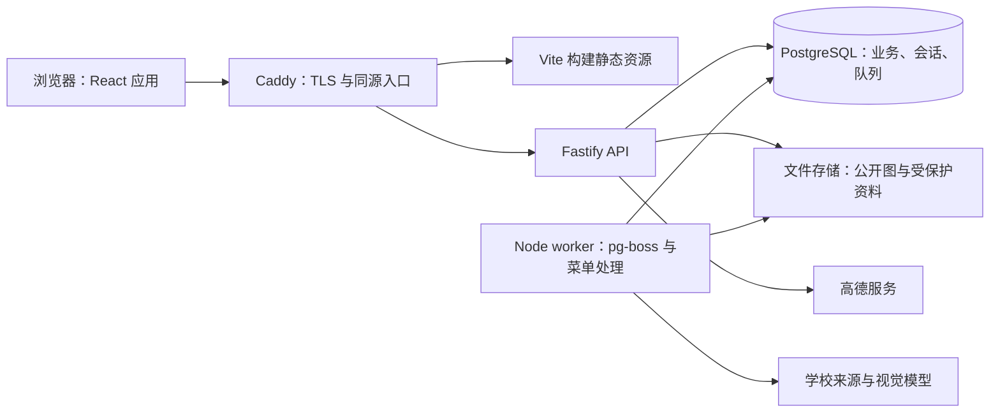

# 全面重构技术栈研究与建议

研究日期：2026-10-24。代码基线：`728463a`，当前分支 `main`。

本文是选型建议，不代表已实施。**保持拾光酥糕的定位、功能、视觉规范和业务规则，只重构实现。** 不提出工时估算。研究依据为当前源码、测试、文档、本地数据库的只读结构与计数，以及相关工具的官方文档；本地数据不代表线上用户规模或访问负载。

## 1. 推荐结论

推荐 **React + TypeScript + Vite + TanStack Router + TanStack Query** 前端，搭配 **Node.js + Fastify + Drizzle ORM + PostgreSQL** 后端。

采用前后端分离、后端按业务模块组织的单体架构。菜单识别使用同一后端代码库中的独立 worker 进程。网站与 API 同源发布。其目标是减少当前手工 DOM、状态同步、接口契约、权限和数据迁移的维护负担。

| 层次 | 推荐选择 | 在本项目中的用途 |
| --- | --- | --- |
| 语言 | TypeScript，开启 `strict` | 前后端、共享请求/响应契约和测试使用统一类型体系 |
| 前端 | React 19 + Vite 8 | 替换原生页面脚本；按页面拆包，构建带内容摘要的静态资源 |
| 路由 | TanStack Router 1 | 类型安全的路由与搜索参数；处理页签、筛选、排序、分页和历史记录 |
| 服务端数据状态 | TanStack Query 5 | 请求去重、缓存、取消、分页、提交后刷新和失败回滚 |
| 样式与组件 | Tailwind CSS 4 + shadcn/ui，统一选择 Radix 基础组件 | 用现有 UI 令牌定制；共享对话框、下拉、开关、表单，不更改现有品牌和布局 |
| 表单 | React Hook Form 7 + Zod 4 | 菜品选评、店铺录入、设置和后台表单；校验与中文错误提示 |
| 后端运行时 | Node.js 24 LTS | 沿用 Node 生态，运行 API、图片处理、菜单获取与识别 |
| HTTP 后端 | Fastify 5 | 按业务模块封装路由、校验、序列化、鉴权、错误处理和日志 |
| 接口契约 | REST + Zod + OpenAPI | `fastify-type-provider-zod` 接入校验与响应序列化，`@fastify/swagger` 生成文档 |
| 数据库 | PostgreSQL 18 的受支持补丁版 | 关系数据、事务、约束、异步访问、会话和后台任务 |
| 数据访问 | Drizzle ORM + `pg` + Drizzle Kit | 类型化查询、连接池、可审查的 SQL 迁移；复杂查询保留显式 SQL |
| 登录会话 | `@fastify/cookie` + `@fastify/session` + PostgreSQL 会话存储 | 保留用户名/密码登录；浏览器使用 HttpOnly Cookie，支持会话撤销 |
| 密码 | 新哈希使用 Argon2id；迁移期保留异步 bcrypt 验证 | 无需用户重设现有密码；成功验证后再升级哈希 |
| 后台任务 | pg-boss + 独立 Node worker | 菜单调度、重试、取消、恢复和任务状态；利用已有 PostgreSQL |
| 图片 | 保留 sharp；文件存储抽象，生产推荐 S3 协议对象存储 | 保留图片及 URL 可访问性；公开图与受保护资料分别管理 |
| 地图与拼音 | 保留 Leaflet、校园 SVG、高德接口、`pinyin-pro` | 用 React 封装现有能力，保留两类地图和现有排序/名称规则 |
| 测试 | Vitest + React Testing Library + Playwright Test + axe-core | 业务规则、组件、真实数据库集成、浏览器、键盘和无障碍回归 |
| 工程 | pnpm workspace + ESLint + Prettier + GitHub Actions | 共享契约、统一检查、自动构建和回归；暂不需要额外构建编排系统 |
| 部署 | Docker Compose + Caddy；PostgreSQL 可托管或独立持久化 | 一个网站域名下提供静态前端与 API，分别运行 API 和 worker |
| 可观测性 | Fastify/Pino 结构化日志、请求 ID、错误收集 | 关联请求与任务、诊断失败；按需接入 OpenTelemetry |

表中的大版本是建议范围，不是已验证可直接安装的完整依赖清单。实施时锁定所有直接依赖、插件和容器的确切版本，提交 lockfile，用 CI 验证组合兼容性；不选 beta/RC。Drizzle 当前稳定线与 1.0 预发布线应明确区分，不直接照搬预发布文档示例。[1][2][3][4][5][6][7]

## 2. 项目实际情况与选型依据

### 2.1 当前规模

| 检查项 | 观察结果 | 对选型的影响 |
| --- | --- | --- |
| 页面 | `public/` 下 18 个 HTML，含 404 | 规模适合单个 React 应用，按路由拆分 |
| HTTP 路由 | 源码中 98 个方法与路径注册声明，含兼容路径 | 已需要规范契约、鉴权和模块边界，但没有拆成微服务的依据 |
| 本地数据库 | 27 张业务表；1,243 道菜品、5,874 条供应记录、5,567 家店铺 | 数据关系较多；数据量本身不构成必须淘汰 SQLite 的理由 |
| 主后端 | `server.js` 1,678 行，包含迁移、登录、权限、业务路由、上传和服务生命周期 | 应拆分职责，不应只把文件扩展名改成 TypeScript |
| 公共前端 | `public/js/ui.js` 1,445 行 | 组件、认证状态、网络请求、收藏弹窗等需分离 |
| 后台页面 | `public/js/pages/admin.js` 1,110 行 | 按后台业务面板拆组件与独立查询 |
| 样式 | `public/css/site.css` 2,934 行 | 已有设计令牌可迁移，不需要重做视觉设计 |
| 工程 | 当前无前端构建、类型检查和已跟踪的 GitHub Actions 工作流 | Vite、TypeScript 和 CI 的收益直接 |
| 业务数据管理 | Git 跟踪 `data.db` 与 6 个历史上传文件 | 后续应分离运行数据、可审查种子与源码发布 |

路由数是静态注册声明数，不是不同路径字符串数；数据库计数来自本地只读连接。未访问生产环境，没有线上 QPS、峰值并发、数据库慢查询或真实用户体验数据，本文不把推测写成测量结论。

### 2.2 应保留的基础

- `lib/menu/` 已分离来源获取、模型客户端、图片处理、校验、存储、手动导入和任务；具备租约、取消、重试、配置指纹、整篇事务发布与审计。保留这些规则与测试，逐步替换基础设施。
- 校园 SVG、31 个地点资料、来源引用、Leaflet 手势与键盘交互已有专项回归；不因换框架更换地图产品。
- 菜品归一化、拼音特例、八字段菜单协议，以及店铺 GCJ-02 坐标与姑苏区围栏，都属于需要保持的业务契约。
- 现有浏览器测试覆盖手机/桌面、明暗主题、错误状态、焦点和键盘；保留场景，迁移测试夹具与选择器。
- 论坛已经从当前版本移除。重构范围不恢复论坛，也不将旧计划中的论坛功能视作当前需求。

### 2.3 当前实现的具体问题

| 证据位置 | 实际观察 | 对应技术选择 |
| --- | --- | --- |
| `public/js/ui.js:141`、`:258` | JWT 与用户快照保存在 localStorage，请求和跨页状态手工维护 | 服务端会话；Query 管理服务端状态；避免多处保存完整账号快照 |
| `public/js/pages/shops.js:301`、`lib/shops/store.js:420` | 列表查询返回全部匹配店铺，浏览器再按每页 20 条切片 | 数据库分页与独立地图点位数据；列表与地图保持现有筛选含义 |
| `server.js:398`、`:434`、`:485` | 部分路径只验证 JWT，权限写入路径则重新读取账号状态，校验口径分散 | 每个受保护操作统一读取有效会话与当前账号状态，再执行授权 |
| `server.js:1298` | 改密只更新哈希，既有 JWT 没有撤销机制 | 可撤销的数据库会话；明确改密、封禁、角色变化的处理 |
| `server.js:36` 与各模块 `migrate` | 同步 SQLite 查询与启动迁移；部分旧表缺少关系约束 | PostgreSQL 异步连接池；显式迁移命令；逐项补约束并处理历史例外 |
| `server.js:546`、登录路由 | 全局开放 CORS；密码校验使用同步 bcrypt；存在开发用默认 JWT 密钥 | 同源发布；异步密码操作；启动校验密钥、受控代理与请求限制 |
| `lib/menu/service.js:231`、`server.js:1664` | 调度由网站启动；worker_threads 已隔离识别，但仍依附 Web 生命周期 | 独立 worker 与持久化任务队列；识别规则继续复用 |
| `tests/ui-smoke.mjs` 等 | 已有大量断言，部分测试使用固定/随机端口与自制运行器 | Playwright Test 的隔离、夹具、报告、失败追踪；减少启动不稳定 |

这不是一次完整安全审计。对当前账号行为额外做了隔离验证：改密返回 200 后，原 token 仍能读取本人资料；管理员封禁该测试账号后，原 token 仍能创建菜品评价，返回 201。测试只写入临时夹具，结束后清理。新会话方案要有对应反向用例，而不是认为安装插件就自动解决所有授权问题。

## 3. 前端为什么选择 React + Vite

### 3.1 与当前功能的对应关系

项目以筛选列表、详情、地图、表单、账号页面与后台面板为主。React 的组件组合与生态能够覆盖这些需求，Vite 提供开发、构建、懒加载和静态发布。当前没有明确的服务端渲染、搜索引擎排名或社交预览需求，因而不把 SSR 加入首选架构。

React 与 Vue 都能实现现有功能。这里选择 React，主要依据是表单、无障碍基础组件、路由、服务端状态管理和测试工具的组合完整，并能直接对应当前大量手工逻辑；不声称 React 本身一定更快或更容易学。

| 候选 | 适用性 | 本次判断 |
| --- | --- | --- |
| React + Vite | 交互页面、地图、表单、独立 API、静态前端部署 | **首选**；满足当前要求且不增加 SSR 运行职责 |
| Vue 3 + Vite + Vue Router + TanStack Vue Query | 同样覆盖现有功能，模板贴近现有 HTML | **有力备选**；若长期维护者明显熟悉 Vue，可优先改选，不影响 PostgreSQL 等后端结论 |
| Next.js | 适合明确需要 React SSR、服务端组件和统一全栈框架的产品 | 可行，但当前没有证据表明其额外能力值得成为默认约束；不是不能自托管。[8] |
| Nuxt | 适合 Vue 全栈、SSR 与混合渲染 | 可行；与 Next.js 同样需要真实需求支撑。Nuxt 本身支持客户端及混合渲染。[9] |
| React Router Framework Mode | 提供基于 Vite 的完整路由、数据加载与多种渲染模式 | 同样可行；本方案采用独立 API 与 Query，选择 TanStack Router 统一 URL 类型与状态，不再重叠引入另一套框架数据层。[10] |
| SvelteKit | 可实现现有页面，编译式组件与全栈能力完整 | 没有发现足以抵消重新选择整套配套工具的项目专属优势 |
| Astro | 内容页面与局部交互 | 能实现，但当前跨页账号、地图、列表与表单交互较多，不作为主应用首选 |

SPA 的代价要承认：动态内容初始 HTML、搜索引擎收录和按详情生成的分享元信息不如 SSR 直接。如果后续明确要求这些能力，应重新评估 React Router Framework Mode / Next.js；本次不以尚不存在的需求扩大范围。

### 3.2 把状态放到正确的位置

| 状态 | 放置位置 | 例子 |
| --- | --- | --- |
| 可分享、可回退的状态 | TanStack Router 的 URL/search params | 店铺关键词、分类、排序、页码，现有页签与锚点 |
| 服务端持有的数据 | TanStack Query | 店铺详情、评论、收藏、本人资料、未读数、后台任务 |
| 表单草稿 | React Hook Form / 局部状态 | 评价正文、店铺录入、菜单配置草稿 |
| 临时交互 | 局部 React 状态/ref | 对话框是否打开、地图实例、当前悬停 |
| 已有浏览器偏好 | 必要的 localStorage | 主题等现有本地偏好；不存认证凭据 |

不默认增加 Redux、全局 Zustand 或第二份 Query 数据。只有出现明确的跨树临时状态需求，再引入小范围状态工具。退出登录、切换账号、私密收藏变化时，要清理或隔离对应的 Query 缓存，避免账号间复用数据。

### 3.3 样式、表单与组件

Tailwind 负责布局和样式组织，现有 CSS 变量继续表达绿色主色、字号、间距、明暗主题与动态效果。shadcn/ui 是可以放入仓库维护的组件源码，不是安装后就不再维护的黑盒；统一选用一种基础组件实现，不混用两套弹窗、菜单或焦点体系。[4]

公共站点使用同一套自有组件；后台仍保留现在的功能、入口和权限，不额外引入一整套管理后台产品。地图和复杂选菜器可保留专项 CSS，不强迫把所有样式写成工具类。

保留中文输入法、每批 50 个选菜候选、“显示更多”、方向键、焦点恢复、Escape、加载失败与重试。不能用默认组件替换后丢失既有行为。React 的默认文本转义也不能替代 URL 校验、富文本策略或服务端输入校验。

## 4. 后端与接口选择

### 4.1 Fastify，而不是默认上 NestJS

Fastify 的插件封装、路由 schema、请求/响应类型、统一日志和测试注入适合当前 API 单体。业务模块分别包含路由、应用服务、查询和策略；模块间通过显式服务调用协作，避免再次形成巨型入口文件。

| 候选 | 判断 |
| --- | --- |
| Fastify + TypeScript | **首选**；以较少框架机制组织当前规模的 API，统一契约和插件边界 |
| Express 5 + TypeScript | 完全可行的保守备选；当前问题并不证明 Express 不能用。若保留，需要自行补齐等价的校验、类型、序列化、日志和模块规范 |
| NestJS | 适合团队明确偏好模块/依赖注入/装饰器约定时；本项目不必为组织约百条路由而默认增加整套机制。可搭 Fastify，但不会因此免除业务策略设计 |
| Django + DRF / Laravel | 关系型后台能力成熟，但同时切换语言，并重写现有 Node 图片、菜单 worker 与测试集成；当前没有相应团队或功能要求 |
| Go / Java / Rust | 均能实现；没有负载测量证明语言执行速度是瓶颈，不据此承担跨语言维护 |

选择 Fastify 的主要理由是工程约束，不是照抄框架基准宣称网站会快多少。后端真正需要改善的是全量列表、查询方式、同步密码计算、状态校验及任务生命周期。

### 4.2 一套明确的契约

- 采用 REST。保留现有 URL 或提供兼容层，不为换框架统一改名全部接口。
- Zod 定义 HTTP 边界 schema，通过 `fastify-type-provider-zod` 与 `@fastify/swagger` 连接运行时校验、响应序列化和 OpenAPI。该 Zod provider 是第三方插件，需锁定兼容版本；Fastify 原生默认使用 JSON Schema/Ajv，不要误当成内置 Zod。[3][11]
- 前后端共享纯契约包；客户端可用 OpenAPI 生成 `openapi-fetch` 类型。数据库模型、密码哈希、私密字段和服务端实现不能进入前端依赖树。
- 请求、响应和数据库表不是同一个对象。响应使用字段白名单，避免“返回整行用户/设置”。
- 菜单的八字段协议继续以现有 JSON Schema/Ajv 与离线技能校验为准，不额外维护一份手写且可能漂移的菜单 Zod schema。
- 普通分页保留现有页码行为；消息与追加评论按既有接口语义处理。稳定排序必须有唯一 ID 兜底。

tRPC 对纯 TypeScript 内部调用也可行，但目前有菜单技能、脚本与现有 HTTP 接口，REST/OpenAPI 的边界更直接。不同时引入 REST、GraphQL 和 tRPC 三套业务入口。

## 5. 数据库与 ORM

### 5.1 PostgreSQL 的理由与代价

**不以“SQLite 装不下当前数据”为理由迁移。** 几千家店铺和菜品目录对 SQLite 很小，现有问题也有相当一部分可以通过查询、索引和拆分职责改善。

推荐 PostgreSQL，是为了全面重构后的异步连接池、事务与关系约束、多进程访问，以及会话和持久化任务的统一承载。其代价是多维护一个数据库服务，需要连接数管理、备份、恢复演练、升级与监控。对长期维护而言，这个代价比额外同时维护 Redis 与另一套任务系统更容易接受。

PostgreSQL 18 已在官方支持列表中；本次查阅时 PostgreSQL 19 仍是 RC，不作为生产基线。MySQL 也能实现需求，当前没有必须选择它的托管或团队约束；MongoDB 与现有多关系、唯一约束、事务和聚合查询并不匹配。[5]

### 5.2 Drizzle 与迁移纪律

项目当前大量使用显式 SQL，店铺筛选、评分聚合、菜单整篇替换与审计都需要清楚理解查询。Drizzle 保留这种透明性，同时提供类型与迁移工具。Prisma 同样可行，不应以“完全不能写 SQL”之类错误理由排除；Kysely 也可行，但本方案偏好一并提供 schema 与迁移工具的 Drizzle。[6]

生产使用生成、审查、提交后的迁移文件；迁移作为独立发布步骤，由单一执行者运行，不在每个 API/worker 启动时顺手修改表。禁止把开发环境的直接 schema push 当作生产迁移策略。给迁移与业务账号分别配置所需数据库权限。

迁移时重点保持：

1. 用户、display ID、菜品、店铺、收藏夹和公开链接 ID；重置 PostgreSQL identity/sequence 到正确位置。
2. 现有用户名的唯一性和大小写处理；不能启用新认证库的默认归一化后合并两个旧账号。
3. 菜名 NFC、空白归一、拼音特例、A–Z 分组和排序；保留当前算法生成的键，不凭数据库默认 collation 重算身份。
4. SQLite 与 PostgreSQL 的空值排序差异、布尔值表示、大小写匹配及 SQL 参数差异；显式测试无评分店铺的位置。
5. 金额采用精确 `NUMERIC`，根据已有有效数据确定精度和小数位，不迁移时自行舍入；区分免费 0 和未知 null。
6. 时刻采用 `timestamptz`，供应日期采用 `date`；现有秒/毫秒时间戳分别转换，北京时间自然日与连续登录规则不变。
7. 店铺评价 1–5 分、每人每店一条可更新；菜品评价当前允许 0–5 分且可多篇。不能为“统一模型”新增同样的限制。
8. 未关联菜品的历史评价继续保留；新增外键前先检查孤立记录，不以静默删除修复数据。
9. 收藏夹私密/公开状态、默认收藏和新建默认公开偏好；`false`、未提供和明确覆盖保持原有差异。

### 5.3 列表、地图和搜索

店铺列表改为数据库筛选、排序、聚合与分页；地图使用独立的精简点位投影，保留“显示全部符合筛选的店铺”的含义，不能只显示当前列表页的 20 家店。地图点位可按视野读取或以版本化数据缓存，但点选仍对应原店铺详情。

当前菜品目录 1,243 条，全量加载并在浏览器搜索仍可接受；是否服务端搜索由响应体、加载时间与交互测量决定，不以统一技术风格强制重写。店铺名称/地址等查询保持原匹配语义；必要时使用 PostgreSQL `pg_trgm` 加速。它不是中文分词引擎，也不能保证一两个字的查询一定走高效索引，必须测量。[12]

暂不引入 Elasticsearch、Meilisearch 或 PostGIS。地图坐标、范围校验与已有步行路线功能并不自动要求这些服务。

## 6. 登录、权限与图片

### 6.1 保留用户名/密码，不强制邮箱

现有用户的邮箱可以为空。首选 `@fastify/session` 管理服务端会话，PostgreSQL 存储会话；不能使用其默认内存 store 作为生产方案。可接入其文档支持的 express-session 兼容 PostgreSQL store，或实现小型、经过集成测试的存储适配器，复用连接池和显式迁移。[13]

浏览器只持有会话标识 Cookie，配置 `HttpOnly`、`Secure`、合适的 `SameSite`；登录后轮换会话标识，登出销毁，改密/封禁按统一策略撤销会话。每个受保护操作检查当前账号状态及权限，而不是把角色永久复制到会话中信任。Cookie 认证仍要处理 CSRF，不能以 HttpOnly 或同源发布为由省略：写操作验证来源并采用 CSRF token 等适合的机制。

现有 bcrypt 哈希不能离线转换为 Argon2id。保留旧格式验证，登录成功取得明文密码时才升级，并限并发、限速，避免在主事件循环执行同步密码计算。技术栈迁移可能需要用户重新登录，但不应要求所有用户重设密码。

Better Auth 是可行候选，但不能直接假设其常见邮箱注册流程符合本项目。若使用，需要先验证无邮箱账号、用户名大小写规则、旧 ID、bcrypt、自有角色与封禁语义；不通过制造假邮箱来掩盖不兼容。为了现有需求，服务端会话插件更直接。[14]

保持现有六级角色、显式特殊权限、学生资格、管理员目标权重限制和首次注册身份规则；把授权集中到可测试策略中。前端按钮只反映可用操作，后端执行决定。认证、授权与权限等级展示分别处理，不用换框架为理由重新设计角色产品。

### 6.2 图片与私密资料

保留 sharp、现有大小限制和图片功能。服务端校验文件真实格式、尺寸与解码结果，控制像素与资源占用，生成所需尺寸并移除不必要元数据；不能只信任上传者提供的 MIME 类型。

生产建议通过存储接口使用对象存储，本地开发可使用目录适配器。公开头像/评价图与仅授权可读的诊断原图、学生资料、封禁资料分开授权。迁移时保留原 `/uploads/...` 的可访问映射，不把受保护文件一并公开。数据库、文件和菜单加密主密钥分别备份并演练配套恢复；运行数据不继续进入源码发布。

## 7. 菜单任务与地图不另起技术体系

### 7.1 pg-boss，而不是默认 Redis + BullMQ

既然数据库选择 PostgreSQL，pg-boss 能复用它提供调度、持久化、并发领取、重试和死信等能力，独立 worker 不依赖 API 进程存活。它不是无限吞吐系统，但目前没有必须引入 Redis 的任务量证据。[7]

保留现有任务与逐篇状态、手动修订、配置测试指纹、取消、原图诊断和发布审计。任务表可维护产品状态，pg-boss 负责执行调度，不把队列内部状态直接当全部业务模型。

任务按可能重复执行设计：队列和租约并不保证外部模型调用、文件写入或发布只发生一次。需要来源摘要、修订号与幂等键，发布事务验证执行权；取消与过期 worker 不得发布。自动同步与人工编辑继续互斥或进行版本冲突检查。生产迁移和 queue schema 初始化同样受发布流程管理。

现有 `worker_threads` 可以继续用于 CPU 密集图像处理；独立 worker 解决生命周期隔离，线程解决单进程中的计算隔离，两者不是替代关系。识别用现有兼容接口客户端即可，不因为包含 AI 就引入 Python 服务、LangChain、向量数据库或多代理框架。

历史验证 `docs/menu-validation.md` 记录：30 项局部抽样的四字段同时匹配为 27/30，三篇整篇自动发布门禁通过为 0/3。这是当时实验的结果，不能推断为当前所有模型的效果；也说明更换 Web 框架不会直接改善识别准确率。保持完整性校验与人工导入能力，不把“有效 JSON”当作“正确完整菜单”。

### 7.2 两种地图继续分开

- 校园图保留 Leaflet 的示意坐标与 SVG 场景；地点目录、介绍、搜索、触控与键盘行为保持。
- 店铺图保留高德 GCJ-02 数据、静态地图代理、近邻聚合与已有路线测算；Web 服务 Key 继续留在后端。[15]
- React 组件通过 ref/effect 封装地图实例和销毁，不在每次状态更新时重建全部地图或重置缩放。
- 校园平面坐标、GCJ-02 和 WGS84 不混存、不用同一组无单位数字相互代替；不把直线距离冒充当前步行距离。

## 8. 最小项目组织与部署

```text
apps/
  web/                  React + Vite：页面、组件、路由、查询、样式
  api/                  Fastify：HTTP、认证、错误处理、应用装配
  worker/               pg-boss：菜单调度、识别执行、重试与恢复
packages/
  contracts/            可供浏览器引用的 schema、DTO、OpenAPI 客户端
  backend/              按业务划分的服务、策略、数据库查询
  database/             Drizzle schema、迁移、可公开种子与校验工具
tests/
  e2e/                  Playwright Test、axe、隔离账号与数据
docs/                   既有文档体系、选型决策、迁移与验证记录
```

API 与 worker 共享后端实现和一个版本发布，属于模块化单体的两个运行入口。前端只依赖纯契约，不依赖 `backend` 或数据库包；不为每个小业务建立一个独立 npm 包。



部署不绑定 Vercel、Supabase 或其他单个平台。前端静态文件、API、worker、数据库可在一台机器起步；有可靠托管 PostgreSQL 可直接使用。Docker Compose 是默认部署描述，不意味着必须同时自建对象存储、监控集群或 Kubernetes。

Caddy 把 `/api` 与上传/受保护资源按规则转发；SPA fallback 只用于有效页面路由，不能把未知 API、静态资源或已移除论坛路径全部返回首页 200。开发用 Vite proxy 访问 API，生产同源，CORS 按实际需要配置。代理信任范围需与部署一致。

## 9. 功能不变的迁移顺序与验收

| 顺序 | 实施内容 | 放行条件 |
| --- | --- | --- |
| 1 | 从当前源码、页面规范与测试列出行为契约；建立 TS/Vite/Fastify 最小骨架 | 旧 URL、角色、默认项、失败状态及地图行为可逐项对照；新旧测试可独立运行 |
| 2 | 定义 PostgreSQL schema、会话策略、显式迁移和数据转换工具 | 旧 ID、记录数、金额、时间、关联、公开状态、密码兼容验证通过 |
| 3 | 迁移只读 API 与列表/详情前端 | 对照相同输入比较数据、排序、分页、空状态和地图点位；先找出行为偏差 |
| 4 | 迁移登录、设置、评价、收藏、认证与后台写入 | 角色与所有权矩阵、CSRF、封禁/改密会话、并发和失败回滚通过 |
| 5 | 迁移菜单 worker、存储与调度 | 重启、重试、取消、租约失效、人工修订及重复执行均不产生错误发布 |
| 6 | 完整演练后切换生产 | 冻结旧站写入，做最终一致性快照并校验；迁移并冒烟，再开放新站写入 |

允许大规模重写，不意味着同时让两套数据库接收生产写入。默认采用演练充分后的一次写入切换，避免双写带来的状态分叉。切换前可恢复旧快照；新站开放写入后再回退，需要回迁/对账或明确的数据恢复方案，不能直接恢复旧快照丢弃新数据。旧后台任务在快照前停止并确认没有待发布结果。

现有 `.html` 地址、`?id=` 链接、页签/锚点、浏览器前进后退、默认进入页与登录后返回地址保留为兼容入口。是否以后调整成新路径属于独立产品决策，本次不默认改。

测试重点：

- Vitest 验证纯业务规则；React Testing Library 验证表单和组件行为。
- PostgreSQL 集成测试验证真实 SQL、约束、事务和迁移；不用 SQLite 替身来声称 PostgreSQL 兼容。
- API 通过 Fastify `inject` 做无端口测试；涉及会话、代理、上传和完整网络链路的行为另做真实 HTTP 测试。
- Playwright Test 保留现有交互场景，加入会话撤销与私密缓存用例，覆盖 Chromium、Firefox、WebKit、手机/桌面、明暗主题、键盘与减少动态效果。
- 使用当前完整店铺/菜品规模测量响应大小、列表查询、首屏和地图交互；记录基线再判断是否需要索引、预聚合、虚拟列表或额外缓存，不杜撰性能提升百分比。
- CI 包含 lint、类型检查、单元/数据库集成、构建、浏览器回归和依赖审查；敏感凭据不进入客户端产物、日志和测试报告。

文档继续遵守根目录 `AGENTS.md`：真正迁移代码时同步相关页面规范、README、MAP、CHANGELOG、progress 与验证记录。当前研究文档不替换当前运行架构描述。

## 10. 本次验证记录与边界

本轮未修改应用代码、依赖或业务配置，没有创建分支、提交或迁移生产数据。已有 `data.db` 的本地改动保留；只读检查只输出结构和计数，不输出账号、认证申请、密钥或工单正文。

| 检查 | 结果 |
| --- | --- |
| 代码与结构 | 核查依赖、入口、全部业务模块边界、关键页面脚本、地图实现、测试夹具、数据库结构和部署文档 |
| 菜单后端 | `npm run test:menu`：18 项通过 |
| 菜品后端 | `npm run test:dishes`：11 项通过 |
| 头衔后端 | `npm run test:titles`：13 项通过 |
| 店铺及配图后端 | `npm run test:shops`：14 项通过 |
| 收藏与论坛移除迁移 | `npm run test:collections`：15 项通过 |
| 合计 | 71 项通过，Node.js `v22.23.1`；均使用隔离数据库及上传目录 |
| 会话行为专项 | 临时夹具验证改密后旧 token 仍有效，以及封禁后旧 token 仍可发布菜品评价；夹具已清理 |
| UI | 本次没有 UI 改动，不运行 Computer/Browser Use；没有重跑浏览器全量，不将历史结果记成本轮通过 |
| 新栈 | 官方文档与包元数据核查已做；尚未建立新栈 PoC、安装完整依赖组合或测量性能，不宣称迁移已验证完成 |

后端日志保存在本机临时目录 `/tmp/sytime-architecture-research-20261024/`，不是需长期保存的仓库资产。研究文档中的业务基线与测试结论为可审查摘要。

## 11. 参考来源

以下链接于 2026-10-24 通过 HTTP 读取；部分站点响应截断，只采用已读取的正文信息。动态文档可能更新，具体版本以实施时锁定清单为准。

1. [Vite：Getting Started](https://vite.dev/guide/)——构建职责、React/TypeScript 模板与 Node 要求。
2. [TanStack Router：Overview](https://tanstack.com/router/latest/docs/overview)、[TanStack Query：Overview](https://tanstack.com/query/latest/docs/framework/react/overview)——URL 类型及服务端状态职责。
3. [Fastify：Validation and Serialization](https://fastify.dev/docs/latest/Reference/Validation-and-Serialization/)、[LTS](https://fastify.dev/docs/latest/Reference/LTS/)——schema、校验/序列化与支持政策。
4. [shadcn/ui：Introduction](https://ui.shadcn.com/docs)——可维护组件源码与无障碍组件定位。
5. [PostgreSQL：Versioning Policy](https://www.postgresql.org/support/versioning/)、[18 Data Types](https://www.postgresql.org/docs/18/datatype.html)——支持周期、版本与数据类型。
6. [Drizzle：Migrations](https://orm.drizzle.team/docs/migrations)——生成、审查、应用迁移等不同工作流。
7. [pg-boss 官方仓库](https://github.com/timgit/pg-boss)——PostgreSQL 队列、调度、事务与重试。
8. [Next.js：Self-Hosting](https://nextjs.org/docs/app/guides/self-hosting)——支持自托管，以及缓存、代理、多实例协调的实际职责。
9. [Nuxt：Rendering Modes](https://nuxt.com/docs/4.x/guide/concepts/rendering)、[Server](https://nuxt.com/docs/4.x/directory-structure/server)——多种渲染模式与服务器路由。
10. [React Router：Picking a Mode](https://reactrouter.com/start/modes)——声明式、数据与 Framework Mode 的能力边界。
11. [fastify-type-provider-zod 官方仓库](https://github.com/turkerdev/fastify-type-provider-zod)——Zod、Fastify 与 OpenAPI 的集成及版本兼容。
12. [PostgreSQL：pg_trgm](https://www.postgresql.org/docs/current/pgtrgm.html)——三元组索引与 LIKE/ILIKE 支持和边界。
13. [@fastify/session 官方仓库](https://github.com/fastify/session)、[connect-pg-simple 官方仓库](https://github.com/voxpelli/node-connect-pg-simple)——服务端存储、Cookie、兼容 store 和 PostgreSQL 存储。
14. [Better Auth：Session Management](https://www.better-auth.com/docs/concepts/session-management)、[Email & Password](https://www.better-auth.com/docs/authentication/email-password)——会话、撤销、缓存边界与自定义密码哈希。
15. [高德：静态地图](https://lbs.amap.com/api/webservice/guide/api/staticmaps)——服务端地图接口与 Key 类型。
16. [Node.js：Previous Releases](https://nodejs.org/en/about/previous-releases)——生产采用受支持的 LTS 版本。

仓库内主要依据：`package.json`、`server.js`、`lib/**`、`public/js/**`、`tests/**`、`README.md`、`MAP.md`、`UI.md`、`docs/menu-sync.md`、`docs/menu-validation.md` 及当前页面规范。
